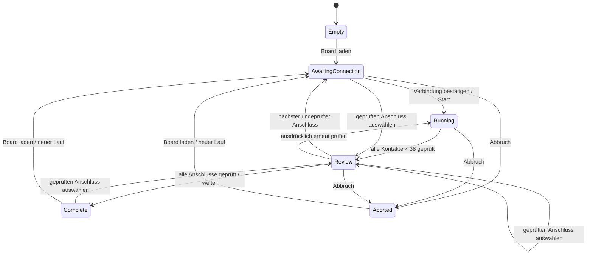

# Prüfboard: Datenmodell, Messschnittstelle und geführter Ablauf

EnvNode-eigene Inhalte unterliegen der LICENSE im Repository
(LicenseRef-EnvNode-Use-and-Redistribution-1.0).

## Vereinbarte Schichten

1. **Verdrahtung des Prüfboards:** `FixtureRouting` ordnet die logischen
   Sockelpins 1–38 sowie die Kontakte des GPIO-, I²C- und Modul-Pigtails jeweils
   einem Multiplexer und Kanal zu. Diese Tabelle gehört zur Revision des
   Prüfboards. Die Leiterbahnführung bestimmt die Zuordnung; fortlaufende
   Kanäle oder symmetrische Verdrahtung werden nicht vorausgesetzt.
2. **Definition des Prüflings:** Eine `BoardDefinition` gehört zu einem Boardtyp
   und einer elektrischen Mainboard-Revision. Sie enthält die 38 Sockelkontakte,
   die Anschlussliste mit Pigtail-Typ und Kontaktzahl, Netznamen, erwartete
   Verbindungen und Darstellungspositionen. Der PCB-Patch und eine Prüfsumme
   dokumentieren den exakten Quelldatenstand. Diese Definition enthält keine
   Multiplexeradressen und ist unabhängig vom Layout des Prüfboards.
3. **Prüfablauf:** `TestRunner` arbeitet ausschließlich mit Pigtail-Typ,
   Kontaktnummer und Sockelpinnummer. Er vergleicht Ergebnisse des `ITestFixture`
   mit der Boarddefinition. Er kennt weder GPIOs noch ADC-Grenzwerte, KiCad oder
   Browserdetails und verwendet keine dynamischen Allokationen.
4. **Anwendung und Browser:** Die Anwendung fordert zum Umstecken auf,
   erwartet die ausdrückliche Bestätigung, startet den Vergleich und zeigt
   Fortschritt, Einzelprüfungen und Ergebnisse. Ein Webadapter verbindet
   Bedienbefehle mit dem Ablauf; er entscheidet keine elektrischen Sollwerte.

`SimulatedFixture` implementiert aktuell `ITestFixture`. Später wird der reale
Treiber dahinter die Multiplexer auswählen, andere Enable-Leitungen deaktivieren,
Ausgangspegel setzen, Einschwingzeiten einhalten und den ADC auswerten. Eine
Kontinuitätsentscheidung darf intern mehrere Anregungs-/Messphasen benötigen;
die Anwendung erhält ein logisches Durchgangsergebnis. `Busy` erlaubt diese
asynchrone Ausführung, ohne Netzwerk und Browser zu blockieren. Ein Messpfad ohne
Ergebnis läuft nach zwei Sekunden in einen Messfehler. Fehlgeschlagene Auswahl,
Messfehler, Abschluss und Abbruch geben den Prüfpfad frei.

Die physische Routingtabelle wird noch nicht ausgefüllt oder angesteuert. Sie
muss aus dem finalen Prüfboard-PCB abgeleitet und gegen dessen Revision geprüft
werden. Die vorhandenen uncommitteten Layoutänderungen werden nicht als finale
Verdrahtung übernommen. Der Simulator schreibt keine GPIOs und startet kein I²C.

## Sollwerte und Abdeckung

Für jeden Anschlusskontakt wird eine **Menge** erwarteter Sockelpins hinterlegt.
Alle 38 Vergleiche werden ausgeführt:

| Erwartung | Beobachtung | Einzelprüfung |
| --- | --- | --- |
| Durchgang | Durchgang | erwarteter Durchgang |
| Trennung | Trennung | erwartete Trennung |
| Durchgang | Trennung | Unterbrechung / fehlender Durchgang |
| Trennung | Durchgang | unerwartete Verbindung |
| beliebig | Messfehler | Fehler |

Beispiel Weather / GPIO16:

- Kontakt 1 / GND: Durchgang zu Sockel **14, 32 und 38**.
- Kontakt 2 / +5V: Durchgang zu Sockel **19**.
- Kontakt 3 / GPIO16: Durchgang zu Sockel **27**.
- Kontakt 4 / +3V3_SYS: aktuell kein abgesicherter positiver Prüfpfad zum Sockel.

Ein Kontakt ohne positiven Prüfpfad ist **nicht vollständig prüfbar**. Erfolgreiche
Trennungsprüfungen allein beweisen seine Lötverbindung nicht. Er bleibt orange;
Anschluss und Gesamtlauf können dadurch nicht vollständig bestehen. Erkannte
Fehler haben Vorrang vor dieser Abdeckungseinschränkung.

Im Weather-PCB liegt Sockelpin 1 auf `+3V3_DEVKIT`, die Anschlussversorgung auf
`+3V3_SYS`. Diese Netze werden nicht gleichgesetzt. Der Nutzer hat ausdrücklich
festgelegt, diesen Punkt vorerst als nicht vollständig prüfbar auszuweisen.
Die aktuelle Definition hat dadurch 19 unvollständig abgedeckte Kontakte.
Für eine kommende Hardware-Revision ist ein zweipoliger JST-PH-Abgriff mit GND
und +3V3_SYS auf dem Zielboard vereinbart. Beide Kontakte erhalten separat
schaltbare Prüfboard-Eingänge; GND wird nicht fest mit Prüfboard-GND verbunden.
+5V bleibt beim Weather über Sockelpin 19 prüfbar. Diese Referenzkontakte sind
im aktuellen 38-Pin-Profil und in der Simulation noch nicht enthalten.

Verbindungen durch Bauteile, Schutzschaltungen und Pull-ups werden aus einem
Netznamenvergleich nicht abgeleitet. Analoge Schwellen und die Interpretation
solcher Pfade bleiben Teil der späteren physischen Validierung.

## Erste Definition: Weather 0.2, PCB 0.2.1

`firmware/testboard/boards/weather-0.2-pcb0.2.1.json` ist die lesbare Definition.
Sie enthält zehn GPIO/JST-PH-Anschlüsse, acht I²C/JST-SH-Anschlüsse und den
14-poligen Modulanschluss J1. GPIO16 steht bewusst am Anfang des geführten Plans.
Die Anwendung verwendet drei Pigtail-Typen: genau einen je Typ.

Die Ableitung erfolgt ausschließlich lesend aus dem KiCad-PCB:

```sh
python3 firmware/scripts/generate_testboard_profile.py
python3 firmware/scripts/generate_testboard_profile.py --check
```

Der Generator erzeugt die JSON-Datei, die kompakte C++-Tabelle und die komprimierte
SVG-Ansicht. Er übernimmt Padnummern, Netze und Koordinaten einschließlich der
Footprint-Drehung. Nur gleiche, nicht leere Netznamen erzeugen erwarteten direkten
Durchgang. Alle 38 Sockelpins und die vier beziehungsweise 14 Kontakte werden
auf Vollständigkeit geprüft. Quelldatei und SHA-256 stehen in der Definition.
Die KiCad-Draufsicht und die LED-Overlays verwenden dieselben Millimeterkoordinaten;
die Browsergröße verändert die Zuordnung nicht.

Weitere Boardtypen/Revisionen benötigen eigene geprüfte Definitionen und einen
entsprechenden Katalogeintrag. Der erste Firmware-Katalog enthält nur Weather.
Hardware-Identitätsrevision 0.2 und PCB-Patch 0.2.1 sind getrennte Felder.

## Zustände und Bedienung



- Die Anschlussliste dient zugleich als Auswahlliste. Sobald kein Test läuft,
  können beliebige Anschlüsse gewählt werden, auch nach Abschluss oder Abbruch.
  Geprüfte Anschlüsse zeigen sofort ihre gespeicherte Detailmatrix; „Erneut prüfen“
  startet nach ausdrücklicher Bestätigung eine neue Messung dieses Anschlusses.
  Die Liste ist während einer laufenden Messung im Browser und in der API gesperrt.
- „Nächster Anschluss“ wählt den nächsten ungeprüften Anschluss und springt bei
  Bedarf zum Anfang der Liste. Erst wenn alle Anschlüsse geprüft sind, führt
  dieser Button zum Abschluss. Eine freie Auswahl überspringt keine offenen Prüfungen.
- Start und Weiter sind nur im passenden Zustand zulässig. Kein Anschluss startet
  automatisch, und kein automatischer Schritt behauptet, der Pigtail sei umgesteckt.
- Jeder GPIO-/I²C-Anschluss erzeugt 4 × 38 = **152** Vergleiche, J1 erzeugt
  14 × 38 = **532**. Der Weather-Plan umfasst **3.268** Einzelvergleiche.
- Der Simulator liefert nominale Verbindungen oder wahlweise eine Unterbrechung
  bzw. Zusatzverbindung an Kontakt 1. Diese Fehler werden unabhängig vom
  Ergebnisvergleich eingespeist. Das ersetzt keine Prüfung realer Hardware oder
  unabhängige elektrische Freigabe des Profils.
- Identische Buchsen desselben I²C-Busses sind elektrisch nicht unterscheidbar.
  Die Bedienbestätigung dokumentiert den beabsichtigten Anschluss, erkennt aber
  nicht, ob jemand tatsächlich umgesteckt hat. Gleiches gilt für gleichwertige
  Parallelpfade: Durchgang allein beweist nicht jede einzelne Lötstelle.
- Der Browser führt den Test nicht selbst aus. Zustandsautomat und Ergebnisse
  liegen auf dem ESP. Browser-Neuladen startet keinen neuen Lauf. Ein neuer Lauf
  wird ausdrücklich über „Board laden / neuer Testlauf“ angelegt.
- Ergebnisse liegen im RAM. Anschluss- und Kontaktergebnisse bleiben im Lauf
  erhalten; vollständige Detailmatrizen und Fortschritt werden pro Anschluss
  gespeichert und beim Auswählen wieder angezeigt. Der Start einer Wiederholung
  verwirft nur das bisherige Ergebnis dieses Anschlusses; andere Ergebnisse bleiben
  erhalten. Eine abgebrochene Wiederholung bleibt ungeprüft statt das alte Ergebnis
  als neue Messung auszugeben. Persistente Prüfberichte sind noch nicht implementiert.

## Darstellung und Statusübertragung

`/test` zeigt die Boardwahl, Umsteckanweisung, Simulatorzustand, Start/Weiter/Abbruch,
Fortschritt, eine echte KiCad-Draufsicht mit Kontakt-LEDs, die Anschlussliste und
die vollständige Kontakt-gegen-Sockel-Matrix. Der aktuelle Anschluss ist direkt
auf dem Board umrahmt. Farben werden durch Symbole und Ergebnistext ergänzt.
Die Kennzeichnung **SIMULATION** bleibt sichtbar.

- `/test/definition`: revisionsgebundene Metadaten, Sollwerte und Positionen.
- `/test/board.svg`: komprimierte KiCad-Draufsicht.
- `/test/state`: kleine aktuelle Zustands-/Ergebnisantwort, ohne Bild/Definition.
- `/test/action`: POST für Laden, Start, Weiter und Abbruch.

Statusabfragen erfolgen nacheinander etwa alle 180 ms; es gibt keinen Seitenrefresh
und keine parallele Abfrageflut. Der Browser zeigt alle inzwischen erhaltenen
Einzelergebnisse. Er muss nicht jedes interne Sampling als Einzelbild darstellen.
Ein Generationszähler weist veraltete oder doppelte Bedienbefehle zurück.
WebSocket/SSE kann später ergänzt werden, ist für diesen Ablauf nicht erforderlich.

## Prüfung des Stands

```sh
cd firmware
pio run -e testboard -e esp32dev
pio test -e testboard_native
```

18 native Prüfboard-Tests decken Basisfunktionen und Ablauf ab, darunter eine vom
Simulator unabhängige GPIO16-Messprobe, alle 3.268 Vergleiche, Multi-GND, Modulslot,
Unterbrechung/Zusatzverbindung, Freigabe/Abbruch/Timeout, Zustandsfreigaben und
JSON-API-Antworten. Beide ESP32-Ziele bauen. Der Browserablauf wurde zusätzlich
gegen eine lokale native Instanz derselben C++-Klassen geprüft; diese Vorschau
verwendet keinen ESP und keine echte Messhardware. Eine solche Desktop-Vorschau
ist ein Entwicklungsprüfmittel, kein zusätzlicher Produkt-Build.

## Mini 0.8 / PCB 0.8.1

Der Katalog enthält Weather und Mini. Profile und Zeichnungen werden revisionsbezogen geladen; ein Boardwechsel verwirft den vorherigen Lauf. Mini umfasst acht Anschlüsse und 1976 Vergleiche. Explizite KiCad-Net-Ties werden aufgelöst: Slot A Adresse liegt auf GND, Slot B auf 3V3_SYS. Letzterer Kontakt und die acht Versorgungsanschlüsse bleiben ohne zusätzlichen Referenzabgriff unvollständig prüfbar. Andere Bauteile werden nicht als direkte Verbindungen interpretiert.

## Später: zentral bereitgestellte Profile

Boardprofile und Zeichnungen sollen perspektivisch über docs.envnode angeboten und vom Prüf-ESP32 geladen werden. Eingebaute Profile bleiben als Offline-Grundbestand verfügbar. Erforderlich wären ein versionierter Katalog, validierte Datenformate und unveränderliche Profile je Board-/PCB-Revision; optional später ein lokaler Cache. Dies ist vorgemerkt und derzeit nicht implementiert.

Die Boardansichten blenden Bauteilwerte aus; Referenzbezeichnungen bleiben sichtbar. Der Generator entfernt die Werte ausschließlich aus einer temporären Exportkopie, die KiCad-Quelldateien bleiben unverändert.
