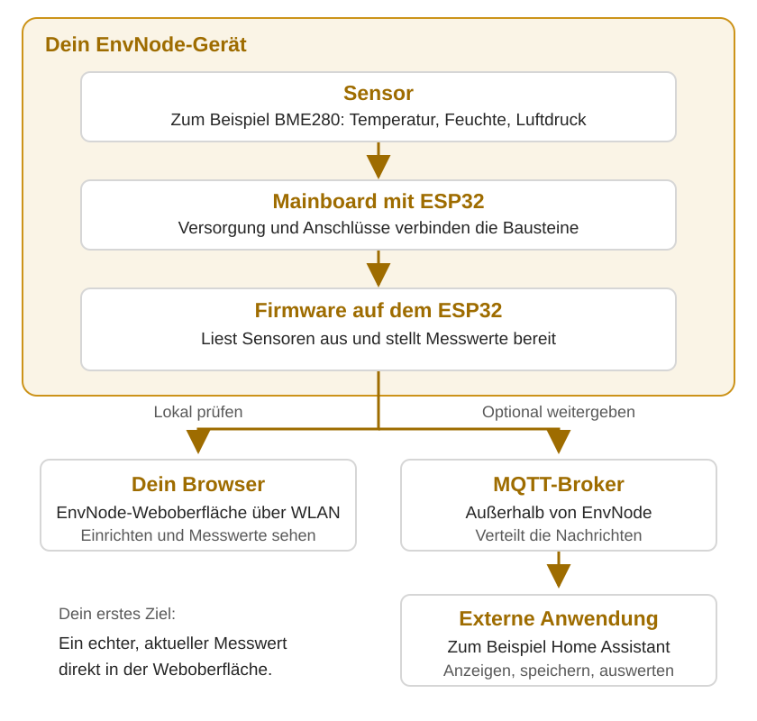

# So arbeitet EnvNode zusammen

EnvNode verbindet Sensoren und optionale Erweiterungen mit einem ESP32.
Die Firmware auf diesem Mikrocontroller liest Messungen aus, stellt sie lokal
bereit und kann sie an andere Systeme weitergeben. Du wählst die Bausteine passend
zu deiner Aufgabe: Ein einzelner Messpunkt und ein größerer Aufbau nutzen dasselbe
Grundprinzip.

[Mit einem Mini und BME280 anfangen](../getting-started/index.md){ .md-button }

## Der Weg vom Sensor zur Anwendung

[Gesamtübersicht groß öffnen](../assets/images/overview/envnode-overview.svg)

Die Pfeile zeigen den vereinfachten Weg der Messdaten. Im Gerät ist die Firmware
bereits für das Erfassen und Bereitstellen zuständig. Über die Weboberfläche kannst
du den Messwert direkt prüfen. Für externe Anwendungen kommt ein MQTT-Broker hinzu.
Browser, Broker und Anwendung laufen außerhalb des EnvNode-Geräts.

## Was übernehmen die einzelnen Bausteine?

| Baustein | Aufgabe | Beispiel |
| --- | --- | --- |
| Sensor | Erfasst eine physikalische Größe und liefert ein Signal beziehungsweise Daten. | BME280 für Temperatur, Feuchte und Luftdruck. |
| Mainboard | Verbindet ESP32, Versorgung, Sensoranschlüsse und Modulslots. | Mini oder Weatherstation. |
| ESP32-DevKit | Führt die Firmware aus und stellt die WLAN-Verbindung bereit. | Das zum Mainboard passende Entwicklungsboard. |
| ORing Power | Übernimmt 5-V-Eingang, 3,3-V-Regelung und Zusammenführung der 3,3-V-Quellen. | Auf dem Mainboard montierter Versorgungsbaustein. |
| Erweiterungsmodul | Ergänzt eine bestimmte Hardwarefunktion am Modulslot. | DuoRelay mit zwei Relais. |
| Firmware | Erfasst Messungen, verarbeitet sie soweit für die Messung nötig und betreibt Einrichtung, lokale Steuerung und Kommunikation. | Die gemeinsame EnvNode-Software. |
| Weboberfläche | Macht Konfiguration, Messwerte und Gerätezustand im Browser zugänglich. | Sensor einrichten und die erste Messung kontrollieren. |
| MQTT-Broker | Verteilt Nachrichten zwischen EnvNode und externen Anwendungen. | Ein erreichbarer Broker im eigenen Netzwerk. |
| Externe Anwendung | Nutzt Messwerte für Anzeige, Speicherung, Auswertung oder übergeordnete Automation. | Home Assistant oder eine Datenbank. |

## Wie wird Hardware angeschlossen?

Ein normaler I²C-Sensor kann direkt an einen passenden I²C-Anschluss des Mainboards
angeschlossen werden. Weitere Sensoren nutzen geeignete GPIO- oder ADC-Eingänge.
Ein Erweiterungsmodul wird über den Modulslot angebunden und ergänzt die dafür
vorgesehene Funktion.

Welche Kombination funktioniert, bestimmen Versorgung, Signalpegel, Pinbelegung
und verfügbare Firmwareunterstützung gemeinsam. Die
[Kompatibilitätsübersicht](../compatibility.md) hilft bei der Auswahl; die
[Hardware-Schnittstellen](../interfaces/index.md) erklären die Anschlüsse.

## Wie weiß die Firmware, was angeschlossen ist?

Hier arbeiten zwei Dinge zusammen:

- **Hardwareidentität und Boardprofil:** Das EEPROM auf dem Mainboard beschreibt
  dessen Identität. Die Firmware ordnet ihr ein unterstütztes Profil mit den
  verfügbaren Anschlüssen zu. Ein optionales Modul-EEPROM beschreibt das jeweilige
  Erweiterungsmodul.
- **Anwendungskonfiguration:** Du legst fest, welche Sensoren, Aktoren und anderen
  Komponenten du mit diesen Anschlüssen betreiben möchtest.

Ein erkannter Sensor beim I²C-Scan oder ein erkanntes Modul ist deshalb noch keine
fertig eingerichtete Anwendung. Für einen BME280 wählst du beispielsweise den
passenden Treiber, Bus und die Adresse. Die
[Firmware-Anleitung](../firmware/index.md) führt durch diese Einrichtung.

## Messen, schalten und lokal steuern

Ein **Sensor** erzeugt Messwerte. Ein **Aktor** bietet einen bedienbaren Ausgang,
zum Beispiel einen Relaiskanal. Ein **Controller** ist eine lokale Softwarefunktion,
die einen konfigurierten Aktor steuert, beispielsweise Blink oder Threshold.
Der RainDetectorController ist dagegen der Name einer Hardwarebaugruppe.

DuoRelay ist ein Beispiel für den Unterschied: Die Platine stellt zwei Relais bereit.
In der Firmware richtest du dafür passende Aktoren ein. Anschließend kannst du sie
manuell bedienen oder mit einem lokalen Controller verbinden.

Ein **Display** kann Werte direkt am Aufbau anzeigen. Es ist optional; dieselben
Messungen kannst du bereits über die Weboberfläche prüfen.

## Was bleibt auf dem Gerät, was übernimmt ein anderes System?

EnvNode erfasst physikalische Messwerte und führt dafür erforderliche Umrechnungen
oder Kalibrierungen aus. Dazu kommen Konfiguration, Diagnose und unterstützte
lokale Steuerfunktionen.

Externe Systeme übernehmen beispielsweise Langzeitspeicherung, historische
Diagramme, Wetterauswertung oder eine übergeordnete Bewässerungsautomation.
MQTT transportiert die Nachrichten zwischen diesen Beteiligten.

Für einen einzelnen lokal sichtbaren Messwert genügen der passende Hardwareaufbau,
eingerichtete Firmware und dein Browser. Von dort aus kannst du schrittweise erweitern.
