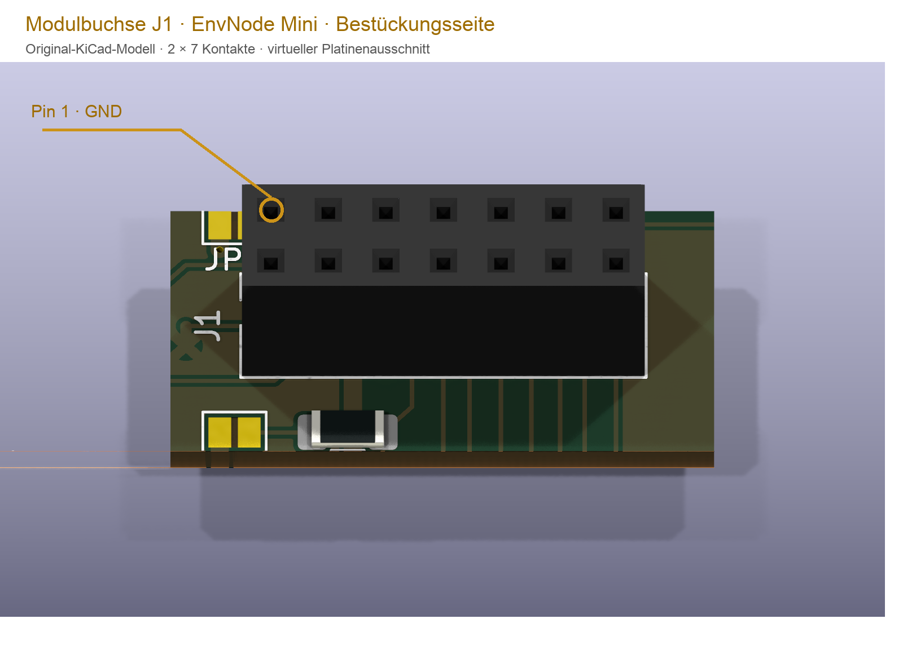
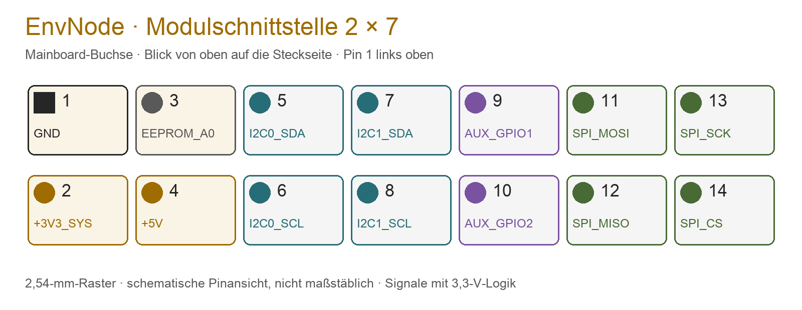

# EnvNode-Modulschnittstelle

Die Modulschnittstelle verbindet ein EnvNode-Mainboard mit einer Erweiterungsplatine.
Jeder Slot besitzt eine **2×7-polige Buchse im 2,54-mm-Raster**. Sie führt
Versorgung, zwei I²C-Busse, SPI und zwei slotabhängige GPIOs. Ein Modul muss nicht
alle Funktionen verwenden; unbenutzte Pins dürfen nicht beliebig umgewidmet werden.

## Stecker und Blickrichtung

Referenz: Buchse J1 auf der Bestückungsseite des Mini-Mainboards. Die Platinenränder
im Ausschnitt sind virtuelle Schnittkanten. Die Pin-1-Markierung ist eine
Dokumentationsbeschriftung, kein zusätzlicher Bestückungsdruck.

Die schematische Ansicht zeigt **die Mainboard-Buchse von oben auf die Steckseite**,
mit Pin 1 links oben. Die obere Reihe enthält die ungeraden Pins 1–13, die untere
die geraden Pins 2–14. Das Modul trägt seinen Gegenstecker auf der Unterseite.
Eine Ansicht dieser Unterseite darf nicht ungeprüft wie die Mainboard-Draufsicht
interpretiert werden: Maßgeblich sind Pinnummern, Pin-1-Markierung und die reale Stecklage.

## Pinbelegung

| Pin | Signal | Aufgabe / Kommentar |
| --- | --- | --- |
| 1 | GND | Gemeinsame Masse für Versorgung und Signale |
| 2 | +3V3_SYS | 3,3-V-Systemversorgung nach dem ORing |
| 3 | EEPROM_A0 | Slotkennung für das Adressbit des Modul-EEPROMs; kein freier GPIO |
| 4 | +5V | 5-V-Versorgung, beispielsweise für Relaisspulen oder lokalen Boost |
| 5 | I2C0_SDA | Datenleitung des gemeinsamen I²C-Busses 0 |
| 6 | I2C0_SCL | Taktleitung des gemeinsamen I²C-Busses 0 |
| 7 | I2C1_SDA | Datenleitung des gemeinsamen I²C-Busses 1 |
| 8 | I2C1_SCL | Taktleitung des gemeinsamen I²C-Busses 1 |
| 9 | AUX_GPIO1 | Slotabhängiger GPIO; Fähigkeiten hängen vom Mainboard ab |
| 10 | AUX_GPIO2 | Zweiter slotabhängiger GPIO |
| 11 | SPI_MOSI | Daten vom Mainboard zum SPI-Modul |
| 12 | SPI_MISO | Daten vom SPI-Modul zum Mainboard |
| 13 | SPI_SCK | Gemeinsamer SPI-Takt |
| 14 | SPI_CS | Eigener SPI-Chip-Select des Slots |

## Versorgung und Signalpegel

Das Mainboard versorgt das Modul über 3,3 V und 5 V. Die 5-V-Leitung bedeutet
**keine 5-V-Toleranz der Signalpins**. Die Logik arbeitet im 3,3-V-Bereich.
Die Schnittstelle führt keine 24 V; AnalogHydroPressure erzeugt diese Spannung lokal.

Module dürfen keine unkoordinierte Versorgung auf die Systemleitungen zurückspeisen.
Es gibt keine pauschale Stromfreigabe allein durch den Stecker: Netzteil,
Versorgungsmodul, Leitungen, Kontakte und gleichzeitige Lasten sind gemeinsam zu bewerten.
Module nur bei ausgeschalteter Versorgung einsetzen oder entfernen.

## I²C: gemeinsame Busse, eindeutige Adressen

I2C0 und I2C1 sind gemeinsame Busse, keine privaten Verbindungen je Slot.
Geräte auf demselben Bus benötigen unterschiedliche Adressen. Auch externe
Sensoren und Displays müssen bei dieser Adressplanung berücksichtigt werden.
Die Pull-ups gelten für den gesamten jeweiligen Bus.

Für die Modulidentifikation sind auf I2C0 die Adressen **0x52 für Slot A** und
**0x53 für Slot B** reserviert. Pin 3 liefert dafür das slotabhängige A0-Signal;
der EEPROM-Adressanschluss A1 liegt bei der Referenzbeschaltung auf 3,3 V.
Das Mainboard-EEPROM ist davon unabhängig und verwendet 0x50.

Beim AnalogHydroPressure wählen JP5 und JP6 gemeinsam den Bus des ADS1115.
Das optionale Identity-EEPROM bleibt auf I2C0. Buswahl und Sensoradresse sind
getrennte Einstellungen.

## GPIO und SPI: Slot ist nicht gleich ESP32-Pinnummer

AUX_GPIO1, AUX_GPIO2 und SPI_CS sind logische Schnittstellennamen.
Ihre ESP32-Zuordnung wird vom tatsächlichen Board und dessen Profil bestimmt.
Die folgende Tabelle beschreibt die aktuelle Hardwarezuordnung; sie ist keine
Freigabe eines beliebigen Firmwareprofils.

| Mainboard / Slot | Pin 9: AUX_GPIO1 | Pin 10: AUX_GPIO2 | Pin 14: SPI_CS |
| --- | --- | --- | --- |
| Mini 0.8 / A | GPIO33 | GPIO13 | GPIO5 |
| Mini 0.8 / B | GPIO32 | GPIO14 | GPIO27 |
| Weather 0.2 / A | GPIO33 | GPIO13 | GPIO5 |

Ältere Mainboards können andere Zuordnungen besitzen. Insbesondere darf eine
für Mini 0.3 bestätigte Konfiguration nicht ungeprüft übernommen werden.
Bei GPIO33/32 ist ADC1-Nutzung möglich; die ADC2-Funktion von GPIO13/14 ist
während WLAN-Betrieb nicht verfügbar. Digitale Nutzung ist davon zu unterscheiden.

SPI_MOSI, SPI_MISO und SPI_SCK werden gemeinsam genutzt; jedes SPI-Modul benötigt
seinen eigenen CS. Ein passender Anschluss allein stellt noch keinen Treiber bereit.

## Beispiele und Firmware

| Modul | Nutzung der Schnittstelle |
| --- | --- |
| DuoRelay | 5 V für Relais, AUX_GPIO1/2 für die beiden Kanäle, optionales EEPROM auf I2C0 |
| AnalogHydroPressure | 5 V für Boost, 3,3 V für ADC, I²C-Buswahl am ADS1115, AUX_GPIO2 für Boost-Enable |

Identifikation, Kompatibilitätsprüfung und Aktivierung einer konkreten Funktion
sind getrennte Schritte. Die Firmware muss die benötigten Ressourcen und Treiber
unterstützen. Fehlt bei einem Modul mit optionalem EEPROM die Identifikation,
kann nur eine ausdrücklich unterstützte manuelle Konfiguration verwendet werden.
Ob das für ein bestimmtes Modul erlaubt ist, steht auf dessen Produktseite.

## Mechanischer Einbau

Der Modulstecker sitzt auf der Unterseite. SMD- und THT-Ausführungen müssen
zusammengebaut dieselbe Pin-zu-Pin-Zuordnung ergeben. Reihenversatz oder gedrehte
Montage können Versorgung und Signale falsch verbinden.

Die Referenzmodule sind 38 mm breit: HalfSize 32 mm, FullSize 64 mm lang.
Die Steckerachse liegt 6,35 mm von der oberen Modulkante entfernt.
M2,5-Stützpunkte und Abstandshalter müssen zur tatsächlich gewählten Steckhöhe passen.
Eine feste, für alle Stecker garantierte Aufbauhöhe ist damit noch nicht festgelegt.

[Kompatibilitätsübersicht](../compatibility.md) · [Provisioning](../firmware/provisioning.md)

[Zur Übersicht aller Hardware-Schnittstellen](../interfaces/index.md)
