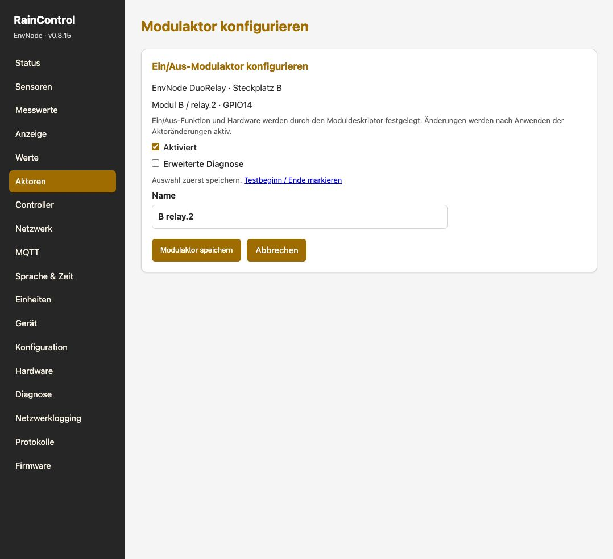

# Ausgänge schalten

Ein Aktor ist die Firmware-Zuordnung zu einem physischen Ausgang.
Unter **Aktoren (Actuators)** wird festgelegt, welches Signal angesteuert wird.

| Implementierung | Aufgabe |
| --- | --- |
| GPIO On/Off | Digitaler Ausgang, zum Beispiel Relais-Treibereingang |
| GPIO PWM / Level | Pegelsteuerung über einen geeigneten PWM-Ausgang |

## Einen Aktor einrichten

1. Last zunächst trennen oder eine geeignete Kleinspannungs-Testlast verwenden.
2. Freien Aktorplatz wählen und eindeutig benennen.
3. Implementierung und tatsächlichen GPIO auswählen.
4. Die feste Pegellogik der Implementierung mit der angeschlossenen Schaltung vergleichen; siehe unten.
5. Speichern und gegebenenfalls Aktoränderungen anwenden.
6. Aktuellen Zustand prüfen; erst dann manuell ein- und ausschalten beziehungsweise den Pegel ändern.

Ein Eingang wie GPIO34 oder GPIO35 ist kein Ausgang. Die Ressourcen müssen zum
aktiven Boardprofil und der Hardware passen. Für Relais immer den geeigneten
Modultreiber verwenden, nicht eine Spule unmittelbar am ESP32 betreiben.

## Felder, Pegel und Startzustand

| Feld / Auswahl | Bedeutung |
| --- | --- |
| Aktiviert | Aktor nach Start und Laufzeitübernahme bereitstellen. |
| Name | Eigene Bezeichnung des Ausgangs; Quelle, Modul und Kanal zusätzlich prüfen. |
| GPIO On/Off | Digitaler Ausgang: Ein entspricht HIGH, Aus LOW. Eine frei konfigurierbare Pegelinvertierung bietet dieses Formular nicht. |
| GPIO PWM / Level | Pegel von 0 bis 100 Prozent als PWM-Tastverhältnis; Ein setzt 100 %, Aus 0 %. Der Prozentwert ist keine gemessene Leistung oder Temperatur. |
| GPIO | Physischer Ausgang nach Boardprofil und Verdrahtung. Bereits belegte beziehungsweise ungeeignete Ressourcen werden eingeschränkt. |
| Module On/Off | Durch den Modul-Descriptor festgelegter Kanal; Hardware und Fähigkeit werden vom Modul vorgegeben. |

GPIO On/Off und GPIO PWM initialisieren beim Start ausgeschaltet beziehungsweise
mit 0 %. Danach kann ein aktivierter Controller sofort einen anderen Zustand
anfordern. Ein kurzzeitig ausgeschalteter Startzustand bedeutet deshalb nicht,
dass der Ausgang im weiteren Betrieb aus bleibt. Auch das Anwenden von
Aktoränderungen baut die Laufzeit neu auf.

Die freie GPIO-Auswahl steuert ein Logiksignal. Ob damit eine Last sicher
angesteuert werden kann, hängt von der zugehörigen Treiberschaltung ab. Bei einem
Modulaktor gilt dessen dokumentierte Pegellogik.

## Zustand und Wirkung prüfen

Die Aktorseite zeigt den angeforderten beziehungsweise im Treiber geführten
Zustand. Ohne separate Rückmeldung bestätigt sie weder einen mechanisch geschlossenen
Relaiskontakt noch Stromfluss durch eine Heizung.

1. Ohne laufenden Controller Ein/Aus oder einen zulässigen PWM-Pegel setzen.
2. Angezeigten Zustand und tatsächlichen Ausgang vergleichen.
3. Erst danach die Zuordnung zu einem Controller herstellen.
4. Nach Anwenden und Neustart erneut kontrollieren, welcher Controller den Ausgang übernimmt.

Bei einem PWM-Aktor ist jeder Pegel größer null ein eingeschalteter Zustand.
Ein On/Off-Controller verwendet dessen Ein-/Aus-Fähigkeit, nicht automatisch
eine stufenlose Regelung.

## Manuelle Bedienung und Controller

Für einen eindeutigen manuellen Test darf kein laufender Controller den Ausgang
parallel verändern. Controllerzustand und Zielbelegung kontrollieren.
Eine LED zeigt gegebenenfalls nur die elektrische Ansteuerung; die tatsächliche
Lastfunktion muss zusätzlich geprüft werden.

Bei einem Neustart gelten wieder gespeicherte Einstellungen. Einen momentan
ausgeschalteten Ausgang deshalb nicht mit einer dauerhaft deaktivierten Funktion verwechseln.

[DuoRelay in Betrieb nehmen](../modules/duo-relay/commissioning.md) · [Controller](controllers.md)

## Descriptor-basierter Modulaktor

Ein kompatibler Modul-Descriptor kann verfügbare Ausgänge automatisch als
Modulaktoren bereitstellen. Prüfe die angezeigte Zuordnung, bevor du zusätzliche
freie GPIO-Aktoren einrichtest. Die baugruppenspezifische Prüfung steht einmalig
unter [DuoRelay in Betrieb nehmen](../modules/duo-relay/commissioning.md).

Aufnahme vom 21.11.2026: Firmware **0.8.15**, deutsche Oberfläche,
Mini-Boardprofil 0.8 und DuoRelay 0.3.
Die gezeigten Ressourcen gelten für diesen Aufbau; das tatsächliche Boardprofil
und die revisionsbezogene GPIO-Zuordnung sind maßgeblich.

Bei verfügbarer Descriptor-Zuordnung bietet die Oberfläche **Module On/Off**.
Im Bild ist `relay.2` in **Slot B** dem Aktorplatz 4 zugeordnet. Der Descriptor
definiert Fähigkeit und GPIO; bearbeitbar sind
Aktivierung und Name. Speichern und ausstehende Aktoränderungen anwenden.
Dies ist eine Alternative zur freien GPIO-Zuordnung.

