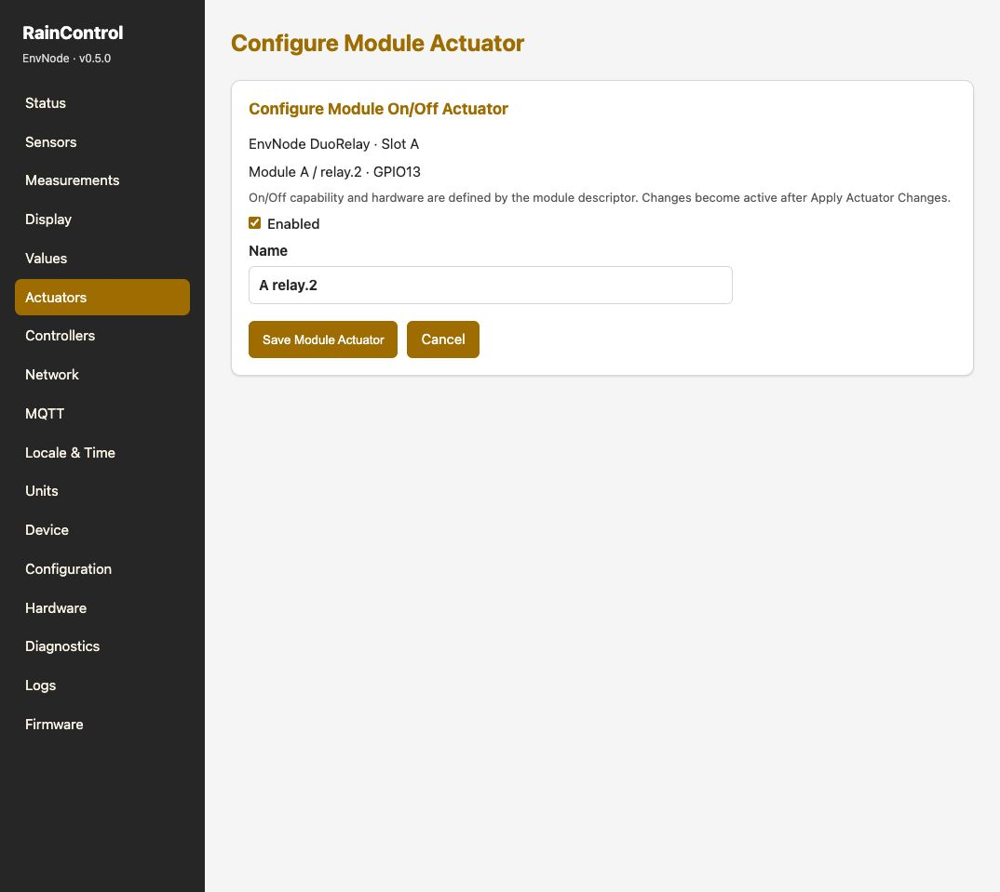

# Ausgänge schalten

Ein Aktor ist die Firmware-Zuordnung zu einem physischen Ausgang.
Unter **Aktoren (Actuators)** wird festgelegt, welches Signal angesteuert wird.

| Implementierung | Aufgabe |
| --- | --- |
| GPIO On/Off | Digitaler Ausgang, zum Beispiel Relais-Treibereingang |
| GPIO PWM / Level | Pegelsteuerung über einen geeigneten PWM-Ausgang |

## Einen Aktor einrichten

1. Last zunächst trennen oder eine geeignete Kleinspannungs-Testlast verwenden.
2. Freien Aktorplatz wählen und eindeutig benennen.
3. Implementierung und tatsächlichen GPIO auswählen.
4. Aktiven Pegel und die angebotenen Start-/Aus-Einstellungen passend zur Schaltung prüfen.
5. Speichern und gegebenenfalls Aktoränderungen anwenden.
6. Aktuellen Zustand prüfen; erst dann manuell ein- und ausschalten beziehungsweise den Pegel ändern.

Ein Eingang wie GPIO34 oder GPIO35 ist kein Ausgang. Die Ressourcen müssen zum
aktiven Boardprofil und der Hardware passen. Für Relais immer den geeigneten
Modultreiber verwenden, nicht eine Spule unmittelbar am ESP32 betreiben.

## Manuelle Bedienung und Controller

Für einen eindeutigen manuellen Test darf kein laufender Controller den Ausgang
parallel verändern. Controllerzustand und Zielbelegung kontrollieren.
Eine LED zeigt gegebenenfalls nur die elektrische Ansteuerung; die tatsächliche
Lastfunktion muss zusätzlich geprüft werden.

Bei einem Neustart gelten wieder gespeicherte Einstellungen. Einen momentan
ausgeschalteten Ausgang deshalb nicht mit einer dauerhaft deaktivierten Funktion verwechseln.

[DuoRelay-Beispiel](example-relay.md) · [Controller](controllers.md)

## Descriptor-basierter Modulaktor

Aufnahme: Firmware 0.5.0, Mini Revision 0.3 und DuoRelay Revision 0.3.
Die gezeigten Ressourcen gelten für diesen Aufbau; das tatsächliche Boardprofil
und die revisionsbezogene GPIO-Zuordnung sind maßgeblich.

Bei verfügbarer Descriptor-Zuordnung bietet die Oberfläche **Module On/Off**.
Für `relay.2` definiert der Descriptor Fähigkeit und GPIO; bearbeitbar sind
Aktivierung und Name. Speichern und ausstehende Aktoränderungen anwenden.
Dies ist eine Alternative zur freien GPIO-Zuordnung.

