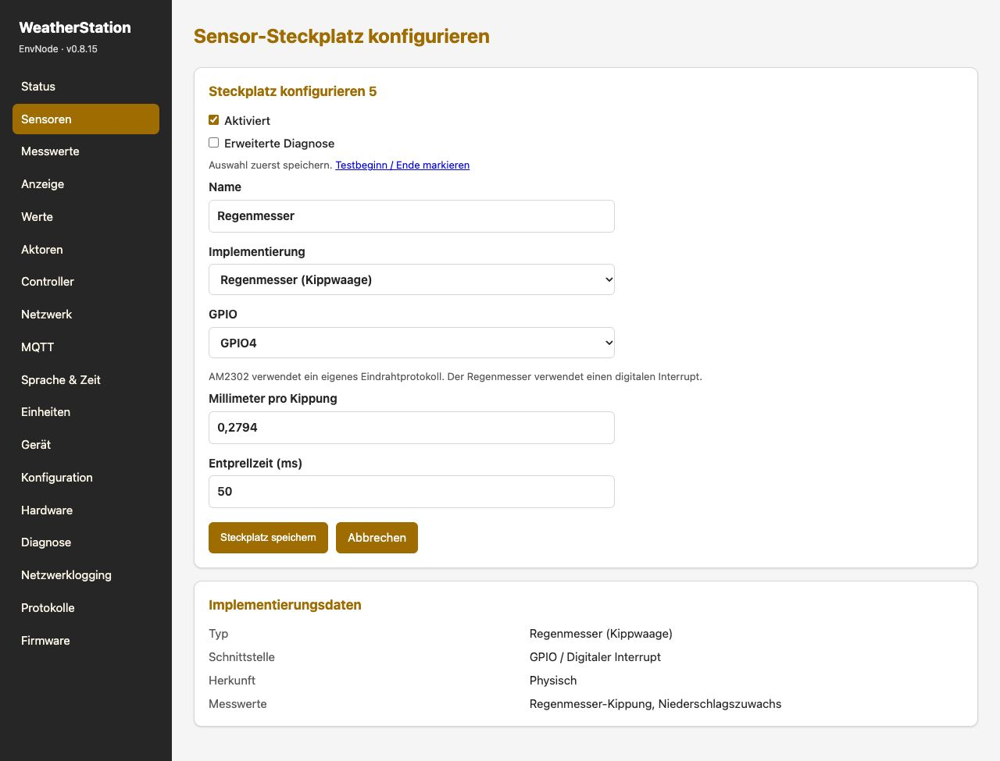
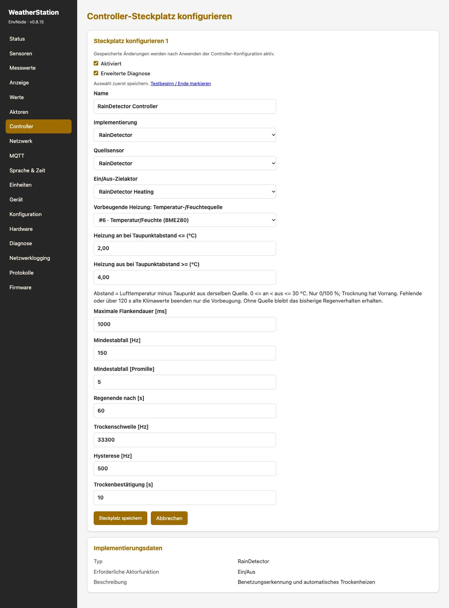

# Beispiel: WeatherStation schrittweise einrichten

Diese WeatherStation erfasst das Klima im Gehäuse und draußen, Luftdruck,
Niederschlag mit einer Regenwippe und Benetzung mit einem RainDetector. Die
Einrichtung erfolgt schrittweise: Nach jeder Erweiterung wird ihre Funktion
geprüft, bevor die nächste hinzukommt.

**Zielaufbau ist WeatherStation Rev. 0.4 mit Firmware 0.8.15.** Das Beispiel
verwendet die Einstellungen eines konfigurierten Testgeräts. Dessen Aufnahmen
stammen noch von einem Weather-Profil 0.2; die hier genannten Steckerzuordnungen
beziehen sich auf das Zielboard 0.4. Die Konfiguration ist ein Ausgangspunkt für
die Inbetriebnahme, keine abgeschlossene Abnahme des Außeneinsatzes.

Die Bedienung der Felder steht in den jeweiligen Fachkapiteln. Hier werden die
konkreten Quellen, Einstellungen und Prüfziele zu einer Anwendung verbunden.

## Aufbau und Zuordnung

| Aufgabe | Komponente | Zuordnung im Beispiel |
| --- | --- | --- |
| Temperatur und Feuchte im Gehäuse | SHTC3 | Sensorplatz 7, I2C0, 0x70, 5000 ms |
| Temperatur, Feuchte und örtlicher Luftdruck außen | BME280 | Sensorplatz 6, I2C0, 0x76, 5000 ms |
| Niederschlag je Kippung | Regenwippe | Sensorplatz 5, ESP32-GPIO4 |
| Frequenz der benetzten Sensorfläche | RainDetectorController mit Head | Sensorplatz 4, ESP32-GPIO27, Ausgabeintervall 5000 ms |
| Heizung des Heads | GPIO-PWM-Aktor | Aktorplatz 1, ESP32-GPIO16 |
| Benetzung auswerten und Heizung steuern | RainDetector-Controller | Controllerplatz 1, Sensorplatz 4 → Aktorplatz 1 |

Die Platznummern entsprechen dem aufgenommenen Testgerät; andere freie Plätze
sind ebenfalls möglich. Entscheidend sind die dazu passenden Quellen- und
Zielzuordnungen. Die auf dem Testgerät vorhandenen Simulationen in den Plätzen
1–3 sind **kein Bestandteil** dieser Wetterstation.

Für WeatherStation 0.4 ergibt sich aus der Hardwarebelegung:

| Aufgabe | Stecker am Mainboard | In der Firmware gewählter ESP32-GPIO |
| --- | --- | --- |
| Regenwippe | GPIO6 | GPIO4 |
| RainDetector-Frequenz | GPIO4 | GPIO27 |
| RainDetector-Heizung | GPIO2 | GPIO16 |

Die Steckernamen sind nicht die ESP32-GPIO-Nummern. Die vollständige Belegung
steht bei den [WeatherStation-Anschlüssen](../mainboards/weatherstation/assembly.md#42-adc-und-gpio-anschlusse).
Die Bestückung und elektrische Prüfung erfolgen nach der
[Hardwareanleitung](../mainboards/weatherstation/index.md), bevor diese Einrichtung beginnt.

## 1. Gerät vorbereiten

Die [Grundeinrichtung](configuration.md) durchführen: Gerät erreichen, Netzwerk
und Sprache/Zeit einrichten und die Hardwareidentität prüfen. Auf dem Zielboard
muss **EnvNode Weather 0.4** aktiv sein. Einen bereits gültigen Datensatz nicht
nur für dieses Beispiel überschreiben.

Als Gerätename wird hier **WeatherStation** verwendet. Standortangaben können
zunächst leer bleiben; sie folgen nach den lokalen Messungen. Die ersten
Prüfschritte benötigen weder Home Assistant noch einen MQTT-Broker.

**Weiter, wenn:** Die Weboberfläche erreichbar ist und das aktive Profil zur
realen Platine passt.

## 2. Zuerst das Klima im Gehäuse messen

Den SHTC3 nach der [I²C-Inbetriebnahme](../commissioning/i2c-sensors.md) anschließen
und einrichten. Im Beispiel liegt er auf I2C0 an **0x70**. Sensorplatz **7** ist
aktiviert, heißt **„Temperatur, Feuchte Gehäuse“** und verwendet **5000 ms**.

Unter **Messwerte** Temperatur und relative Feuchte dieser Quelle prüfen und
mehrere Aktualisierungen abwarten. Diese Werte beschreiben das Gehäuseinnere;
sie werden später nicht als Außenklima der Heizung verwendet.

**Weiter, wenn:** Beide Messgrößen aktuell und gültig sind und nach einem Neustart
erneut erscheinen.

## 3. Außenklima und Luftdruck ergänzen

Als Außenquelle den BME280 nach derselben I²C-Anleitung einrichten. Im Beispiel:
Sensorplatz **6**, Name **„Temperatur/Feuchte“**, **I2C0 / 0x76**, **5000 ms**.
Er liefert zusätzlich den örtlichen Luftdruck.

Die unterschiedlichen Adressen 0x70 und 0x76 erlauben beide Sensoren am selben
Bus. Den Außenfühler so montieren, dass er die vorgesehenen Außenbedingungen
misst und nicht vor allem Gehäuse- oder Heizwärme erfasst.

Unter **Messwerte** Gehäuse- und Außenquelle ausdrücklich unterscheiden. Ein
ähnlicher Temperaturwert belegt noch nicht dieselbe Messstelle. Den örtlichen
Druck zunächst unabhängig vom späteren Meereshöhendruck prüfen.

**Alternative:** Auch im Gehäuse kann ein BME280 eingesetzt werden. Zwei BME280
benötigen unterschiedliche Adressen auf demselben Bus oder getrennte Busse.
Beide Druckmessungen bleiben dann eigenständige Quellen. Das hier aufgenommene
Beispiel verwendet jedoch SHTC3 innen und BME280 außen.

**Weiter, wenn:** Gehäuseklima, Außenklima und örtlicher Luftdruck jeweils unter
der richtigen Quelle aktuell angezeigt werden.

## 4. Regenwippe anschließen und einmessen

Die [Regenwippen-Anleitung](../commissioning/rain-gauge.md) beschreibt Anschluss,
Entprellung und Kalibrierung. Für diesen Aufbau wird **GPIO6 am Mainboard**, also
**ESP32-GPIO4**, verwendet.

| Einstellung | Wert im aufgenommenen Beispiel |
| --- | --- |
| Sensorplatz / Name | 5 / Regenmesser |
| Implementierung | Regenmesser (Kippwaage) |
| GPIO | GPIO4 |
| Millimeter pro Kippung | 0,2794 mm |
| Entprellzeit | 50 ms |

**0,2794 mm ist der eingestellte Faktor dieser Wippe, kein allgemeiner Wert für
Regenmesser.** Vor der Übernahme mit dem eigenen Modell beziehungsweise der
[Kalibrierung](../commissioning/rain-gauge.md#regenwippe-kalibrieren) abgleichen.

Zuerst bekannte Einzelkippungen prüfen, anschließend den Wasserversuch nach dem
Kalibrierverfahren durchführen. Bei zehn angenommenen Kippungen entspricht der
Zuwachs mit diesem Faktor **2,794 mm**. Die Firmware meldet einzelne Ereignisse
und Zuwächse; die Messwertseite ist kein fortlaufender Summenzähler.

**Weiter, wenn:** Kippungen ohne Doppelzählungen oder Verluste erfasst werden und
der Faktor durch den eigenen Abgleich plausibel ist.

## 5. RainDetector und Heizungssteuerung ergänzen

[Head und Controller in Betrieb nehmen](../commissioning/rain-detector.md).
Sensorfläche und Heizung zuerst elektrisch prüfen. Der Head ist in beiden um
180° versetzten Steckrichtungen funktional richtig verbunden; beide Verbinder
müssen vollständig und ohne Versatz greifen.

Für das Beispiel sind drei Instanzen miteinander verbunden:

| Bereich | Einstellung |
| --- | --- |
| Sensorplatz 4 | RainDetector, Frequenzeingang GPIO27, Ausgabeintervall 5000 ms |
| Aktorplatz 1 | „RainDetector Heating“, GPIO PWM, Ausgang GPIO16 |
| Controllerplatz 1 | „RainDetector Controller“, Quelle Sensorplatz 4, Ziel Aktorplatz 1 |

Das Ausgabeintervall ist nicht das interne Frequenzmessfenster. Der Controller
verwendet den PWM-Aktor für **aus oder 100 %**, nicht als stufenlose Temperaturregelung.

### Trockenschwelle und Benetzung abgleichen

Die [Einmessung am eigenen Head](../commissioning/rain-detector.md#trockenschwelle-am-eigenen-aufbau-bestimmen)
vollständig durchführen. Auf dem aufgenommenen Gerät sind eingestellt:

| Parameter | Ausgangswert |
| --- | --- |
| Maximale Flankendauer | 1000 ms |
| Mindestabfall absolut | 150 Hz |
| Mindestabfall relativ | 5 ‰ |
| Regenende-Ruhezeit | 60 s |
| Trockenschwelle | 33300 Hz |
| Trockenhysterese | 500 Hz |
| Trockenbestätigung | 10 s |

Die beobachtete Momentanfrequenz lag bei etwa 33,55 kHz. Das ist noch kein
Nachweis des trockenen Referenzbereichs oder der richtigen Schwelle. Die
**33300 Hz** am eigenen Head mit trockener Fläche, Benetzung und Trocknung
prüfen; Beschichtung, Kabel und Montage gehören zu diesem Abgleich.

Nach Speichern und Anwenden zuerst die Startprüfung abwarten. Dann kontrolliert
benetzen und Erkennung, Heizanforderung, Regenende und Trockenbestätigung
beobachten. Regenende und trockene Fläche sind getrennte Prüfergebnisse.

### Vorbeugendes Heizen anschließend prüfen

Für den ersten Grundtest die optionale Vorbeugung nach der Inbetriebnahmeanleitung
ausgeschaltet lassen. Danach verwendet dieses Beispiel die **Außenquelle
BME280 in Sensorplatz 6** mit folgenden Einstellungen:

| Einstellung | Wert |
| --- | --- |
| Temperatur-/Feuchtequelle | Sensorplatz 6, BME280 |
| Heizung an bei Taupunktabstand | ≤ 2 °C |
| Heizung aus bei Taupunktabstand | ≥ 4 °C |

Die Aufnahme zeigt die bereits konfigurierte Zusatzfunktion. Die Werte sind
Ausgangspunkte für die Erprobung. Den Gehäusesensor dafür nicht versehentlich
als Außenquelle auswählen. Die
[Regeln und Abschaltbedingungen](../commissioning/rain-detector.md#optional-vorbeugend-nach-taupunktabstand-heizen)
bleiben maßgeblich.

**Weiter, wenn:** Quellen und Ziel stimmen, Benetzung und Trocknung am eigenen
Aufbau nachvollziehbar sind und Stop sowie Signalausfall die Heizung wie
beschrieben abschalten. Stromaufnahme und tatsächliche Head-Temperatur mitprüfen.
Die Vorbeugung separat beurteilen, bevor der Außenbetrieb unbeaufsichtigt erfolgt.

## 6. Standort und Meereshöhendruck einrichten

Unter [Gerät und Standort](device.md#standort-eingeben) die tatsächliche Sensorhöhe,
Longitude und Latitude eintragen. Für diese Dokumentation werden die persönlichen
Standortwerte nicht übernommen. Beispielhafte, **fiktive** Eingaben wären
`48,000000` Breitengrad, `9,000000` Längengrad und `100` m Sensorhöhe;
für die eigene Messung durch die tatsächlichen Angaben ersetzen.

Die Sensorhöhe bezieht sich auf Meereshöhe einschließlich Montagehöhe.
Latitude und Longitude sind für die Druckreduktion nicht erforderlich, werden
hier aber zur vollständigen Standortkonfiguration ergänzt.

Die [Luftdruckberechnung](geo-position-pressure.md) wird auf der Geräteseite
getrennt gespeichert. Das aufgenommene Gerät verwendet **Keine Temperatur –
Standardatmosphäre** und ein Temperatur-Maximalalter von **60 s**. Für die
Variante mit lokaler Außentemperatur Sensorplatz **6** ausdrücklich als Quelle
wählen, speichern und Sensoränderungen anwenden. Diese Variante ist eine
bewusste Ergänzung gegenüber der aufgenommenen Einstellung.

Unter **Messwerte** örtlichen Druck und zusätzlich berechneten Meereshöhendruck
des BME280 prüfen, einschließlich Methode und Qualität. Der örtliche Druck wird
durch die Standortangaben nicht ersetzt oder auf einen Wetterdienstwert kalibriert.

**Weiter, wenn:** Standortangaben gespeichert sind und die Druckberechnung die
beabsichtigte Methode und Quelle verwendet.

## 7. Gesamtaufbau sichern und im Außenbetrieb prüfen

Nach der lokalen Einrichtung neu starten. Gehäuse- und Außenmessung, erneute
Erfassung der Wippenereignisse, Controllerstart und Heizungszustand kontrollieren.
Anschließend eine [Konfigurationssicherung](maintenance.md#konfiguration-sichern-und-wiederherstellen)
herunterladen.

Für die Außenprüfung die Beobachtungen mit Datum und Firmwarestand festhalten:

| Prüfung | Erwartetes Ergebnis |
| --- | --- |
| Gehäuse- und Außenklima | Richtige Quellen, aktuelle Werte, erkennbare Unterschiede plausibel |
| Regenwippe | Nachvollziehbare Ereignisse und geprüfter Zuwachsfaktor |
| Neue Benetzung | Frequenzänderung wird erkannt; passender Heizauftrag |
| Regenende und Trocknung | Ruhezeit und Trockenbestätigung sind getrennt nachvollziehbar |
| Taupunktvorbeugung | Verwendet Außenklima und schaltet entsprechend dem Abstand; Trocknung hat Vorrang |
| Neustart und Fehlerfälle | Gespeicherte Zuordnungen stimmen; Abschaltverhalten entspricht der Anleitung |

So wird aus der Konfiguration schrittweise ein erprobter Aufbau. Die tatsächliche
Außenabnahme und dabei nachgeführte Kalibrierwerte werden erst nach diesen Tests
als bestätigte Ergebnisse dokumentiert.

## Anschließend: Messwerte an MQTT weitergeben

Die [MQTT-Anleitung](mqtt.md) beschreibt Verbindung und erste Kontrolle. Als
neutralen Broker-Beispielnamen verwenden wir **`mqtt.example.net`**; Zugangsdaten
und reale interne Brokeradressen werden nicht übernommen.

Mit dem Gerätenamen WeatherStation lassen sich etwa
`envnode/WeatherStation/sensor/#` abonnieren. Die tatsächlichen Topics auf der
Messwertseite gegenprüfen. Empfangene Messungen müssen zu den lokal angezeigten
Quellen und Einheiten passen.

Eine spätere Ergänzung zeigt die Verwendung in Home Assistant einschließlich
stündlicher und täglicher Regensummen. Diese Summen werden im empfangenden System
aus den Wippenereignissen gebildet.
