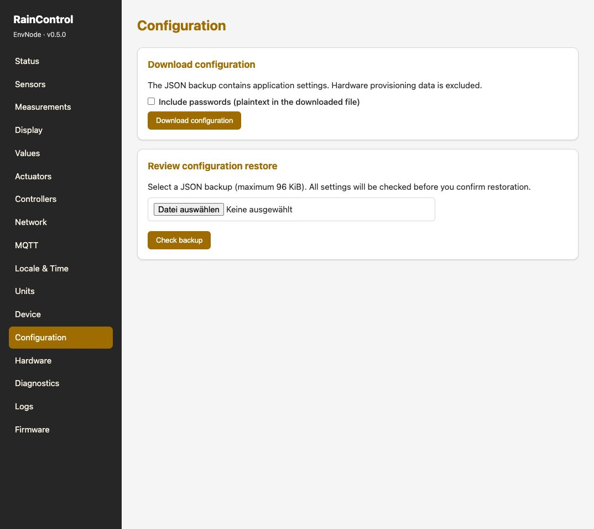

# Firmware bedienen

Diese Anleitung führt von der ersten Verbindung mit EnvNode bis zu Messung,
Schalten, Anzeige und MQTT. Sie beschreibt den Firmware-Quellstand vom
14. Oktober 2026 (Firmware 0.6.1). Die Sprache der Oberfläche ist einstellbar; englische
Seitennamen stehen hier zur eindeutigen Zuordnung in Klammern.

Du beginnst gerade mit EnvNode? [Der Einstieg](../getting-started/index.md) erklärt
auch die benötigte Hardware und verbindet die einzelnen Einrichtungsschritte.

## Orientierung in der Weboberfläche

Die Navigation links führt durch die Bedienbereiche; rechts stehen die Inhalte
und Aktionen der gewählten Seite. Die Aufnahme zeigt als Beispiel die
Konfigurationsseite mit Sicherung und Wiederherstellung. Dieselbe Navigation
begleitet die Einrichtung von Sensoren, Aktoren, Controllern und Displays.

Aufnahme von Firmware 0.5.0 auf Mini 0.3 mit DuoRelay 0.3. Die Hardwarebelegung
ist aufbauspezifisch; die Aufnahme dient der Orientierung in der Bedienoberfläche.

## Der Weg zur ersten Anwendung

| Schritt | Ziel |
| --- | --- |
| [1. Begriffe und Oberfläche](basics.md) | Verstehen, welche Aufgabe jede Komponente hat |
| [2. Erste Inbetriebnahme](configuration.md) | Gerät erreichen und Netzwerk einrichten |
| [3. Hardware und Provisioning](provisioning.md) | Board und Module richtig zuordnen |
| [4. Erste Messung](sensors.md) | Sensor konfigurieren und Werte prüfen |
| [5. Ausgänge schalten](actuators.md) | Aktoren sicher einrichten und bedienen |
| [6. Lokal automatisch steuern](controllers.md) | Controller mit einem Zielaktor verbinden |
| [7. Values und Anzeigen](values-displays.md) | Eigene Werte und Displayinhalte einrichten |
| [8. MQTT und Home Assistant](mqtt.md) | Messungen und Zustände extern verwenden |
| [9. Wartung und Diagnose](maintenance.md) | Sichern, aktualisieren und Fehler eingrenzen |

Wenn das ESP32 noch keine passende Firmware hat, beginne mit
[Bauen und Aufspielen](installation.md).

## Standort und Luftdruck

[GeoPosition und Meereshöhendruck](geo-position-pressure.md) beschreibt die
optionalen Koordinaten, die tatsächliche Sensorhöhe, die lokale Temperaturauswahl
und den getrennten abgeleiteten Druckwert einschließlich Qualität und Rückfallverhalten.
Die Funktion steht ab Firmware 0.6.0 zur Verfügung.

## Zwei durchgehende Beispiele

- [Mini mit SHT4x: von der Verdrahtung zur MQTT-Messung](example-measurement.md)
- [DuoRelay: manuell schalten und anschließend mit Blink betreiben](example-relay.md)

Die Hardwareanleitungen erklären Bestückung und elektrische Prüfungen.
Diese Bedienungsanleitung setzt einen entsprechend geprüften Aufbau voraus.
Firmwareunterstützung und Hardware-Reifegrad werden getrennt beschrieben;
RainDetector, SCT013 und der ADS1115-Messpfad sind keine fertigen Sensoroptionen
in der aktuellen Sensorregistry.
