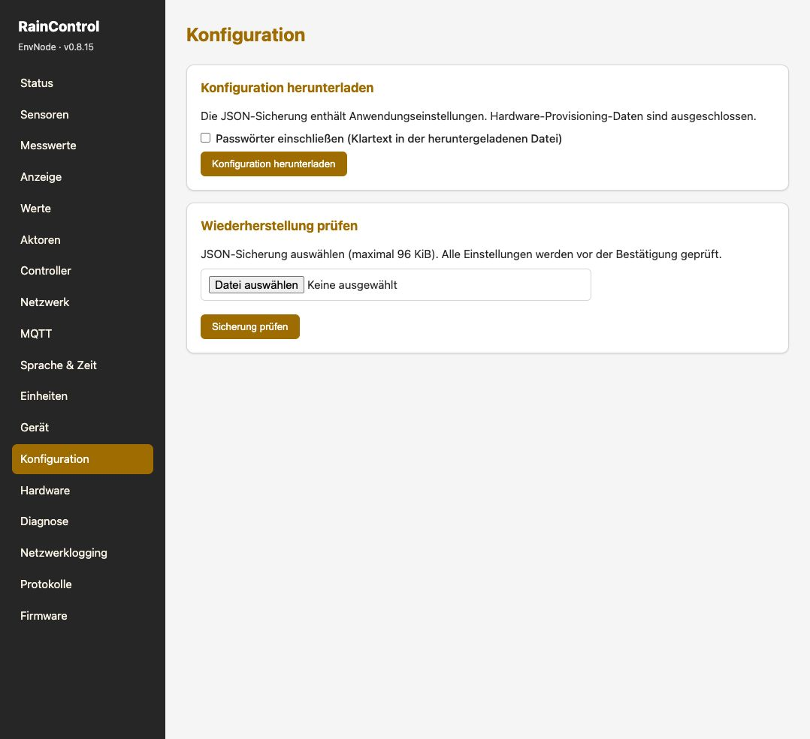

# EnvNode-Firmware bedienen

Die separate Prüfanwendung ist unter [Test/Provisioning](../test-provisioning/index.md) dokumentiert.

Diese Anleitung führt von der ersten Verbindung mit EnvNode bis zu Messung,
Schalten, Anzeige und MQTT. Die einzelnen Kapitel nennen bei Bedarf ihren
Funktionsstand. Die Sprache der Oberfläche ist einstellbar; englische
Seitennamen stehen hier zur eindeutigen Zuordnung in Klammern.

Du beginnst gerade mit EnvNode? [Der Einstieg](../getting-started/index.md) erklärt
auch die benötigte Hardware und verbindet die einzelnen Einrichtungsschritte.

## Orientierung in der Weboberfläche

Die Navigation links führt durch die Bedienbereiche; rechts stehen die Inhalte
und Aktionen der gewählten Seite. Die Aufnahme zeigt als Beispiel die
Konfigurationsseite mit Sicherung und Wiederherstellung. Dieselbe Navigation
begleitet die Einrichtung von Sensoren, Aktoren, Controllern und Displays.

Aufnahme vom 21.11.2026 mit Firmware **0.8.15** und deutscher Oberfläche.
Der gezeigte Aufbau verwendet das Mini-Boardprofil 0.8 und DuoRelay 0.3; die
Hardwarebelegung ist aufbauspezifisch. Die Aufnahme dient der Orientierung.

Welche Sensoren passen zu deiner Messaufgabe? Die
[Sensorwahl nach Messgröße](../applications/measurements.md) führt zur passenden
Einrichtung; dieses Kapitel erklärt die Bedienung der Oberfläche.

## Der Weg zur ersten Anwendung

| Schritt | Ziel |
| --- | --- |
| [1. Begriffe und Oberfläche](basics.md) | Verstehen, welche Aufgabe jede Komponente hat |
| [2. Gerät einrichten](configuration.md) | Erste Verbindung, Netzwerk und Grundeinstellungen |
| [3. Hardwareerkennung und Provisioning](provisioning.md) | Board und Module richtig zuordnen |
| [4. Erste Messung](sensors.md) | Sensor konfigurieren und Werte prüfen |
| [5. Ausgänge schalten](actuators.md) | Aktoren sicher einrichten und bedienen |
| [6. Lokal automatisch steuern](controllers.md) | Controller mit einem Zielaktor verbinden |
| [7. Values](values.md) und [Displays](values-displays.md) | Eigene Auswahlwerte definieren und Inhalte anzeigen |
| [8. MQTT und Home Assistant](mqtt.md) | Messungen und Zustände extern verwenden |
| [9. Wartung und Diagnose](maintenance.md) | Sichern, aktualisieren und Fehler eingrenzen |

Wenn das ESP32 noch keine passende Firmware hat, beginne mit
[Bauen und Aufspielen](installation.md).

## Grundeinstellungen gezielt nachschlagen

Unter **Gerät einrichten** sind die allgemeinen Einstellungen zusammengefasst:
[Netzwerk](network.md), [Sprache und Zeit](language-time.md),
[Gerät und Standort](device.md), [Einheiten](units.md) sowie
[Hardwareerkennung und Provisioning](provisioning.md).
Die [erste Verbindung und Grundeinrichtung](configuration.md) führt durch die Reihenfolge.

## Luftdruck als Messfunktion

[Luftdruck auf Meereshöhe](geo-position-pressure.md) erklärt die lokale
Temperaturauswahl und den getrennten abgeleiteten Druckwert einschließlich
Qualität und Rückfallverhalten. Die dafür benötigte Sensorhöhe wird unter
[Gerät und Standort](device.md#standort-eingeben) eingegeben.

## Diagnoseaufzeichnung

[Netzwerklogging](network-logging.md) erklärt, wie die Firmware Meldungen und
erweiterte Diagnosen an einen bereits eingerichteten externen rsyslogd sendet
und wie du den Empfang kontrollierst.

## Beispiele

- [WeatherStation: Gehäuse- und Außenklima, Regenwippe und RainDetector](example-weatherstation.md)
- [Mini mit SHT4x: von der Verdrahtung zur MQTT-Messung](example-measurement.md)
- [DuoRelay: Relais bedienen und mit Blink betreiben](example-relay.md)

Die [DuoRelay-Inbetriebnahme](../modules/duo-relay/commissioning.md) führt zuvor
durch Modulidentität, Aktorzuordnung und Funktionstest mit der Firmware.

Die Hardwareanleitungen erklären Bestückung und elektrische Prüfungen.
Diese Bedienungsanleitung setzt einen entsprechend geprüften Aufbau voraus.
Firmwareunterstützung und Hardware-Reifegrad werden getrennt beschrieben;
RainDetector und SCT013 sind im klassischen Build integriert. Für weitere
Analogpfade ist die jeweils dokumentierte Firmwareunterstützung maßgeblich.
