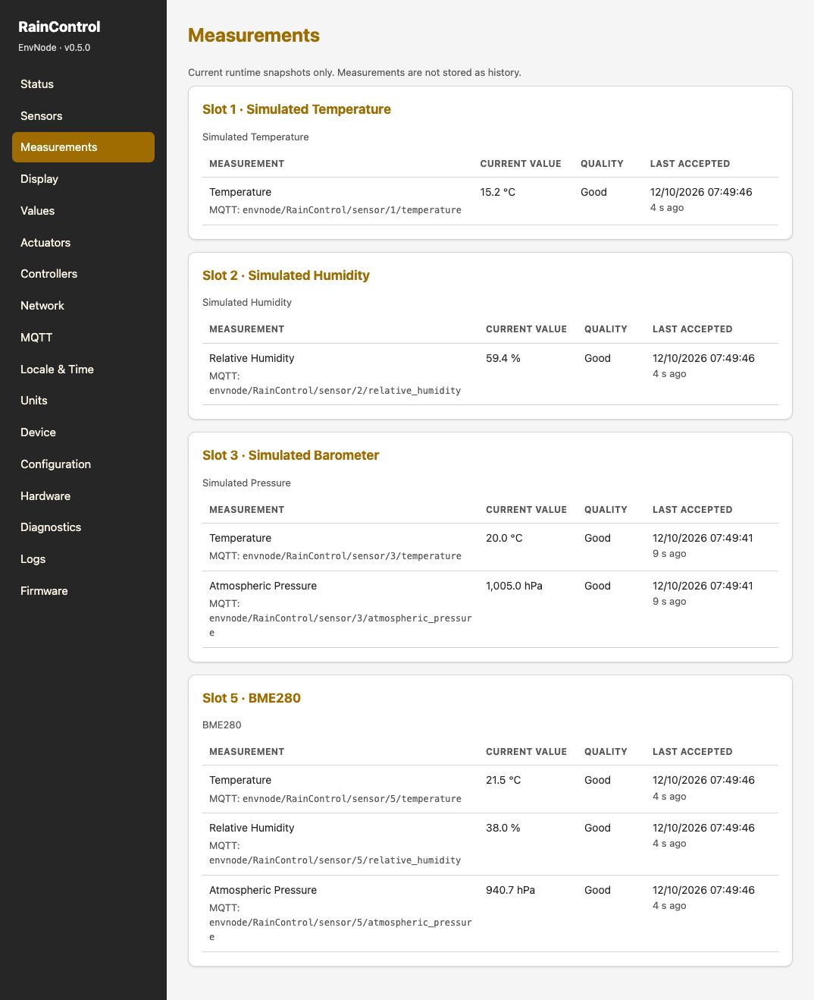
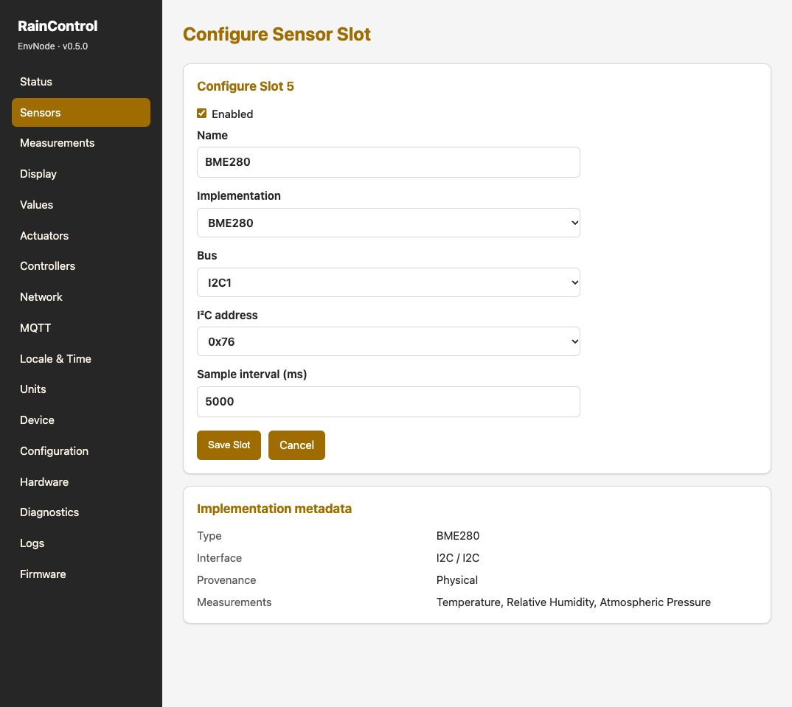

# Sensoren einrichten und Messwerte prüfen

## Sensorplatz vorbereiten

Unter **Sensoren (Sensors)** einen freien Platz bearbeiten, einen verständlichen
Namen vergeben und die passende Implementierung wählen. Für einen Test ohne
Hardware eine simulierte Implementierung verwenden und sie erkennbar benennen.
Simulation bestätigt den Softwareablauf, nicht die reale Verkabelung.

| Implementierung | Schnittstelle | Einstellungen |
| --- | --- | --- |
| BME280 | I²C | Bus, Adresse 0x76 oder 0x77 |
| SHT4x | I²C | Bus, Adresse 0x44 |
| SHTC3 | I²C | Bus, Adresse 0x70 |
| AM2302 / DHT22 | GPIO | Geeigneter Einleitungs-GPIO |
| Rain Gauge | GPIO-Interrupt | GPIO, Millimeter pro Kippung, Entprellung |

Die tatsächliche Adresse und Pegel müssen zum Sensorboard passen.
[Anschluss und Pull-ups](../sensors/i2c.md) vor dem Einschalten prüfen.
Ein I²C-Scan ist eine Hilfe bei der Verkabelungsprüfung, kein automatisches Einrichten.

## Speichern, anwenden, kontrollieren

1. Implementierung und Ressourcen passend zur Hardware setzen.
2. Konfiguration speichern.
3. Falls angezeigt, ausstehende Sensoränderungen anwenden.
4. Sensorzustand kontrollieren und eine Messperiode abwarten.
5. Unter **Messwerte (Measurements)** Quelle, Messgröße, Einheit und Zustand prüfen.

Ein fehlender Wert ist nicht automatisch null. Bei fehlenden, ungültigen oder
alten Werten erst Zeit, Sensorzustand und Logs untersuchen. Nicht nur den
angezeigten Zahlenwert beurteilen.

## Vom Sensor zum sichtbaren Ergebnis

Der Ablauf ist **Sensor konfigurieren → speichern und anwenden → Messwerte prüfen**.
Die Seite *Sensors* legt Quelle, Bus und Adresse fest; *Measurements* zeigt das
Ergebnis mit Einheit, Qualität, Zeitpunkt der letzten angenommenen Messung und MQTT-Topic.

Im Beispiel sind die Plätze 1–3 ausdrücklich Simulationen. Platz 5 ist der physische
BME280 und liefert Temperatur, relative Feuchte und Luftdruck. Der deaktivierte
SHTC3 erzeugt keine aktiven Messungen und erscheint deshalb hier nicht als Messquelle.
Die Zahlen sind eine Momentaufnahme dieses Aufbaus, keine Soll- oder Kalibrierwerte.

Damit lässt sich die [BME280-Konfiguration](#bme280-konfigurieren) mit dem Ergebnis
vergleichen: Ein eingerichteter Sensor muss auch aktuelle, gültige Messungen liefern.

## Typische Fehler

| Symptom | Erste Prüfung |
| --- | --- |
| Adresse fehlt im Scan | Versorgung, Bus, SDA/SCL, Pull-ups |
| Adresse vorhanden, Sensor fehlerhaft | Implementierung, erlaubte Adresse, Sensorvariante |
| Gespeichert, aber keine Änderung | Ausstehende Änderungen angewendet? |
| Lokal Werte, extern keine | MQTT-Verbindung und Topics |

RainDetector ist kein Rain-Gauge-Treiber. SCT013 und ADS1115 sind im aktuellen
Sensorregistry nicht als fertige Auswahl enthalten.

[Durchgehendes SHT4x-Beispiel](example-measurement.md)

## BME280 konfigurieren

Aufnahme: Firmware 0.5.0, Mini Revision 0.3 und DuoRelay Revision 0.3.
Die gezeigten Ressourcen gelten für diesen Aufbau; das tatsächliche Boardprofil
und die revisionsbezogene GPIO-Zuordnung sind maßgeblich.

BME280 ist in Platz 5 aktiviert: I2C1, Adresse 0x76, Intervall 5000 ms.
SHTC3 ist im Aufbau eingerichtet, aber deaktiviert.

