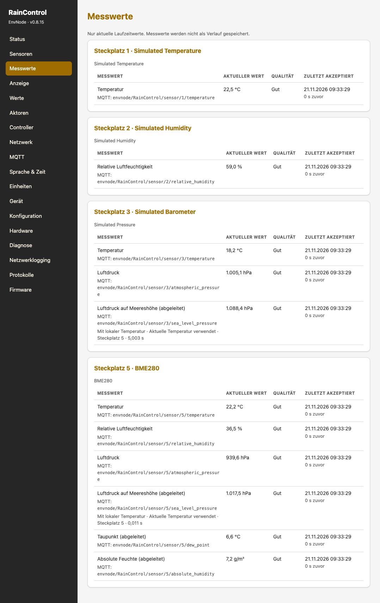
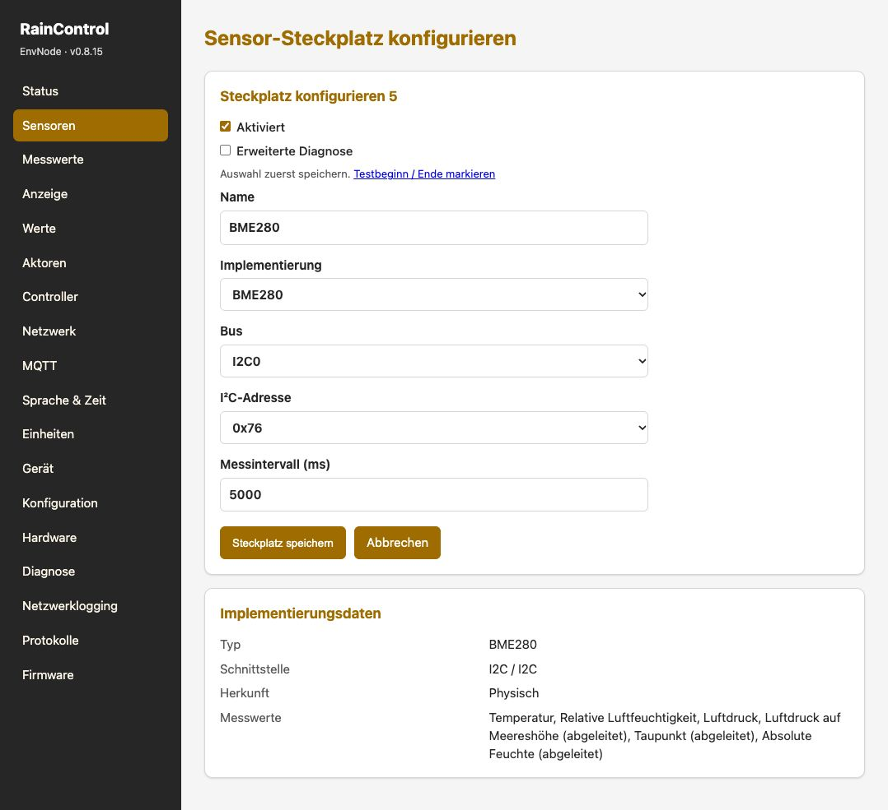

# Sensoren einrichten und Messwerte prüfen

Für die passende Reihenfolge am konkreten Sensor beginne mit der
[Inbetriebnahmeübersicht](../commissioning/index.md). Diese Seite erklärt das gemeinsame Sensorformular.

## Sensorplatz vorbereiten

Unter **Sensoren (Sensors)** einen freien Platz bearbeiten, einen verständlichen
Namen vergeben und die passende Implementierung wählen. Für einen Test ohne
Hardware eine simulierte Implementierung verwenden und sie erkennbar benennen.
Simulation bestätigt den Softwareablauf, nicht die reale Verkabelung.

| Implementierung | Schnittstelle | Einstellungen |
| --- | --- | --- |
| BME280 | I²C | Bus, Adresse 0x76 oder 0x77 |
| SHT4x | I²C | Bus, Adresse 0x44 |
| SHTC3 | I²C | Bus, Adresse 0x70 |
| AM2302 / DHT22 | GPIO | Geeigneter Einleitungs-GPIO |
| Rain Gauge | GPIO-Interrupt | GPIO, Millimeter pro Kippung, Entprellung |
| RainDetector (frequency) | GPIO-Frequenzeingang | GPIO für das Frequenzsignal des Controllers |
| SCT013 AC RMS | ADC1 | Freier Analogport, Sensorprofil, Kalibrierung und Nullschwellen |
| Solar Position | Berechnung | Konfigurierte Koordinaten und synchronisierte Zeit |

Die Auswahl nach Messaufgabe findest du unter [Ich möchte messen](../applications/measurements.md).

Die tatsächliche Adresse und Pegel müssen zum Sensorboard passen.
[Anschluss und Pull-ups](../sensors/i2c.md) vor dem Einschalten prüfen.
Ein I²C-Scan ist eine Hilfe bei der Verkabelungsprüfung, kein automatisches Einrichten.

## Felder des Sensorformulars

| Feld | Bedeutung und Auswahl |
| --- | --- |
| Aktiviert | Dieser Platz soll beim Start und nach dem Anwenden als Sensor betrieben werden. Deaktivieren erhält die Einstellungen, beendet nach der Übernahme aber die Erfassung. |
| Name | Eigene Bezeichnung für die Messstelle, zum Beispiel „Gehäuse“ oder „Außen“. |
| Implementierung | Tatsächlicher Sensortyp beziehungsweise ausdrücklich gewählte Simulation. Bestimmt Schnittstelle, Messgrößen und weitere Felder. |
| I²C-Bus | Der Bus, an dem der Sensor elektrisch angeschlossen ist. Nicht aus der Adresse allein ableitbar. |
| I²C-Adresse | Adresse des konkreten Sensorboards auf diesem Bus. Zwei Geräte mit gleicher Adresse benötigen verschiedene Busse oder eine umstellbare Adresse. |
| GPIO / ADC-Port | Der tatsächlich verdrahtete, für diese Implementierung geeignete Anschluss. Die Auswahl berücksichtigt Boardprofil und belegte Ressourcen. |
| Messintervall in ms | Abstand periodischer Erfassungen; 5000 ms entsprechen fünf Sekunden. Nur verfügbar, wenn die Implementierung ein solches Intervall verwendet. |
| Erweiterte Diagnose, falls angeboten | Zusätzliche Diagnose des Sensors für die Fehlersuche. Ersetzt keine Messkonfiguration. |

Das Formular zeigt nur die für die gewählte Implementierung relevanten Felder.
Ein nach Änderung des Sensortyps vorausgewählter Bus, GPIO oder Intervallwert
muss vor dem Speichern erneut mit dem Aufbau verglichen werden.

**Ereignis- und Frequenzsensoren:** Die Regenwippe erfasst einzelne Kippungen;
sie wird nicht nur im Takt einer periodischen Klimamessung gelesen. Beim
RainDetector bestimmt das Ausgabeintervall die Veröffentlichung, während die
Frequenz intern häufiger erfasst wird. Die zusätzlichen Parameter stehen bei
[Regenwippe](../commissioning/rain-gauge.md),
[RainDetector](../commissioning/rain-detector.md) und
[SCT013](../sensors/sct013/commissioning.md).

## Mehrere Messstellen und Luftdruck

Jede physische Messstelle erhält einen eigenen Sensorplatz. Zwei BME280 können
jeweils Temperatur, Feuchte und Luftdruck liefern. Ein SHT4x oder SHTC3 liefert
Temperatur und Feuchte, aber keinen Luftdruck. Verwende die tatsächliche
Sensorimplementierung; fehlende Fähigkeiten werden nicht durch einen Namen ergänzt.

Bei zwei Barometern bleiben beide örtlichen Druckmessungen getrennt. Benenne
die Messstellen eindeutig und prüfe sie einzeln. Für die Berechnung des
Meereshöhendrucks wird eine gemeinsame lokale Außentemperaturquelle ausgewählt;
eine Gehäusetemperatur ist dafür nicht automatisch passend.
[Standort, Sensorhöhe und Temperaturquelle](geo-position-pressure.md).

## Speichern, anwenden, kontrollieren

1. Implementierung und Ressourcen passend zur Hardware setzen.
2. Konfiguration speichern.
3. Falls angezeigt, ausstehende Sensoränderungen anwenden.
4. Sensorzustand kontrollieren und eine Messperiode abwarten.
5. Unter **Messwerte (Measurements)** Quelle, Messgröße, Einheit und Zustand prüfen.

Ein fehlender Wert ist nicht automatisch null. Bei fehlenden, ungültigen oder
alten Werten erst Zeit, Sensorzustand und Logs untersuchen. Nicht nur den
angezeigten Zahlenwert beurteilen.

## Vom Sensor zum sichtbaren Ergebnis

Der Ablauf ist **Sensor konfigurieren → speichern und anwenden → Messwerte prüfen**.
Die Seite *Sensors* legt Quelle, Bus und Adresse fest; *Measurements* zeigt das
Ergebnis mit Einheit, Qualität, Zeitpunkt der letzten angenommenen Messung und MQTT-Topic.

Im Beispiel sind die Plätze 1–3 ausdrücklich Simulationen. Platz 5 ist der physische
BME280 und liefert Temperatur, relative Feuchte und Luftdruck. Der deaktivierte
SHTC3 erzeugt keine aktiven Messungen und erscheint deshalb hier nicht als Messquelle.
Die Oberfläche ist deutsch; selbst vergebene Namen wie „Simulated Temperature“
bleiben unverändert. Die Zahlen sind eine Momentaufnahme dieses Aufbaus, keine
Soll- oder Kalibrierwerte.

Damit lässt sich die [BME280-Konfiguration](#bme280-konfigurieren) mit dem Ergebnis
vergleichen: Ein eingerichteter Sensor muss auch aktuelle, gültige Messungen liefern.

## Messwerte beurteilen

| Angabe | Was du daraus erkennst |
| --- | --- |
| Quelle und Messgröße | Welcher Sensor welche Größe liefert; nicht nur den Zahlenwert vergleichen. |
| Einheit | Bedeutung des Zahlenwerts; örtlichen und abgeleiteten Meereshöhendruck unterscheiden. |
| Gültigkeit und Qualität | Ob ein Wert verwendbar ist oder Einschränkungen beziehungsweise Schätzungen vorliegen. Eine gültige Null ist etwas anderes als ein fehlender Wert. |
| Letzte angenommene Messung | Ob die Quelle weiter aktualisiert wird. Ein sichtbarer letzter Wert kann bereits zu alt für einen Controller sein. |
| Herkunft | Physische Messung, Simulation oder abgeleiteter Wert. Eine Simulation belegt keine Hardwarefunktion. |
| MQTT-Topic | Adresse für die externe Weitergabe; die Anzeige allein bestätigt noch keine Brokerverbindung. |

Die Messwertseite zeigt Laufzeitaufnahmen und kein Messarchiv. Nach dem Anwenden
oder Neustart zunächst eine neue Erfassung abwarten. Historie und stündliche oder
tägliche Summen entstehen im empfangenden System.

**Prüfung:** Sensor aktivieren, speichern und anwenden, mehrere Aktualisierungen
beobachten und anschließend neu starten. Quelle, Einheit und gespeicherte
Einstellungen müssen weiterhin passen. Bei einer Ereignisquelle ein bekanntes
Ereignis auslösen, statt auf eine periodische Aktualisierung zu warten.

## Typische Fehler

| Symptom | Erste Prüfung |
| --- | --- |
| Adresse fehlt im Scan | Versorgung, Bus, SDA/SCL, Pull-ups |
| Adresse vorhanden, Sensor fehlerhaft | Implementierung, erlaubte Adresse, Sensorvariante |
| Gespeichert, aber keine Änderung | Ausstehende Änderungen angewendet? |
| Lokal Werte, extern keine | MQTT-Verbindung und Topics |

RainDetector ist kein Rain-Gauge-Treiber. Der [SCT013](../sensors/sct013/index.md) liefert Effektivstrom in Ampere; ADS1115 ist weiterhin nicht als eigener Sensor auswählbar.

[Durchgehendes SHT4x-Beispiel](example-measurement.md)

## BME280 konfigurieren

Aufnahme vom 21.11.2026: Firmware **0.8.15**, deutsche Oberfläche,
Mini-Boardprofil 0.8 und DuoRelay 0.3.
Die gezeigten Ressourcen gelten für diesen Aufbau; das tatsächliche Boardprofil
und die revisionsbezogene GPIO-Zuordnung sind maßgeblich.

BME280 ist in Platz 5 aktiviert: **I2C0**, Adresse 0x76, Intervall 5000 ms.
SHTC3 ist im Aufbau eingerichtet, aber deaktiviert.

## Luftdruck auf Meereshöhe

Ab Firmware 0.6.0 bleibt der örtliche Luftdruck des BME280 unverändert verfügbar.
Ein zusätzlicher abgeleiteter Druckwert nutzt die konfigurierte Sensorhöhe und
optional einen aktuellen Temperaturwert eines lokalen Sensors. Die Erweiterung
arbeitet auch mit simulierten Barometern.

[GeoPosition, Temperaturauswahl und Druckberechnung einrichten](geo-position-pressure.md)
