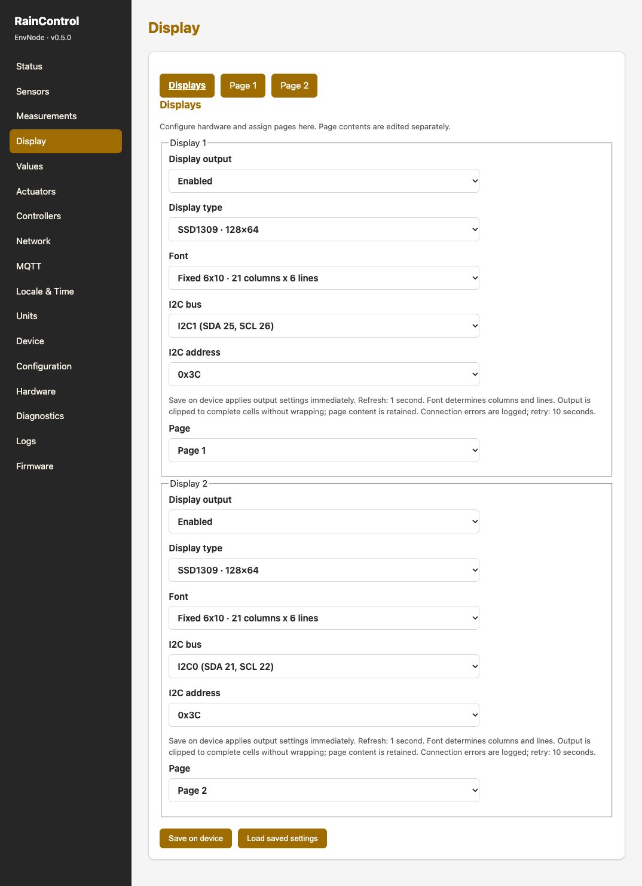

# Eigene Werte und Anzeigen

## Values

Ein Value ist ein konfigurierbarer eigener Wert, keine zusätzliche Sensormessung.
Unter **Values** einen Eintrag mit passendem Typ und verständlichem Namen erstellen.
Bei Enum-Werten die erlaubten Codes und ihre Bedeutung festlegen.
Anschließend den aktuellen Wert setzen und prüfen, welche Verbraucher ihn verwenden.

Zum Beispiel kann ein Enum-Value die Betriebsart eines Selectors vorgeben.
Der Value allein schaltet keine Last; die Zuordnung zu Controller und Aktor
macht daraus die Anwendung.

## Displays

Unter **Display** werden Ausgabehardware und Inhaltsseiten getrennt eingerichtet.
Die unterstützten 128×64-I²C-Treiber sind SSD1309, SSD1306 und SH1106.
Bus und Adresse (0x3C oder 0x3D) müssen zur Hardware passen.
Zwei aktive Displays dürfen nicht dieselbe Adresse am selben Bus besitzen.

1. Ausgabe aktivieren und passenden Treiber, Bus und Adresse wählen.
2. Eine der beiden Inhaltsseiten dem Ausgang zuordnen.
3. Die gewünschten Quellen für die bis zu sechs Zeilen auswählen.
4. Texte, Formatierung und gegebenenfalls Bool-/Enum-Anzeigetexte einstellen.
5. Vorschau prüfen und speichern; danach die reale Anzeige kontrollieren.

Quellen können Sensor-, Aktor-, Controller-, Value- und Systemeigenschaften sein.
Eine Controller-Entscheidung und deren Grund helfen beim Verstehen des Verhaltens.
Fehlende oder ungültige Eingaben nicht durch einen scheinbar plausiblen festen
Zahlenwert verdecken. Vorschau und Gerät können sich unterscheiden, wenn keine
aktuellen Messungen verfügbar sind.

[Displayhardware und Fehlersuche](../displays/index.md)

## Zwei Displays konfigurieren

Aufnahme: Firmware 0.5.0, Mini Revision 0.3 und DuoRelay Revision 0.3.
Die gezeigten Ressourcen gelten für diesen Aufbau; das tatsächliche Boardprofil
und die revisionsbezogene GPIO-Zuordnung sind maßgeblich.

Beide SSD1309 verwenden 0x3C, aber unterschiedliche Busse: Display 1 an I2C1
mit Seite 1, Display 2 an I2C0 mit Seite 2. Damit entsteht kein Adresskonflikt.
Die Schriftwahl bestimmt das Raster: 6×10 ergibt 21 Spalten und 6 Zeilen;
8×13 ergibt 16 Spalten und 4 sichtbare Zeilen.

