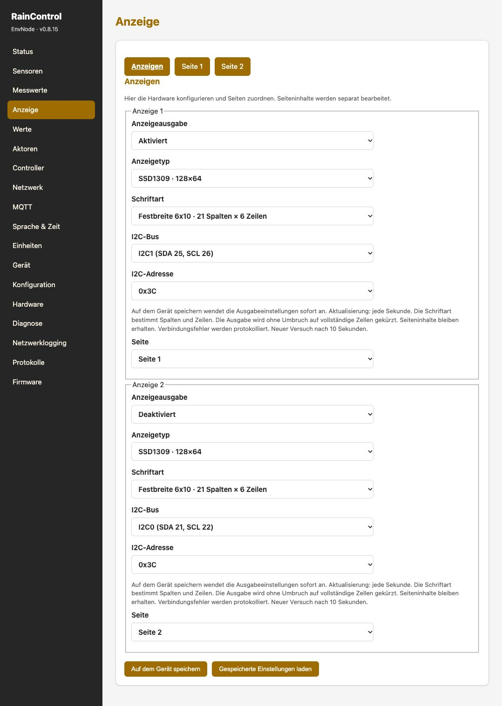

# Displays und Inhaltsseiten

## Values

Eigene Auswahlwerte, deren Optionsschlüssel, Neustartregel und MQTT-Bedienung
beschreibt das eigenständige Kapitel [Values](values.md). Als Displayquelle
können sie zusammen mit Messungen und anderen Eigenschaften verwendet werden.

## Displays

Unter **Display** werden Ausgabehardware und Inhaltsseiten getrennt eingerichtet.
Die unterstützten 128×64-I²C-Treiber sind SSD1309, SSD1306 und SH1106.
Bus und Adresse (0x3C oder 0x3D) müssen zur Hardware passen.
Es gibt zwei Displayausgänge und zwei Inhaltsseiten mit jeweils bis zu sechs Zeilen.
Jeder Ausgang erhält eine Seite; beide dürfen dieselbe Seite verwenden.
Zwei aktive Displays dürfen nicht dieselbe Adresse am selben Bus besitzen.

1. Ausgabe aktivieren und passenden Treiber, Bus und Adresse wählen.
2. Eine der beiden Inhaltsseiten dem Ausgang zuordnen.
3. Die gewünschten Quellen für die bis zu sechs Zeilen auswählen.
4. Texte, Formatierung und gegebenenfalls Bool-/Enum-Anzeigetexte einstellen.
5. Vorschau prüfen und speichern; danach die reale Anzeige kontrollieren.

Quellen können Sensor-, Aktor-, Controller-, Value- und Systemeigenschaften sein.
Eine Controller-Entscheidung und deren Grund helfen beim Verstehen des Verhaltens.
Ab Firmware 0.7.0 steht zusätzlich **Git-Branch** als Systemeigenschaft zur
Auswahl. Damit lassen sich Geräte mit unterschiedlichen Entwicklungsständen
direkt auf dem Display unterscheiden.
Fehlende oder ungültige Eingaben nicht durch einen scheinbar plausiblen festen
Zahlenwert verdecken. Vorschau und Gerät können sich unterscheiden, wenn keine
aktuellen Messungen verfügbar sind.

[Displayhardware und Fehlersuche](../displays/index.md)

## Ausgabehardware und Inhaltsseite unterscheiden

Die Register **Displays**, **Seite 1** und **Seite 2** haben getrennte Aufgaben.
Unter Displays werden die beiden physischen Ausgänge konfiguriert; auf den
Seiten wird ihr Text gestaltet. Beide Ausgänge dürfen dieselbe Seite anzeigen,
auch mit unterschiedlicher Schrift. Ein deaktivierter Ausgang löscht seine
Inhaltsseite nicht.

| Feld des Ausgangs | Bedeutung |
| --- | --- |
| Aktiviert | Diesen physischen Displayausgang betreiben. |
| Displaytyp | Tatsächlich verbauter Controller: SSD1309, SSD1306 oder SH1106 mit 128×64 Pixeln. |
| Schrift | Fixed 6×10: 21 Spalten und sechs Zeilen. Fixed 8×13: 16 Spalten und vier sichtbare Zeilen. |
| I²C-Bus und Adresse | Elektrischer Anschluss des Displays. Dieselbe Adresse ist an verschiedenen Bussen möglich. |
| Seite | Gespeicherte Inhaltsseite 1 oder 2 für diesen Ausgang. |

Hardwareeinstellungen speichern, anschließend die betreffende Inhaltsseite
bearbeiten und separat speichern. Vor dem Wechsel zwischen den Registern die
Eingaben sichern. Vorschau allein speichert sie nicht.

## Quellen und Formate einer Zeile

Im Seiteneditor entspricht jede Formatzeile einer Displayzeile. Pro Zeile sind
bis zu vier Quellen möglich. Jede Quelle ersetzt genau einen Platzhalter im
Format, in derselben Reihenfolge. Quellen von Position 1 an ohne Lücke belegen.
Eine Zeile ohne Quelle kann festen Text enthalten oder leer bleiben.

| Platzhalter | Erwartete Quelle | Bedeutung |
| --- | --- | --- |
| `%.1f` | Gleitkommazahl, zum Beispiel Temperatur | Eine Nachkommastelle; `%.0f` ohne Nachkommastellen |
| `%u` | Nicht negative Ganzzahl | Ganzzahlige Eigenschaft |
| `%s` | Text, Bool oder Enum | Text beziehungsweise lesbare Zustandsbezeichnung |
| `%%` | Keine zusätzliche Quelle | Ein wörtliches Prozentzeichen |

Beispiel für eine einzelne Zeile: Quelle 1 ist eine Temperatur und das Format
`T: %.1f C`. Für eine zweite Feuchtequelle folgt etwa `T %.1f C  F %.0f%%`.
Das sind Formatbeispiele, keine vorgegebene Sensorzuordnung. Anzahl und Datentypen
der Quellen müssen zum Format passen; `%s` ist kein Ersatz für einen Zahlenplatzhalter.
Einheiten im festen Text ergänzen und mit der Eigenschaft vergleichen.
Sensorzahlen in Anzeige und Vorschau verwenden die eingestellten Anzeigeeinheiten
und das Dezimaltrennzeichen der Sprache. Diese Darstellung ändert nicht die
kanonischen Einheiten für Controller-Schwellwerte.

Die Quellen stammen aus diesen Bereichen:

| Bereich | Typische Verwendung |
| --- | --- |
| Sensor | Einzelne Messgröße der gewählten Sensor-ID |
| Aktor | Schaltzustand oder Pegel |
| Controller | Laufzustand, Entscheidung oder Entscheidungsgrund |
| Value | Aktuell ausgewählte Option |
| System | Geräteeigenschaften wie Git-Branch |

Die Auswahl speichert eine Referenz auf die Komponente. Das Umbenennen ist keine
neue Messung; Austausch oder Entfernen einer Komponente kann eine unpassende
Referenz zurücklassen. Danach Quellen und Vorschau erneut kontrollieren.

## Bool- und Enum-Texte

Bei einer Bool-Quelle lassen sich die Texte für Wahr/Ein und Falsch/Aus
überschreiben. Bei einer Enum-Quelle können deren einzelne Zustandsbezeichnungen
übersetzt werden. Die Texte gelten für diese Quelle in dieser Zeile und verändern
weder den tatsächlichen Zustand noch Optionsschlüssel oder MQTT-Befehle.
Leere Textfelder behalten die ursprüngliche Bezeichnung bei. Die Darstellung
erfolgt mit `%s`.

Bool-Texte sind auf 16 UTF-8-Bytes begrenzt; Umlaute können mehr als ein Byte
benötigen. Kurze Texte erleichtern zugleich die Darstellung auf dem Display.
Die Oberflächensprache und selbst eingetragene Anzeigetexte sind unterschiedliche
Einstellungen: Ein Sprachwechsel übersetzt eigene Texte nicht automatisch.

## Vorschau, Speicherung und Prüfung

1. Gewünschte Inhaltsseite wählen und Formatzeilen eintragen.
2. Für jeden Platzhalter die passende Quelle auswählen.
3. Optional Zustandsbezeichnungen anpassen.
4. Vorschau aktualisieren und Meldungen zu Quellen oder Formaten beachten.
5. Unter **Vorschau für** den tatsächlichen Displayausgang wählen. Die ungekürzte
   Seitenvorschau berücksichtigt dessen Spalten- und Zeilengrenzen nicht.
6. Seite speichern und reale Anzeige kontrollieren.

Bei der größeren Schrift bleiben Zeilen 5 und 6 gespeichert, sind aber auf dem
vierzeiligen Ausgang nicht sichtbar. Zu lange Zeilen werden am Raster abgeschnitten;
für wichtige Informationen deshalb die Vorschau des konkreten Ausgangs verwenden.

Fehlt ein aktueller Wert oder ist eine Referenz ungültig, zeigt die Vorschau den
entsprechenden Fehler. Zuerst Quelle und Zustand auf Messwert-, Aktor- oder
Controllerseite prüfen. Einen fehlenden Messwert nicht mit einer festen Zahl
kaschieren. Nach Speichern werden die Einstellungen im laufenden Betrieb übernommen;
ein gesondertes Sensor- oder Controller-Anwenden ist für die reine Textgestaltung
nicht erforderlich.

**Abschlussprüfung:** Beide Inhaltsseiten, beide Ausgänge, lange Zustandsnamen und
Umlaute am Zeilenende kontrollieren. Nach Neustart müssen Schrift, Zuordnung und
Texte wieder erscheinen; Messquellen können zunächst auf ihre erste neue Erfassung warten.

## Displayausgänge konfigurieren

Aufnahme vom 21.11.2026: Firmware **0.8.15**, deutsche Oberfläche,
Mini-Boardprofil 0.8 und DuoRelay 0.3.
Die gezeigten Ressourcen gelten für diesen Aufbau; das tatsächliche Boardprofil
und die revisionsbezogene GPIO-Zuordnung sind maßgeblich.

Die Aufnahme zeigt Display 1 aktiviert: SSD1309 an I2C1, Adresse 0x3C, Seite 1.
Display 2 ist an I2C0 mit 0x3C und Seite 2 vorbereitet, aber **deaktiviert**.
Bei Aktivierung wären die gleichen Adressen an unterschiedlichen Bussen zulässig.
Die Schriftwahl bestimmt das Raster: 6×10 ergibt 21 Spalten und 6 Zeilen;
8×13 ergibt 16 Spalten und 4 sichtbare Zeilen.

