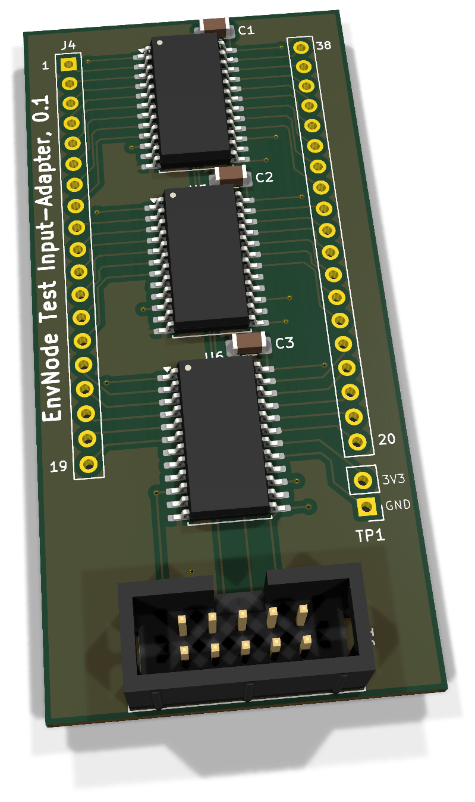
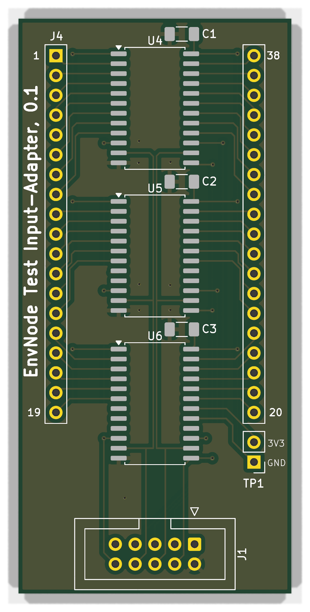

# Input-Adapter 0.1 - Bestückung und Inbetriebnahme

Messadapter für den Test-Controller 0.1 mit drei CD74HC4067 und 40 voneinander getrennten DUT-Messkontakten: 38 DevKit-Sockelkontakte sowie TP1 für MB_GND und MB_3V3_SYS. Der Adapter enthält keinen ESP32.

**Dokumentation abgeschlossen am 28. Oktober 2026.** Der Fertigungs- und Erprobungsstand wird im Abschlusskapitel getrennt geführt.

[Anleitung als PDF](../../assets/downloads/Input_Adapter_Rev0.1_Anleitung.pdf){ .md-button }
[Alte Revisionen](old-revisions.md){ .md-button }

!!! warning "DUT nur spannungsfrei testen"
    Vor dem Kontaktieren alle DUT-Versorgungen und USB-Verbindungen trennen, den ESP32 aus dem DUT ziehen und das separate Provisioning-Kabel abziehen. Der Test Controller darf für seine eigene Elektronik versorgt sein. DUT-Masse und DUT-3,3-V-Referenz bleiben Messkontakte; nicht pauschal mit der Tester-Versorgung verbinden.

## 3D-Ansicht

{ .hero-board-view }

Vorderseite (F.Cu); die Rückseite trägt keine separat zu bestückenden Bauteile. Nicht hinterlegte 3D-Modelle bleiben ausgespart. Die Bestückungspläne folgen im Abschnitt zur Bestückungsübersicht.

## 1. Teile und Vorbereitung
| Ref. | Anz. / Einheit | Wert / Funktion | Artikel |
| --- | --- | --- | --- |
| PCB | 1 | Input-Adapter Rev.0.1 | ENP-00156 |
| U4,U5,U6 | 3 | SOIC-24W; kein HCT | ENP-00153 |
| C1,C2,C3 | 3 | 100 nF X7R 1206 | ENP-00006 |
| J1 | 1 | WSL 10G | ENP-00147 |
| J4,TP1 | 40 | Rohmaterial in Kontaktpositionen: 2× 1×19 für Testplug und 1×2 für Referenzpigtail-Anschluss | ENP-00145 |

ENP-00145 wird in einzelnen Kontaktpositionen gezählt, nicht als Anzahl fertig zugeschnittener Leisten. Kabel, Zugentlastung, Gehäuse und Befestigung separat ergänzen.

Für J4 werden zwei gerade 1×19-Leisten im Reihenabstand **25,40 mm** benötigt. TP1 ist der separate zweipolige Anschluss für das Referenzpigtail. Der **zweipolige JST-PH-Stecker sitzt am freien Kabelende in Richtung Prüfling**, nicht auf dem Input-Adapter. Die beiden DUT-Referenzen dürfen weder mit Adapter-GND noch mit 3V3_SYS gebrückt werden.

## 2. Bestückungsübersicht

### Vorderseite: Bestückungsplan

{ .assembly-plan }

[Plan als PNG](../../assets/board-views/input-adapter-0.1/assembly-front.png){ .md-button }

Senkrechtes KiCad-Rendering der Leiterplatte ohne Bauteilmodelle. Kupfer, Lötstoppmaske und Bestückungsdruck entsprechen der PCB-Quelle. Rückseitenpläne werden von B.Cu aus betrachtet.

Die Bestückungspläne zeigen die Leiterplatte senkrecht zur jeweiligen Seite. Bestückungsdruck und Referenzen folgen der PCB-Quelle; eine Rückseitenansicht ist keine Kontaktansicht eines Kabelsteckers.

Die Pinfolge folgt den tatsächlichen Padnummern. J4 von der Oberseite betrachtet: links 1–19, rechts 38–20. Ein realer Testplug muss ohne Versatz in die 38-poligen Sockel passen; nicht allein nach der 3D-Ansicht fertigen.

## 3. Löt-Reihenfolge

1. C1-C3 und anschließend U4-U6 ausrichten und bestücken; SOIC-24W-Pin 1 und feine Brücken prüfen.
2. J1 mit korrekter IDC-Kodierung einsetzen und löten.
3. Die beiden J4-Reihen in einer maßhaltigen Vorrichtung mit 25,40-mm-Abstand ausrichten; zunächst Endpins fixieren, Passprobe spannungsfrei durchführen und erst dann fertig löten.
4. Den Pigtail-Kabelanschluss an TP1 herstellen. Den zweipoligen JST-PH-Stecker am Kabelende zum Prüfling mit Pin 1/2 eindeutig zuordnen und beide Adern einzeln durchmessen.
5. Reinigen und Lötstellen sowie Abstände kontrollieren.

## 4. Anschlüsse und vollständige Kanalzuordnung

### Versorgung und Steuerung über J1
| J1 Pin | Netz / Funktion |
| --- | --- |
| 1 | `3V3_SYS` |
| 2 | `GND` |
| 3 | `/IN_EN1` |
| 4 | `/IN_S3` |
| 5 | `/IN_EN2` |
| 6 | `/IN_S2` |
| 7 | `/IN_EN3` |
| 8 | `/IN_S1` |
| 9 | `/COM` |
| 10 | `/IN_S0` |

J1 verbindet sich 1:1 mit Test-Controller J8. Versorgung 3V3_SYS/GND dient nur dem Adapter. Die drei Muxe teilen COM; nur einer darf gleichzeitig aktiv sein. Adressbit S0 ist das niederwertigste Bit.

### TP1-Referenzen

| Adapterkontakt | DUT-Kontakt | Muxkanal |
| --- | --- | --- |
| TP1.1, MB_GND | Mainboard TP1.1, D1-Kathode | U6 I14 |
| TP1.2, MB_3V3_SYS | Mainboard TP1.2, D2-Kathode | U6 I13 |

Die beiden Referenzen werden über das Pigtail zum TP1-Anschluss des Prüflings geführt. Sie sind zusätzliche Messkontakte und keine direkte Verbindung zur Versorgung des Testers.

### J4 / Multiplexer

| J4-Pin | Netz | Mux | Kanal |
| --- | --- | --- | --- |
| 1 | `L01` | U4 | I7 |
| 2 | `L02` | U4 | I6 |
| 3 | `L03` | U4 | I5 |
| 4 | `L04` | U4 | I4 |
| 5 | `L05` | U4 | I3 |
| 6 | `L06` | U4 | I2 |
| 7 | `L07` | U4 | I1 |
| 8 | `L08` | U4 | I0 |
| 9 | `L09` | U5 | I7 |
| 10 | `L10` | U5 | I6 |
| 11 | `L11` | U5 | I5 |
| 12 | `L12` | U5 | I4 |
| 13 | `L13` | U5 | I3 |
| 14 | `L14` | U5 | I2 |
| 15 | `L15` | U6 | I7 |
| 16 | `L16` | U6 | I6 |
| 17 | `L17` | U6 | I5 |
| 18 | `L18` | U6 | I4 |
| 19 | `L19` | U6 | I3 |
| 20 | `R19` | U6 | I12 |
| 21 | `R18` | U6 | I11 |
| 22 | `R17` | U6 | I10 |
| 23 | `R16` | U6 | I9 |
| 24 | `R15` | U6 | I8 |
| 25 | `R14` | U5 | I13 |
| 26 | `R13` | U5 | I12 |
| 27 | `R12` | U5 | I11 |
| 28 | `R11` | U5 | I10 |
| 29 | `R10` | U5 | I9 |
| 30 | `R09` | U5 | I8 |
| 31 | `R08` | U4 | I15 |
| 32 | `R07` | U4 | I14 |
| 33 | `R06` | U4 | I13 |
| 34 | `R05` | U4 | I12 |
| 35 | `R04` | U4 | I11 |
| 36 | `R03` | U4 | I10 |
| 37 | `R02` | U4 | I9 |
| 38 | `R01` | U4 | I8 |

## 5. Spannungsfreie Prüfung

- ☐ Kein Kurzschluss der Adapterversorgung; C1-C3 korrekt an 3V3_SYS/GND.
- ☐ U4-U6 Pin 24 an 3V3_SYS, Pin 12 an GND, Pin 1 an COM/J1.9.
- ☐ U4/U5/U6 Pin 15 an IN_EN1/2/3; gemeinsame S0-S3 korrekt.
- ☐ Jeder J4-Kontakt erreicht genau den zugeordneten Muxkanal.
- ☐ TP1.1 erreicht U6 I14 (IC-Pin 17), TP1.2 U6 I13 (IC-Pin 18).
- ☐ MB_GND und MB_3V3_SYS sind nicht direkt an Adapterversorgung gebrückt.
- ☐ J4-Reihenabstand, Pin 1 und Ausrichtung am unversorgten Referenzsockel bestätigt.

## 6. Erstinbetriebnahme

1. Ohne DUT und mit ausgeschaltetem Controller J1 verbinden.
2. Controller strombegrenzt einschalten. 3V3_SYS an allen drei Muxen und offene Enable-HIGH-Pegel prüfen; Ruhestrom dokumentieren.
3. Mit geeigneter Diagnosefirmware nacheinander genau einen Mux und einen Kanal wählen; unbenutzte Muxe deaktiviert lassen.
4. Zuerst bekannte Prüfschleifen verwenden, jeden der 38 Sockelkontakte und beide TP1-Pfade einzeln erfassen; Querpfade und ausgeschaltete Kanäle kontrollieren.
5. Die TP1-Diodenpfade des neuen Mainboards mit passender Stromrichtung prüfen. ADC-Schwellwerte und Einschwingzeit am Referenzaufbau bestimmen.
6. Vor Kontaktierung eines DUT ausschalten; DUT-DevKit entfernen, alle DUT-Quellen und Provisioning trennen und den Testplug korrekt einstecken. Den JST-PH-Stecker des TestPin-Kabels nur bei Mainboards mit passendem TP1-Anschluss verbinden.

### Firmware und Bedienung bei älteren Mainboards

Bei älteren Mainboardrevisionen ohne TP1 bleibt das **zweipolige JST-PH-TestPin-Kabel unverbunden**. Der Test erfolgt dann über die 38 DevKit-Sockelkontakte; die beiden zusätzlichen Referenzmessungen stehen nicht zur Verfügung.

Die Test-Firmware muss das Testergebnis in diesem Fall als **„unvollständig“** ausweisen. Ein vollständiger Test setzt die beiden angeschlossenen und geprüften TP1-Referenzpfade voraus. Diese Auswertung gehört zum noch zu validierenden Verhalten der Test-Firmware.

## 7. Messprotokoll

| Prüfschritt | Ergebnis / Datum / Person |
| --- | --- |
| PCB-Revision / Seriennummer | |
| Bauteile, Orientierung und Lötstellen | |
| Versorgung / Ruhestrom | |
| Kabel-Pin-1 und 1:1-Zuordnung | |
| Einzelkanäle und unerwünschte Querpfade | |
| Testprofil / Firmwarecommit | |
| Referenz-Diodenrichtung / Schaltschwellen | |
| Mechanische Passprobe | |

Bei Mainboards mit TP1 alle 40 Messkontakte einzeln abhaken. Ohne TP1 die beiden Referenzmessungen als nicht durchgeführt und das Gesamtergebnis als „unvollständig“ protokollieren; für jeden Mux Adresse, COM-Messwert sowie ausgeschalteten Vergleichswert festhalten. Kontaktzählung, Versorgung und Referenzrichtung dürfen nicht aus dem alten 38-Kontakt-Simulationsmodell übernommen werden.

## 8. Fehlerbilder und Grenzen

| Befund | Prüfen |
| --- | --- |
| Ganze Kontaktgruppe fehlt | Mux-Enable, Versorgung, SOIC-Pin 1 und gemeinsamer COM |
| Kanal um eins verschoben | S0-S3, echte I0-I15-Zuordnung, Tabellenwerte |
| TP1-Messung fehlt | Referenzpigtail, Diodenrichtung und U6 I14/I13 |
| Sockel passt nicht | 25,40-mm-Abstand, 19 Kontakte je Reihe, Reihenversatz |

Die aktuelle Test-Firmware ist noch keine bestätigte physische 40-Kanal-Steuerung. Test Controller, Input-Adapter und Modul-Adapter gemeinsam mit einem abgestimmten Profil validieren. Bei älteren Mainboards ohne TP1 bleibt das TestPin-Kabel unverbunden; die Prüfung bleibt ohne diese Referenzmessungen unvollständig (siehe „Firmware und Bedienung bei älteren Mainboards“).

## 9. Abschluss

Die Dokumentation ist redaktionell abgeschlossen. Quellen und Pad-Netze wurden gegen eine neu exportierte Schaltplan-Netzliste abgeglichen; die gemeinsamen belegten Pins stimmen überein. Es wurde für diese Anleitung kein neuer vollständiger ERC-/DRC-Lauf und kein physischer Bring-up durchgeführt. Mechanische Passprobe, Schaltschwellen, Teststromrichtung, Einschwingzeit und Fertigungsqualität sind am Aufbau zu protokollieren.

### Quellenstand

Dokumentiert ist der gespeicherte KiCad-Stand aus `test-provision-board`, Projekt `Input-Adapter`, Basiscommit `08f55b1810812b1deb1e877ef2f7853d0797d5ad`. Die Prüfsummen bestimmen den tatsächlichen Arbeitsstand einschließlich lokaler Änderungen; der Commit allein beschreibt diese nicht.

| Quelle | SHA-256 |
| --- | --- |
| INL.kicad_sch | `4b570360a9fd0dd4d0fed59df2594a2fb9191453079c9270894bd907ad8334fc` |
| Input-Adapter.kicad_pcb | `1a679c7b5ab490e0d10f3b440de0cc60bdbb0584cd9eb3dee55e2a8b1af4037c` |
| Input-Adapter.kicad_pro | `c09950b3b0f4df092f76454debb5c8df3a2c1af04d029f4b354dd75a29616f59` |
| Input-Adapter.kicad_sch | `ed28f15d0cce07d0d4c391dd75df6b1b31f5b2a0b2347c138b483ebb7045b686` |

[Rendernachweis](../../assets/images/input-adapter-0.1/provenance.json). Dokumentation: LicenseRef-EnvNode-Use-and-Redistribution-1.0, siehe [Lizenz](../../license.md). Drittanbieterrechte an KiCad-Modellen und Bibliotheken bleiben bestehen.
