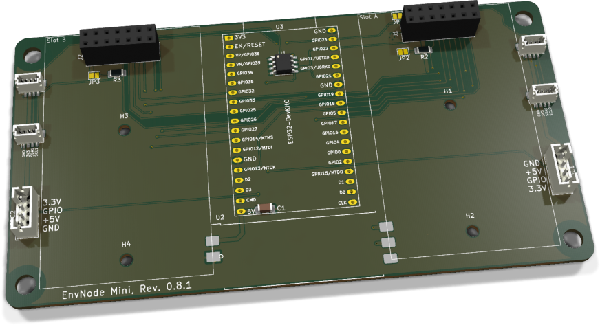
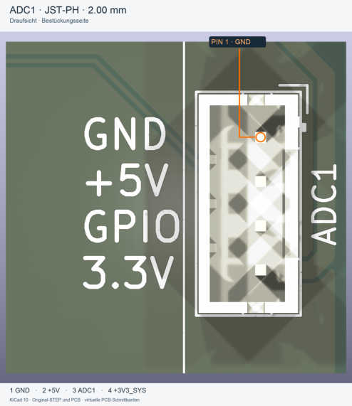

# EnvNode Mini - Bestückung und Inbetriebnahme

ESP32-Mainboard mit zwei Modulslots und zwei direkten ADC-Eingängen. C1 blockt die 5-V-Schiene ab; das Board-EEPROM besitzt keinen separaten Abblockkondensator.

**PCB 0.8.1; Board Identity 0.8.**

[Anleitung als PDF](../../assets/downloads/EnvNode_Mini_Rev0.8.1_Anleitung.pdf){ .md-button }

## 1. Baugruppen und Teile

### 1.1 Elektronische Bestückung

| Ref. | Anz. | Wert / Funktion | EnvNode-Part | Footprint / Hinweis |
| --- | --- | --- | --- | --- |
| C1 | 1 | 100 nF, X7R | ENP-00006 | 1206, Abblockung der +5V-Schiene |
| R1-R4 | 4 | 4,7 kOhm, 1 % | ENP-00005 | 1206, I2C-Pull-ups |
| JP1-JP4 | 4 | Lötjumper, normal offen | - | PCB-Struktur; kein Kaufteil |
| U1 | 1 | 24LC32, Board Identity | ENP-00102 | SOIC-8, I2C0-Adresse 0x50 |
| U2 | 1 | ORing-Power Rev. 0.1 bestückt, gefertigt | ENK-00020 | 39 x 15 mm, castellated Carrier |
| U3 | 1 | ESP32-Entwicklungsboard | ENP-00010 | 38-polig; Pinout und Passform prüfen |
| J1, J2 | 2 | Modulsockel 2 x 7 | ENP-00054 | 2,54 mm, vertikale Buchsenleiste |
| J4-J7 | 4 | JST-SH, 4-polig, top-entry | ENP-00122 | BM04B-SRSS-TB, 1,00 mm |
| ADC1, ADC2 | 2 | JST-PH, 4-polig, vertikal | ENP-00025 | B4B-PH-K, 2,00 mm |
| NT1, NT2 | 2 | Net-Tie | - | PCB-Struktur; kein Kaufteil |

Nicht auf dem Mainboard: Eingangsschutz, 5-V-Eingang, USB und 3,3-V-ORing gehören zum separat dokumentierten ORing-Power-Modul.

### 1.2 Mechanik

| Teil | Anz. | Hinweis |
| --- | --- | --- |
| EnvNode Mini PCB Rev. 0.8.1 | 1 | Titelblock und Silkscreen müssen Rev. 0.8.1 zeigen |
| H1-H4 | 4 | M2,5-Stützpunkte für Tochterplatinen |
| H5-H8 | 4 | 4,5-mm-NPTH für BOX4U-Gehäuse |

Artikelabgleich: 18.10.2026, inventory/parts-preview.json. ENK-00020 gemäß Artikelvorgabe. Lötjumper und Net-Ties sind keine Kaufteile. ESP32-Variante elektrisch und mechanisch prüfen. EnvNode-eigene Inhalte: siehe LICENSE (LicenseRef-EnvNode-Use-and-Redistribution-1.0).

## 2. Bestückungsübersicht

{ .board-view }

| Bereich | Bauteile | Prüfschwerpunkt |
| --- | --- | --- |
| Mitte | U3, U1, C1 | DevKit-Ausrichtung, EEPROM Pin 1, Antennenfreiraum |
| Slot A rechts | J1, R1/R2, JP1/JP2, NT1 | Slot-Adresse, Steckerorientierung |
| Slot B links | J2, R3/R4, JP3/JP4, NT2 | Slot-Adresse, Steckerorientierung |
| Außenkanten | J4-J7 | JST-SH MP-Laschen und 1-mm-Pins |
| Unterkante außen | ADC1, ADC2 | JST-PH, Pin 1 und Kabelbelegung |
| Unterkante Mitte | U2 | Castellations, Fluchtung und Lötbrücken |

Die Referenzen ADC1 und ADC2 bezeichnen die beiden Steckverbinder. Beide Signale gehören intern zum ADC1-Peripherieblock des ESP32: GPIO34 = ADC1_CH6 und GPIO35 = ADC1_CH7.

## 3. Orientierung und Lötreihenfolge

### 3.1 Kritische Orientierung

- ☐ U1: Pin 1 anhand Punkt/Kerbe und PCB-Markierung ausrichten.

- ☐ U3: 38-poliges ESP32-DevKitC ohne Reihenversatz einsetzen; USB-Ende und Antennenseite prüfen.

- ☐ J4-J7: Stecköffnung nach oben; mechanische Pads plan auflegen und vollständig benetzen.

- ☐ ADC1/ADC2: Pin 1 ist GND. Stecköffnung und Kabelbelegung vor dem Verlöten prüfen.

- ☐ U2: Pinfolge und Außenkontur des ORing-Power-Moduls mit dem Carrier-Aufdruck abgleichen.

- ☐ J1/J2: Pin 1, Bestückungsseite und rechtwinklige Ausrichtung kontrollieren.

### 3.2 Empfohlene Reihenfolge

| Schritt | Gruppe | Vorgehen |
| --- | --- | --- |
| 1 | R1-R4, JP1-JP4, NT1/NT2, C1 | Kleine SMD-Teile zuerst; Net-Ties unter Vergrößerung prüfen. |
| 2 | U1 | SOIC-8 ausrichten, einen Pin fixieren, Lage prüfen, fertig löten. |
| 3 | J4-J7 | MP-Pads zuerst fixieren; danach vier Signalpins löten. |
| 4 | ADC1/ADC2 | Plan und rechtwinklig ausrichten; THT-Pins löten. |
| 5 | J1/J2 | Buchsenleisten gerade ausrichten und THT-Pins löten. |
| 6 | U2 | Geprüftes ORing-Power-Modul ausrichten und Castellations verlöten. |
| 7 | U3 | Erst nach passiver und elektrischer Prüfung einsetzen. |

## 4. Anschluss- und Adressbelegung

### 4.1 I2C / Qwiic

| Stecker | Bus | Pin 1 | Pin 2 | Pin 3 | Pin 4 |
| --- | --- | --- | --- | --- | --- |
| J4, J5 | I2C0 | GND | +3V3_SYS | SDA | SCL |
| J6, J7 | I2C1 | GND | +3V3_SYS | SDA | SCL |

JP1-JP4 sind ab Werk offen. Für einen Bus beide zugehörigen Jumper nur schließen, wenn das Mainboard die Pull-up-Verantwortung übernehmen soll.

### 4.2 ADC/GPIO-Anschlüsse

| Stecker | Pin 1 | Pin 2 | Pin 3 | Pin 4 | ESP32-Signal |
| --- | --- | --- | --- | --- | --- |
| ADC1 | GND | +5V | ADC1 | +3V3_SYS | GPIO34 / ADC1_CH6 |
| ADC2 | GND | +5V | ADC2 | +3V3_SYS | GPIO35 / ADC1_CH7 |

GPIO34 und GPIO35 sind reine Eingänge. Sie können nicht als Digitalausgänge oder PWM-Ausgänge verwendet werden und besitzen keine internen Pull-up-/Pull-down-Widerstände.

Der Signaleingang ist nicht 5-V-tolerant. Pin 2 liefert +5 V ausschließlich zur Sensorversorgung; der Sensor-Ausgang an Pin 3 muss im zulässigen 3,3-V-Eingangsbereich bleiben. Pin 4 stellt alternativ +3V3_SYS bereit. +5 V und +3V3_SYS dürfen nicht miteinander verbunden werden.

### 4.3 Identität und Modulslots

| Funktion | Bus / Adresse | Festlegung |
| --- | --- | --- |
| Mainboard U1 | I2C0 / 0x50 | A0=A1=A2=0, WP=GND |
| Slot A Modul-EEPROM | I2C0 / 0x52 | Pin 3 über NT1 an GND |
| Slot B Modul-EEPROM | I2C0 / 0x53 | Pin 3 über NT2 an +3V3_SYS |

## 5. Prüfungen ohne Versorgung

- ☐ Alle SMD- und THT-Lötstellen unter Vergrößerung geprüft.

- ☐ Kein niederohmiger Kurzschluss zwischen +5V und GND.

- ☐ Kein niederohmiger Kurzschluss zwischen +3V3_SYS und GND.

- ☐ Kein Durchgang zwischen +5V und +3V3_SYS an ADC1/ADC2.

- ☐ ADC1/ADC2: Pin 1=GND, Pin 2=+5V, Pin 3=Signal, Pin 4=+3V3_SYS.

- ☐ GPIO34/35-Signalpfade haben Durchgang zwischen U3 und jeweiligem Pin 3.

- ☐ U1 Pin 1 korrekt; A0, A1, A2 und WP haben Durchgang zu GND.

- ☐ NT1 setzt Slot A auf GND; NT2 setzt Slot B auf +3V3_SYS.

- ☐ J4-J7: keine Brücken zwischen den 1-mm-Pads.

- ☐ JP1-JP4 sind offen, sofern nicht anders dokumentiert.

- ☐ U2 sitzt plan; jede Castellation ist sichtbar benetzt.

- ☐ J1/J2 stehen gerade und sind frei von Lötbrücken.

Halbleiter, Kondensatoren und das Power-Modul können zeitabhängige oder richtungsabhängige Widerstandswerte verursachen. Auffällige Messungen mit Polaritätswechsel und Vergleichsmessung bewerten.

## 6. Erstinbetriebnahme

Grundregel: Erste Inbetriebnahme ohne ESP32-DevKitC, Tochterplatinen und externe ADC-Sensoren. Nur eine 5-V-Quelle verwenden. Labornetzteil zunächst auf 5,0 V und etwa 100 mA begrenzen.

### 6.1 Versorgung ohne U3

| Schritt | Aktion / Erwartung |
| --- | --- |
| 1 | 5,0 V über den vorgesehenen Eingang des ORing-Power-Moduls einspeisen. |
| 2 | Bei Strombegrenzung, Erwärmung oder Geruch sofort ausschalten. |
| 3 | +5V am Carrier, an beiden Modulsockeln und ADC1/ADC2 Pin 2 kontrollieren. |
| 4 | +3V3_SYS an U1, J4-J7 Pin 2 und ADC1/ADC2 Pin 4 messen. |
| 5 | ADC1/ADC2 Pin 3 darf ohne Signalquelle keine Überspannung führen. |
| 6 | Ruhestrom dokumentieren und mit einer bekannten guten Baugruppe vergleichen. |

### 6.2 ESP32-DevKitC und ADC-Eingänge

- ☐ Versorgung ausschalten und U3 ohne Reihenversatz einsetzen.

- ☐ Strombegrenzt einschalten; Firmware-Start und +3V3_SYS prüfen.

- ☐ GPIO34 und GPIO35 zunächst als hochohmige Eingänge konfigurieren.

- ☐ Bekannte Signalspannung über Strombegrenzung einspeisen: 0 V, ca. 1,0 V und max. 3,3 V.

- ☐ ADC-Rohwerte und skalierte Werte dokumentieren; keine Spannung über +3V3_SYS anlegen.

- ☐ Bei gleichzeitigem USB-Anschluss ORing-Funktion und fehlenden Rückstrom prüfen.

## 7. Bus-, EEPROM-, Modul- und GPIO-Prüfung

- ☐ I2C0 und I2C1 ohne externe Geräte prüfen; SDA/SCL müssen mit wirksamen Pull-ups HIGH sein.

- ☐ I2C0-Scan: Mainboard-U1 muss auf 0x50 antworten.

- ☐ Gültigen BoardIdentityRecord für Board-Identity-Revision 0.8 schreiben und vollständig zurücklesen.

- ☐ Unbestückte Slots dürfen keine Antwort auf 0x52 oder 0x53 erzeugen.

- ☐ Slot-A-Modul einzeln prüfen: optionaler Modul-EEPROM auf 0x52.

- ☐ Slot-B-Modul einzeln prüfen: optionaler Modul-EEPROM auf 0x53.

- ☐ J4/J5 als I2C0 und J6/J7 als I2C1 mit einem bekannten Testgerät prüfen.

- ☐ ADC1/GPIO34 und ADC2/GPIO35 jeweils mit drei bekannten Spannungswerten prüfen.

- ☐ Offenen Eingang nicht als definierten LOW- oder HIGH-Pegel interpretieren; externe Beschaltung muss einen Pegel vorgeben.

- ☐ Nach jedem Modul Stromaufnahme, +5V und +3V3_SYS erneut kontrollieren.

Module und Kabel nur spannungsfrei einsetzen. Reihenversatz, gedrehte Stecker oder ein falsch belegtes ADC-Kabel können Versorgungsschienen und ESP32-Eingänge beschädigen.

## 8. Messprotokoll

| Prüfpunkt | Soll | Messwert / Bemerkung |
| --- | --- | --- |
| +5V am U2-Carrier | 4,75-5,25 V |  |
| +3V3_SYS ohne U3 | ca. 3,3 V |  |
| ADC1/ADC2 Pin 2 | ca. 5 V |  |
| ADC1/ADC2 Pin 4 | ca. 3,3 V |  |
| ADC1 GPIO34 | 0 / 1 / 3,3 V plausibel |  |
| ADC2 GPIO35 | 0 / 1 / 3,3 V plausibel |  |
| U1 I2C-Adresse | 0x50 |  |
| Slot A / Slot B | 0x52 / 0x53, falls bestückt |  |
| I2C0 / I2C1 | beide Busse funktionsfähig |  |
| Firmware-Start | fehlerfrei |  |

### Seriennummer / Board Identity

| Feld | Eintrag |
| --- | --- |
| BoardProfileId |  |
| Board-Identity-Revision | 0.8 |
| Seriennummer |  |
| Provisioniert am / durch |  |
| CRC / Read-back geprüft |  |

## 9. Freigabegrenzen und Abschluss

Die bestandene KiCad-Konsistenzprüfung und dieses Bring-up sind keine Serien- oder Produktfreigabe. Fertigungsdaten, Artikelstamm, thermische Reserven, EMV, ESD, Dauerlauf, Gehäuseintegration und der Leistungsbedarf der vorgesehenen Module und Sensoren bleiben zu qualifizieren.

| Prüfung | Ergebnis Rev. 0.8 |
| --- | --- |
| Schematic ERC | 0 Fehler, 0 Warnungen |
| PCB DRC | 0 aktive Verletzungen; 18 dokumentierte Ausschlüsse |
| Offene Verbindungen | 0 |
| Schaltplan-PCB-Parität | 0 Abweichungen |
| Visuelle PCB-Prüfung | ADC-Stecker, Routing, Außenkontur und Slotbereiche plausibel |
| Physischer Bring-up | für Revision 0.8 noch durchzuführen |

Die 18 ausgeschlossenen DRC-Befunde betreffen bekannte Courtyard-Überlappungen unter dem ESP32 sowie Silkscreen-/Soldermask-Konflikte an DesignBlock-Grenzen und Steckverbindern. Keine davon betrifft Kupferabstand, Netzkonnektivität oder die neuen ADC-Signale.

### 9.1 Revisionsnachweis

| Quelle | SHA-256 |
| --- | --- |
| EnvNode Mini.kicad_pcb | `2e364ea20551036751df5349409bbd5b25c72e8f0e5c8e0cb863ebe0561dfbbf` |
| EnvNode Mini.kicad_sch | `78fa1c97c988f2115f3457a907520ab12068aeb523717326baaf04e4c8b47e57` |
| EnvNode Mini.kicad_pro | `603dabfd1a7ad8409fda4197f8eaa18cf53902ab3ce4011e0492460370ac20da` |
| ADC.kicad_sch | `ff48076ff5b82145a34fdf95a253e811a9e1ee4cfc0862605f8838f099209a8e` |
| ESP32Core.kicad_sch | `40aa71dcac9cbd5451ee75570263b55051d8e4af0149612679af53c101b425f4` |

Quellenstand: PCB Revision 0.8.1 vom 18. Oktober 2026. Renderings und SHA-256 oben beziehen sich auf diesen Stand. Die Prüfergebnisse oben stammen vom 29. September 2026 (Rev. 0.8); kein neuer ERC/DRC-Lauf. Board Identity bleibt 0.8; keine Neuprovisionierung. Patch: Steckerbeschriftung, keine elektrische oder mechanische Änderung.

## JST-PH / ADC und GPIO

Die beiden Mini-Ausschnitte ADC1 und J5 dienen als Referenz für alle entsprechenden vierpoligen JST-PH- und JST-SH-Anschlüsse auf Mini und Weather. Signal, Bus, Referenzname und Einbaurichtung richten sich nach dem jeweiligen Anschluss.

{ .connector-view }
{ .connector-view }

| Pin | Signal |
| --- | --- |
| 1 | GND |
| 2 | +5V (Sensorversorgung) |
| 3 | ADC- bzw. GPIO-Signal |
| 4 | +3V3_SYS |

JST-PH B4B-PH-K, Raster 2,00 mm. In der gezeigten Draufsicht: Pin 1 oben, Pin 4 unten. Der orange Kreis markiert den ersten Steckkontakt. Der Original-Silkscreen GPIO bezeichnet hier das Mini-ADC1-Signal an GPIO34.

Mini: ADC1 und ADC2. Weather: ADC1 bis ADC4 sowie GPIO14, GPIO16, GPIO17, GPIO27, GPIO32 und GPIO4. Die 5-V-Versorgung erlaubt keinen 5-V-Signalpegel am ESP32; die Grenzen des jeweiligen Eingangs gelten weiterhin.

Ansicht von der Bestückungsseite, nicht von der Kontaktseite eines Kabelsteckers. Bei gedrehten Anschlüssen Pin 1 am tatsächlichen Footprint zuordnen. Der zweipolige ORing-Power-Eingang ist von dieser Referenz nicht erfasst.

Originale PCB-/STEP-Daten, virtuelle PCB-Schnittkanten. Mini-Pins gegen PCB und Schaltplan geprüft.

Alle entsprechenden Mini-/Weather-Padbelegungen verglichen; historische Prüfstände bleiben erhalten.

EnvNode: siehe Root-Lizenz LICENSE. Modelle: Rene Poeschl (2017), KiCAD (2025), CC BY-SA 4.0 mit KiCad-Ausnahme.

## JST-SH / I2C

Die beiden Mini-Ausschnitte ADC1 und J5 dienen als Referenz für alle entsprechenden vierpoligen JST-PH- und JST-SH-Anschlüsse auf Mini und Weather. Signal, Bus, Referenzname und Einbaurichtung richten sich nach dem jeweiligen Anschluss.

{ .connector-view }
{ .connector-view }

| Pin | Signal |
| --- | --- |
| 1 | GND |
| 2 | +3V3_SYS |
| 3 | SDA des jeweiligen I2C-Busses |
| 4 | SCL des jeweiligen I2C-Busses |

JST-SH BM04B-SRSS-TB, Raster 1,00 mm. In der gezeigten Draufsicht: Pin 1 links, Pin 4 rechts. Der orange Kreis markiert den ersten Lötanschluss. J5 gehört zu I2C0 (SDA0/SCL0); an I2C1 gilt die gleiche Folge für SDA1/SCL1. Die seitlichen Metalllaschen sind mechanische Befestigungen, keine Signalpins.

Mini: J4/J5 auf I2C0 und J6/J7 auf I2C1. Weather: I2C0_1 bis I2C0_4 und I2C1_1 bis I2C1_4. Die Draufsicht zeigt auch die Referenz J5; in der Schrägansicht wird diese durch das Gehäuse verdeckt.

Ansicht von der Bestückungsseite, nicht von der Kontaktseite eines Kabelsteckers. Bei gedrehten Anschlüssen Pin 1 am tatsächlichen Footprint zuordnen. Der zweipolige ORing-Power-Eingang ist von dieser Referenz nicht erfasst.

Originale PCB-/STEP-Daten, virtuelle PCB-Schnittkanten. Mini-Pins gegen PCB und Schaltplan geprüft.

Alle entsprechenden Mini-/Weather-Padbelegungen verglichen; historische Prüfstände bleiben erhalten.

EnvNode: siehe Root-Lizenz LICENSE. Modelle: Rene Poeschl (2017), KiCAD (2025), CC BY-SA 4.0 mit KiCad-Ausnahme.

### Lizenz

EnvNode-eigene Inhalte: LicenseRef-EnvNode-Use-and-Redistribution-1.0; siehe [Lizenz](../../license.md). Rechte an Drittanbieter-Modellen und sonstigen Fremdinhalten bleiben bestehen.
