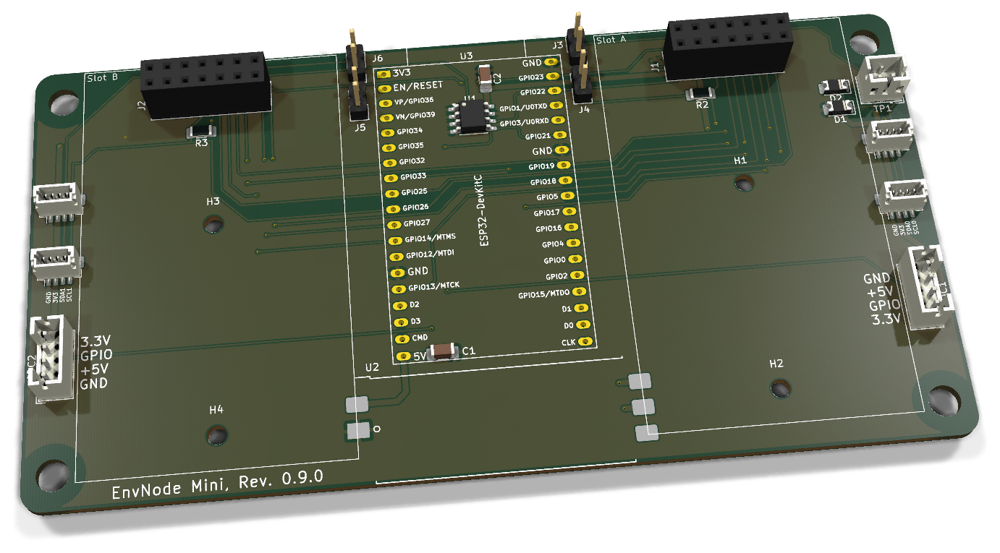
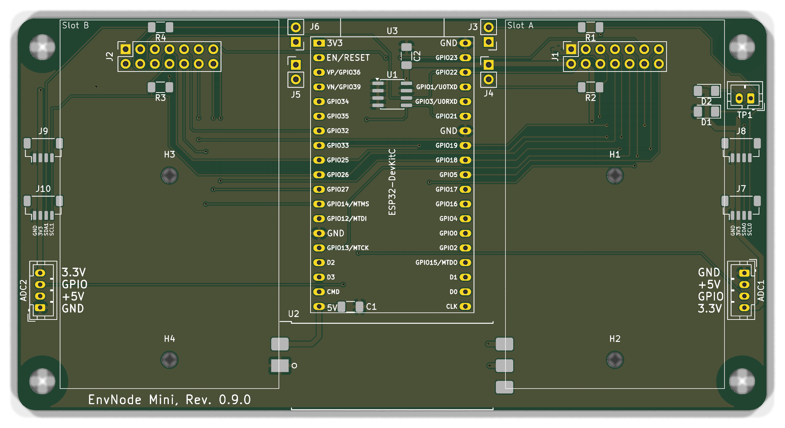

# EnvNode Mini - Bestückung und Inbetriebnahme

ESP32-Mainboard mit zwei Modulslots und zwei direkten ADC-Eingängen. C1 blockt die 5-V-Schiene ab; das Board-EEPROM wird zusätzlich durch C2 (100 nF) an +3V3_SYS abgeblockt.

**PCB 0.9.0; Board Identity 0.9.**

[Anleitung als PDF](../../assets/downloads/EnvNode_Mini_Rev0.9.0_Anleitung.pdf){ .md-button }

[Produktübersicht](overview.md){ .md-button }
[Alte Revisionen](old-revisions.md){ .md-button }

### Änderungen gegenüber 0.8.1

- **TP1:** zweipoliger Referenzanschluss für den spannungsfreien Mainboardtest, über D1/D2 von GND und +3V3_SYS entkoppelt.
- **Steckbare Pull-up-Jumper J3-J6:** abnehmbare Kappen statt bisheriger Lötjumper. Es sind Pull-ups nach +3V3_SYS, keine Pull-downs.
- **C2:** 100 nF zur lokalen Abblockung der 3,3-V-EEPROM-Versorgung; C1 bleibt an +5V.
- **I²C-Stecker:** jetzt J7/J8 für I2C0 und J9/J10 für I2C1; J3-J6 gehören zu den Pull-ups.

**Dokumentation abgeschlossen am 28. Oktober 2026.**

## 3D-Ansicht

{ .hero-board-view }

Vorderseite (F.Cu); die Rückseite trägt keine separat zu bestückenden Bauteile. Nicht hinterlegte 3D-Modelle bleiben ausgespart. Die Bestückungspläne folgen im Abschnitt zur Bestückungsübersicht.

## 1. Baugruppen und Teile

### 1.1 Elektronische Bestückung

| Ref. | Anz. | Wert / Funktion | EnvNode-Part | Footprint / Hinweis |
| --- | --- | --- | --- | --- |
| C1, C2 | 2 | 100 nF, X7R | ENP-00006 | 1206; C1: +5V, C2: +3V3_SYS |
| R1-R4 | 4 | 4,7 kOhm, 1 % | ENP-00005 | 1206, I2C-Pull-ups |
| J3-J6 | 4 | Pull-up-Leiste 1×2 + Kappe | ENP-00145 / ENP-00101 | 2,54 mm; 8 Kontakte + 4 Kappen |
| D1, D2 | 2 | 1N4148W, Testreferenz | ENP-00033 | SOD-123 auf D_1206-Pads; Passform siehe TP1 |
| TP1 | 1 | Testreferenz 1×2 | ENP-00132 | JST-PH, 2,00 mm |
| U1 | 1 | 24LC32, Board Identity | ENP-00102 | SOIC-8, I2C0-Adresse 0x50 |
| U2 | 1 | ORing-Power Rev. 0.1 bestückt, gefertigt | ENK-00020 | 39 x 15 mm, castellated Carrier |
| U3 | 1 | ESP32-Entwicklungsboard | ENP-00010 | 38-polig; Pinout und Passform prüfen |
| J1, J2 | 2 | Modulsockel 2 x 7 | ENP-00054 | 2,54 mm, vertikale Buchsenleiste |
| J7-J10 | 4 | JST-SH, 4-polig, top-entry | ENP-00122 | BM04B-SRSS-TB, 1,00 mm |
| ADC1, ADC2 | 2 | JST-PH, 4-polig, vertikal | ENP-00025 | B4B-PH-K, 2,00 mm |
| NT1, NT2 | 2 | Net-Tie | - | PCB-Struktur; kein Kaufteil |
| PCB | 1 | EnvNode Mini 0.9.0 | ENP-00160 | Revisionsgebundene Platine |
| U3-Sockel | 2 | DevKit-Sockel 1×19 | ENP-00004 | Aus 1×20 auf 19 kürzen |

Nicht auf dem Mainboard: Eingangsschutz, 5-V-Eingang, USB und 3,3-V-ORing gehören zum separat dokumentierten ORing-Power-Modul.

### 1.2 Mechanik

| Teil | Anz. | Hinweis |
| --- | --- | --- |
| EnvNode Mini PCB Rev. 0.9.0 | 1 | Titelblock und Silkscreen müssen Rev. 0.9.0 zeigen |
| H1-H4 | 4 | M2,5-Stützpunkte für Tochterplatinen |
| H5-H8 | 4 | 4,5-mm-NPTH für BOX4U-Gehäuse |

Den tatsächlich bestückten ORing-Modulstand im Protokoll erfassen. Jumperleisten und Kappen sind Kaufteile; Net-Ties sind PCB-Strukturen. ESP32-Variante elektrisch und mechanisch prüfen. EnvNode-eigene Inhalte: siehe LICENSE (LicenseRef-EnvNode-Use-and-Redistribution-1.0).

## 2. Bestückungsübersicht

### Vorderseite: Bestückungsplan

{ .assembly-plan }

[Plan als PNG](../../assets/board-views/mini-0.9.0/assembly-front.png){ .md-button }

Senkrechtes KiCad-Rendering der Leiterplatte ohne Bauteilmodelle. Kupfer, Lötstoppmaske und Bestückungsdruck entsprechen der PCB-Quelle. Rückseitenpläne werden von B.Cu aus betrachtet.

Die Bestückungspläne zeigen die Leiterplatte senkrecht zur jeweiligen Seite. Bestückungsdruck und Referenzen folgen der PCB-Quelle; eine Rückseitenansicht ist keine Kontaktansicht eines Kabelsteckers.

| Bereich | Bauteile | Prüfschwerpunkt |
| --- | --- | --- |
| Mitte | U3, U1, C1 | DevKit-Ausrichtung, EEPROM Pin 1, Antennenfreiraum |
| Slot A rechts | J1, R1/R2, J3/J4, NT1 | Slot-Adresse, Steckerorientierung |
| Slot B links | J2, R3/R4, J5/J6, NT2 | Slot-Adresse, Steckerorientierung |
| Außenkanten | J7-J10 | JST-SH MP-Laschen und 1-mm-Pins |
| Unterkante außen | ADC1, ADC2 | JST-PH, Pin 1 und Kabelbelegung |
| Unterkante Mitte | U2 | Castellations, Fluchtung und Lötbrücken |

Die Referenzen ADC1 und ADC2 bezeichnen die beiden Steckverbinder. Beide Signale gehören intern zum ADC1-Peripherieblock des ESP32: GPIO34 = ADC1_CH6 und GPIO35 = ADC1_CH7.

## 3. Orientierung und Lötreihenfolge

### 3.1 Kritische Orientierung

- ☐ U1: Pin 1 anhand Punkt/Kerbe und PCB-Markierung ausrichten.

- ☐ U3: 38-poliges ESP32-DevKitC ohne Reihenversatz einsetzen; USB-Ende und Antennenseite prüfen.

- ☐ J7-J10: Stecköffnung nach oben; mechanische Pads plan auflegen und vollständig benetzen.

- ☐ ADC1/ADC2: Pin 1 ist GND. Stecköffnung und Kabelbelegung vor dem Verlöten prüfen.

- ☐ U2: Pinfolge und Außenkontur des ORing-Power-Moduls mit dem Carrier-Aufdruck abgleichen.

- ☐ J1/J2: Pin 1, Bestückungsseite und rechtwinklige Ausrichtung kontrollieren.

### 3.2 Empfohlene Reihenfolge

| Schritt | Gruppe | Vorgehen |
| --- | --- | --- |
| 1 | R1-R4, J3-J6, NT1/NT2, C1/C2, D1/D2 | Kleine SMD-Teile zuerst; Net-Ties unter Vergrößerung prüfen. |
| 2 | U1 | SOIC-8 ausrichten, einen Pin fixieren, Lage prüfen, fertig löten. |
| 3 | J7-J10 | MP-Pads zuerst fixieren; danach vier Signalpins löten. |
| 4 | ADC1/ADC2 | Plan und rechtwinklig ausrichten; THT-Pins löten. |
| 5 | J1/J2 | Buchsenleisten gerade ausrichten und THT-Pins löten. |
| 6 | U2 | Geprüftes ORing-Power-Modul ausrichten und Castellations verlöten. |
| 7 | U3 | Erst nach passiver und elektrischer Prüfung einsetzen. |

## 4. Anschluss- und Adressbelegung

### 4.1 I2C / Qwiic

| Stecker | Bus | Pin 1 | Pin 2 | Pin 3 | Pin 4 |
| --- | --- | --- | --- | --- | --- |
| J7, J8 | I2C0 | GND | +3V3_SYS | SDA | SCL |
| J9, J10 | I2C1 | GND | +3V3_SYS | SDA | SCL |

J3-J6 bleiben für die Erstprüfung ohne Kappen. Für einen Bus beide zugehörigen Jumperkappen nur aufsetzen, wenn das Mainboard die Pull-up-Verantwortung übernehmen soll.

### 4.2 ADC/GPIO-Anschlüsse

| Stecker | Pin 1 | Pin 2 | Pin 3 | Pin 4 | ESP32-Signal |
| --- | --- | --- | --- | --- | --- |
| ADC1 | GND | +5V | ADC1 | +3V3_SYS | GPIO34 / ADC1_CH6 |
| ADC2 | GND | +5V | ADC2 | +3V3_SYS | GPIO35 / ADC1_CH7 |

GPIO34 und GPIO35 sind reine Eingänge. Sie können nicht als Digitalausgänge oder PWM-Ausgänge verwendet werden und besitzen keine internen Pull-up-/Pull-down-Widerstände.

Der Signaleingang ist nicht 5-V-tolerant. Pin 2 liefert +5 V ausschließlich zur Sensorversorgung; der Sensor-Ausgang an Pin 3 muss im zulässigen 3,3-V-Eingangsbereich bleiben. Pin 4 stellt alternativ +3V3_SYS bereit. +5 V und +3V3_SYS dürfen nicht miteinander verbunden werden.

### 4.3 Identität und Modulslots

| Funktion | Bus / Adresse | Festlegung |
| --- | --- | --- |
| Mainboard U1 | I2C0 / 0x50 | A0=A1=A2=0, WP=GND |
| Slot A Modul-EEPROM | I2C0 / 0x52 | Pin 3 über NT1 an GND |
| Slot B Modul-EEPROM | I2C0 / 0x53 | Pin 3 über NT2 an +3V3_SYS |

### Steckbare I²C-Pull-ups

| Kappe | Widerstand | Leitung |
| --- | --- | --- |
| J3 | R1, 4,7 kΩ | I2C0_SCL |
| J4 | R2, 4,7 kΩ | I2C0_SDA |
| J5 | R3, 4,7 kΩ | I2C1_SCL |
| J6 | R4, 4,7 kΩ | I2C1_SDA |

Ohne Kappe ist der jeweilige Pull-up getrennt. Die beiden Kappen eines Busses gemeinsam setzen, wenn dort keine ausreichenden externen Pull-ups vorhanden sind. Nur spannungsfrei umstecken.

## TP1: Referenzen für den Testadapter

| TP1-Pin | Verbindung am Mainboard | Erwartung im Diodentest |
| --- | --- | --- |
| 1 | D1-Kathode; D1-Anode an GND | Rot an GND, Schwarz an TP1.1: Durchlassrichtung |
| 2 | D2-Kathode; D2-Anode an +3V3_SYS | Rot an +3V3_SYS, Schwarz an TP1.2: Durchlassrichtung |

TP1 ist **kein Versorgungseingang** und kein direkter Masseanschluss. Nur mit ausgeschaltetem, vollständig abgetrenntem DUT und entferntem DUT-DevKit testen; das separate Provisioning-Kabel bleibt abgezogen. Messstromrichtung und Diodenabfall im Testprofil berücksichtigen. Pin 1 wird mit MB_GND, Pin 2 mit MB_3V3_SYS des Input-Adapters verbunden. Gegenrichtung und Fremdversorgung sind nicht durch eine reine Durchgangsprüfung qualifiziert.

C2 zwischen +3V3_SYS und GND sowie die Orientierung von D1/D2 vor Einschalten prüfen. Der zugeordnete Einkaufsartikel ENP-00033 hat SOD-123; die CAD-Pads heißen D_1206. Passform und Kathodenlage vor dem Löten am realen Bauteil bestätigen.

## 5. Prüfungen ohne Versorgung

- ☐ Alle SMD- und THT-Lötstellen unter Vergrößerung geprüft.

- ☐ Kein niederohmiger Kurzschluss zwischen +5V und GND.

- ☐ Kein niederohmiger Kurzschluss zwischen +3V3_SYS und GND.

- ☐ Kein Durchgang zwischen +5V und +3V3_SYS an ADC1/ADC2.

- ☐ ADC1/ADC2: Pin 1=GND, Pin 2=+5V, Pin 3=Signal, Pin 4=+3V3_SYS.

- ☐ GPIO34/35-Signalpfade haben Durchgang zwischen U3 und jeweiligem Pin 3.

- ☐ U1 Pin 1 korrekt; A0, A1, A2 und WP haben Durchgang zu GND.

- ☐ NT1 setzt Slot A auf GND; NT2 setzt Slot B auf +3V3_SYS.

- ☐ J7-J10: keine Brücken zwischen den 1-mm-Pads.

- ☐ J3-J6 sind ohne Kappen, sofern nicht anders dokumentiert.

- ☐ U2 sitzt plan; jede Castellation ist sichtbar benetzt.

- ☐ J1/J2 stehen gerade und sind frei von Lötbrücken.

Halbleiter, Kondensatoren und das Power-Modul können zeitabhängige oder richtungsabhängige Widerstandswerte verursachen. Auffällige Messungen mit Polaritätswechsel und Vergleichsmessung bewerten.

## 6. Erstinbetriebnahme

Grundregel: Erste Inbetriebnahme ohne ESP32-DevKitC, Tochterplatinen und externe ADC-Sensoren. Nur eine 5-V-Quelle verwenden. Labornetzteil zunächst auf 5,0 V und etwa 100 mA begrenzen.

### 6.1 Versorgung ohne U3

| Schritt | Aktion / Erwartung |
| --- | --- |
| 1 | 5,0 V über den vorgesehenen Eingang des ORing-Power-Moduls einspeisen. |
| 2 | Bei Strombegrenzung, Erwärmung oder Geruch sofort ausschalten. |
| 3 | +5V am Carrier, an beiden Modulsockeln und ADC1/ADC2 Pin 2 kontrollieren. |
| 4 | +3V3_SYS an U1, J7-J10 Pin 2 und ADC1/ADC2 Pin 4 messen. |
| 5 | ADC1/ADC2 Pin 3 darf ohne Signalquelle keine Überspannung führen. |
| 6 | Ruhestrom dokumentieren und mit einer bekannten guten Baugruppe vergleichen. |

### 6.2 ESP32-DevKitC und ADC-Eingänge

- ☐ Versorgung ausschalten und U3 ohne Reihenversatz einsetzen.

- ☐ Strombegrenzt einschalten; Firmware-Start und +3V3_SYS prüfen.

- ☐ GPIO34 und GPIO35 zunächst als hochohmige Eingänge konfigurieren.

- ☐ Bekannte Signalspannung über Strombegrenzung einspeisen: 0 V, ca. 1,0 V und max. 3,3 V.

- ☐ ADC-Rohwerte und skalierte Werte dokumentieren; keine Spannung über +3V3_SYS anlegen.

- ☐ Bei gleichzeitigem USB-Anschluss ORing-Funktion und fehlenden Rückstrom prüfen.

## 7. Bus-, EEPROM-, Modul- und GPIO-Prüfung

- ☐ I2C0 und I2C1 ohne externe Geräte prüfen; SDA/SCL müssen mit wirksamen Pull-ups HIGH sein.

- ☐ I2C0-Scan: Mainboard-U1 muss auf 0x50 antworten.

- ☐ Gültigen BoardIdentityRecord für Board-Identity-Revision 0.9 schreiben und vollständig zurücklesen.

- ☐ Unbestückte Slots dürfen keine Antwort auf 0x52 oder 0x53 erzeugen.

- ☐ Slot-A-Modul einzeln prüfen: optionaler Modul-EEPROM auf 0x52.

- ☐ Slot-B-Modul einzeln prüfen: optionaler Modul-EEPROM auf 0x53.

- ☐ J7/J8 als I2C0 und J9/J10 als I2C1 mit einem bekannten Testgerät prüfen.

- ☐ ADC1/GPIO34 und ADC2/GPIO35 jeweils mit drei bekannten Spannungswerten prüfen.

- ☐ Offenen Eingang nicht als definierten LOW- oder HIGH-Pegel interpretieren; externe Beschaltung muss einen Pegel vorgeben.

- ☐ Nach jedem Modul Stromaufnahme, +5V und +3V3_SYS erneut kontrollieren.

Module und Kabel nur spannungsfrei einsetzen. Reihenversatz, gedrehte Stecker oder ein falsch belegtes ADC-Kabel können Versorgungsschienen und ESP32-Eingänge beschädigen.

## 8. Messprotokoll

| Prüfpunkt | Soll | Messwert / Bemerkung |
| --- | --- | --- |
| +5V am U2-Carrier | 4,75-5,25 V |  |
| +3V3_SYS ohne U3 | ca. 3,3 V |  |
| ADC1/ADC2 Pin 2 | ca. 5 V |  |
| ADC1/ADC2 Pin 4 | ca. 3,3 V |  |
| ADC1 GPIO34 | 0 / 1 / 3,3 V plausibel |  |
| ADC2 GPIO35 | 0 / 1 / 3,3 V plausibel |  |
| U1 I2C-Adresse | 0x50 |  |
| Slot A / Slot B | 0x52 / 0x53, falls bestückt |  |
| I2C0 / I2C1 | beide Busse funktionsfähig |  |
| Firmware-Start | fehlerfrei |  |

### Seriennummer / Board Identity

| Feld | Eintrag |
| --- | --- |
| BoardProfileId |  |
| Board-Identity-Revision | 0.9 (passendes Profil erforderlich) |
| Seriennummer |  |
| Provisioniert am / durch |  |
| CRC / Read-back geprüft |  |

## 9. Abschluss und Prüfstand

Die Aufbauanleitung für PCB 0.9.0 ist redaktionell abgeschlossen. Quellen und Renderings beziehen sich auf den gespeicherten KiCad-Stand. Kein neuer ERC-/DRC-Lauf oder physischer Bring-up; frühere Prüfergebnisse bleiben historisch.

| Freigabeschritt | Eintrag |
| --- | --- |
| PCB-Revision / Seriennummer | |
| Versorgung ohne DevKit geprüft | |
| C1 und C2 / EEPROM 0x50 geprüft | |
| Pull-up-Kappenstellung beider Busse | |
| TP1-Diodenprüfung | |
| ADC-, I²C- und Modultest | |
| Aufbau geprüft am / durch | |

Board Identity: Für den neuen funktionalen Hardwarestand ist die Revisionszuordnung **0.9** vorgesehen. Einen passenden freigegebenen Descriptor bzw. ein passendes Boardprofil verwenden; diese Anleitung implementiert oder bestätigt kein neues Firmwareprofil. Die vollständige Patchrevision 0.9.0 bleibt im Hardwareprotokoll erhalten.

Elektrische Last-, Temperatur-, EMV-, ESD- und Fertigungsprüfungen werden durch den redaktionellen Abschluss nicht ersetzt.

### Quellenstand

KiCad-Arbeitsstand `main`, Basiscommit `ff90660`; die SHA-256 bestimmen die dokumentierten Dateien einschließlich lokaler Änderungen.

| Quelle | SHA-256 |
| --- | --- |
| ADC.kicad_sch | `ff48076ff5b82145a34fdf95a253e811a9e1ee4cfc0862605f8838f099209a8e` |
| ESP32Core.kicad_sch | `bf94fd4b7574112858502d14253b375606cfb2127f8e3209d7c1e6a214dbca3c` |
| EnvNode Mini.kicad_pcb | `dedcc65f34321b88156fd7b93a440469cc25cc61f6da9eb185e67ea6d8039105` |
| EnvNode Mini.kicad_pro | `a661c4137794305c178d1c2fb949855dc6e34a1d8023b7b6eb5cf200f9dab77a` |
| EnvNode Mini.kicad_sch | `45d7af2e59a0f6668a6372a5ece9d94c20ad248f669ff8589a1a6c61c9e9a178` |
| PCB.kicad_sch | `ed19908459ebba8a0c0957a70928c7e5f7a28a7906c4574dc2a22a69e9126551` |
| Power.kicad_sch | `e31c045d9ccf359a5704e7f459512f885d122886f80038bd971eea93a1a3da0a` |
| SlotA.kicad_sch | `6acc11c48da4dce5fd633a443f920c35c617c4472b92fc866cc63f65c99d06f2` |
| SlotB.kicad_sch | `649abacbdd409d99a35778051c58a5466877563ed6fda753ce3fb25c828c579d` |

[Rendernachweis](../../assets/images/mini-0.9.0/provenance.json). Dokumentation: LicenseRef-EnvNode-Use-and-Redistribution-1.0, siehe [Lizenz](../../license.md). Drittanbieterrechte an KiCad-Modellen und Bibliotheken bleiben bestehen.
