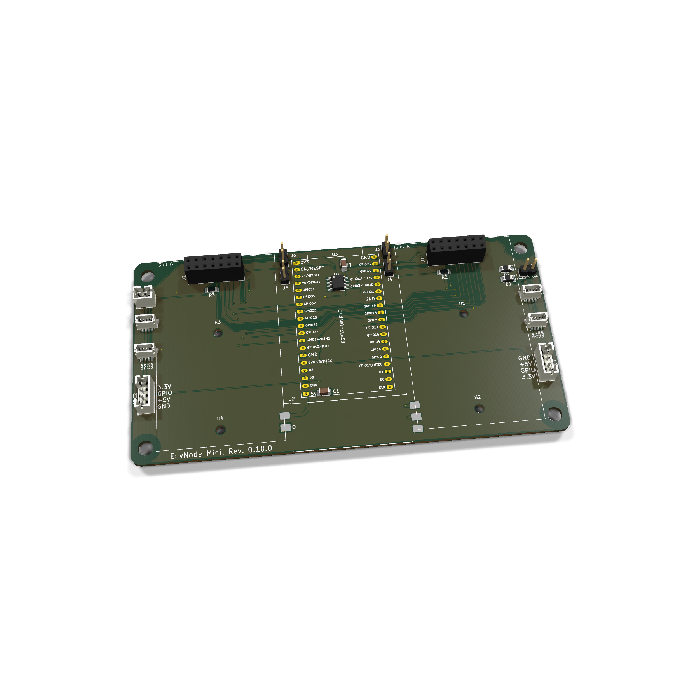

# EnvNode Mini 0.10.0

Aktueller gespeicherter CAD-Stand mit **RST1**, zweipoligem JST-PH:
**Pin 1 GND, Pin 2 EN/CHIP_PU**. Ein Schließertaster setzt den gesteckten ESP32
zurück; bei dauerhaft geschlossenem Kontakt bleibt er deaktiviert.

Die Darstellung ist ein Beispielaufbau; nicht hinterlegte 3D-Modelle werden nicht erfunden.

Zwei Modulslots J1/J2; I²C-Anschlüsse J7–J10. Geerdete JST-SH-Haltepads und verschobener EEPROM-Net-Tie bleiben berücksichtigt.

Die direkte EEPROM-Abblockung C2 (100 nF), steckbare I²C-Pull-ups und die
diodengeschützten TP1-Referenzkontakte sind vorhanden. Versorgung, Modul-GPIOs
und I²C-Signalzuordnung bleiben gegenüber der vorherigen Revision gleich.

## Firmware und Prüfung

- Eigene Prüf-/Provisioningidentität: `mini-0.10-pcb0.10.0`.
- Normale Firmware ab **0.8.11**, Test-Firmware ab **0.15.0**.
- Reset-Pigtail am Controller 0.2 mit gleicher GND/EN-Pinfolge; 1:1-Kabel.
- Weiterhin 38 Sockelpins und zwei Referenzeingänge, insgesamt 40 Inputs.
- RST1 wird gegen den EN-Sockelpin 2 und die GND-Kontakte geprüft;
  dafür sind keine zusätzlichen Eingänge nötig.

KiCad 10.0.5, 9. November 2026: ERC 0, DRC 0, keine offenen Verbindungen und
keine Abweichungen zum Schaltplan. Dateigebundene Prüfprotokolle liegen im
Projektverzeichnis unter `Documentation/Validation-0.10.0.json`.
**Die physische Abnahme dieser Revision steht noch aus.**

[Ältere Bestückungsanleitung und Grundlagen](../assembly.md) ·
[Testhardware und Selbsttests](../../../firmware/test-provisioning/hardwareprofile.md)

Die ältere Anleitung zeigt einen historischen Bestückungs- und Beschriftungsstand;
RST1 und die hier genannten neuen Referenzen sind dort noch nicht dargestellt.
