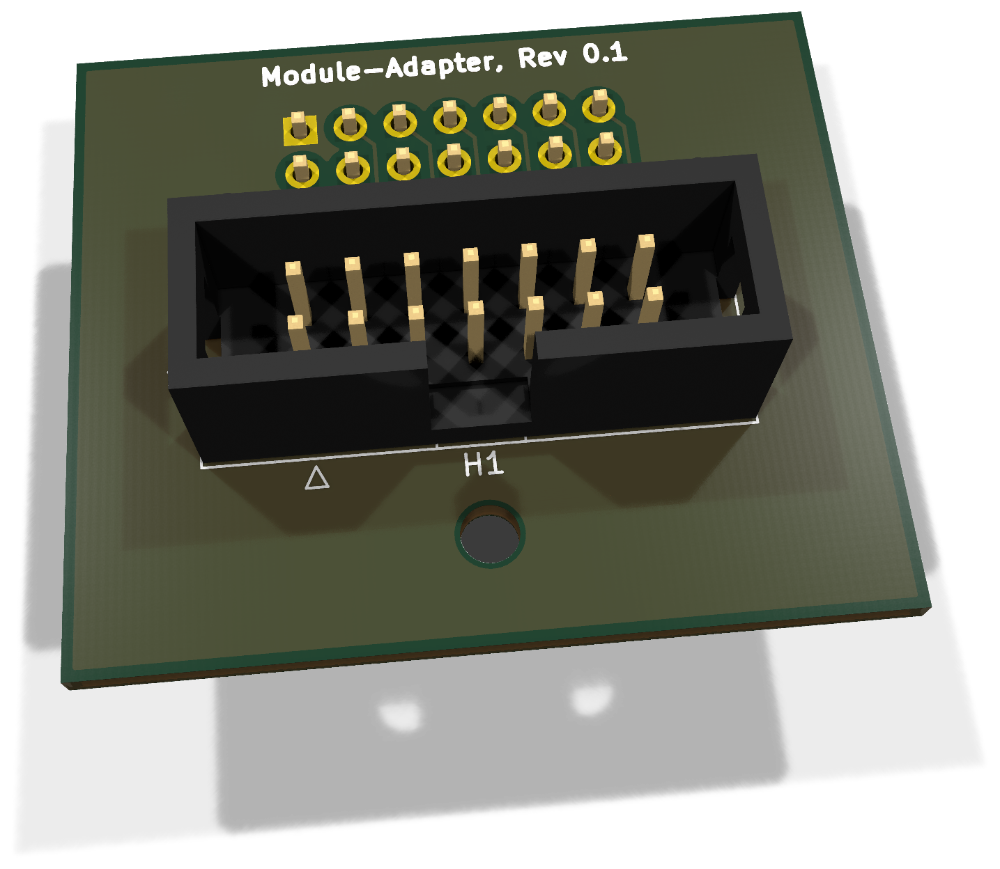
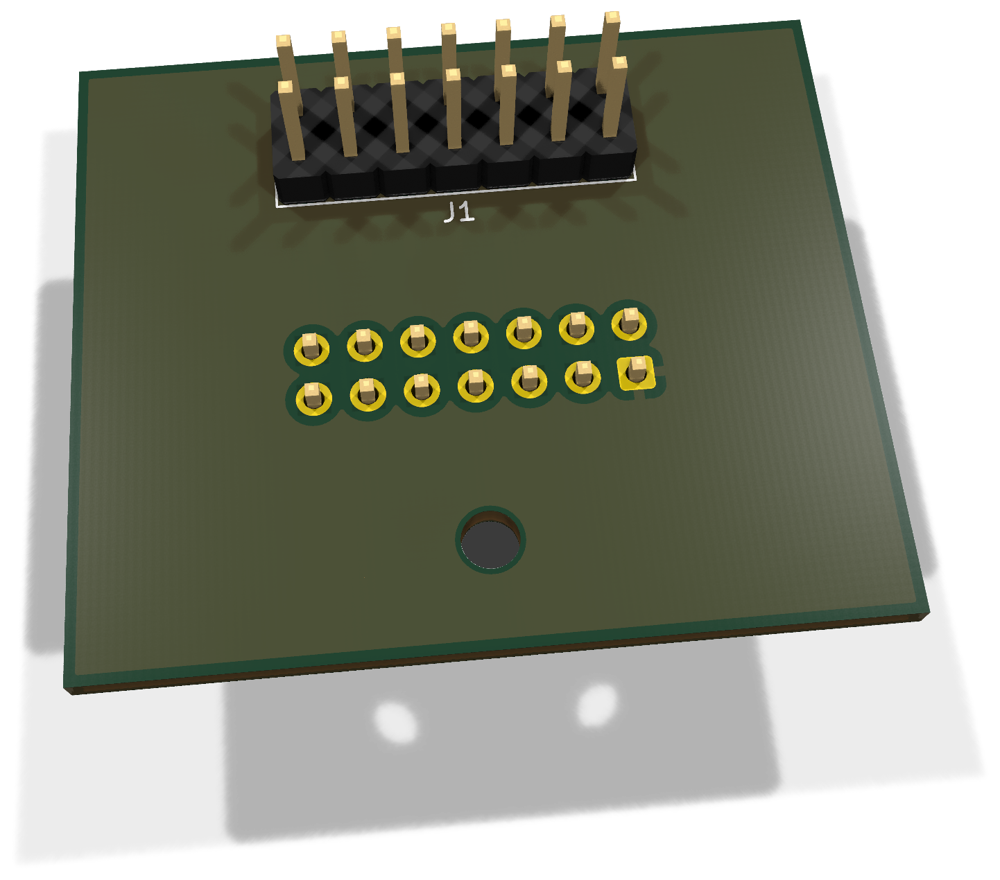
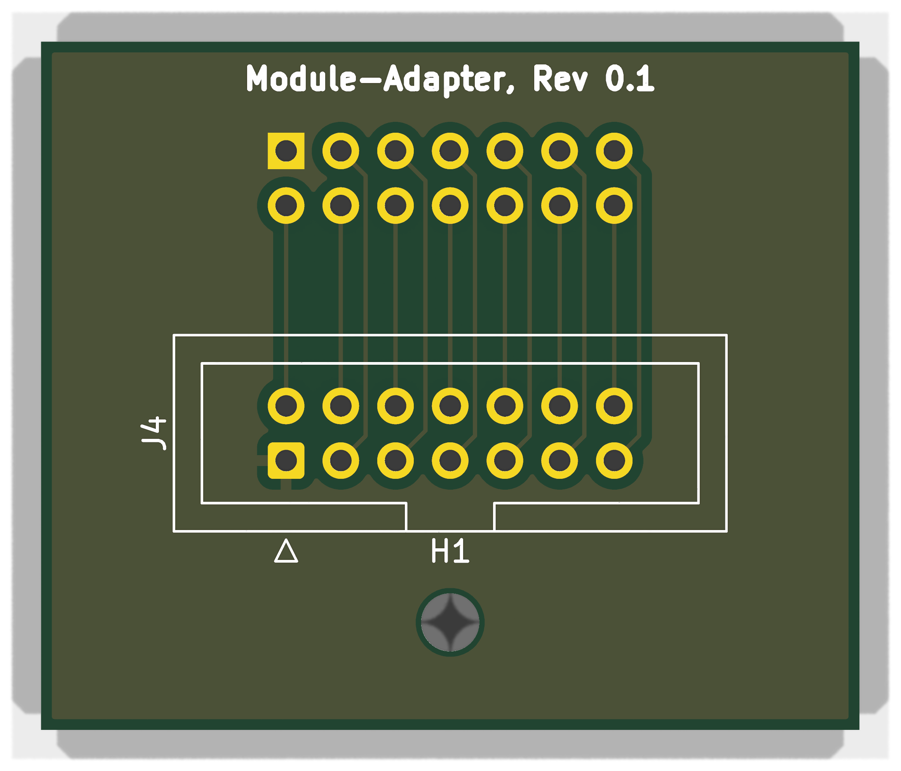
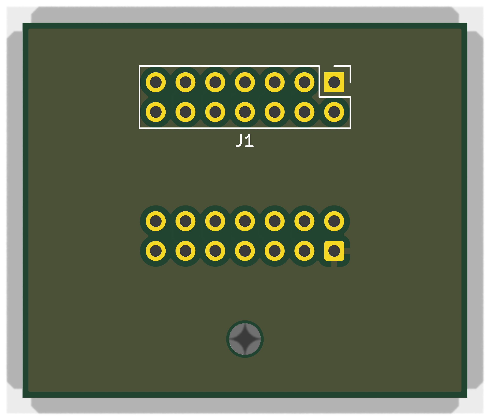

# Modul-Adapter 0.1 - Bestückung und Inbetriebnahme

Passiver 14-poliger Adapter zwischen Test-Controller J3 und dem DUT-Modulslot. Kein funktionales Sensormodul, kein EEPROM und keine lokale Versorgung: J4.n ist direkt mit J1.n verbunden.

**Dokumentation abgeschlossen am 28. Oktober 2026.** Der Fertigungs- und Erprobungsstand wird im Abschlusskapitel getrennt geführt.

[Anleitung als PDF](../../assets/downloads/Module_Adapter_Rev0.1_Anleitung.pdf){ .md-button }
[Alte Revisionen](old-revisions.md){ .md-button }

!!! warning "DUT nur spannungsfrei testen"
    Vor dem Kontaktieren alle DUT-Versorgungen und USB-Verbindungen trennen, den ESP32 aus dem DUT ziehen und das separate Provisioning-Kabel abziehen. Der Test Controller darf für seine eigene Elektronik versorgt sein. DUT-Masse und DUT-3,3-V-Referenz bleiben Messkontakte; nicht pauschal mit der Tester-Versorgung verbinden.

## 3D-Ansicht

{ .hero-paired-view }
{ .hero-paired-view }

Vorderseite (F.Cu) und bestückte Rückseite (B.Cu). Nicht hinterlegte 3D-Modelle bleiben ausgespart. Die Bestückungspläne folgen im Abschnitt zur Bestückungsübersicht.

## 1. Teile und Vorbereitung
| Ref. | Anz. / Einheit | Wert / Funktion | Artikel |
| --- | --- | --- | --- |
| PCB | 1 | Module-Adapter Rev.0.1 | ENP-00157 |
| J4 | 1 | WSL 14G | ENP-00151 |
| J1 | 1 | THT 2x7 auf Unterseite; keine Kabelbuchse | ENP-00059 |

Artikelzuordnung aus dem vorhandenen lokalen BOM-Export vom 28.10.2026; kein neuer Lagerabgleich. ENP-00145 wird in einzelnen Kontaktpositionen gezählt, nicht als Anzahl fertig zugeschnittener Leisten. Kabel, Zugentlastung, Gehäuse und Befestigung separat ergänzen.

J1 ist eine Bottom-Mount-THT-Stiftleiste auf der Unterseite, keine Kabelbuchse. Zum Test Controller gehört ein passendes kodiertes 14-poliges 1:1-IDC-Kabel. H1 ist 2,7 mm für M2,5; isolierende Abstützung passend zum realen Aufbau wählen.

## 2. Bestückungsübersicht

### Vorderseite: Bestückungsplan

{ .assembly-plan }

[Plan als PNG](../../assets/board-views/module-adapter-0.1/assembly-front.png){ .md-button }

### Rückseite: Bestückungsplan

{ .assembly-plan }

[Plan als PNG](../../assets/board-views/module-adapter-0.1/assembly-back.png){ .md-button }

Senkrechtes KiCad-Rendering der Leiterplatte ohne Bauteilmodelle. Kupfer, Lötstoppmaske und Bestückungsdruck entsprechen der PCB-Quelle. Rückseitenpläne werden von B.Cu aus betrachtet.

Die Bestückungspläne zeigen die Leiterplatte senkrecht zur jeweiligen Seite. Bestückungsdruck und Referenzen folgen der PCB-Quelle; eine Rückseitenansicht ist keine Kontaktansicht eines Kabelsteckers.

J4 liegt oben, J1 unten. Kontaktansicht, Oberseite und Unterseite nicht ungeprüft gleichsetzen. Das quadratische Pad bzw. die Pin-1-Kennzeichnung ist maßgeblich.

## 3. Montage

1. J4 plan mit richtiger IDC-Kodierung einsetzen, zunächst gegenüberliegende Pins fixieren und Ausrichtung prüfen.
2. J1 von unten einsetzen; mit Gegenbuchse rechtwinklig ausrichten und ohne Reihenversatz verlöten.
3. Restliche Pins löten, Flussmittelreste und Zinnspritzer entfernen.
4. H1 isolierend abstützen. Mechanische Kräfte des Kabels dürfen nicht allein am DUT-Modulsockel hängen.

## 4. Pinvertrag

Jeweils **Test-Controller J3.n → Kabel → Adapter J4.n → Adapter J1.n → DUT-Slot n**.

| J1 Pin | Netz / Funktion |
| --- | --- |
| 1 | `/GND` |
| 2 | `/+3V3_SYS` |
| 3 | `/EEPROM_A0` |
| 4 | `/+5V` |
| 5 | `/I2C0_SDA` |
| 6 | `/I2C0_SCL` |
| 7 | `/I2C1_SDA` |
| 8 | `/I2C1_SCL` |
| 9 | `/AUX_GPIO1` |
| 10 | `/AUX_GPIO2` |
| 11 | `/SPI_MOSI` |
| 12 | `/SPI_MISO` |
| 13 | `/SPI_SCK` |
| 14 | `/SPI_CS` |

Die Netznamen bezeichnen DUT-Testkontakte. Auch GND, +5V und +3V3_SYS werden hier nicht als dauerhafte Versorgungsleitungen eingespeist. Die Kupferfläche gehört allein zu Testkontakt 1; sie ist kein separat anzuschließender Tester-Masserückleiter. EEPROM_A0 ist ein Testkontakt für die slotabhängige Identitätsbeschaltung.

## 5. Prüfung ohne Versorgung

Für jeden Pin 1–14 J4.n gegen J1.n auf direkten Durchgang prüfen. Zwischen sämtlichen unterschiedlichen Kontakten darf ohne angeschlossenen DUT kein niederohmiger Querpfad vorhanden sein. Alle 14 Adern des IDC-Kabels einzeln 1:1 messen; Kodierung allein beweist die elektrische Pinfolge nicht.

- ☐ Pin 1 oben/unten und an beiden Kabelenden bestätigt.
- ☐ Kein Reihenversatz oder vertauschtes ungerade/gerade Paar.
- ☐ Alle Lötstellen benetzt, keine Brücken.
- ☐ H1/Schraube und Kabelzug erzeugen keinen Kurzschluss.

## 6. Erstverwendung im Testaufbau

1. Tester ausschalten und DUT vollständig spannungsfrei machen; DUT-DevKit sowie Provisioning-Kabel entfernen.
2. 14-poliges Kabel zwischen Controller J3 und Adapter J4 verbinden und Adapter J1 in genau einen DUT-Slot einsetzen.
3. Input-Adapter und gegebenenfalls TP1-Referenzen nach deren Anleitung verbinden; keine DUT-Versorgung nachrüsten.
4. Tester einschalten; zunächst alle Ausgangs- und Eingangsmultiplexer deaktiviert lassen.
5. Mit geeigneter Diagnosefirmware jeden Modul-Testkontakt einzeln anfahren und seine erwarteten DUT-Verbindungen prüfen. Nur ein Ausgangspfad gleichzeitig; Profil muss zum Slot und zur Mainboardrevision passen.
6. Vor Slotwechsel ausschalten. Den einen Adapter erst danach zwischen A und B umsetzen; EEPROM_A0 und slotabhängige GPIOs im Profil unterscheiden.

## 7. Prüfprotokoll

| Prüfschritt | Ergebnis / Datum / Person |
| --- | --- |
| PCB-Revision / Seriennummer | |
| Bauteile, Orientierung und Lötstellen | |
| Versorgung / Ruhestrom | |
| Kabel-Pin-1 und 1:1-Zuordnung | |
| Einzelkanäle und unerwünschte Querpfade | |
| Testprofil / Firmwarecommit | |
| Referenz-Diodenrichtung / Schaltschwellen | |
| Mechanische Passprobe | |

Zusätzlich je Pin 1–14 Durchgang J4.n/J1.n, Kabelader und erwarteten DUT-Pfad dokumentieren. Für Slot A und B getrennte Ergebnisse führen.

## 8. Fehlerbilder und Einsatzgrenzen

| Befund | Prüfen |
| --- | --- |
| Alle Kontakte vertauscht | Ansicht von unten, IDC-Orientierung, Reihenversatz |
| Einzelkontakt fehlt | THT-Lötstelle, Kabelcrimp, Federkontakt des DUT |
| Falscher Slotbefund | EEPROM_A0, slotabhängiges Profil, AUX-/CS-Zuordnung |
| Versorgung oder unzulässiger Prüfstrom am DUT | Fremdquelle, falsches Kabel, aktivierte parallele Ausgänge |

Der Adapter kann mit dem Multimeter vollständig auf 1:1-Durchgang geprüft werden. Ein automatischer Gesamttest setzt zusätzlich reale Multiplexer-/ADC-Firmware und validierte Testprofile voraus; der bestehende Simulationsstand bestätigt dies nicht.

## 9. Abschluss

Die Dokumentation ist redaktionell abgeschlossen. Quellen und Pad-Netze wurden gegen eine neu exportierte Schaltplan-Netzliste abgeglichen; die gemeinsamen belegten Pins stimmen überein. Es wurde für diese Anleitung kein neuer vollständiger ERC-/DRC-Lauf und kein physischer Bring-up durchgeführt. Mechanische Passprobe, Schaltschwellen, Teststromrichtung, Einschwingzeit und Fertigungsqualität sind am Aufbau zu protokollieren.

### Quellenstand

Dokumentiert ist der gespeicherte KiCad-Stand aus `test-provision-board`, Projekt `Module-Adapter`, Basiscommit `08f55b1810812b1deb1e877ef2f7853d0797d5ad`. Die Prüfsummen bestimmen den tatsächlichen Arbeitsstand einschließlich lokaler Änderungen; der Commit allein beschreibt diese nicht.

| Quelle | SHA-256 |
| --- | --- |
| Module-Adapter.kicad_pcb | `92b226456e13fd003e9b2b550233a6c4a4f5a1368186fd2fb4c23098fef7e0a1` |
| Module-Adapter.kicad_pro | `b05cd35e919ecc45781aa0d66b834ad57a318423e2fb8da1c2ea52c689cbae0a` |
| Module-Adapter.kicad_sch | `e32ba198aa4b170ad6ad0eee55a2898b225467d8caefdfbe51abdc62552ece17` |

[Rendernachweis](../../assets/images/module-adapter-0.1/provenance.json). Dokumentation: LicenseRef-EnvNode-Use-and-Redistribution-1.0, siehe [Lizenz](../../license.md). Drittanbieterrechte an KiCad-Modellen und Bibliotheken bleiben bestehen.
