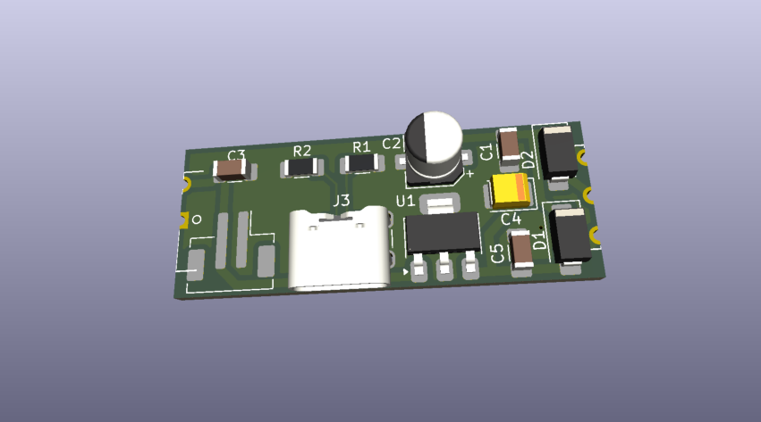
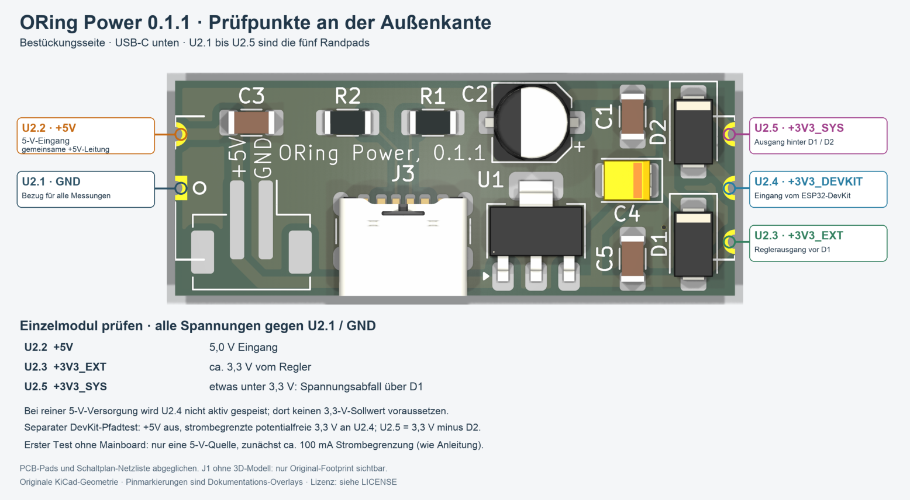

# ORing Power - Bestückung und Inbetriebnahme

Castellated-Versorgungsmodul mit 5-V-Eingang, LM3940 und Dioden-ORing der beiden 3,3-V-Quellen. J1 und USB-C J3 liegen direkt parallel; nur eine eindeutig festgelegte 5-V-Quelle verwenden. Enthalten ist die letzte Prüfpunktergänzung für Beschriftungsstand 0.1.1.

[Anleitung als PDF](../../assets/downloads/ORing_Power_Rev0.1.1_Anleitung.pdf){ .md-button }

## Baugruppe und Orientierung

{ .board-view }

J1 ist in der ursprünglichen KiCad-Ansicht nicht dargestellt, da für den verwendeten JST-PH-SMD-Footprint lokal kein 3D-Modell verfügbar war. Maßgeblich bleibt die Stückliste.

### Geltungsbereich

Diese Anleitung gilt für das eigenständige EnvNode ORing Power Modul Revision 0.1. Das 39 x 15 mm große Modul stellt den 5-V-Eingang, den LM3940-Regler und die Dioden-ORing-Funktion als castellated Tochterplatine bereit. Orientierungshinweise beziehen sich auf die Bestückungsseite.

J1 und USB-C J3 liegen direkt parallel auf +5 V. Sie sind keine gegeneinander entkoppelten Eingänge. Das Modul darf nur mit einer eindeutig festgelegten 5-V-Quelle betrieben werden.

## 1. Teile und Vorbereitung

### 1.1 Elektronische Bestückung

| Ref. | Anz. | Wert / Funktion | EnvNode-Part | Gehäuse / Footprint |
| --- | --- | --- | --- | --- |
| C1, C5 | 2 | 100 nF, 10 %, X7R | ENP-00006 | 1206 / 3216 Metric |
| C2 | 1 | 10 µF, 25 V, Aluminium-Elko | ENP-00056 | SMD Ø5 x 5,4 mm |
| C3 | 1 | 10 µF, 25 V, X7R | ENP-00007 | 1206 / 3216 Metric |
| C4 | 1 | 47 µF, 10 V, Tantal, polarisiert | ENP-00008 | EIA 3528-21, Bauform B |
| D1, D2 | 2 | SS14, Schottky, 1 A / 40 V | ENP-00055 | SMA / DO-214AC |
| R1, R2 | 2 | 5,1 kΩ, 1 %, 250 mW | ENP-00110 | 1206 / 3216 Metric |
| U1 | 1 | LM3940, 3,3 V / 1 A | ENP-00009 | SOT-223-3, Tab = Pin 2 |
| J1 | 1 | JST-PH, 2-polig, vertikal, SMD | ENP-00119 | B2B-PH-SM4-TB, 1MP |
| J3 | 1 | USB-C, 6 Kontakte, Power-only | ENP-00117 | GCT USB4125-GF-A-0190 |
| PCB | 1 | ORing Power Modul PCB Rev. 0.1 | ENP-00118 | 39 x 15 mm, castellated |

U2 bezeichnet im Schaltplan und Layout die fünfpolige Modul-Schnittstelle. U2 ist kein separat zu bestückendes Bauteil; seine Pads werden als castellated Halblöcher gefertigt.

### 1.2 Polarität und Orientierung

- ☐ C2 und C4: Plus-Markierung mit dem Platinenaufdruck abgleichen.

- ☐ D1 und D2: Kathodenmarkierung am Gehäuse und PCB müssen übereinstimmen.

- ☐ U1: Pin 1 und Kühlfahne prüfen; der Tab gehört zu Pin 2.

- ☐ J1: Gehäusekontur, Pin 1 und beide mechanischen SMD-Haltepads prüfen.

- ☐ J3: Gehäusekante, Zentrierzapfen, Shield-Tabs und sechs Kontakte plan ausrichten.

## 2. Bestückungsübersicht

### 2.1 Funktionsbereiche

| Bereich | Bauteile | Prüfschwerpunkt |
| --- | --- | --- |
| 5-V-Eingänge | J1, J3, R1, R2, C3 | Parallele Einspeisung, CC-Widerstände, Kurzschlussfreiheit |
| Regler | U1, C2, C3, D1 | Polarität, Tab-Anbindung, +3V3_EXT |
| ORing | D1, D2, C4, C5 | Diodenrichtung, +3V3_SYS, Rückspeisung |
| Modulschnittstelle | U2 / fünf Castellated-Pads | Netzreihenfolge, Kantenmetallisierung, Lötbarkeit |

### 2.2 Mechanik und Fertigung

Die Bohrungsmittelpunkte der fünf Castellated-Pads liegen auf den seitlichen Edge.Cuts. Die Leiterplatte darf an diesen Stellen nicht als gewöhnliche, unplattierte Fräskante gefertigt werden. Vor Bestellung muss der Leiterplattenhersteller kantenmetallisierte Halblöcher ausdrücklich unterstützen und die Fertigungsdaten entsprechend akzeptieren.

Die Modulaußenkontur und das Carrier-Landpattern sind vertraglich gekoppelt. Einzelne Pads weder im Modul- noch im Carrier-Footprint verschieben.

### 2.3 Versorgungslogik

U1 erzeugt +3V3_EXT aus +5 V. D1 führt +3V3_EXT auf +3V3_SYS. D2 führt die vom Mainboard kommende +3V3_DEVKIT ebenfalls auf +3V3_SYS. Die Schottky-Dioden verhindern die direkte Rückspeisung zwischen den beiden 3,3-V-Quellen. Die beiden 5-V-Eingänge J1 und J3 sind dagegen direkt verbunden.

## 3. Empfohlene Löt-Reihenfolge

| Schritt | Gruppe | Vorgehen |
| --- | --- | --- |
| 1 | R1, R2, C1, C3, C5 | Kleine 1206-Bauteile zuerst bestücken; Widerstands- und Kapazitätswerte trennen. |
| 2 | D1, D2 | Kathodenorientierung prüfen, zunächst je ein Pad fixieren, danach vollständig löten. |
| 3 | U1 | SOT-223 ausrichten; Pins und Kühlfahne ohne Brücken vollständig benetzen. |
| 4 | C2, C4 | Polarisierte Kondensatoren mit korrekter Plus-Markierung montieren. |
| 5 | J1 | Mechanische Haltepads zuerst fixieren, Sitz prüfen, anschließend Pin 1 und Pin 2 löten. |
| 6 | J3 | USB-C exakt an der Kante ausrichten. Shield-Tabs zuerst, Kontakte unter Vergrößerung löten. |
| 7 | Reinigung und Sichtprüfung | Flussmittelreste entfernen; insbesondere J1, J3, U1 und Dioden unter Vergrößerung prüfen. |
| 8 | Montage auf Mainboard | Erst nach vollständigem Einzeltest des Moduls; siehe Abschnitt 7. |

SMD-Paste darf nicht auf die Castellated-Schnittstelle aufgebracht werden, wenn das Modul zunächst separat gefertigt und geprüft wird. Die seitlichen Pads werden bei der späteren Carrier-Montage als Lötstellen verwendet.

## 4. Anschlussbelegung

### 4.1 Eingänge

| Anschluss | Pin / Signal | Funktion |
| --- | --- | --- |
| J1 | Pin 1 = GND; Pin 2 = +5 V | Alternativer 5-V-Eingang, JST-PH SMD |
| J3 | A9/B9 = +5 V; A12/B12 + Shield = GND | USB-C Power-only |
| J3 | CC1/CC2 jeweils über 5,1 kΩ nach GND | USB-C-Sink-Erkennung |

### 4.2 Castellated-Schnittstelle U2

| Pin | Netz | Richtung am Modul | Funktion |
| --- | --- | --- | --- |
| 1 | GND | gemeinsam | Masse |
| 2 | +5V | Ausgang zum Mainboard | Gemeinsame 5-V-Eingangsschiene |
| 3 | +3V3_EXT | Ausgang zum Mainboard | Reglerausgang vor ORing-Diode |
| 4 | +3V3_DEVKIT | Eingang vom Mainboard | DevKit-3,3-V-Quelle vor ORing-Diode |
| 5 | +3V3_SYS | Ausgang zum Mainboard | OR-verknüpfte Systemversorgung |

Die Pinfolge muss vor der Carrier-Montage gegen Symbol, Modul-Footprint und Carrier-Footprint geprüft werden. Eine spiegelverkehrte Montage vertauscht Versorgungsnetze und kann Modul sowie Mainboard zerstören.

## 5. Prüfungen ohne Versorgung

- ☐ Alle SMD-Lötstellen unter Vergrößerung geprüft.

- ☐ Keine Lotbrücken an den sechs USB-C-Kontakten, Shield-Tabs oder Zentrierzapfen.

- ☐ Kein niederohmiger Kurzschluss zwischen +5 V und GND.

- ☐ Kein niederohmiger Kurzschluss zwischen +3V3_EXT und GND.

- ☐ Kein niederohmiger Kurzschluss zwischen +3V3_SYS und GND.

- ☐ J1 Pin 1 führt zu GND; Pin 2 führt zu +5 V.

- ☐ J1 +5 V und USB-C VBUS haben Durchgang zueinander.

- ☐ R1 und R2 jeweils ungefähr 5,1 kΩ zwischen CC-Pin und GND.

- ☐ D1 und D2 in korrekter Durchlassrichtung montiert.

- ☐ C2 und C4 korrekt polarisiert.

- ☐ Castellated Pin 1 bis 5 entsprechen GND, +5V, +3V3_EXT, +3V3_DEVKIT und +3V3_SYS.

- ☐ Jedes Halbloch ist offen, metallisiert und frei von Lötzinnresten oder Fräsgrat.

### Diodentest

Im Diodentest die beiden ORing-Pfade einzeln prüfen. Von +3V3_EXT nach +3V3_SYS und von +3V3_DEVKIT nach +3V3_SYS ist jeweils eine Schottky-Flussspannung zu erwarten. In Gegenrichtung darf kein niederohmiger Durchgang bestehen.

## 6. Erstinbetriebnahme des Einzelmoduls

Grundregel: Erste Inbetriebnahme ohne Mainboard. Nur eine 5-V-Quelle verwenden und die Strombegrenzung zunächst auf etwa 100 mA setzen.

### 6.1 Reglerpfad

| Schritt | Aktion / Erwartung |
| --- | --- |
| 1 | Labornetzteil auf 5,0 V einstellen; GND und +5 V über J1 oder geeignete Prüfpunkte einspeisen. |
| 2 | Einschalten. Bei Strombegrenzung, Erwärmung oder Geruch sofort ausschalten. |
| 3 | +5 V an J1, USB-VBUS und Castellated Pin 2 prüfen. |
| 4 | +3V3_EXT an Castellated Pin 3: ungefähr 3,3 V. |
| 5 | +3V3_SYS an Castellated Pin 5: typischerweise etwas unter +3V3_EXT wegen D1. |
| 6 | U1 und D1 auf unzulässige Erwärmung prüfen; Ruhestrom dokumentieren. |

### 6.2 USB-C-Eingang

- ☐ Labornetzteil vollständig trennen.

- ☐ USB-C-Netzteil anschließen; +5 V und beide 3,3-V-Netze erneut messen.

- ☐ J1 bleibt dabei unbeschaltet.

- ☐ Stecker mechanisch leicht belasten; Versorgung darf nicht unterbrechen.

### 6.3 ORing-Pfad vom DevKit

Diesen Test nur mit strombegrenzter, potentialfreier 3,3-V-Quelle durchführen. +5 V bleibt ausgeschaltet. 3,3 V an +3V3_DEVKIT einspeisen und +3V3_SYS hinter D2 messen. Sicherstellen, dass weder +3V3_EXT noch +5 V rückwärts gespeist werden.

## 7. Montage auf dem Mainboard

- ☐ Mainboard vollständig spannungsfrei; USB-Verbindungen und externe Versorgung entfernt.

- ☐ Carrier-Footprint und Modul-Pinfolge 1 bis 5 verglichen.

- ☐ Modul flächig und ohne seitlichen Versatz innerhalb der 39 x 15 mm Carrier-Kontur positioniert.

- ☐ Zunächst ein Castellated-Pad je Seite angeheftet; Lage und Planparallelität erneut geprüft.

- ☐ Alle fünf Pads mit sichtbarer, gleichmäßiger Lötkehle verlötet.

- ☐ Keine Lötbrücke, kein Lot unter dem Modul außerhalb der Carrier-Pads.

Nach der Montage die Widerstands- und Durchgangsprüfungen aus Abschnitt 5 wiederholen. Danach das Mainboard zunächst ohne ESP32-DevKit und ohne weitere Module strombegrenzt in Betrieb nehmen.

### 7.1 Messprotokoll

| Prüfpunkt | Soll | Messwert | OK | Bemerkung |
| --- | --- | --- | --- | --- |
| +5 V Eingang | 4,75 bis 5,25 V |  |  |  |
| +3V3_EXT | ca. 3,3 V |  |  |  |
| +3V3_SYS aus Regler | 3,3 V minus D1 |  |  |  |
| +3V3_SYS aus DevKit | 3,3 V minus D2 |  |  |  |
| Ruhestrom Einzelmodul | unauffällig / dokumentieren |  |  |  |
| Rückspeisung +3V3_EXT | nicht vorhanden |  |  |  |
| Rückspeisung +5 V | nicht vorhanden |  |  |  |
| USB-C mechanisch | stabil |  |  |  |

## 8. Fehlerbilder

| Beobachtung | Zuerst prüfen |
| --- | --- |
| Keine 3,3 V aus dem Regler | 5-V-Eingang, U1, D1, C2/C3, Kurzschluss auf +3V3_EXT oder +3V3_SYS. |
| Hoher Strom ohne Mainboard | Sofort ausschalten; J1, J3, U1, D1/D2 und polarisierte Kondensatoren prüfen. |
| USB-C versorgt nicht | Kabel/Netzteil, R1/R2, VBUS-Pads, Shield-/GND-Verbindung und Kontaktbrücken. |
| J1 versorgt nicht | Pinbelegung, SMD-Signalpads, mechanische Haltepads und +5-V-Leiterbahn. |
| +3V3_SYS nur aus einer Quelle | D1/D2-Orientierung, Lötstellen und zugehörige Castellated-Pads. |
| Rückspeisung in andere 3,3-V-Quelle | Falsche oder gebrückte Diode, falsches Netz, Messaufbau und gemeinsame Masse. |
| Modul sitzt schief | Nicht weiterlöten; angeheftete Pads erwärmen, neu ausrichten und Carrier-Kontur prüfen. |
| Castellated-Pad nimmt kein Lot an | Kantenmetallisierung, Oxidation, Flussmittel, Löttemperatur und PCB-Oberfläche. |

### Freigabehinweis

Vor Produktionsfreigabe sind Herstellerfreigabe der Castellated-Holes, reale Lötbarkeit, thermisches Verhalten des LM3940, Quellenübergang, Rückstromverhalten, USB-C-Mechanik und Montage auf mindestens einem Ziel-Mainboard praktisch zu dokumentieren.

J1 und J3 dürfen im Betrieb nicht mit unabhängigen 5-V-Quellen gleichzeitig gespeist werden.

## 9. Revisionsnachweis

| Quelle | SHA-256 |
| --- | --- |
| ORing Power.kicad_pcb | `7f16d98ad92b0bd15eb0112ce4af3d6d42d2c357af48cb1347d8e3da8ae329c2` |
| ORing Power.kicad_sch | `33e3890765b487b416dd0c90f3f7fe25a810ee3baf4796301dd48e67064acdff` |
| EnvNode_Parts.xlsx | `3bb63f242b939543a27f5b79b89820097739af125a416112dbe87014f2855517` |

### Dokumentierte Ausführung

Revision 0.1 verwendet den power-only USB-C-Steckverbinder GCT USB4125-GF-A-0190 und den vertikalen zweipoligen JST-PH-SMD-Steckverbinder B2B-PH-SM4-TB. Die fünf Modulkontakte werden als kantenmetallisierte Halblöcher ausgeführt.

### Änderungen nach dem Dokumentstand

Jede Änderung an Pinfolge, Platinenkontur, Castellated-Geometrie, Steckverbinder-Footprints, Regler, Diodentyp oder Kondensatorauslegung erfordert eine neue Prüfung und einen aktualisierten Revisionsnachweis.

### Quellenabgleich vom 5. Oktober 2026

Aktueller PCB-Stand: Commit 2864933. Gegenüber dem bisherigen Nachweis sind nur Plot-Einstellungen, ein leerer Einstellungsblock und die Reihenfolge unveränderter Leiterbahn-Einträge geändert. Geometrie, Bestückung und Netze bleiben gleich; die Referenzansicht bleibt gültig.

Textkorrektur: D1 führt +3V3_EXT auf +3V3_SYS; D2 führt +3V3_DEVKIT auf +3V3_SYS. Die zuvor vertauschten Zuordnungen wurden im Funktions- und Prüfteil korrigiert. Der Abgleich der PCB-Padnetze mit der exportierten Schaltplan-Netzliste ergab keine Abweichungen.

Die Bezeichnung Revision 0.1 wird aus der bisherigen Dokumentation übernommen; der PCB-Titelblock enthält keine formale Revision. Kein neuer vollständiger ERC-/DRC-Lauf und keine physische Prüfung im Rahmen dieser Aktualisierung.

## Prüfpunkte an der Außenkante

Beschriftungsstand 0.1.1 vom 18. Oktober 2026.

{ .testpoint-view }

### Messwerte des Einzelmoduls

Alle Spannungen gegen **U2.1 / GND** messen. USB-C liegt in der gezeigten Bestückungsansicht unten. Links befinden sich U2.2 (+5 V) und U2.1 (GND); rechts von oben nach unten U2.5, U2.4 und U2.3.

| Prüfpunkt | Signal | Erwartung / Testaufbau |
| --- | --- | --- |
| U2.2 | +5V | 5,0 V Eingang; gemeinsame Leitung von J1 und USB-C |
| U2.3 | +3V3_EXT | Etwa 3,3 V vom Regler, vor D1 |
| U2.5 | +3V3_SYS | Bei 5-V-Einspeisung etwas unter 3,3 V durch Spannungsabfall über D1 |
| U2.4 | +3V3_DEVKIT | Bei reiner 5-V-Versorgung nicht aktiv gespeist; dort keinen 3,3-V-Sollwert voraussetzen |

Separater DevKit-Pfadtest: +5 V ausschalten; strombegrenzte potentialfreie 3,3 V an U2.4 einspeisen. An U2.5 sind etwa 3,3 V minus D2 zu erwarten. Erster Test ohne Mainboard und mit etwa 100 mA Strombegrenzung gemäß Abschnitt 6.

Ergänzung zu Abschnitt 5 und 6: Spannungen gegen U2.1 messen; Quellen nur gemäß dem beschriebenen Testaufbau anschließen.

Diese Abbildung ergänzt die Orientierung. Die vollständigen Bestückungs-, Durchgangs- und Rückspeisungsprüfungen bleiben maßgeblich.

EnvNode: siehe Root-Lizenz LICENSE. KiCad-Modelle behalten ihre Lizenzen; siehe [Modellnachweise](https://github.com/magicamun/EnvNode/blob/main/images/oring-power/testpoints/THIRD_PARTY_NOTICES.txt).

### Lizenz

EnvNode-eigene Inhalte: LicenseRef-EnvNode-Use-and-Redistribution-1.0; siehe [Lizenz](../../license.md). Rechte an Drittanbieter-Modellen und sonstigen Fremdinhalten bleiben bestehen.
