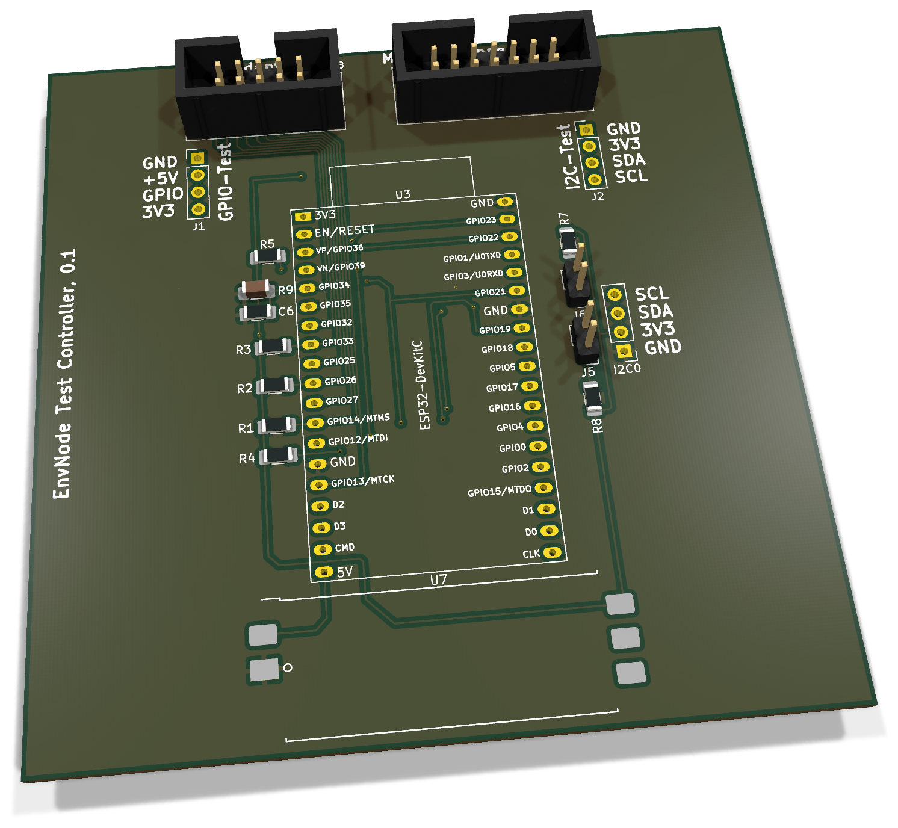
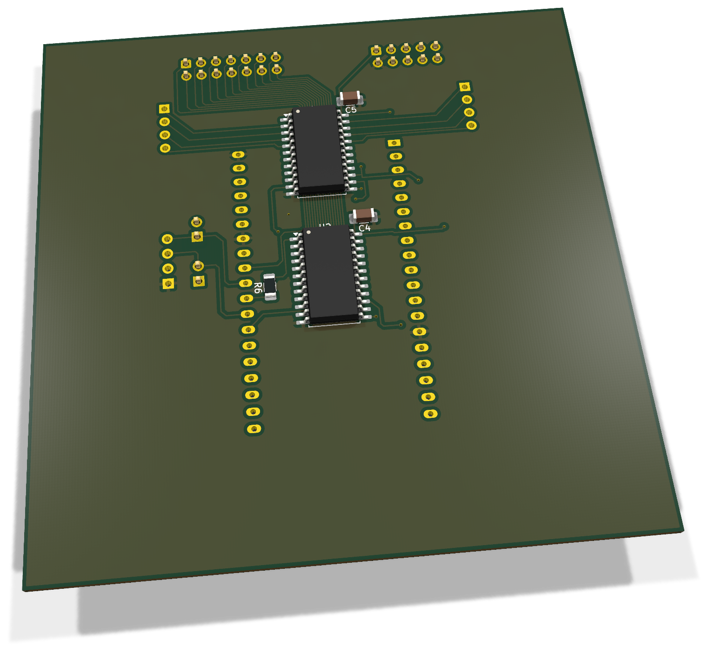
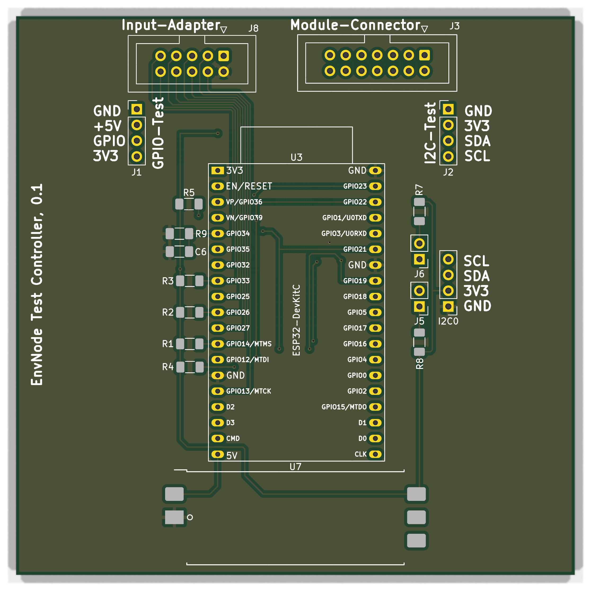
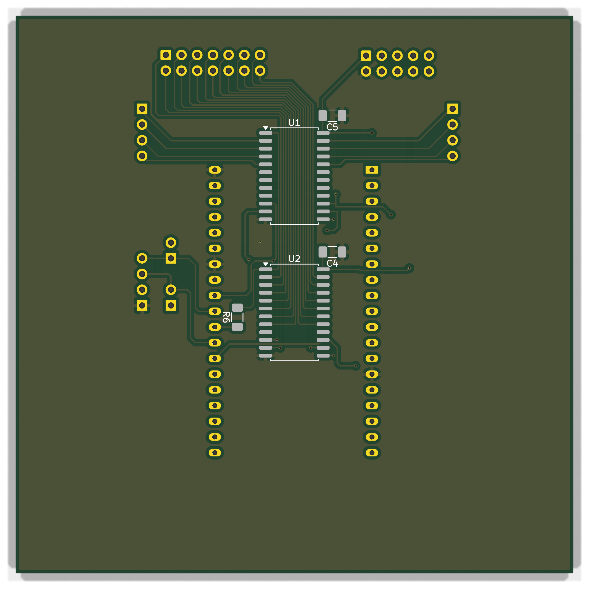

# Test-Controller 0.1 - Bestückung und Inbetriebnahme

ESP32-DevKitC-Steuerplatine für passive Mainboardtests mit separater I²C-Provisioning-Verbindung. Sie arbeitet mit Input-Adapter 0.1 und Modul-Adapter 0.1 zusammen und ersetzt den Controllerteil der früheren monolithischen Test-Provisioning-Platine.

**Dokumentation abgeschlossen am 28. Oktober 2026.** Der Fertigungs- und Erprobungsstand wird im Abschlusskapitel getrennt geführt.

[Anleitung als PDF](../../assets/downloads/Test_Controller_Rev0.1_Anleitung.pdf){ .md-button }
[Alte Revisionen](old-revisions.md){ .md-button }

!!! warning "DUT nur spannungsfrei testen"
    Vor dem Kontaktieren alle DUT-Versorgungen und USB-Verbindungen trennen, den ESP32 aus dem DUT ziehen und das separate Provisioning-Kabel abziehen. Der Test Controller darf für seine eigene Elektronik versorgt sein. DUT-Masse und DUT-3,3-V-Referenz bleiben Messkontakte; nicht pauschal mit der Tester-Versorgung verbinden.

## 3D-Ansicht

{ .hero-paired-view }
{ .hero-paired-view }

Vorderseite (F.Cu) und bestückte Rückseite (B.Cu). Nicht hinterlegte 3D-Modelle bleiben ausgespart. Die Bestückungspläne folgen im Abschnitt zur Bestückungsübersicht.

## 1. Teile und Vorbereitung
| Ref. | Anz. / Einheit | Wert / Funktion | Artikel |
| --- | --- | --- | --- |
| PCB | 1 | Test-Controller Rev.0.1 | ENP-00155 |
| U1,U2 | 2 | SOIC-24W | ENP-00153 |
| C4,C5,C6 | 3 | 100 nF X7R 1206 | ENP-00006 |
| R1,R2,R3,R4,R5 | 5 | 10 kOhm 1206 Enable-Pullups | ENP-00094 |
| R6 | 1 | 1 kOhm 1206 | ENP-00099 |
| R9 | 1 | 2,2 kOhm 1206 | ENP-00154 |
| R7,R8 | 2 | 4,7 kOhm 1206 | ENP-00005 |
| U3 | 1 | ESP32 DevKitC 38 Pins | ENP-00010 |
| U3-Sockel | 2 | Je auf 19 Kontakte gekuerzt | ENP-00004 |
| U7 | 1 | ORing-Power Rev.0.1 bestueckt | ENK-00021 |
| J8 | 1 | WSL 10G | ENP-00147 |
| J3 | 1 | WSL 14G | ENP-00151 |
| J1,J2,I2C0 | 3 | Stiftleisten 1x4; externe Pigtails nicht enthalten | ENP-00108 |
| J5,J6 | 4 | Rohmaterial: 2x 1x2, vier Kontaktpositionen | ENP-00145 |
| J5,J6 | 2 | Abnehmbare Jumperkappen | ENP-00101 |

Artikelzuordnung aus dem vorhandenen lokalen BOM-Export vom 28.10.2026; kein neuer Lagerabgleich. ENP-00145 wird in einzelnen Kontaktpositionen gezählt, nicht als Anzahl fertig zugeschnittener Leisten. Kabel, Zugentlastung, Gehäuse und Befestigung separat ergänzen.

U1/U2 sind **CD74HC4067M**, SOIC-24W; kein ungeprüfter HCT-Ersatz. U3 sitzt in zwei auf je 19 Kontakte gekürzten Sockelleisten. U7 ist das fertig bestückte ORing-Power-Modul. Messmittel: Multimeter mit Diodentest, strombegrenzte Versorgung, Oszilloskop/Logikanalysator für spätere Multiplexerprüfung.

## 2. Bestückungsübersicht

### Vorderseite: Bestückungsplan

{ .assembly-plan }

[Plan als PNG](../../assets/board-views/test-controller-0.1/assembly-front.png){ .md-button }

### Rückseite: Bestückungsplan

{ .assembly-plan }

[Plan als PNG](../../assets/board-views/test-controller-0.1/assembly-back.png){ .md-button }

Senkrechtes KiCad-Rendering der Leiterplatte ohne Bauteilmodelle. Kupfer, Lötstoppmaske und Bestückungsdruck entsprechen der PCB-Quelle. Rückseitenpläne werden von B.Cu aus betrachtet.

Die Bestückungspläne zeigen die Leiterplatte senkrecht zur jeweiligen Seite. Bestückungsdruck und Referenzen folgen der PCB-Quelle; eine Rückseitenansicht ist keine Kontaktansicht eines Kabelsteckers.

**B.Cu:** U1, U2, C4, C5 und R6. **F.Cu:** übrige Widerstände, C6, Steckverbinder, DevKit-Sockel und ORing-Carrier U7. Pin 1 an U1/U2 und an den IDC-Headern prüfen. Der Controller enthält zwei Ausgangsmultiplexer; die drei Eingangsmultiplexer sitzen auf dem Input-Adapter. Ein sichtbarer ORing-Carrier ohne vollständiges Modulmodell ersetzt das physisch bestückte U7 nicht.

## 3. Löt-Reihenfolge

1. R1-R9 und C4-C6 nach Stückliste bestücken; R6 = 1 kΩ, R9 = 2,2 kΩ nicht verwechseln.
2. U1/U2 ausrichten, einen Pin fixieren, Lage prüfen und alle SOIC-Pins löten.
3. J5/J6, J1/J2/I2C0 und die IDC-Header J3/J8 montieren. Kodierung und Pin 1 prüfen.
4. U3-Sockel parallel ausrichten und ORing-Modul U7 plan verlöten.
5. Reinigen, spannungsfrei prüfen; U3 erst danach einsetzen. Erstprüfung ohne Adapter und DUT.

## 4. Verbindungen

### J8 zum Input-Adapter J1
| J8 Pin | Netz / Funktion |
| --- | --- |
| 1 | `3V3_SYS` |
| 2 | `GND` |
| 3 | `/IN_EN1` |
| 4 | `/IN_S3` |
| 5 | `/IN_EN2` |
| 6 | `/IN_S2` |
| 7 | `/IN_EN3` |
| 8 | `/IN_S1` |
| 9 | `/COM_IN` |
| 10 | `/IN_S0` |

Das zehnpolige IDC-Kabel verbindet jeweils dieselbe Pinnummer. GPIO-Zuordnung: IN_EN1 GPIO14, IN_EN2 GPIO26, IN_EN3 GPIO33; IN_S0 GPIO32, IN_S1 GPIO25, IN_S2 GPIO27, IN_S3 GPIO13; COM_IN GPIO34.

### Ausgang und getrenntes Provisioning

J3 geht 1:1 über ein 14-poliges IDC-Kabel zum Modul-Adapter J4. J1 ist das vierpolige GPIO-Testpigtail, J2 das vierpolige I²C-Testpigtail. Diese Testkanäle sind keine ständig versorgten Sensorports.

| Funktion | GPIO / Verbindung |
| --- | --- |
| COM_OUT | GPIO17 über R6 = 1 kΩ zu beiden Ausgangs-COMs |
| OUT_S0 / S1 / S2 / S3 | GPIO18 / 19 / 21 / 22 |
| OUT_EN1 / OUT_EN2 | GPIO23 / GPIO4, aktiv LOW |
| Eingang COM_IN | GPIO34, R9 = 2,2 kΩ und C6 = 100 nF nach GND |
| Separates I2C0 | Pin 1 GND, 2 3V3_SYS, 3 SDA GPIO16, 4 SCL GPIO5 |
| J5 / J6 | Zuschaltung der 4,7-kΩ-Pull-ups für SDA / SCL |

Die I2C0-Provisioning-Verbindung umgeht die Multiplexer und kann den DUT versorgen. Sie wird ausschließlich als getrennte Betriebsphase verwendet. U7-Pins für +3V3_EXT und +3V3_DEVKIT sind unverbunden; die DevKit-3V3-Leitung ist nicht direkt mit 3V3_SYS kurzgeschlossen.

### Ausgangskanäle

| Ausgang | Multiplexerkanäle in Kontaktreihenfolge |
| --- | --- |
| J1.1–4 (GPIO-Pigtail) | U1 I8, I9, I10, I11 |
| J2.1–4 (I²C-Pigtail) | U1 I7, I6, I5, I4 |
| J3.1–7 (Modul) | U2 I7, I6, I5, I4, I3, I2, I1 |
| J3.8–14 (Modul) | U2 I14, I13, I12, I11, I10, I9, I8 |

Am DUT ist die GPIO-Pigtailfolge GND, +5V, Signal, +3V3_SYS; beim I²C-Pigtail GND, +3V3_SYS, SDA, SCL. Diese Namen sind Prüfkontakte am unversorgten DUT. Vor Verbindung jede Ader durchmessen.

## 5. Spannungsfreie Prüfung

- ☐ Kein niederohmiger Kurzschluss zwischen +5V, 3V3_SYS und GND.
- ☐ U1/U2 Pin 24 an 3V3_SYS, Pin 12 an GND; C4/C5 korrekt.
- ☐ IN_EN1–3 und OUT_EN1/2 haben jeweils 10-kΩ-Pull-up nach 3V3_SYS.
- ☐ GPIO17 führt über R6 zu U1/U2 COM; GPIO34 an R9/C6 und J8.9.
- ☐ J8.1/.2 sind Adapterversorgung, keine DUT-Referenzkontakte.
- ☐ Provisioning-I2C0 und J5/J6 stimmen mit der Tabelle überein.
- ☐ Alle IDC-Kabel 1:1 und ohne Nachbarkurzschluss.

## 6. Erstinbetriebnahme ohne DUT

1. U3 zunächst entfernt lassen, keine Adapter angeschlossen. Controller über den vorgesehenen ORing-Eingang strombegrenzt versorgen; 5 V und 3V3_SYS messen, Ruhestrom protokollieren.
2. Alle aktiven LOW-Enable-Leitungen müssen durch ihre Pull-ups HIGH bleiben. Bei unbekanntem Pegel nicht mit DUT verbinden.
3. Ausschalten, U3 korrekt einsetzen und mit geeigneter Diagnosefirmware starten. Alle Multiplexer zunächst deaktivieren; COM_OUT zunächst LOW.
4. Mit Diagnosefirmware Adressleitungen nur bei deaktivierten Multiplexern umschalten; pro Prüfpfad genau einen Ausgang und einen Eingang aktivieren. Settlingzeit berücksichtigen.
5. Eingangspfad zunächst mit bekannten isolierten Prüfschleifen testen. R6/R9 und Multiplexerwiderstände begrenzen bzw. teilen die Prüfspannung; keine ungeprüften 3,3-V-ADC-Schwellen übernehmen.
6. Erst nach Einzelprüfung Input-Adapter und Modul-Adapter verbinden und mit bekanntem Referenz-DUT weiterarbeiten.

## 7. Prüfablauf und Protokoll

Für Mini 0.9.0 und Weather 0.3.0 die TP1-Diodenpfade im passenden Boardprofil berücksichtigen. Vor jedem Kanalwechsel deaktivieren; nach Adresswahl einschwingen lassen, messen, Ergebnis protokollieren und wieder deaktivieren. Nach dem passiven Test Tester und DUT trennen, bevor ein separates Provisioning beginnt.

| Prüfschritt | Ergebnis / Datum / Person |
| --- | --- |
| PCB-Revision / Seriennummer | |
| Bauteile, Orientierung und Lötstellen | |
| Versorgung / Ruhestrom | |
| Kabel-Pin-1 und 1:1-Zuordnung | |
| Einzelkanäle und unerwünschte Querpfade | |
| Testprofil / Firmwarecommit | |
| Referenz-Diodenrichtung / Schaltschwellen | |
| Mechanische Passprobe | |

## 8. Fehlerbilder und Firmwarestand

| Befund | Prüfen |
| --- | --- |
| Mehrere Kanäle gleichzeitig aktiv | Aktive-LOW-Enables, Pull-ups, Umschaltfolge |
| COM_IN immer LOW | J8.9, GPIO34, Auswahl, R9/C6, Teststromrichtung |
| Unerwartete Querpfade | IDC-Orientierung, Brücken, mehrfach aktive Muxe |
| Fremdversorgung des DUT | Provisioning-Kabel, DUT-USB, irrtümliche Masse-/3V3-Brücken |

Der vorhandene `testboard`-Stand beschreibt eine geführte Simulation. Physische Multiplexer-/ADC-Steuerung und Provisioning sind damit nicht als betriebsbereit bestätigt. Das neue Testsystem hat 40 getrennte Messkontakte; die alte Simulation mit 38 Eingängen muss entsprechend angepasst werden. Die Anleitung beschreibt den Aufbau und den vorgesehenen Prüfablauf, keine bereits funktionsfähige automatische Test-Firmware.

## 9. Abschluss

Die Dokumentation ist redaktionell abgeschlossen. Quellen und Pad-Netze wurden gegen eine neu exportierte Schaltplan-Netzliste abgeglichen; die gemeinsamen belegten Pins stimmen überein. Es wurde für diese Anleitung kein neuer vollständiger ERC-/DRC-Lauf und kein physischer Bring-up durchgeführt. Mechanische Passprobe, Schaltschwellen, Teststromrichtung, Einschwingzeit und Fertigungsqualität sind am Aufbau zu protokollieren.

### Quellenstand

Dokumentiert ist der gespeicherte KiCad-Stand aus `test-provision-board`, Projekt `Test-Controller`, Basiscommit `08f55b1810812b1deb1e877ef2f7853d0797d5ad`. Die Prüfsummen bestimmen den tatsächlichen Arbeitsstand einschließlich lokaler Änderungen; der Commit allein beschreibt diese nicht.

| Quelle | SHA-256 |
| --- | --- |
| INL.kicad_sch | `d997c7a458d4028ab6709aa2018255b760285d3a5f047a7abdc2853ecb74905c` |
| OU1.kicad_sch | `f744029b4555ac6727b4ee6516dcf553085af52931c4f0180e8048643995efac` |
| OUT2.kicad_sch | `4a0550655b79f2b7135092b2bef4404ae10aa8281a209b2fcd528be4e2088701` |
| Test-Controller.kicad_pcb | `bb6f4f2f0c016539785691c14dda86cc97bd94ba72e7a92f6113fda60ea6bf07` |
| Test-Controller.kicad_pro | `d2c7d29bfff9455a5a17e456aaad0f98b935e4786765ad76c5d2d755c411c514` |
| Test-Controller.kicad_sch | `15768ca5fb11fd62738d2707c869b4fbdd0c709248c94a1deb1ab3aad009ba01` |

[Rendernachweis](../../assets/images/test-controller-0.1/provenance.json). Dokumentation: LicenseRef-EnvNode-Use-and-Redistribution-1.0, siehe [Lizenz](../../license.md). Drittanbieterrechte an KiCad-Modellen und Bibliotheken bleiben bestehen.
