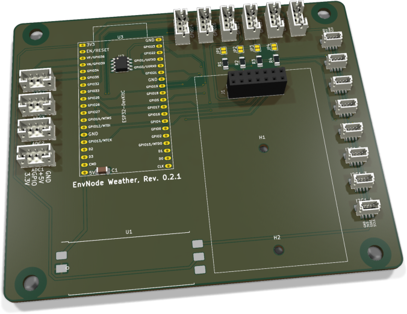
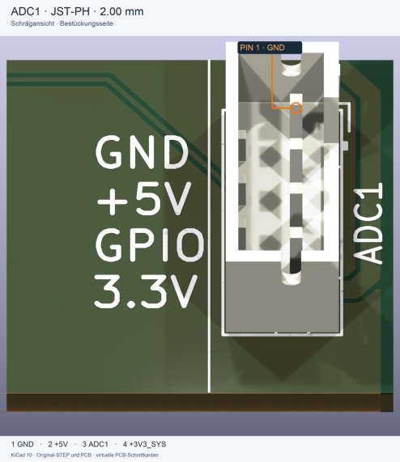
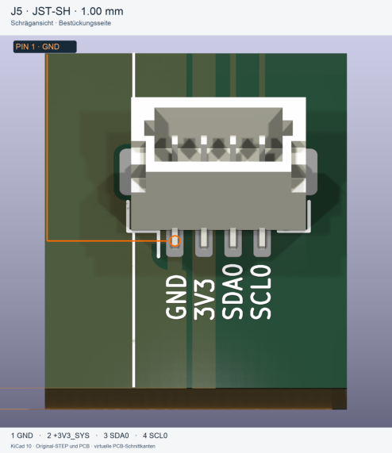
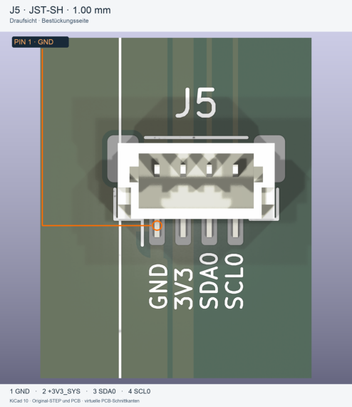

# Weatherstation - Bestückung und Inbetriebnahme

ESP32-Mainboard mit einem Modulslot, acht I²C-Anschlüssen und zehn ADC-/GPIO-Anschlüssen. C1 blockt die 5-V-Schiene ab; das Board-EEPROM besitzt keinen separaten Abblockkondensator.

**PCB 0.2.1; Board Identity 0.2.**

!!! info "Pilotfassung"
    Aus der jeweils letzten PDF-Anleitung überführt. Inhalt und Darstellung sind noch zur Durchsicht vorgesehen. Webansicht und neue PDF verwenden dieselbe Markdown-Quelle. Die Überführung ist keine neue Hardwareprüfung.

[Generierte PDF-Pilotfassung](../../assets/downloads/Weatherstation_Rev0.2.1_Markdown-Pilot.pdf){ .md-button }

[Bisherige PDF-Ausgabe](../../assets/downloads/EnvNode_Weather_Bestueckungs_und_Bringup_Rev0.2.pdf)

## 1. Baugruppen und Teile

### 1.1 Elektronische Bestückung

| Ref. | Anz. | Wert / Funktion | EnvNode-Part | Footprint / Hinweis |
| --- | --- | --- | --- | --- |
| C1 | 1 | 100 nF, X7R | ENP-00006 | 1206, Abblockung der +5V-Schiene |
| R1-R4 | 4 | 4,7 kOhm, 1 % | ENP-00005 | 1206, I2C-Pull-ups |
| JP1-JP4 | 4 | Lötjumper, normal offen | - | PCB-Struktur; kein Kaufteil |
| U1 | 1 | ORing-Power Rev. 0.1 bestückt, gefertigt | ENK-00020 | 39 x 15 mm, castellated Carrier |
| U2 | 1 | 24LC32, Board Identity | ENP-00102 | SOIC-8, I2C0-Adresse 0x50 |
| U3 | 1 | ESP32-Entwicklungsboard | ENP-00010 | 38-polig; Pinout und Passform prüfen |
| J1 | 1 | Modulsockel 2 x 7 | ENP-00054 | 2,54 mm, vertikale Buchsenleiste |
| I2C0_1-I2C0_4 | 4 | JST-SH, 4-polig, top-entry | ENP-00122 | BM04B-SRSS-TB, 1,00 mm |
| I2C1_1-I2C1_4 | 4 | JST-SH, 4-polig, top-entry | ENP-00122 | BM04B-SRSS-TB, 1,00 mm |
| ADC1-ADC4 | 4 | JST-PH, 4-polig, top-entry | ENP-00025 | B4B-PH-K, 2,00 mm |
| GPIO14/16/17/27/ 32/4 | 6 | JST-PH, 4-polig, top-entry | ENP-00025 | B4B-PH-K, 2,00 mm |

Nicht auf dem Mainboard: Eingangsschutz, 5-V-Eingang, USB und 3,3-V-ORing gehören zum separat dokumentierten ORing-Power-Modul.

### 1.2 Mechanik

Die PCB-Geometrie ist für das BOX4U-Gehäuse 5U310700 vorgesehen.

| Teil | Anz. | Hinweis |
| --- | --- | --- |
| EnvNode Weather PCB Rev. 0.2.1 | 1 | Titelblock und Silkscreen müssen Rev. 0.2.1 zeigen |
| H1-H2 | 2 | M2,5-Stützpunkte für Tochterplatinen |
| H3-H6 | 4 | 4,5-mm-NPTH für BOX4U-Gehäuse |

Artikelabgleich: 18.10.2026, inventory/parts-preview.json. ENK-00020 gemäß Artikelvorgabe. Lötjumper und Net-Ties sind keine Kaufteile. ESP32-Variante elektrisch und mechanisch prüfen. EnvNode-eigene Inhalte: siehe LICENSE (LicenseRef-EnvNode-Use-and-Redistribution-1.0).

## 2. Bestückungsübersicht

### 2.1 3D-Ansicht

{ .board-view }

Die Darstellung zeigt den unbestückten ORing-Power-Carrier U1. Das fertige Versorgungsmodul wird dort über seine Castellations verlötet. Fehlende 3D-Geometrie des Moduls ist daher kein Bestückungsfehler.

| Bereich | Bauteile | Prüfschwerpunkt |
| --- | --- | --- |
| Mitte / links | U3, U2, C1 | DevKit-Ausrichtung, EEPROM Pin 1, Antennenfreiraum |
| Rechts | J1, H1/H2 | Modulsockel, Pin 1 und mechanischer Freiraum |
| Rechte Kante | I2C0_1-4, I2C1_1-4 | Top-entry, MP-Laschen und Buszuordnung |
| Obere / linke Kante | ADC1-4, GPIO-Stecker | Signalbeschriftung und einheitliche Pinfolge |
| Unterkante | U1 | Castellations, Fluchtung, Lotmenge und Brücken |

## 3. Orientierung und Lötreihenfolge

### 3.1 Kritische Orientierung

- ☐ U2: Pin 1 anhand Punkt/Kerbe und PCB-Markierung ausrichten.

- ☐ U3: 38-poliges ESP32-DevKitC entsprechend der Beschriftung einsetzen; USB-Ende und Antennenseite vor dem Einsetzen kontrollieren.

- ☐ I2C0_1-4 und I2C1_1-4: Stecköffnung zeigt nach oben; mechanische Pads plan auflegen und vollständig benetzen.

- ☐ ADC1-4 und GPIO-Stecker: Pin 1 und Außenbeschriftung kontrollieren; alle Buchsen rechtwinklig ausrichten.

- ☐ U1: Pinfolge und Außenkontur des ORing-Power-Moduls mit dem Carrier-Aufdruck abgleichen.

- ☐ J1: Pin 1, Bestückungsseite und rechtwinklige Ausrichtung kontrollieren.

### 3.2 Empfohlene Reihenfolge

| Schritt | Gruppe | Vorgehen |
| --- | --- | --- |
| 1 | R1-R4, JP1-JP4, C1 | Kleine SMD-Teile zuerst; Lötjumper offen lassen. |
| 2 | U2 | SOIC-8 ausrichten, einen Pin fixieren, Lage prüfen, restliche Pins löten. |
| 3 | JST-SH | MP-Pads zuerst fixieren; danach vier Signalpins löten. |
| 4 | JST-PH und J1 | Buchsen gerade ausrichten und alle Pins löten. |
| 5 | U1 | Fertig geprüftes ORing-Power-Modul exakt ausrichten und Castellations verlöten. |
| 6 | U3 | Erst nach passiver und elektrischer Prüfung einsetzen. |

## 4. Anschluss- und Adressbelegung

### 4.1 I2C / Qwiic

| Stecker | Bus | Pin 1 | Pin 2 | Pin 3 | Pin 4 |
| --- | --- | --- | --- | --- | --- |
| I2C0_1-I2C0_4 | I2C0 | GND | +3V3_SYS | SDA | SCL |
| I2C1_1-I2C1_4 | I2C1 | GND | +3V3_SYS | SDA | SCL |

Pull-ups: JP1/JP2 schalten die SCL/SDA-Pull-ups für I2C0, JP3/JP4 entsprechend für I2C1. Beide Jumper eines Busses nur schließen, wenn das Mainboard die Pull-up-Verantwortung übernehmen soll. Keine einzelnen Leitungen eines Paares aktivieren und keine unnötigen parallelen Pull-ups erzeugen.

### 4.2 ADC- und GPIO-Anschlüsse

| Steckergruppe | Pin 1 | Pin 2 | Pin 3 | Pin 4 |
| --- | --- | --- | --- | --- |
| ADC1-ADC4 | GND | +5V | ADC1-ADC4 | +3V3_SYS |
| GPIO14/16/17/27/32/4 | GND | +5V | bezeichneter GPIO | +3V3_SYS |

Achtung: Pin 2 führt 5 V, Pin 4 führt 3,3 V. Sensoren und Pigtails vor dem Einstecken gegen diese Pinfolge prüfen. Die ADC-Leitungen sind direkte ESP32-ADC-Eingänge und besitzen auf dem Mainboard keine zusätzliche Überspannungs- oder Analogfilterstufe.

### 4.3 Identität und Modulslot

| Funktion | Bus / Adresse | Festlegung |
| --- | --- | --- |
| Mainboard U2 | I2C0 / 0x50 | A0=A1=A2=0, WP=GND |
| Slot A Modul-EEPROM | I2C0 / 0x52 | J1 Pin 3 liegt auf GND |

### Zuordnung der direkten ADC-Eingänge

ADC1 = GPIO34 / ADC1_CH6; ADC2 = GPIO35 / ADC1_CH7; ADC3 = GPIO36 / ADC1_CH0; ADC4 = GPIO39 / ADC1_CH3. Diese vier GPIOs sind Eingänge. GPIO33 / ADC1_CH5 liegt am Modulslot J1.9, nicht am separaten JST-PH-Anschluss.

## 5. Schnittstellen und Versorgung

### 5.1 EnvNode-Modulslot J1

| Pin | Signal | Pin | Signal |
| --- | --- | --- | --- |
| 1 | GND | 2 | +3V3_SYS |
| 3 | EEPROM_A0 = GND | 4 | +5V |
| 5 | I2C0_SDA | 6 | I2C0_SCL |
| 7 | I2C1_SDA | 8 | I2C1_SCL |
| 9 | GPIO33 / AUX_GPIO1 | 10 | GPIO13 / AUX_GPIO2 |
| 11 | SPI MOSI | 12 | SPI MISO |
| 13 | SPI SCK | 14 | SPI CS |

### 5.2 ORing-Power-Carrier U1

| U1 Pin | Signal | Mainboard-Nutzung |
| --- | --- | --- |
| 1 | GND | Masse |
| 2 | +5V | 5-V-Systemschiene |
| 3 | +3V3_EXT | absichtlich NC auf Rev. 0.2 |
| 4 | +3V3_DEVKIT | 3,3-V-Ausgang des DevKitC zum ORing |
| 5 | +3V3_SYS | geORte 3,3-V-Systemschiene |

Das Mainboard besitzt keinen eigenen USB- oder 5-V-Eingangsstecker. Zulässige Eingänge, Schutzbeschaltung, Stromgrenzen und das Verhalten bei zusätzlicher DevKit-USB-Versorgung richten sich nach der ORing-Power-Dokumentation.

### Modulslot und separate Sensoranschlüsse

Maßgeblich ist die Tabelle oben. AUX_GPIO1 = GPIO33 (J1.9), AUX_GPIO2 = GPIO13 (J1.10). Der separate JST-PH-Sensoranschluss heißt GPIO4.

## 6. Prüfungen ohne Versorgung

- ☐ Alle SMD- und THT-Lötstellen unter Vergrößerung geprüft.

- ☐ Kein niederohmiger Kurzschluss zwischen +5V und GND.

- ☐ Kein niederohmiger Kurzschluss zwischen +3V3_SYS und GND.

- ☐ U2 Pin 1 korrekt; keine Brücken zwischen SOIC-Pads.

- ☐ C1 liegt elektrisch zwischen +5V und GND.

- ☐ U2: A0, A1, A2 und WP haben Durchgang zu GND.

- ☐ J1 Pin 3 hat Durchgang zu GND; kein Kurzschluss zu +3V3_SYS.

- ☐ Alle JST-SH: Pin 1=GND, Pin 2=+3V3_SYS; keine Brücken zwischen 1-mm-Pads.

- ☐ Alle JST-PH: Pin 1=GND, Pin 2=+5V, Pin 4=+3V3_SYS.

- ☐ JP1-JP4 sind offen, sofern keine abweichende Assemblierung dokumentiert ist.

- ☐ U1 sitzt plan, ist korrekt orientiert und jede Castellation ist sichtbar benetzt.

- ☐ J1 und alle Sensorbuchsen stehen gerade und sind frei von Lötbrücken.

Widerstandsmessung: Halbleiter, Kondensatoren und das aufgelötete Power-Modul können zeitabhängige oder richtungsabhängige Messwerte verursachen. Auffällige Werte mit Polaritätswechsel und Vergleichsmessung bewerten; nicht allein aus einem einzelnen Ohmwert freigeben.

### 6.1 Zusätzliche Durchgangsprüfung für Revision 0.2

- ☐ J1.5 hat Durchgang zu I2C0_1.3 (SDA) und U3.33.

- ☐ J1.6 hat Durchgang zu I2C0_1.4 (SCL) und U3.36.

- ☐ Keine Lötbrücke zwischen J1.5 und J1.6; SDA/SCL nicht vertauscht.

- ☐ J1.9 hat Durchgang zu U3.8 (GPIO33); J1.10 zu U3.15 (GPIO13).

- ☐ GPIO4-Stecker, Pin 3, hat Durchgang zu U3.26 (GPIO4).

- ☐ C1.1 liegt an +5V, C1.2 an GND; C1 ist keine 3,3-V-Abblockung für U2.

Prüfung spannungsfrei und ohne eingesetztes DevKit, Tochterplatine oder Sensoren. U3-Pinnummern beziehen sich auf den 38-poligen DevKitC-Sockel, nicht auf die GPIO-Nummern.

## 7. Erstinbetriebnahme

Grundregel: Erste Inbetriebnahme ohne ESP32-DevKitC, ohne Tochterplatine und ohne angeschlossene Sensoren. Nur eine externe 5-V-Quelle verwenden. Labornetzteil zunächst auf 5,0 V und etwa 100 mA Strombegrenzung einstellen. Die zulässigen Eingänge richten sich nach der ORing-Power-Dokumentation.

### 7.1 Versorgung ohne U3

| Schritt | Aktion / Erwartung |
| --- | --- |
| 1 | 5,0 V über den vorgesehenen Eingang des aufgelöteten ORing-Power-Moduls einspeisen. |
| 2 | Einschalten. Bei Strombegrenzung, Erwärmung oder Geruch sofort ausschalten. |
| 3 | +5V am Carrier, J1 Pin 4 und allen JST-PH Pin 2 kontrollieren. |
| 4 | +3V3_SYS am Carrier, U2 Pin 8, allen JST-SH Pin 2 und JST-PH Pin 4 messen: ungefähr 3,3 V. |
| 5 | +3V3_DEVKIT darf ohne eingesetztes DevKit keine unerwartete Fremdspeisung zeigen. |
| 6 | Ruhestrom dokumentieren und mit einer bekannten guten Baugruppe vergleichen. |

### 7.2 ESP32-DevKitC

- ☐ Versorgung ausschalten und Restspannung abwarten.

- ☐ U3 korrekt und ohne Reihenversatz einsetzen.

- ☐ Strombegrenzt einschalten und +3V3_SYS erneut kontrollieren.

- ☐ Serielle Ausgabe, Reset und Firmware-Start prüfen.

- ☐ Bei gleichzeitig angeschlossenem USB die ORing-Funktion und fehlenden Rückstrom verifizieren.

## 8. Bus-, Sensor- und Modulprüfung

- ☐ I2C0 und I2C1 zunächst ohne externe Geräte prüfen; SDA/SCL müssen bei wirksamen Pull-ups HIGH sein.

- ☐ I2C-Scan auf I2C0: Mainboard-U2 muss auf 0x50 antworten.

- ☐ BoardIdentityRecord ab Adresse 0x00 lesen; bei leerem EEPROM nur Blank-Zustand erwarten.

- ☐ Gültigen 32-Byte-BoardIdentityRecord für Board-Identity-Revision 0.2 schreiben und vollständig zurücklesen.

- ☐ Unbestückter Slot darf keine Antwort auf 0x52 erzeugen.

- ☐ Slot-A-Modul einzeln einsetzen: optionaler Modul-EEPROM muss auf 0x52 antworten.

- ☐ I2C0_1 bis I2C0_4 und I2C1_1 bis I2C1_4 jeweils mit einem bekannten Testgerät prüfen.

- ☐ ADC1 bis ADC4 mit definierten, zulässigen Testspannungen prüfen; ESP32-Grenzwerte einhalten.

- ☐ GPIO14/16/17/27/32/4 mit hochohmiger Testlast zunächst als Eingang prüfen, danach konfigurierte Ausgangsfunktion testen.

- ☐ Nach jedem Sensor oder Modul Stromaufnahme, +5V und +3V3_SYS erneut kontrollieren.

Module und Sensoren sicher einsetzen: Nur spannungsfrei stecken. Pin 1, Pigtail-Belegung, Bestückungsseite und mechanischen Überstand prüfen. Reihenversatz, falsche Pigtails oder Drehung können Versorgung und GPIOs kurzschließen.

## 9. Messprotokoll und Freigabegrenzen

| Prüfpunkt | Soll | Messwert / Bemerkung |
| --- | --- | --- |
| +5V am U1-Carrier | 4,75-5,25 V |  |
| +3V3_SYS ohne U3 | ca. 3,3 V |  |
| Ruhestrom ohne U3 | unauffällig; dokumentieren |  |
| JST-SH Pin 2 / JST-PH Pin 4 | ca. 3,3 V |  |
| U2 I2C-Adresse | 0x50 |  |
| Slot A Identität | 0x52, falls bestückt |  |
| +3V3_SYS mit U3 | ca. 3,3 V |  |
| Firmware-Start | fehlerfrei |  |
| I2C0 / I2C1 | beide Busse funktionsfähig |  |
| ADC / GPIO | alle bestückten Ports geprüft |  |

### Seriennummer / Board Identity

| Feld | Eintrag |
| --- | --- |
| BoardProfileId |  |
| Board-Identity-Revision | 0.2 |
| Seriennummer |  |
| Provisioniert am / durch |  |
| CRC / Read-back geprüft |  |

### 9.1 Prüfstand vom 28. September 2026

| Prüfung | Ergebnis Rev. 0.2 |
| --- | --- |
| Schematic ERC | 0 Fehler, 0 Warnungen im gespeicherten Stand |
| PCB DRC | 0 aktive Verstöße; 0 offene Pads; 3 Ausnahmen |
| Schematic-PCB-Parität | 0 Abweichungen beim Schaltplanabgleich |
| Physischer Bring-up | Für Revision 0.2 noch durchzuführen |

Die bestandene KiCad-Konsistenzprüfung und dieses Bring-up belegen keine Serien- oder Produktfreigabe. Vor Produktionsreife bleiben Fertigungsdaten, Artikelstamm, thermische Reserven, EMV, ESD, Überspannungsfestigkeit der externen Anschlüsse, Umweltbelastung, Dauerlauf und Gehäuseintegration zu qualifizieren.

## 10. Revisions- und Quellennachweis

Dokumentstand: 18. Oktober 2026. PCB-Titelblock: Revision 0.2.1 vom 18. Oktober 2026. Die folgenden SHA-256-Prüfsummen dokumentieren die aktuellen gespeicherten KiCad-Quellen; sie beziehen sich nicht auf die PDF.

ESP32.kicad_sch

`b349d0243cf7ae922ee4f81923d4203e3e015d186cb218f4325d61d67b34d97c`

PCB.kicad_sch

`04b61087758ed3db550336a319e9a180bac551b3461eb8a1879add806ebccd1d`

Power.kicad_sch

`1b1e36652d6621b422b7d9de3e1460a93c4376938a50cd0f9d70fc41bdb67155`

SlotA.kicad_sch

`08575310281bf13715ff1b76f3a23dd3777e89d7fede6c446bf04f4076f1672e`

Weatherstation.kicad_pcb

`03522844fad0329562dca237da38add60c2cfe2100cccc07ab42ce9277234f69`

Weatherstation.kicad_pro

`8abf38bba2fd30609637821f99721fa50fcfeeb752a8c4feab95ea5f54802c97`

Weatherstation.kicad_sch

`947f5fcef8747bdb8fa0b48401ed678914f973e002579f13f121f278a8a4f508`

gpio.kicad_sch

`fef9f739a8ab8b702d6f67de3bc0a6f6af5e98d3c8eefef4a304895d4f398c16`

qwiic.kicad_sch

`047540728d00ee9a955c5807119e125a0a1fada2133fdb335e175ead853fcb1e`

Renderbasis: aktueller PCB-Stand 0.2.1 vom 18. Oktober 2026, siehe SHA-256 oben. Die 3D-Ansicht wurde daraus neu gerendert. Patch 0.2.1 ergänzt Steckerbeschriftungen; elektrische und mechanische Geometrie bleiben unverändert. Board Identity bleibt 0.2; keine Neuprovisionierung. Der Anschlussabgleich vom 5. Oktober 2026 bleibt historisch.

Historische KiCad-Prüfung vom 28. September 2026: ERC ohne Befunde; DRC ohne aktive Verstöße, offene Pads oder Schaltplan-PCB-Abweichungen. Drei bestehende Ausnahmen: zwei Courtyard-Überlappungen unter dem DevKit und eine Silkscreen/Soldermask-Meldung am Power-Modul. Diese Ergebnisse wurden aus dem Projekt-README übernommen; für diese Dokumentaktualisierung wurde kein neuer vollständiger ERC/DRC-Lauf durchgeführt.

C1 und EEPROM-Versorgung: C1 (100 nF) liegt zwischen +5V und GND und blockt die 5-V-Versorgung ab. Das Identity-EEPROM U2 wird aus +3V3_SYS versorgt und besitzt keinen separaten lokalen Abblockkondensator. Diese Ausführung ist bei Mini und Weather identisch. Hardware und Firmware wurden durch diese Dokumentaktualisierung nicht verändert.

## JST-PH / ADC und GPIO

Die beiden Mini-Ausschnitte ADC1 und J5 dienen als Referenz für alle entsprechenden vierpoligen JST-PH- und JST-SH-Anschlüsse auf Mini und Weather. Signal, Bus, Referenzname und Einbaurichtung richten sich nach dem jeweiligen Anschluss.

{ .connector-view }
{ .connector-view }

| Pin | Signal |
| --- | --- |
| 1 | GND |
| 2 | +5V (Sensorversorgung) |
| 3 | ADC- bzw. GPIO-Signal |
| 4 | +3V3_SYS |

JST-PH B4B-PH-K, Raster 2,00 mm. In der gezeigten Draufsicht: Pin 1 oben, Pin 4 unten. Der orange Kreis markiert den ersten Steckkontakt. Der Original-Silkscreen GPIO bezeichnet hier das Mini-ADC1-Signal an GPIO34.

Mini: ADC1 und ADC2. Weather: ADC1 bis ADC4 sowie GPIO14, GPIO16, GPIO17, GPIO27, GPIO32 und GPIO4. Die 5-V-Versorgung erlaubt keinen 5-V-Signalpegel am ESP32; die Grenzen des jeweiligen Eingangs gelten weiterhin.

Beschriftungsstand: Die Bilder zeigen Mini. Weather 0.2.1 ergänzt entsprechende Beschriftungen. Position und Einbaurichtung folgen dem jeweiligen Weather-Anschluss.

Ansicht von der Bestückungsseite, nicht von der Kontaktseite eines Kabelsteckers. Bei gedrehten Anschlüssen Pin 1 am tatsächlichen Footprint zuordnen. Der zweipolige ORing-Power-Eingang ist von dieser Referenz nicht erfasst.

Originale PCB-/STEP-Daten, virtuelle PCB-Schnittkanten. Mini-Pins gegen PCB und Schaltplan geprüft.

Alle entsprechenden Mini-/Weather-Padbelegungen verglichen; historische Prüfstände bleiben erhalten.

EnvNode: siehe Root-Lizenz LICENSE. Modelle: Rene Poeschl (2017), KiCAD (2025), CC BY-SA 4.0 mit KiCad-Ausnahme.

## JST-SH / I2C

Die beiden Mini-Ausschnitte ADC1 und J5 dienen als Referenz für alle entsprechenden vierpoligen JST-PH- und JST-SH-Anschlüsse auf Mini und Weather. Signal, Bus, Referenzname und Einbaurichtung richten sich nach dem jeweiligen Anschluss.

{ .connector-view }
{ .connector-view }

| Pin | Signal |
| --- | --- |
| 1 | GND |
| 2 | +3V3_SYS |
| 3 | SDA des jeweiligen I2C-Busses |
| 4 | SCL des jeweiligen I2C-Busses |

JST-SH BM04B-SRSS-TB, Raster 1,00 mm. In der gezeigten Draufsicht: Pin 1 links, Pin 4 rechts. Der orange Kreis markiert den ersten Lötanschluss. J5 gehört zu I2C0 (SDA0/SCL0); an I2C1 gilt die gleiche Folge für SDA1/SCL1. Die seitlichen Metalllaschen sind mechanische Befestigungen, keine Signalpins.

Mini: J4/J5 auf I2C0 und J6/J7 auf I2C1. Weather: I2C0_1 bis I2C0_4 und I2C1_1 bis I2C1_4. Die Draufsicht zeigt auch die Referenz J5; in der Schrägansicht wird diese durch das Gehäuse verdeckt.

Beschriftungsstand: Die Bilder zeigen Mini. Weather 0.2.1 ergänzt entsprechende Beschriftungen. Position und Einbaurichtung folgen dem jeweiligen Weather-Anschluss.

Ansicht von der Bestückungsseite, nicht von der Kontaktseite eines Kabelsteckers. Bei gedrehten Anschlüssen Pin 1 am tatsächlichen Footprint zuordnen. Der zweipolige ORing-Power-Eingang ist von dieser Referenz nicht erfasst.

Originale PCB-/STEP-Daten, virtuelle PCB-Schnittkanten. Mini-Pins gegen PCB und Schaltplan geprüft.

Alle entsprechenden Mini-/Weather-Padbelegungen verglichen; historische Prüfstände bleiben erhalten.

EnvNode: siehe Root-Lizenz LICENSE. Modelle: Rene Poeschl (2017), KiCAD (2025), CC BY-SA 4.0 mit KiCad-Ausnahme.

### Überführung und Lizenz

Diese Pilotfassung übernimmt den zuletzt gepflegten PDF-Stand einschließlich seiner Ergänzungen. Quellenprüfsummen und Prüfberichte im Text sind historische Nachweise aus der PDF und wurden durch diese Überführung nicht neu bestätigt. Für neu generierte Ausgaben protokolliert der Build zusätzlich die Prüfsummen von Markdown, ursprünglicher PDF, Inhaltsbildern, Druckvorlage und Schriften.

EnvNode-eigene Inhalte: LicenseRef-EnvNode-Use-and-Redistribution-1.0; siehe [Lizenz](../../license.md). Rechte an Drittanbieter-Modellen und sonstigen Fremdinhalten bleiben bestehen.
