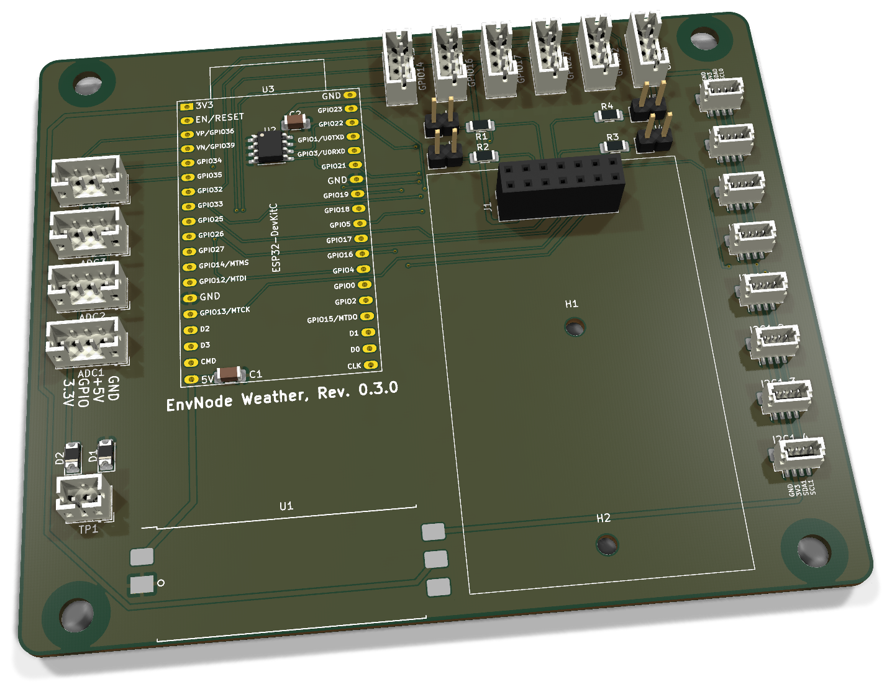
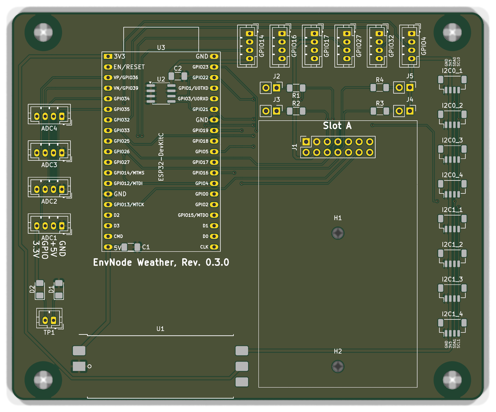

# Weatherstation - Bestückung und Inbetriebnahme

ESP32-Mainboard mit einem Modulslot, acht I²C-Anschlüssen und zehn ADC-/GPIO-Anschlüssen. C1 blockt die 5-V-Schiene ab; das Board-EEPROM wird zusätzlich durch C2 (100 nF) an +3V3_SYS abgeblockt.

**PCB 0.3.0; Board Identity 0.3.**

[Anleitung als PDF](../../assets/downloads/Weatherstation_Rev0.3.0_Anleitung.pdf){ .md-button }

[Produktübersicht](overview.md){ .md-button }
[Alte Revisionen](old-revisions.md){ .md-button }

### Änderungen gegenüber 0.2.1

- **TP1:** zweipoliger Referenzanschluss für den spannungsfreien Mainboardtest, über D1/D2 von GND und +3V3_SYS entkoppelt.
- **Steckbare Pull-up-Jumper J2-J5:** abnehmbare Kappen statt bisheriger Lötjumper. Es sind Pull-ups nach +3V3_SYS, keine Pull-downs.
- **C2:** 100 nF zur lokalen Abblockung der 3,3-V-EEPROM-Versorgung; C1 bleibt an +5V.

**Dokumentation abgeschlossen am 28. Oktober 2026.**

## 3D-Ansicht

{ .hero-board-view }

Vorderseite (F.Cu); die Rückseite trägt keine separat zu bestückenden Bauteile. Nicht hinterlegte 3D-Modelle bleiben ausgespart. Die Bestückungspläne folgen im Abschnitt zur Bestückungsübersicht.

## 1. Baugruppen und Teile

### 1.1 Elektronische Bestückung

| Ref. | Anz. | Wert / Funktion | EnvNode-Part | Footprint / Hinweis |
| --- | --- | --- | --- | --- |
| C1, C2 | 2 | 100 nF, X7R | ENP-00006 | 1206; C1: +5V, C2: +3V3_SYS |
| R1-R4 | 4 | 4,7 kOhm, 1 % | ENP-00005 | 1206, I2C-Pull-ups |
| J2-J5 | 4 | Pull-up-Leiste 1×2 + Kappe | ENP-00145 / ENP-00101 | 2,54 mm; 8 Kontakte + 4 Kappen |
| D1, D2 | 2 | 1N4148W, Testreferenz | ENP-00033 | SOD-123 auf D_1206-Pads; Passform siehe TP1 |
| TP1 | 1 | Testreferenz 1×2 | ENP-00132 | JST-PH, 2,00 mm |
| U1 | 1 | ORing-Power Rev. 0.1 bestückt, gefertigt | ENK-00020 | 39 x 15 mm, castellated Carrier |
| U2 | 1 | 24LC32, Board Identity | ENP-00102 | SOIC-8, I2C0-Adresse 0x50 |
| U3 | 1 | ESP32-Entwicklungsboard | ENP-00010 | 38-polig; Pinout und Passform prüfen |
| J1 | 1 | Modulsockel 2 x 7 | ENP-00054 | 2,54 mm, vertikale Buchsenleiste |
| I2C0_1-I2C0_4 | 4 | JST-SH, 4-polig, top-entry | ENP-00122 | BM04B-SRSS-TB, 1,00 mm |
| I2C1_1-I2C1_4 | 4 | JST-SH, 4-polig, top-entry | ENP-00122 | BM04B-SRSS-TB, 1,00 mm |
| ADC1-ADC4 | 4 | JST-PH, 4-polig, top-entry | ENP-00025 | B4B-PH-K, 2,00 mm |
| GPIO14/16/17/27/ 32/4 | 6 | JST-PH, 4-polig, top-entry | ENP-00025 | B4B-PH-K, 2,00 mm |
| PCB | 1 | Weatherstation 0.3.0 | ENP-00161 | Revisionsgebundene Platine |
| U3-Sockel | 2 | DevKit-Sockel 1×19 | ENP-00004 | Aus 1×20 auf 19 kürzen |

Nicht auf dem Mainboard: Eingangsschutz, 5-V-Eingang, USB und 3,3-V-ORing gehören zum separat dokumentierten ORing-Power-Modul.

### 1.2 Mechanik

Die PCB-Geometrie ist für das BOX4U-Gehäuse 5U310700 vorgesehen.

| Teil | Anz. | Hinweis |
| --- | --- | --- |
| EnvNode Weather PCB Rev. 0.3.0 | 1 | Titelblock und Silkscreen müssen Rev. 0.3.0 zeigen |
| H1-H2 | 2 | M2,5-Stützpunkte für Tochterplatinen |
| H3-H6 | 4 | 4,5-mm-NPTH für BOX4U-Gehäuse |

Den tatsächlich bestückten ORing-Modulstand im Protokoll erfassen. Jumperleisten und Kappen sind Kaufteile; Net-Ties sind PCB-Strukturen. ESP32-Variante elektrisch und mechanisch prüfen. EnvNode-eigene Inhalte: siehe LICENSE (LicenseRef-EnvNode-Use-and-Redistribution-1.0).

## 2. Bestückungsübersicht

### Vorderseite: Bestückungsplan

{ .assembly-plan }

[Plan als PNG](../../assets/board-views/weatherstation-0.3.0/assembly-front.png){ .md-button }

Senkrechtes KiCad-Rendering der Leiterplatte ohne Bauteilmodelle. Kupfer, Lötstoppmaske und Bestückungsdruck entsprechen der PCB-Quelle. Rückseitenpläne werden von B.Cu aus betrachtet.

## Lage der Baugruppen

Die Bestückungspläne zeigen die Leiterplatte senkrecht zur jeweiligen Seite. Bestückungsdruck und Referenzen folgen der PCB-Quelle; eine Rückseitenansicht ist keine Kontaktansicht eines Kabelsteckers.

Die Darstellung zeigt den unbestückten ORing-Power-Carrier U1. Das fertige Versorgungsmodul wird dort über seine Castellations verlötet. Fehlende 3D-Geometrie des Moduls ist daher kein Bestückungsfehler.

| Bereich | Bauteile | Prüfschwerpunkt |
| --- | --- | --- |
| Mitte / links | U3, U2, C1 | DevKit-Ausrichtung, EEPROM Pin 1, Antennenfreiraum |
| Rechts | J1, H1/H2 | Modulsockel, Pin 1 und mechanischer Freiraum |
| Rechte Kante | I2C0_1-4, I2C1_1-4 | Top-entry, MP-Laschen und Buszuordnung |
| Obere / linke Kante | ADC1-4, GPIO-Stecker | Signalbeschriftung und einheitliche Pinfolge |
| Unterkante | U1 | Castellations, Fluchtung, Lotmenge und Brücken |

## 3. Orientierung und Lötreihenfolge

### 3.1 Kritische Orientierung

- ☐ U2: Pin 1 anhand Punkt/Kerbe und PCB-Markierung ausrichten.

- ☐ U3: 38-poliges ESP32-DevKitC entsprechend der Beschriftung einsetzen; USB-Ende und Antennenseite vor dem Einsetzen kontrollieren.

- ☐ I2C0_1-4 und I2C1_1-4: Stecköffnung zeigt nach oben; mechanische Pads plan auflegen und vollständig benetzen.

- ☐ ADC1-4 und GPIO-Stecker: Pin 1 und Außenbeschriftung kontrollieren; alle Buchsen rechtwinklig ausrichten.

- ☐ U1: Pinfolge und Außenkontur des ORing-Power-Moduls mit dem Carrier-Aufdruck abgleichen.

- ☐ J1: Pin 1, Bestückungsseite und rechtwinklige Ausrichtung kontrollieren.

### 3.2 Empfohlene Reihenfolge

| Schritt | Gruppe | Vorgehen |
| --- | --- | --- |
| 1 | R1-R4, J2-J5, C1/C2, D1/D2 | Kleine SMD-Teile zuerst; Jumperkappen zunächst abziehen. |
| 2 | U2 | SOIC-8 ausrichten, einen Pin fixieren, Lage prüfen, restliche Pins löten. |
| 3 | JST-SH | MP-Pads zuerst fixieren; danach vier Signalpins löten. |
| 4 | JST-PH und J1 | Buchsen gerade ausrichten und alle Pins löten. |
| 5 | U1 | Fertig geprüftes ORing-Power-Modul exakt ausrichten und Castellations verlöten. |
| 6 | U3 | Erst nach passiver und elektrischer Prüfung einsetzen. |

## 4. Anschluss- und Adressbelegung

### 4.1 I2C / Qwiic

| Stecker | Bus | Pin 1 | Pin 2 | Pin 3 | Pin 4 |
| --- | --- | --- | --- | --- | --- |
| I2C0_1-I2C0_4 | I2C0 | GND | +3V3_SYS | SDA | SCL |
| I2C1_1-I2C1_4 | I2C1 | GND | +3V3_SYS | SDA | SCL |

Pull-ups: J2/J3 schalten die SCL/SDA-Pull-ups für I2C0, J4/J5 entsprechend für I2C1. Beide Jumperkappen eines Busses nur aufsetzen, wenn das Mainboard die Pull-up-Verantwortung übernehmen soll. Keine einzelnen Leitungen eines Paares aktivieren und keine unnötigen parallelen Pull-ups erzeugen.

### 4.2 ADC- und GPIO-Anschlüsse

| Steckergruppe | Pin 1 | Pin 2 | Pin 3 | Pin 4 |
| --- | --- | --- | --- | --- |
| ADC1-ADC4 | GND | +5V | ADC1-ADC4 | +3V3_SYS |
| GPIO14/16/17/27/32/4 | GND | +5V | bezeichneter GPIO | +3V3_SYS |

Achtung: Pin 2 führt 5 V, Pin 4 führt 3,3 V. Sensoren und Pigtails vor dem Einstecken gegen diese Pinfolge prüfen. Die ADC-Leitungen sind direkte ESP32-ADC-Eingänge und besitzen auf dem Mainboard keine zusätzliche Überspannungs- oder Analogfilterstufe.

### 4.3 Identität und Modulslot

| Funktion | Bus / Adresse | Festlegung |
| --- | --- | --- |
| Mainboard U2 | I2C0 / 0x50 | A0=A1=A2=0, WP=GND |
| Slot A Modul-EEPROM | I2C0 / 0x52 | J1 Pin 3 liegt auf GND |

### Zuordnung der direkten ADC-Eingänge

ADC1 = GPIO34 / ADC1_CH6; ADC2 = GPIO35 / ADC1_CH7; ADC3 = GPIO36 / ADC1_CH0; ADC4 = GPIO39 / ADC1_CH3. Diese vier GPIOs sind Eingänge. GPIO33 / ADC1_CH5 liegt am Modulslot J1.9, nicht am separaten JST-PH-Anschluss.

## 5. Schnittstellen und Versorgung

### 5.1 EnvNode-Modulslot J1

| Pin | Signal | Pin | Signal |
| --- | --- | --- | --- |
| 1 | GND | 2 | +3V3_SYS |
| 3 | EEPROM_A0 = GND | 4 | +5V |
| 5 | I2C0_SDA | 6 | I2C0_SCL |
| 7 | I2C1_SDA | 8 | I2C1_SCL |
| 9 | GPIO33 / AUX_GPIO1 | 10 | GPIO13 / AUX_GPIO2 |
| 11 | SPI MOSI | 12 | SPI MISO |
| 13 | SPI SCK | 14 | SPI CS |

### 5.2 ORing-Power-Carrier U1

| U1 Pin | Signal | Mainboard-Nutzung |
| --- | --- | --- |
| 1 | GND | Masse |
| 2 | +5V | 5-V-Systemschiene |
| 3 | +3V3_EXT | absichtlich NC auf Rev. 0.3.0 |
| 4 | +3V3_DEVKIT | 3,3-V-Ausgang des DevKitC zum ORing |
| 5 | +3V3_SYS | geORte 3,3-V-Systemschiene |

Das Mainboard besitzt keinen eigenen USB- oder 5-V-Eingangsstecker. Zulässige Eingänge, Schutzbeschaltung, Stromgrenzen und das Verhalten bei zusätzlicher DevKit-USB-Versorgung richten sich nach der ORing-Power-Dokumentation.

### Modulslot und separate Sensoranschlüsse

Maßgeblich ist die Tabelle oben. AUX_GPIO1 = GPIO33 (J1.9), AUX_GPIO2 = GPIO13 (J1.10). Der separate JST-PH-Sensoranschluss heißt GPIO4.

### Steckbare I²C-Pull-ups

| Kappe | Widerstand | Leitung |
| --- | --- | --- |
| J2 | R1, 4,7 kΩ | I2C0_SCL |
| J3 | R2, 4,7 kΩ | I2C0_SDA |
| J4 | R3, 4,7 kΩ | I2C1_SCL |
| J5 | R4, 4,7 kΩ | I2C1_SDA |

Ohne Kappe ist der jeweilige Pull-up getrennt. Die beiden Kappen eines Busses gemeinsam setzen, wenn dort keine ausreichenden externen Pull-ups vorhanden sind. Nur spannungsfrei umstecken.

## TP1: Referenzen für den Testadapter

| TP1-Pin | Verbindung am Mainboard | Erwartung im Diodentest |
| --- | --- | --- |
| 1 | D1-Kathode; D1-Anode an GND | Rot an GND, Schwarz an TP1.1: Durchlassrichtung |
| 2 | D2-Kathode; D2-Anode an +3V3_SYS | Rot an +3V3_SYS, Schwarz an TP1.2: Durchlassrichtung |

TP1 ist **kein Versorgungseingang** und kein direkter Masseanschluss. Nur mit ausgeschaltetem, vollständig abgetrenntem DUT und entferntem DUT-DevKit testen; das separate Provisioning-Kabel bleibt abgezogen. Messstromrichtung und Diodenabfall im Testprofil berücksichtigen. Pin 1 wird mit MB_GND, Pin 2 mit MB_3V3_SYS des Input-Adapters verbunden. Gegenrichtung und Fremdversorgung sind nicht durch eine reine Durchgangsprüfung qualifiziert.

C2 zwischen +3V3_SYS und GND sowie die Orientierung von D1/D2 vor Einschalten prüfen. Der zugeordnete Einkaufsartikel ENP-00033 hat SOD-123; die CAD-Pads heißen D_1206. Passform und Kathodenlage vor dem Löten am realen Bauteil bestätigen.

## 6. Prüfungen ohne Versorgung

- ☐ Alle SMD- und THT-Lötstellen unter Vergrößerung geprüft.

- ☐ Kein niederohmiger Kurzschluss zwischen +5V und GND.

- ☐ Kein niederohmiger Kurzschluss zwischen +3V3_SYS und GND.

- ☐ U2 Pin 1 korrekt; keine Brücken zwischen SOIC-Pads.

- ☐ C1 liegt elektrisch zwischen +5V und GND.

- ☐ U2: A0, A1, A2 und WP haben Durchgang zu GND.

- ☐ J1 Pin 3 hat Durchgang zu GND; kein Kurzschluss zu +3V3_SYS.

- ☐ Alle JST-SH: Pin 1=GND, Pin 2=+3V3_SYS; keine Brücken zwischen 1-mm-Pads.

- ☐ Alle JST-PH: Pin 1=GND, Pin 2=+5V, Pin 4=+3V3_SYS.

- ☐ J2-J5 sind ohne Kappen, sofern keine abweichende Assemblierung dokumentiert ist.

- ☐ U1 sitzt plan, ist korrekt orientiert und jede Castellation ist sichtbar benetzt.

- ☐ J1 und alle Sensorbuchsen stehen gerade und sind frei von Lötbrücken.

Widerstandsmessung: Halbleiter, Kondensatoren und das aufgelötete Power-Modul können zeitabhängige oder richtungsabhängige Messwerte verursachen. Auffällige Werte mit Polaritätswechsel und Vergleichsmessung bewerten; nicht allein aus einem einzelnen Ohmwert freigeben.

### 6.1 Zusätzliche Durchgangsprüfung für Revision 0.3.0

- ☐ J1.5 hat Durchgang zu I2C0_1.3 (SDA) und U3.33.

- ☐ J1.6 hat Durchgang zu I2C0_1.4 (SCL) und U3.36.

- ☐ Keine Lötbrücke zwischen J1.5 und J1.6; SDA/SCL nicht vertauscht.

- ☐ J1.9 hat Durchgang zu U3.8 (GPIO33); J1.10 zu U3.15 (GPIO13).

- ☐ GPIO4-Stecker, Pin 3, hat Durchgang zu U3.26 (GPIO4).

- ☐ C1.1 liegt an +5V, C1.2 an GND; C1 ist keine 3,3-V-Abblockung für U2.

Prüfung spannungsfrei und ohne eingesetztes DevKit, Tochterplatine oder Sensoren. U3-Pinnummern beziehen sich auf den 38-poligen DevKitC-Sockel, nicht auf die GPIO-Nummern.

## 7. Erstinbetriebnahme

Grundregel: Erste Inbetriebnahme ohne ESP32-DevKitC, ohne Tochterplatine und ohne angeschlossene Sensoren. Nur eine externe 5-V-Quelle verwenden. Labornetzteil zunächst auf 5,0 V und etwa 100 mA Strombegrenzung einstellen. Die zulässigen Eingänge richten sich nach der ORing-Power-Dokumentation.

### 7.1 Versorgung ohne U3

| Schritt | Aktion / Erwartung |
| --- | --- |
| 1 | 5,0 V über den vorgesehenen Eingang des aufgelöteten ORing-Power-Moduls einspeisen. |
| 2 | Einschalten. Bei Strombegrenzung, Erwärmung oder Geruch sofort ausschalten. |
| 3 | +5V am Carrier, J1 Pin 4 und allen JST-PH Pin 2 kontrollieren. |
| 4 | +3V3_SYS am Carrier, U2 Pin 8, allen JST-SH Pin 2 und JST-PH Pin 4 messen: ungefähr 3,3 V. |
| 5 | +3V3_DEVKIT darf ohne eingesetztes DevKit keine unerwartete Fremdspeisung zeigen. |
| 6 | Ruhestrom dokumentieren und mit einer bekannten guten Baugruppe vergleichen. |

### 7.2 ESP32-DevKitC

- ☐ Versorgung ausschalten und Restspannung abwarten.

- ☐ U3 korrekt und ohne Reihenversatz einsetzen.

- ☐ Strombegrenzt einschalten und +3V3_SYS erneut kontrollieren.

- ☐ Serielle Ausgabe, Reset und Firmware-Start prüfen.

- ☐ Bei gleichzeitig angeschlossenem USB die ORing-Funktion und fehlenden Rückstrom verifizieren.

## 8. Bus-, Sensor- und Modulprüfung

- ☐ I2C0 und I2C1 zunächst ohne externe Geräte prüfen; SDA/SCL müssen bei wirksamen Pull-ups HIGH sein.

- ☐ I2C-Scan auf I2C0: Mainboard-U2 muss auf 0x50 antworten.

- ☐ BoardIdentityRecord ab Adresse 0x00 lesen; bei leerem EEPROM nur Blank-Zustand erwarten.

- ☐ Gültigen 32-Byte-BoardIdentityRecord für Board-Identity-Revision 0.3 schreiben und vollständig zurücklesen.

- ☐ Unbestückter Slot darf keine Antwort auf 0x52 erzeugen.

- ☐ Slot-A-Modul einzeln einsetzen: optionaler Modul-EEPROM muss auf 0x52 antworten.

- ☐ I2C0_1 bis I2C0_4 und I2C1_1 bis I2C1_4 jeweils mit einem bekannten Testgerät prüfen.

- ☐ ADC1 bis ADC4 mit definierten, zulässigen Testspannungen prüfen; ESP32-Grenzwerte einhalten.

- ☐ GPIO14/16/17/27/32/4 mit hochohmiger Testlast zunächst als Eingang prüfen, danach konfigurierte Ausgangsfunktion testen.

- ☐ Nach jedem Sensor oder Modul Stromaufnahme, +5V und +3V3_SYS erneut kontrollieren.

Module und Sensoren sicher einsetzen: Nur spannungsfrei stecken. Pin 1, Pigtail-Belegung, Bestückungsseite und mechanischen Überstand prüfen. Reihenversatz, falsche Pigtails oder Drehung können Versorgung und GPIOs kurzschließen.

## 9. Abschluss und Prüfstand

Die Aufbauanleitung für PCB 0.3.0 ist redaktionell abgeschlossen. Quellen und Renderings beziehen sich auf den gespeicherten KiCad-Stand. Kein neuer ERC-/DRC-Lauf oder physischer Bring-up; frühere Prüfergebnisse bleiben historisch.

| Freigabeschritt | Eintrag |
| --- | --- |
| PCB-Revision / Seriennummer | |
| Versorgung ohne DevKit geprüft | |
| C1 und C2 / EEPROM 0x50 geprüft | |
| Pull-up-Kappenstellung beider Busse | |
| TP1-Diodenprüfung | |
| ADC-, I²C- und Modultest | |
| Aufbau geprüft am / durch | |

Board Identity: Für den neuen funktionalen Hardwarestand ist die Revisionszuordnung **0.3** vorgesehen. Einen passenden freigegebenen Descriptor bzw. ein passendes Boardprofil verwenden; diese Anleitung implementiert oder bestätigt kein neues Firmwareprofil. Die vollständige Patchrevision 0.3.0 bleibt im Hardwareprotokoll erhalten.

Elektrische Last-, Temperatur-, EMV-, ESD- und Fertigungsprüfungen werden durch den redaktionellen Abschluss nicht ersetzt.

### Quellenstand

KiCad-Arbeitsstand `main`, Basiscommit `ff90660`; die SHA-256 bestimmen die dokumentierten Dateien einschließlich lokaler Änderungen.

| Quelle | SHA-256 |
| --- | --- |
| ESP32.kicad_sch | `3a6c5e3fd0234711286af83a08b76d0d6e98a0f4ce0a0a72be42c8b4101d6455` |
| PCB.kicad_sch | `04b61087758ed3db550336a319e9a180bac551b3461eb8a1879add806ebccd1d` |
| Power.kicad_sch | `1b1e36652d6621b422b7d9de3e1460a93c4376938a50cd0f9d70fc41bdb67155` |
| SlotA.kicad_sch | `08575310281bf13715ff1b76f3a23dd3777e89d7fede6c446bf04f4076f1672e` |
| Weatherstation.kicad_pcb | `283af20eac9fc8edefeb13afd8426694a9446b5cae547c0964a1795a77c9efaf` |
| Weatherstation.kicad_pro | `4d331a105813127bf69246b853b661cea702e263e69fb7d2d156a92b2ece0621` |
| Weatherstation.kicad_sch | `8b30ca749ae622fc67e3b163461e802649d7ad9303f55385799cee3484acbacb` |
| gpio.kicad_sch | `fef9f739a8ab8b702d6f67de3bc0a6f6af5e98d3c8eefef4a304895d4f398c16` |
| qwiic.kicad_sch | `047540728d00ee9a955c5807119e125a0a1fada2133fdb335e175ead853fcb1e` |

[Rendernachweis](../../assets/images/weatherstation-0.3.0/provenance.json). Dokumentation: LicenseRef-EnvNode-Use-and-Redistribution-1.0, siehe [Lizenz](../../license.md). Drittanbieterrechte an KiCad-Modellen und Bibliotheken bleiben bestehen.
