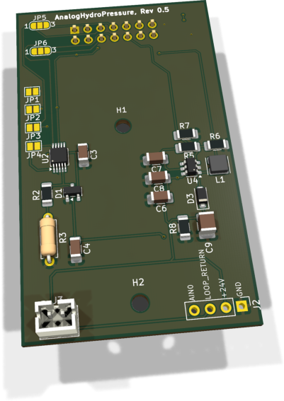
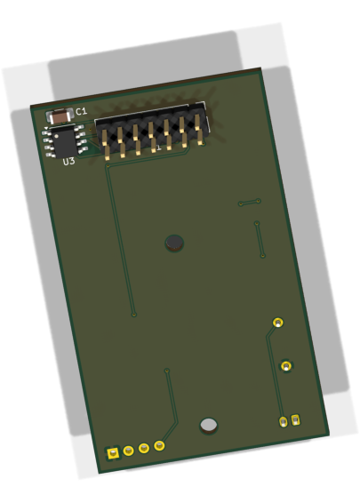

# AnalogHydroPressure - Bestückung und Inbetriebnahme

FullSize-Modul für eine Zweileiter-4-20-mA-Drucksonde mit lokalem 24-V-Boost und ADS1115. JP5 (SDA) und JP6 (SCL) müssen gemeinsam auf denselben I²C-Bus gesetzt werden. Ohne diese Brücken ist der ADS1115 nicht erreichbar.

!!! info "Pilotfassung"
    Aus der jeweils letzten PDF-Anleitung überführt. Inhalt und Darstellung sind noch zur Durchsicht vorgesehen. Webansicht und neue PDF verwenden dieselbe Markdown-Quelle. Die Überführung ist keine neue Hardwareprüfung.

[Generierte PDF-Pilotfassung](../../assets/downloads/AnalogHydroPressure_Rev0.5_Markdown-Pilot.pdf){ .md-button }

[Bisherige PDF-Ausgabe](../../assets/downloads/AnalogHydroPressure_Bestueckungs_und_Bringup_Rev0.5.pdf)

## 1. Teile und Vorbereitung

### 1.1 Elektronische Bestückung

| Ref. | Anz. | Wert / Funktion | EnvNode-Part | Gehäuse / Footprint |
| --- | --- | --- | --- | --- |
| C1, C3, C8 | 3 | 100 nF, X7R, 100 V | ENP-00006 | 1206 |
| C4, C7 | 2 | 1 µF | ENP-00028 | 1206 |
| C6 | 1 | 4,7 µF, 25 V, X7R | ENP-00067 | 1206 |
| C9 | 1 | 4,7 µF, 50 V, X7R | ENP-00068 | 1210 |
| D1 | 1 | BAT54S Dual-Schottky | ENP-00029 | SOT-23 |
| D3 | 1 | B260S1F-7, 60 V / 2 A | ENP-00106 | SOD-123F |
| L1 | 1 | 0,68 µH, WE-MAPI | ENP-00070 | MAPI-3012-Footprint |
| R2 | 1 | 4,7 kΩ, 1 % | ENP-00005 | 1206 |
| R3 | 1 | 150 Ω, 0,1 %, <=25 ppm/K | ENP-00032 | THT 0207, P7,62 |
| R5 | 1 | 1 MΩ, 1 % | ENP-00071 | 1206 |
| R6 | 1 | 71,5 kΩ, 1 % | ENP-00072 | 1206 |
| R7 | 1 | 100 kΩ, 0,1 % | ENP-00016 | 1206 |
| R8 | 1 | 220 kΩ, 1 % | ENP-00073 | 1206 |
| U2 | 1 | ADS1115IDGS, 16-Bit ADC | ENP-00027 | VSSOP/TSSOP-10, 0,5 mm |
| U3 | 1 | 24LC32A-I/SN | ENP-00102 | SOIC-8 |
| U4 | 1 | LT8330ES6, Boost-Regler | ENP-00075 | TSOT-23-6 |
| J1 | 1 | 2x7 Bottom-Mount Modulstecker | ENP-00059 | 2,54 mm THT |
| J3 | 1 | JST-PH, 2-polig, vertikal | ENP-00012 | B2B-PH-K-S |
| PCB | 1 | AnalogHydroPressure Rev. 0.5 | ENP-00107 | 38,00 x 64,00 mm |

J2 (optionale 1x4-Messstiftleiste) bleibt DNP. Die Lötjumper JP1 bis JP6 sind Leiterplattenstrukturen und keine separaten Kaufteile.

### 1.2 Orientierung, Konfiguration und Sicherheit

#### Bauteilorientierung

- ☐ D1 und D3 nach Gehäuse- und PCB-Markierung ausrichten.

- ☐ U2: Pin 1 und die feine 0,5-mm-Pinreihe unter Vergrößerung kontrollieren.

- ☐ U4: Pin 1 des TSOT-23-6 kontrollieren; keine Brücken zwischen den Pins.

- ☐ J1 wird von der Modulunterseite bestückt. Pin 1 ist am quadratischen Pad erkennbar.

- ☐ J3 plan und rechtwinklig einsetzen; Verriegelungsrichtung mit dem PCB-Aufdruck abgleichen.

- ☐ R3 ist der präzise 150-Ω-Shunt. Nicht mit einem Standard-150-Ω-Widerstand geringerer Genauigkeit verwechseln.

#### Konfiguration vor dem ersten Einschalten

ADC-Adresse: Genau einen der Jumper JP1 bis JP4 schließen. JP1 = 0x48, JP2 = 0x49, JP3 = 0x4A, JP4 = 0x4B. Mehrere geschlossene Jumper sind unzulässig.

I2C-Bus: JP5 (SDA) und JP6 (SCL) immer gemeinsam auf denselben Bus setzen. Bei beiden Jumpern: Pins 1-2 = I2C0; Pins 2-3 = I2C1. Ohne Brücken ist der ADS1115 nicht erreichbar. Keine gemischte Buswahl und keine Vollbrücke: I2C0 und I2C1 dürfen nicht verbunden werden.

24-V-Bereich: Das Modul erzeugt lokal etwa 24 V. Der erste Bring-up erfolgt strombegrenzt, ohne angeschlossene Drucksonde und mit berührungssicheren Messmitteln.

#### Benötigte Hilfsmittel

- ☐ Feinlötkolben, Flussmittel, Vergrößerung und geeignetes Werkzeug für 0,5-mm-Pitch.

- ☐ Multimeter sowie Oszilloskop mit geeignetem Tastkopf für Schaltknoten und Ripple.

- ☐ Strombegrenztes 5-V-Labornetzteil und ein I2C-Master bzw. EnvNode-Mainboard.

- ☐ Kalibrierte Stromquelle oder 4-20-mA-Simulator für die Messpfadprüfung.

## 2. Bestückungsübersicht - Oberseite

{ .board-view }

Auf der Oberseite liegen die aktive Analog- und Boost-Beschaltung, die vier ADC-Adressjumper JP1 bis JP4, die beiden I2C-Buswahljumper JP5/JP6, der Sondenanschluss J3 sowie die optionalen Messpunkte von J2.

Hinweis zur 3D-Ansicht: KiCad kann DNP-Positionen als Gehäuse darstellen. Maßgeblich für die Bestückung sind die Stückliste und die DNP-Angaben in dieser Anleitung.

### 2.1 Unterseite und Modulstecker

{ .board-view }

J1 wird als Bottom-Mount-Stiftleiste von der Modulunterseite eingesetzt. U3 und C1 liegen ebenfalls auf der Unterseite.

Wichtig: J1 nicht durch einen von oben bestückten Standard-Header ersetzen. Die mechanische Lage und die Pinreihenfolge im Mainboard-Slot wären sonst falsch.

### Betrieb ohne Modulidentifikation

Der analoge Messpfad bleibt ohne EEPROM elektrisch funktionsfähig. Ohne gültigen Modul-Descriptor kann die Firmware das Modul jedoch nicht identifizieren, seine Kompatibilität prüfen oder modulabhängige Einstellungen daraus ableiten. ADC-Anbindung und Boost-Ansteuerung müssen dann manuell konfiguriert werden; passende Treiberunterstützung bleibt erforderlich.

## 3. Empfohlene Löt-Reihenfolge

### 1. Feine ICs

U2 und U4 zuerst bestücken. Pin 1 prüfen, einen Eckpin fixieren, Lage korrigieren und anschließend alle Pins löten.

### 2. Kleine Halbleiter

D1 und D3 polaritätsrichtig montieren. Danach Diodentest durchführen.

### 3. Kleine passive Bauteile

C3/C4/C6/C7/C8/C9, R2/R5/R6/R7/R8 und L1 bestücken. C9 muss die vorgesehene 50-V-Ausführung sein.

### 4. Präzisions-Shunt

R3 = 150 Ω / 0,1 % sauber und spannungsfrei einlöten. Anschlussdrähte kurz halten, ohne das Gehäuse mechanisch zu belasten.

### 5. U3/C1 bestücken, J2 DNP

U3 (24LC32A-I/SN) und C1 (100 nF) auf der Unterseite bestücken. J2 bleibt unbestückt.

### 6. J3

JST-PH-Stecker von oben einsetzen, rechtwinklig ausrichten und mechanisch saubere THT-Lötstellen herstellen.

### 7. J1 Bottom-Mount

J1 von unten einsetzen, mit einer Buchse oder Vorrichtung rechtwinklig halten und über Kreuz anlöten.

### 8. Lötjumper setzen

Genau einen ADC-Adressjumper schließen; JP5 und JP6 gemeinsam auf I2C0 oder I2C1 setzen. Konfiguration dokumentieren.

### 9. Reinigung und Sichtprüfung

Flussmittelreste entfernen. U2/U4, D3, L1 und die Jumper unter Vergrößerung prüfen.

## 4. Anschlussbelegung und Sollwerte

### 4.1 EnvNode-Modulstecker J1

| Pin | Netz | Verwendung |
| --- | --- | --- |
| 1 | GND | Versorgungs- und Messreferenz |
| 2 | +3V3_SYS | ADS1115 und Identifikation |
| 3 | EEPROM_A0 | U3-Adressauswahl |
| 4 | +5V | Eingang für den lokalen 24-V-Boost |
| 5 / 6 | I2C0_SDA / SCL | ADS1115 wählbar; U3 fest |
| 7 / 8 | I2C1 | ADS1115 über JP5/JP6 wählbar |
| 9 / 10 | AUX_GPIO1 / 2 | Pin 9 frei; Pin 10 Boost-Enable |
| 11-14 | SPI | nicht verwendet |

### 4.2 Sensor- und Messanschlüsse

J3: Anschluss der Zweileiter-4-20-mA-Drucksonde. Die vorgesehene Sonde ist intern polaritätsunabhängig; bei Ersatztypen Datenblatt und Polung prüfen.

J2 (DNP): optionale Messpunkte in der Reihenfolge GND, +24V, LOOP_RETURN und AIN0. Für den normalen Betrieb ist keine Stiftleiste erforderlich.

### 4.3 Erwartete elektrische Werte

| Prüfpunkt | Sollwert / Bedeutung |
| --- | --- |
| +3V3_SYS | 3,3 V nominal |
| +5V | 5 V nominal |
| +24V | etwa 24 V, lastabhängig prüfen |
| AIN0 bei 4 mA | etwa 0,600 V |
| AIN0 bei 20 mA | etwa 3,000 V |
| ADS1115 | Adresse gemäß genau einem JP1-JP4 |

### Boost-Enable und Mainboard-Zuordnung

J1.10 = AUX_GPIO2: HIGH (3,3 V) aktiviert den Boost, LOW deaktiviert ihn. R7 = 100 kOhm zieht EN/UVLO gegen GND. Mini Slot A und Weatherstation Slot A: GPIO13; Mini Slot B: GPIO14. J1.9 bleibt frei; eine SCT013-Eingangsschaltung ist nicht implementiert.

## 5. Prüfungen ohne Versorgung

- ☐ Sichtprüfung aller Lötstellen, Leiterplattenkanten, Bohrungen und Steckverbinder bestanden.

- ☐ Kein niederohmiger Kurzschluss zwischen +5V und GND, +3V3_SYS und GND sowie +24V und GND.

- ☐ U2/U4 korrekt orientiert; keine Brücken an den feinen Pins.

- ☐ D1/D3 in plausibler Diodenrichtung; L1 und C9 mechanisch sicher.

- ☐ J1 von der Unterseite bestückt, Pin 1 korrekt und Stecker rechtwinklig.

- ☐ U3 und C1 bestückt; U3-Orientierung und Lötstellen geprüft. J2 bleibt DNP.

- ☐ Genau ein Adressjumper JP1-JP4 geschlossen.

- ☐ JP5 und JP6 beide auf 1-2 (I2C0) oder beide auf 2-3 (I2C1); keine Vollbrücke.

- ☐ J3 ohne Kurzschluss zwischen den beiden Sondenanschlüssen.

## 6. Erstinbetriebnahme

| Schritt | Aktion / Erwartung |
| --- | --- |
| 1 | Ohne Sonde: AUX_GPIO2 LOW halten; 5 V zuerst auf 100 mA begrenzen. |
| 2 | +3V3_SYS und +5V kontrollieren. Bei ungewöhnlicher Stromaufnahme sofort abschalten. |
| 3 | AUX_GPIO2 auf 3,3 V HIGH setzen; +24V gegen GND auf etwa 24 V testen. |
| 4 | Schaltknoten und 24-V-Ripple mit kurzer Massefeder prüfen; keine langen Tastkopf-Masseleitungen. |
| 5 | ADS1115 am gewählten Bus auf Adresse 0x48 bis 0x4B suchen. |
| 6 | Erst danach 4-20-mA-Simulator oder Drucksonde anschließen. |

### Modulidentifikation prüfen

3,3 V am EEPROM messen. I2C0: Slot A = 0x52, Slot B = 0x53. Adresse, passenden Descriptor und erkannte Identität prüfen und protokollieren.

### Zusätzliche Prüfung vor dem Einschalten

Spannungsfrei: Durchgang J1.10 zu U4.4 (EN/UVLO) und R7.1 prüfen; R7.2 muss an GND liegen. Keine Brücke zu J1.9. Beim Start AUX_GPIO2 LOW halten, dann gezielt HIGH setzen. Nach LOW kann C9 Restspannung halten; vor Arbeiten +24V messen.

### 6.1 Funktions-, Last- und Kalibrierprüfung

- ☐ 4 mA einspeisen und etwa 0,600 V an AIN0 messen.

- ☐ 12 mA einspeisen und etwa 1,800 V an AIN0 messen.

- ☐ 20 mA einspeisen und etwa 3,000 V an AIN0 messen.

- ☐ ADS1115-Rohwerte für mindestens drei Strompunkte dokumentieren.

- ☐ 24-V-Ausgang bei 4 mA und 20 mA prüfen; Ripple und Einbruch dokumentieren.

- ☐ Temperatur von U4, L1, D3, C9 und R3 nach mindestens 15 Minuten bei 20 mA beurteilen.

- ☐ Mit der vorgesehenen Drucksonde Nullpunkt und Endwert gegen bekannte Wasserhöhe bzw. Referenzdruck kalibrieren.

Die Sollspannungen ergeben sich aus dem 150-Ω-Shunt: U = I x 150 Ω. Bauteiltoleranz, Leitungswiderstand, ADC-Offset und Sensorabweichung werden in der Systemkalibrierung berücksichtigt.

## 7. Messprotokoll

| Prüfpunkt | Soll | Messwert | Bestanden | Bemerkung |
| --- | --- | --- | --- | --- |
| +3V3_SYS | 3,3 V |  |  |  |
| +5V | 5 V |  |  |  |
| +24V, ohne Sonde | ca. 24 V |  |  |  |
| AIN0 @ 4 mA | ca. 0,600 V |  |  |  |
| AIN0 @ 12 mA | ca. 1,800 V |  |  |  |
| AIN0 @ 20 mA | ca. 3,000 V |  |  |  |
| ADS1115-Adresse | JP1-JP4 |  |  |  |
| 24-V-Ripple | dokumentieren |  |  |  |
| Temperaturtest | unauffällig |  |  |  |

## 8. Fehlerbilder

| Beobachtung | Zuerst prüfen |
| --- | --- |
| Kein +24V | AUX_GPIO2 / J1.10 HIGH? Dann +5V, U4, L1, D3 und Widerstände testen. |
| 24V deutlich falsch | Feedback-Widerstände R5/R6, Massebezug, D3/C9 und Lötstellen am U4. |
| Hoher Strom / Erwärmung | Sofort ausschalten; Orientierung D3/U4, Kurzschluss am Schaltknoten, L1 und C9 prüfen. |
| ADS1115 nicht erreichbar | 3,3 V, JP5/JP6-Buswahl, U2 und genau einen Adressjumper prüfen. |
| Falsche I2C-Adresse | JP1-JP4 prüfen; mehrere geschlossene Jumper entfernen. |
| Messwert immer 0 V | Sondenschleife, J3, +24V, LOOP_RETURN, R3 und ADC-Kanal prüfen. |
| Messwert zu hoch / begrenzt | Schleifenstrom, R3-Wert, D1-Klemmung, ADS1115-Konfiguration und Eingangsspannung prüfen. |
| Messwert instabil | 24-V-Ripple, Masseführung, I2C, Kontakt an J3 und Sensorleitung prüfen. |
| U3 nicht erreichbar | 3,3 V, I2C0, Adresse 0x52/0x53, Orientierung und gültigen Descriptor prüfen. |

3,3 V, I2C0, Adresse 0x52/0x53, Orientierung und gültigen Descriptor prüfen.

Historischer Teststand vom 28. September 2026: Rev. 0.5 ist als Prototyp dokumentiert. ERC: 0 Fehler, 10 bekannte Warnungen zu unbenutzten Interface-Netzen sowie gleichnamigen lokalen/globalen Labels. DRC und Schaltplan-PCB-Parität sind sauber. Physische Boost-, Temperatur-, EMV- und Kalibrierprüfung bleiben erforderlich.

## 9. Revisionsnachweis

Dokumentstand: 17. Oktober 2026. PCB Revision 0.5 unverändert. Die folgenden SHA-256-Prüfsummen auf die gespeicherten KiCad-Quellen vom 17. Oktober 2026. beziehen sich

24VBoost.kicad_sch

`ff275bf52899710001d8b2802a27134ceb3b9a78ef540b48b30462479fc9534c`

Analog.kicad_sch

`729005c880a309e3794441fb1a53eeddc8cf9b88c6007529d2a3a3c7f8e63bfe`

AnalogHydroPressure.kicad_pcb

`593013c4576161ed076c4f8a136ea8c3ed478ddf798b3796247990af6e96c141`

AnalogHydroPressure.kicad_pro

`574f5654d2e57cf020bf475cde377324bd7091b878dcf141b5059e5342f494fa`

AnalogHydroPressure.kicad_sch

`c6b52cef2d62b485415fd6f44c61734b7cdcedfc81fe570f0dba18ae9b5cec2c`

Quellenabgleich vom 5. Oktober 2026: Modul- und Messanschlüsse sowie Boost-Enable wurden gegen Netzliste und PCB-Padnetze geprüft. Die Rückseitenansicht und die Prüfsummen wurden am 17. Oktober 2026 aus den gespeicherten KiCad-Dateien aktualisiert. Die Oberseitenansichten bleiben unverändert.

Historische KiCad-Prüfung vom 28. September 2026: ERC: 0 Fehler und 10 Warnungen zu unbenutzten Signalen und gleichen lokalen/globalen Labelnamen. PCB DRC: 0 Verstöße, 0 offene Verbindungen; Schaltplan-PCB-Parität: 0 Abweichungen. Quelle: Projekt-README. Für diese Dokumentaktualisierung wurde kein vollständiger neuer ERC-/DRC-Lauf durchgeführt.

Bestückungsbasis: Bauteile gemäß Stückliste und Lötfolge. Messheader J2 bleibt DNP. Die Unterseitenansicht wurde aus dem gespeicherten KiCad-Projekt vom 17. Oktober 2026 erzeugt. Die PCB-Revision bleibt 0.5.

Freigabe: Entwurf / Prototypenstand. Physischer Boost-Bring-up, Last-, Temperatur-, EMV- und Kalibrierprüfungen bleiben erforderlich. Die Firmware muss den zur Slot-Belegung passenden GPIO ansteuern.

Bring-up: 3,3 V am EEPROM prüfen. Auf I2C0 muss es in Slot A bei 0x52, in Slot B bei 0x53 antworten. Passenden Descriptor provisionieren, Rückleseprüfung und erkannte Identität dokumentieren. Ein I2C-Antwortsignal allein bestätigt keinen gültigen Inhalt. Die dokumentierte Web-Provisionierung bietet nur DuoRelay; diese Vorlage niemals für AnalogHydroPressure verwenden. Ein passender Descriptor und Provisionierungsweg sind erforderlich.

EnvNode-eigene Inhalte: LicenseRef-EnvNode-Use-and-Redistribution-1.0; siehe LICENSE im Repository. Drittanbieterrechte bleiben unberührt.

### Überführung und Lizenz

Diese Pilotfassung übernimmt den zuletzt gepflegten PDF-Stand einschließlich seiner Ergänzungen. Quellenprüfsummen und Prüfberichte im Text sind historische Nachweise aus der PDF und wurden durch diese Überführung nicht neu bestätigt. Für neu generierte Ausgaben protokolliert der Build zusätzlich die Prüfsummen von Markdown, ursprünglicher PDF, Inhaltsbildern, Druckvorlage und Schriften.

EnvNode-eigene Inhalte: LicenseRef-EnvNode-Use-and-Redistribution-1.0; siehe [Lizenz](../../license.md). Rechte an Drittanbieter-Modellen und sonstigen Fremdinhalten bleiben bestehen.
