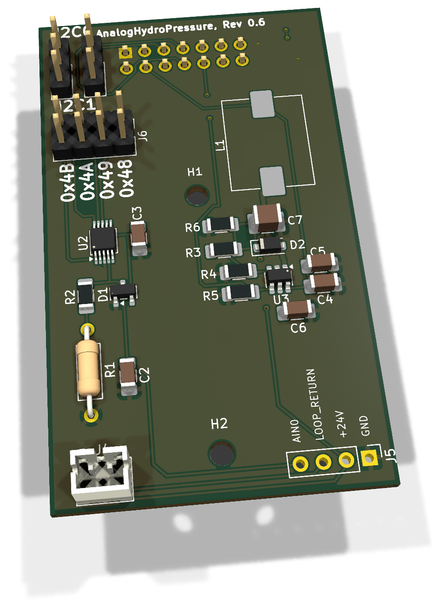
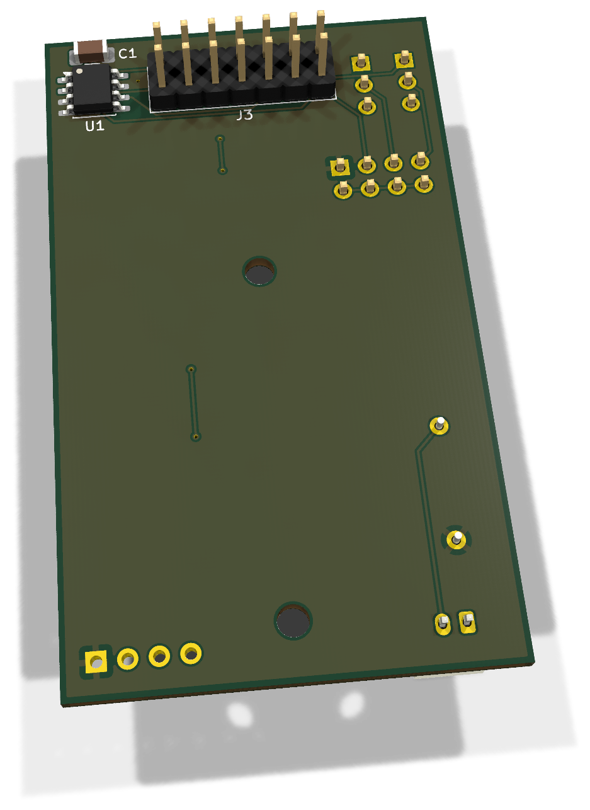
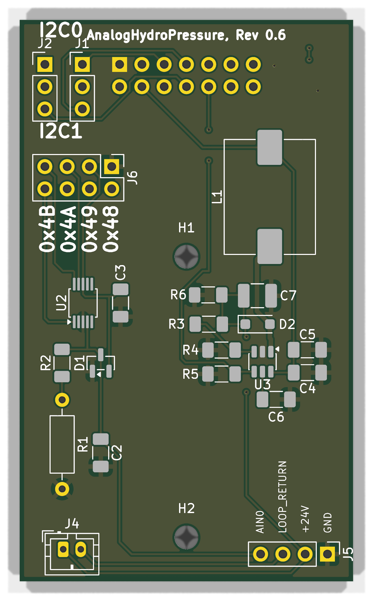
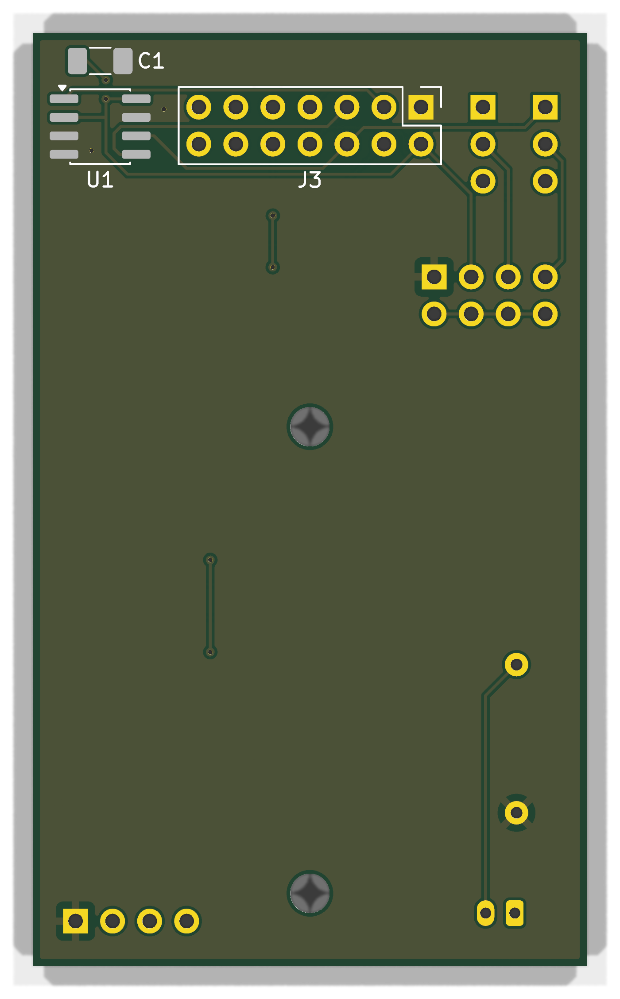

# AnalogHydroPressure 0.6 - Bestückung und Inbetriebnahme

FullSize-Modul für Zweileiter-Drucksonden mit 4–20 mA, lokaler 24-V-Versorgung und ADS1115. Revision 0.6 ersetzt Lötjumper durch steckbare Bus-/Adressjumper und verwendet die Bourns-Spule SDR1005-R68ML sowie einen THT-Präzisionsshunt.

**Dokumentation abgeschlossen am 28. Oktober 2026.** Der Fertigungs- und Erprobungsstand wird im Abschlusskapitel getrennt geführt.

[Anleitung als PDF](../../assets/downloads/AnalogHydroPressure_Rev0.6_Anleitung.pdf){ .md-button }
[Alte Revisionen](old-revisions.md){ .md-button }

## 3D-Ansicht

{ .hero-paired-view }
{ .hero-paired-view }

Vorderseite (F.Cu) und bestückte Rückseite (B.Cu). Nicht hinterlegte 3D-Modelle bleiben ausgespart. Die Bestückungspläne folgen im Abschnitt zur Bestückungsübersicht.

## 1. Teile und Vorbereitung

| Ref. | Anz. | Wert / Funktion | Artikel | Gehäuse / Hinweis |
| --- | --- | --- | --- | --- |
| C1, C3, C5 | 3 | 100 nF | ENP-00006 | 1206 |
| C2 | 1 | 1 µF | ENP-00028 | 1206 |
| C6 | 1 | 1 µF, mindestens 10 V | ENP-00028 | 1206, INTVCC |
| C4 | 1 | 4,7 µF, mindestens 10 V | ENP-00067 | 1206, 5-V-Eingang |
| C7 | 1 | 4,7 µF, 50 V | ENP-00068 | 1210, Boost-Ausgang |
| D1 | 1 | BAT54S | ENP-00029 | SOT-23, ADC-Begrenzung |
| D2 | 1 | Schottky, bisher B260S1F-7 | ENP-00106 | SOD-123F; genaue MPN gegen Einkaufs-BOM bestätigen |
| L1 | 1 | Bourns SDR1005-R68ML, 0,68 µH | ENP-00140 | Handlötpads; kein 3D-Modell |
| R1 | 1 | 150 Ω, 0,1 %, ≤25 ppm/K, >0,125 W | ENP-00032 | THT 0207, Raster 10,16 mm |
| R2 | 1 | 4,7 kΩ | ENP-00005 | 1206 |
| R3 | 1 | 1 MΩ, 1 % | ENP-00071 | 1206 |
| R4 | 1 | 71,5 kΩ, 1 % | ENP-00072 | 1206 |
| R5 | 1 | 100 kΩ, 1 % oder besser | ENP-00016 | 1206; Enable-Pull-down |
| R6 | 1 | 220 kΩ, 1 % | ENP-00073 | 1206; Entladung |
| U1 | 1 | 24LC32A-I/SN | ENP-00102 | SOIC-8, Unterseite |
| U2 | 1 | ADS1115IDGS | ENP-00027 | TSSOP/VSSOP-10, 0,5 mm |
| U3 | 1 | LT8330S6 | ENP-00075 | TSOT-23-6 |
| J1, J2 | 2 | Buswahl 1×3 plus je eine Kappe | Zuordnen | 2,54 mm |
| J6 | 1 | Adresswahl 2×4 plus eine Kappe | Zuordnen | 2,54 mm |
| J3 | 1 | Modulstecker 2×7 | ENP-00059 | THT, Bottom-Mount |
| J4 | 1 | JST-PH 2-polig | ENP-00012 | Sondenanschluss |
| J5 | 0/1 | Messheader 1×4 | Optional | Darf DNP bleiben |
| PCB | 1 | AnalogHydroPressure 0.6 | Revisionsartikel zuordnen | 38 × 64 mm |

Die Artikelzuordnungen stammen aus der Rev.-0.6-Vorlage vom 22.10.2026; neue Jumper- und PCB-Artikel sind dort noch nicht zugeordnet. Das ist kein Nachweis aktueller Lagerbestände. Die Bauteilreferenzen unterscheiden sich erheblich von Rev. 0.5. U1 = EEPROM, U2 = ADC, U3 = Boost; Modulstecker = J3.

Bereitlegen: Feinlötkolben, Vergrößerung, Multimeter, Oszilloskop mit kurzer Masseleitung, strombegrenzte 5-V-/3,3-V-Versorgung, I²C-Master, 4–20-mA-Testquelle und mindestens 1-W-Lastwiderstand mit 1,2 kΩ.

## 2. Bestückungsübersicht

### Vorderseite: Bestückungsplan

{ .assembly-plan }

[Plan als PNG](../../assets/board-views/analog-0.6/assembly-front.png){ .md-button }

### Rückseite: Bestückungsplan

{ .assembly-plan }

[Plan als PNG](../../assets/board-views/analog-0.6/assembly-back.png){ .md-button }

Senkrechtes KiCad-Rendering der Leiterplatte ohne Bauteilmodelle. Kupfer, Lötstoppmaske und Bestückungsdruck entsprechen der PCB-Quelle. Rückseitenpläne werden von B.Cu aus betrachtet.

Die Bestückungspläne zeigen die Leiterplatte senkrecht zur jeweiligen Seite. Bestückungsdruck und Referenzen folgen der PCB-Quelle; eine Rückseitenansicht ist keine Kontaktansicht eines Kabelsteckers.

L1 hat kein hinterlegtes 3D-Modell und ist trotzdem zu bestücken. Nicht mit einer 68-µH-Spule verwechseln. U1, C1 und J3 liegen auf der Unterseite. H1/H2 haben 2,7-mm-Bohrungen; isolierende Befestigung mit passenden Abständen verwenden.

## 3. Löt-Reihenfolge

1. R2-R6 und C2-C7 bestücken; C7 muss für 50 V geeignet sein.
2. D1/D2, U2/U3 ausrichten und löten. U2-Pins einzeln unter Vergrößerung prüfen.
3. U1 und C1 auf der Unterseite bestücken; EEPROM-Pin 1 prüfen.
4. L1 plan verlöten und R1 ohne mechanische Spannung im 10,16-mm-Raster einsetzen.
5. J3 von unten einsetzen und mit Gegenbuchse rechtwinklig halten.
6. J1/J2, J6 und J4 auf der Oberseite bestücken; J5 nur bei Bedarf.
7. Reinigen, Brücken ausschließen und Kappen ausschließlich spannungsfrei setzen.

## 4. Anschlüsse und Konfiguration

### Buswahl

| Bus | J1 / SDA | J2 / SCL |
| --- | --- | --- |
| I2C0 | 1–2 | 1–2 |
| I2C1 | 2–3 | 2–3 |

Mittelpin J1.2 führt zu U2.9, J2.2 zu U2.10. Beide Kappen immer gemeinsam auf denselben Bus setzen. U1 bleibt unabhängig davon fest auf I2C0.

### ADS1115-Adresse

| Adresse | Genau ein Pinpaar auf J6 brücken |
| --- | --- |
| 0x48 | 1–2, ADDR an GND |
| 0x49 | 3–4, ADDR an +3V3_SYS |
| 0x4A | 5–6, ADDR an SDA |
| 0x4B | 7–8, ADDR an SCL |

J6 niemals mit mehreren Kappen bestücken. In der Oberseitenansicht mit Platinentitel oben liegen die Adresspaare von links nach rechts als 0x4B, 0x4A, 0x49, 0x48. Verbindlich sind die Pinnummern.

### Modulstecker und Sonde

| Anschluss | Funktion |
| --- | --- |
| J3.1 / .2 / .4 | GND / +3V3_SYS / +5V |
| J3.3 | EEPROM_A0, slotabhängig |
| J3.5 / .6 | I2C0 SDA / SCL; EEPROM fest, ADC wählbar |
| J3.7 / .8 | I2C1 SDA / SCL für den ADC |
| J3.10 | AUX_GPIO2 → U3.4, Boost-Enable |
| J4.1 / .2 | +24V / LOOP_RETURN zur Zweileitersonde |
| J5.1 / .2 / .3 / .4 | GND / +24V / LOOP_RETURN / AIN0 |

J3.9 sowie SPI sind ohne Messfunktion. U1 hat A1 HIGH, A2 LOW, A0 an J3.3: Identifikation bei 0x52 in Slot A oder 0x53 in Slot B. AUX_GPIO2 ist am Mini A GPIO13, am Mini B GPIO14 und am Weather-Slot GPIO13. Die ADC-Adresse ist von der EEPROM-Adresse unabhängig.

!!! warning "Enable ist keine Lasttrennung"
    LOW an AUX_GPIO2 stoppt den Boost; über L1 und D2 bleibt ein passiver Pfad von 5 V zum Ausgang. C7 kann Restspannung halten. Vor Arbeiten alle Quellen trennen und Ausgang messen. Nie 24 V an AIN0 oder Mainboard-Signalpins anlegen.

## 5. Prüfung ohne Versorgung

- ☐ Keine niederohmigen Kurzschlüsse zwischen +5V, +3V3_SYS, +24V und GND; Kondensatorladeeffekte berücksichtigen.
- ☐ R1 = 150 Ω; D1/D2 und alle ICs korrekt orientiert.
- ☐ J1/J2 gleiche Buswahl; auf J6 genau eine Kappe.
- ☐ J4.1 an C7.1/+24V, J4.2 an R1.1/LOOP_RETURN; R1.2 an GND.
- ☐ U1.8/U2.8 an +3V3_SYS; U1.4/U2.3 an GND.
- ☐ U1.5/.6 an I2C0; J3.10 an U3.4 und R5.1.
- ☐ Keine Brücken an U2; J3 sitzt korrekt auf der Unterseite.

## 6. Erstinbetriebnahme

1. Ohne Sonde und stromlos verdrahten. AUX_GPIO2 LOW halten.
2. 3,3 V und 5 V über ein geeignetes Mainboard bzw. Prüfadapter strombegrenzt bereitstellen; Versorgungspolarität und Ruhestrom dokumentieren.
3. U1 und ADS1115 auf dem tatsächlich gewählten Bus suchen. ACK und gültigen Modul-Descriptor getrennt prüfen.
4. Boost gezielt HIGH schalten. Ausgang gegen GND messen; nominal etwa 24 V. Bei Strombegrenzung, Überschwingen oder auffälliger Erwärmung abschalten.
5. 1,2-kΩ-Last mit mindestens 1 W anschließen: nominal 20 mA und 0,48 W bei 24 V. Spannungsreserve, Ripple und Temperatur von U3/L1/D2 erfassen.
6. Enable LOW und Ausgangsverlauf dokumentieren; Restspannung und passiven Pfad berücksichtigen.
7. Mit einer geeigneten 4–20-mA-Quelle den Messpfad prüfen, anschließend erst die passende Sonde anschließen und kalibrieren.

## 7. Messprotokoll

| Prüfung | Erwartung | Ist / Datum |
| --- | --- | --- |
| +3V3_SYS / +5V | Nominal 3,3 / 5 V | |
| EEPROM / ADC | 0x52 oder 0x53 / gewählte Adresse | |
| Boost ohne Last / mit 1,2 kΩ | Etwa 24 V, Ripple dokumentieren | |
| 4 mA am Shunt | 0,600 V | |
| 12 mA am Shunt | 1,800 V | |
| 20 mA am Shunt | 3,000 V | |
| Enable LOW / HIGH | Verlauf, Strom und Temperatur erfassen | |
| Sonde / Druckbereich / Kalibrierung | Identifikation und Referenzwerte | |

Die Shuntwerte folgen U = I × 150 Ω. ADS1115-Rohwert hängt von der konfigurierten Verstärkung ab; keinen festen Umrechnungsfaktor ohne PGA-Einstellung verwenden.

## 8. Fehlerbilder und Firmware

| Befund | Prüfen |
| --- | --- |
| ADC fehlt | Buskappen J1/J2, eine Adresskappe, Versorgung, U2-Lötstellen |
| Keine Boostfunktion | +5V, AUX_GPIO2, U3/L1/D2 und Rückkopplung R3/R4 |
| Restspannung trotz LOW | Passiver L1/D2-Pfad; kein Beweis für defekten Enable |
| Messfehler | R1, Teststrom, ADC-PGA, Filter und Bezugspotential |
| EEPROM antwortet, Modul bleibt unbekannt | Passender Descriptor und Firmwareprofil |

Ein gültiger Modul-Descriptor aktiviert nicht automatisch ADC und Boost. Eine konkrete Firmware-Mindestversion wird hier nicht festgelegt. Hardwareprotokoll und spätere Firmware-Freigabe bleiben getrennt.

## 9. Abschluss und Prüfstand

Die Dokumentation ersetzt den Rev.-0.6-Entwurf vom 22.10.2026; Rev. 0.5 liegt unter „Alte Revisionen“. Der damalige Designreview nennt DRC einschließlich Zonenfüllung/Parität ohne Befund sowie ERC ohne Fehler und mit zehn Warnungen. Diese CAD-Ergebnisse sind historisch und keine neue Hardwaremessung. Reale Boost-, Last-, Temperatur- und Kalibrierprüfungen sind im Aufbauprotokoll zu ergänzen. Die Anleitung ist redaktionell abgeschlossen; die Bauteil-/Artikelhinweise oben bleiben ausdrücklich sichtbar.

### Quellenstand

Dokumentiert ist der gespeicherte KiCad-Stand aus `analog-hydro-pressure`, Projekt `AnalogHydroPressure`, Basiscommit `22a23bd7c2d1eeedc8284dd62a1c876d9f3fd786`. Die Prüfsummen bestimmen den tatsächlichen Arbeitsstand einschließlich lokaler Änderungen; der Commit allein beschreibt diese nicht.

| Quelle | SHA-256 |
| --- | --- |
| 24VBoost.kicad_sch | `cd0a84deb00eb290ab596b9604f476b06d50300694f4aedb86c46addc5f0420d` |
| Analog.kicad_sch | `447e8534e54cfb9ef02fb16d72f3351dadf1a94b8d307a0a62f713d6e4933ac3` |
| AnalogHydroPressure.kicad_pcb | `922c80698c3d7b888f5c7f905ecb3e3dfc0098ac6227a8902e95c6f52a30463a` |
| AnalogHydroPressure.kicad_pro | `30fa158903dace3d5a136cffc23a9f3cca427e2d56e63312cce7ec86b020b512` |
| AnalogHydroPressure.kicad_sch | `abdc9c851af5464fd9510fa227b51d634a789c2d216f9b1fe4f82aaa6f35f55a` |

[Rendernachweis](../../assets/images/analog-0.6/provenance.json). Dokumentation: LicenseRef-EnvNode-Use-and-Redistribution-1.0, siehe [Lizenz](../../license.md). Drittanbieterrechte an KiCad-Modellen und Bibliotheken bleiben bestehen.
