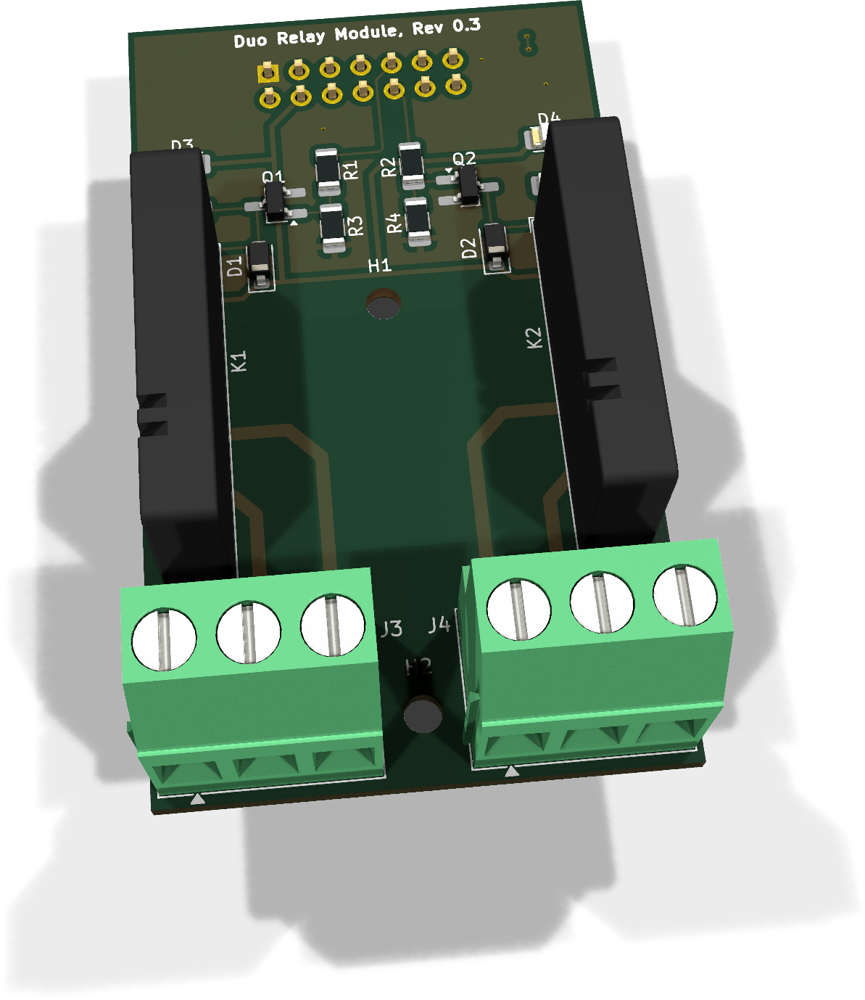
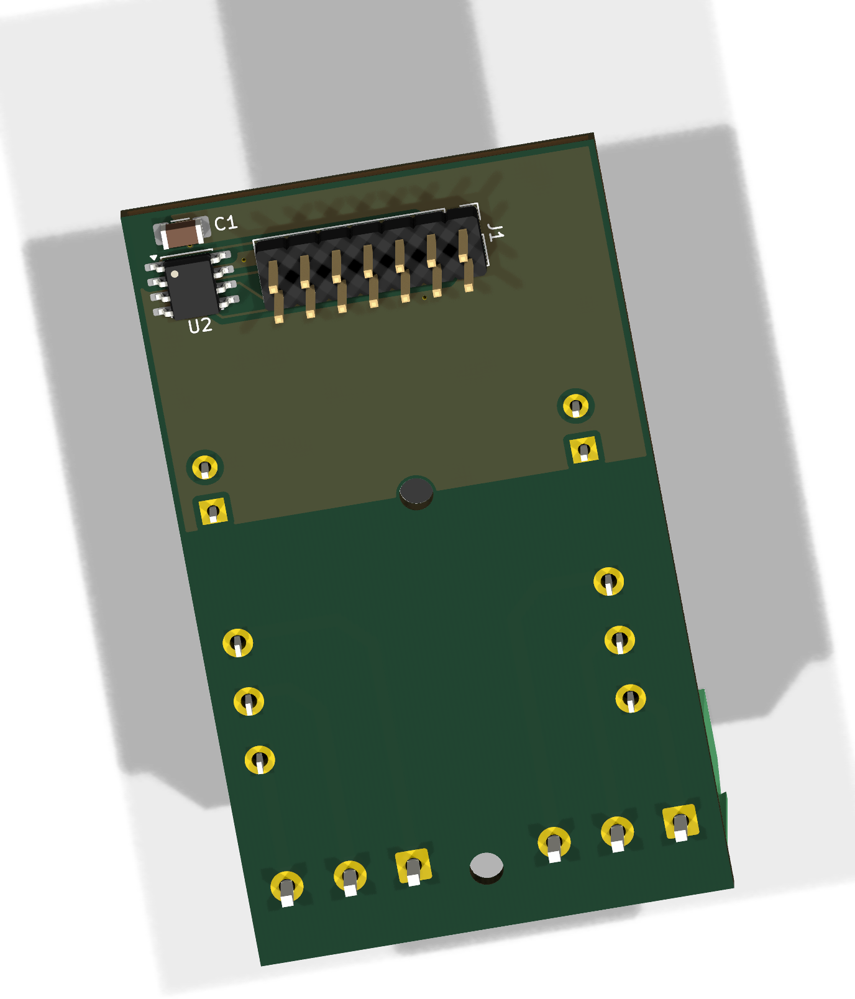

# DuoRelay - Bestückung und Inbetriebnahme

**FullSize-Modul, PCB-Revision 0.3.** Diese Anleitung beschreibt Handbestückung,
Sichtprüfung und Erstinbetriebnahme mit sicherer Kleinspannung.

[Anleitung als PDF](../../assets/downloads/DuoRelay_Rev0.3_Anleitung.pdf){ .md-button }

[Produktübersicht](index.md)

## 1. Teile und Vorbereitung

### Elektronische Bestückung

| Ref. | Anz. | Wert / Funktion | Artikel | Gehäuse / Hinweis |
| --- | --- | --- | --- | --- |
| D1, D2 | 2 | 1N4148W Freilaufdiode | ENP-00033 | SOD-123 |
| D3, D4 | 2 | LED rot, KP-3216SURC | ENP-00064 | 1206 |
| R1, R2 | 2 | 1 kΩ, 1 %, 250 mW | ENP-00036 | 1206 |
| R3, R4 | 2 | 100 kΩ, 0,1 %, 250 mW | ENP-00016 | 1206 |
| R5, R6 | 2 | 1,5 kΩ, 1 %, 250 mW | ENP-00065 | 1206 |
| Q1, Q2 | 2 | BC817 NPN | ENP-00035 | SOT-23 Handsoldering |
| K1, K2 | 2 | Finder 34.51, 5-V-Spule, 1 Wechsler | ENP-00023 | THT |
| J3, J4 | 2 | Schraubklemme 1×3, 5,08 mm | ENP-00034 | Phoenix MKDS-3 horizontal |
| J1 | 1 | Stiftleiste 2×7, Bottom-Mount | ENP-00059 | Von unten bestücken |
| U2 | 1 | 24LC32A-I/SN | ENP-00102 | SOIC-8 |
| C1 | 1 | 100 nF, X7R | ENP-00006 | 1206 |
| PCB | 1 | DuoRelay FullSize 0.3 | ENP-00066 | 38 × 64 mm |

U2 und C1 werden im dokumentierten Bestückungsstand gemeinsam bestückt.
U2 nutzt I2C0 mit 0x52 in Slot A beziehungsweise 0x53 in Slot B.
Der passende Modul-Descriptor ist zu provisionieren und die erkannte Identität zu prüfen.

### Orientierung und Hilfsmittel

- D1/D2: Kathodenmarkierung mit dem PCB-Aufdruck abgleichen.
- D3/D4: LED-Polarität anhand Pin-1-/Kathodenmarkierung prüfen.
- Q1/Q2: SOT-23-Lage und Pin 1 nicht spiegeln.
- J1 von der Unterseite bestücken; Pin 1 am quadratischen Pad erkennen.
- K1/K2 und J3/J4 plan aufsetzen und zunächst mit einem Pin fixieren.
- H1/H2: 2,7-mm-Bohrungen für M2,5; Abstandshalter dürfen keine Leiterbahnen berühren.

Benötigt werden Feinlötkolben, Lot, Flussmittel, Vergrößerung, Multimeter mit
Widerstands-/Dioden-/Durchgangsmessung, strombegrenztes 5-V-Netzteil, zwei sichere
Kleinspannungs-Testlasten und ein geeignetes Mainboard oder eine GPIO-Prüfvorrichtung.

!!! warning "Sicherheitsgrenze"
    Relaisdaten und Abstände sind keine Netzspannungsfreigabe. Klemmen,
    Absicherung, Gehäuse, Berührungsschutz, Lastart, Verschmutzungsgrad und
    Produktnorm müssen für die konkrete Anwendung bewertet werden.
    Der erste Bring-up erfolgt ausschließlich mit sicherer Kleinspannung.

## 2. Bestückungsübersicht

### Oberseite

{ .board-view }

In dieser Ansicht liegt J1 oben. Kanal 1 befindet sich links mit Q1, D1, D3, K1
und J3; Kanal 2 rechts mit Q2, D2, D4, K2 und J4. Kontaktbezeichnungen am unteren
Rand vor der externen Verdrahtung zusätzlich durch Durchgangsmessung verifizieren.

### Unterseite und Modulstecker

{ .board-view }

J1, U2 und C1 liegen auf der Unterseite. Relais- und Klemmenanschlüsse erscheinen
in dieser Ansicht gespiegelt. J1 nicht durch einen von oben bestückten Standardheader
ersetzen. U2-Pin 1 und alle SOIC-8-Lötstellen kontrollieren.

Ohne EEPROM bleibt die Relaisschaltung elektrisch funktionsfähig. Ohne gültigen
Descriptor fehlen Identifikation, Kompatibilitätsprüfung und daraus abgeleitete
Moduleinstellungen; die Ansteuerung muss dann manuell und mit passender
Treiberunterstützung konfiguriert werden.

## 3. Empfohlene Löt-Reihenfolge

1. **Widerstände:** R1/R2 = 1 kΩ, R3/R4 = 100 kΩ und R5/R6 = 1,5 kΩ; kanalweise prüfen.
2. **Dioden und LEDs:** D1/D2 und D3/D4 polaritätsrichtig montieren; Diodentest je Kanal.
3. **Transistoren:** Q1/Q2 ausrichten, einen Pin fixieren, anschließend vollständig löten.
4. **U2/C1:** gemeinsam bestücken; Pin 1 und sämtliche SOIC-8-Lötstellen prüfen.
5. **J1:** von unten einsetzen und mit Vorrichtung rechtwinklig über Kreuz anlöten.
6. **K1/K2:** plan auf die Oberseite setzen; erst gegenüberliegende Pins fixieren.
7. **J3/J4:** Öffnung nach außen, plan und mechanisch belastbar verlöten.
8. **Reinigung:** Flussmittelreste entfernen und alle Lötstellen sowie den Kontaktbereich prüfen.

## 4. Anschlussbelegung

### Modulstecker J1

| Pin | Netz | Verwendung |
| --- | --- | --- |
| 1 | GND | Treiberreferenz |
| 2 | +3V3_SYS | U2-Versorgung; A1 fest HIGH |
| 3 | EEPROM_A0 | Slotabhängige EEPROM-Adresse |
| 4 | +5V | Relais- und LED-Versorgung |
| 5 / 6 | I2C0 SDA / SCL | U2 |
| 7 / 8 | I2C1 | Nicht verwendet |
| 9 | AUX_GPIO1 | Relaiskanal 1 |
| 10 | AUX_GPIO2 | Relaiskanal 2 |
| 11-14 | SPI | Nicht verwendet |

Jeder Treibereingang besitzt 100 kΩ Pull-down. Bei Reset, Boot und abgezogenem
Controller müssen beide Relais abgefallen bleiben.

### Relaiskontakte

| Kanal | Klemme | Pin 1 | Pin 2 | Pin 3 |
| --- | --- | --- | --- | --- |
| 1 | J3 | NO | COM | NC |
| 2 | J4 | NC | COM | NO |

Die Klemmen sind gegensinnig orientiert. Im Ruhezustand ist COM-NC geschlossen,
bei Ansteuerung COM-NO. Aufdruck und Durchgangsmessung sind maßgeblich.

### EEPROM U2

| U2-Pin | Verbindung |
| --- | --- |
| 1 / A0 | J1.3 |
| 2 / A1 | +3V3_SYS |
| 3 / A2 | GND |
| 4 | GND |
| 5 / SDA | J1.5 |
| 6 / SCL | J1.6 |
| 7 / WP | GND |
| 8 | +3V3_SYS |

Daraus folgen die 7-Bit-Adressen 0x52 bei A0 LOW und 0x53 bei A0 HIGH.

## 5. Prüfungen ohne Versorgung

- ☐ Lötstellen, Platinenkanten und Abstände visuell geprüft.
- ☐ Keine niederohmigen Kurzschlüsse von +5V beziehungsweise +3V3_SYS nach GND.
- ☐ Q1/Q2 und D1/D2 plausibel im Diodentest; keine SOT-23-Lötbrücken.
- ☐ J1 korrekt von unten, Pin 1 richtig, vollständig und rechtwinklig verlötet.
- ☐ Relais und Klemmen plan; keine kalten oder gerissenen Lötstellen.
- ☐ Beide Kanäle: COM-NC niederohmig, COM-NO offen.
- ☐ Kein Durchgang zwischen Kontaktkreis und GND, +5V, +3V3_SYS oder GPIOs.
- ☐ U2 und C1 bestückt; Orientierung und Lötstellen geprüft.
- ☐ U2.5 zu J1.5 und U2.6 zu J1.6 auf Durchgang geprüft.
- ☐ U2.8 und C1.1 zu J1.2; U2.4/U2.7/C1.2 zu GND geprüft.
- ☐ U2.1 zu J1.3, U2.2 zu +3V3_SYS und U2.3 zu GND geprüft.

!!! warning "Unerwartete Verbindung"
    Bei einer unerwarteten Verbindung zwischen Kontaktseite und SELV-Steuerseite
    das Modul nicht einschalten.

## 6. Erstinbetriebnahme und Funktionstest

| Schritt | Aktion / Erwartung |
| --- | --- |
| 1 | Ohne externe Last, ausschließlich mit 5 V starten; Strombegrenzung zunächst etwa 150 mA. |
| 2 | AUX_GPIO1/2 LOW halten: K1/K2 abgefallen und D3/D4 aus. |
| 3 | AUX_GPIO1 HIGH: D3 leuchtet und K1 zieht an; Kanal 2 bleibt aus. |
| 4 | J3: COM-NO geschlossen und COM-NC offen; LOW stellt Ruhezustand wieder her. |
| 5 | Kanal 2 mit AUX_GPIO2, D4, K2 und J4 entsprechend prüfen; Kanal 1 unbeeinflusst. |
| 6 | Beide kurz gleichzeitig einschalten; 5-V-Spannung und Stromaufnahme dokumentieren. |

### Modulidentifikation

3,3 V an U2 messen. Auf I2C0 muss das EEPROM im gewählten Slot auf 0x52 oder
0x53 antworten. Passenden DuoRelay-0.3-Descriptor mit der angebotenen Vorlage
provisionieren, Rückleseprüfung und erkannte Identität protokollieren.
Eine I²C-Antwort allein bestätigt keinen gültigen Inhalt. Die EEPROM-Versorgung
benötigt +3V3_SYS zusätzlich zu den 5 V der Relais.

Modulidentifikation allein ersetzt keine sichere Anwendungskonfiguration.
GPIO-Zuordnung und LOW-Zustand während Reset/Boot am tatsächlichen Board prüfen.

### Funktions- und Belastungstest

- ☐ Erste Kontaktprüfung ausschließlich mit sicherer Kleinspannungs-Testlast.
- ☐ Jeden Kanal mindestens zehnmal schalten; LED, Relaisgeräusch und Kontakte konsistent.
- ☐ Beide Kanäle gleichzeitig prüfen und Versorgungseinbruch beobachten.
- ☐ Kontaktwiderstand und Erwärmung bei der vorgesehenen Last gesondert qualifizieren.
- ☐ Induktive, kapazitive oder motorische Lasten mit geeigneter Schutzbeschaltung und Absicherung bewerten.

## 7. Messprotokoll

Baugruppe / Seriennummer: ____________________ Datum: ____________________

Mainboard / Slot / Firmware: ______________________________________________

| Prüfpunkt | Soll | Messwert | OK | Bemerkung |
| --- | --- | --- | --- | --- |
| +5 V an J1 | 4,75-5,25 V | __________ | ☐ | __________ |
| Ruhestrom, beide aus | Dokumentieren | __________ | ☐ | __________ |
| AUX_GPIO1 LOW/HIGH | K1 aus/ein | __________ | ☐ | __________ |
| AUX_GPIO2 LOW/HIGH | K2 aus/ein | __________ | ☐ | __________ |
| D3 / D4 | Folgen K1 / K2 | __________ | ☐ | __________ |
| J3 Ruhe / aktiv | NC / NO korrekt | __________ | ☐ | __________ |
| J4 Ruhe / aktiv | NC / NO korrekt | __________ | ☐ | __________ |
| Beide Relais aktiv | 5 V stabil | __________ | ☐ | __________ |
| Kontakt / SELV | Kein Durchgang | __________ | ☐ | __________ |
| EEPROM / Descriptor | Adresse, Rücklesen, Identität korrekt | __________ | ☐ | __________ |

## 8. Fehlerbilder

| Beobachtung | Zuerst prüfen |
| --- | --- |
| Relais bleibt aus | +5V, AUX_GPIO, R1/R2, Q1/Q2, Spule und Freilaufdiode |
| LED an, Relais schaltet nicht | Spulenspannung unter Last, Anschlüsse, Lötstellen, Spulenwiderstand |
| Relais zieht beim Boot an | 100-kΩ-Pull-down, GPIO-Konfiguration und Slotbelegung |
| Kontaktzustand vertauscht | Gegensinnige Klemmenorientierung; COM durch Durchgang finden |
| Hoher Strom / Wärme | Sofort abschalten; Dioden, Transistoren, Lötbrücken und Spulen prüfen |
| Kanäle beeinflussen sich | Gemeinsame 5-V-Versorgung, GPIO-Zuordnung, Treiber-Lötbrücken |
| U2 nicht erreichbar | 3,3 V, I2C0, A0/A1, Orientierung, Adresse und Descriptor |

## 9. Dokumentierter Stand und Quellen

PCB-Revision 0.3. Dokumentierter Quellenstand: 17. Oktober 2026.

Der Netzlisten-/PCB-Abgleich vom 5. Oktober bestätigte J1.9 über R1 zu Kanal 1,
J1.10 über R2 zu Kanal 2, J3.1/2/3 = NO1/COM1/NC1 und
J4.1/2/3 = NC2/COM2/NO2. Die historischen ERC-/DRC-Ergebnisse der Revision 0.2
(0 ERC-Fehler, 9 Warnungen; DRC ohne Verstöße, offene Verbindungen oder Footprintfehler)
sind keine erneute Validierung der Revision 0.3. Vollständige erneute Prüfung,
konkrete Klemmen-MPN, Lastqualifikation und anwendungsbezogene Freigaben bleiben offen.

Die Rückseitenabbildung vom 17. Oktober 2026 zeigt bestückte U2/C1.

### Historische Quellenprüfsummen

| Quelle | SHA-256 (historischer Nachweis, nicht neu berechnet) |
| --- | --- |
| DuoRelay.kicad_pcb | `9c7e7d0384efa0a1356a4b9addc3fd7d3b9b6d98eff934059c3addbe35f9a5ac` |
| DuoRelay.kicad_sch | `3a564f3eed7a305c5341b60f4a81d9b3a402525f4ef22cea43710eba0cd59500` |
| DuoRelay.kicad_pro | `eb93d146a7427e1c61ed8eeafaa88f99cde2af8ecb35ecc9e019e2d9c2e67786` |
| README.md | `45b007a3b056f707ef3534ba254772ac659239ed2dca2395581cab7c5eac2d22` |
| EnvNode_Parts.xlsx | `4b908e5bf1f60eb7718d7ad450ac383838b4ab2b8eb72d8c8a33d34de5f85280` |

KiCad-/README-Nachweise beziehen sich auf den gespeicherten Stand vom
17. Oktober; der Artikelstamm-Nachweis bleibt historisch.
EnvNode-eigene Inhalte: LicenseRef-EnvNode-Use-and-Redistribution-1.0;
Drittanbieterrechte bleiben unberührt. Siehe [Lizenz](../../license.md).
