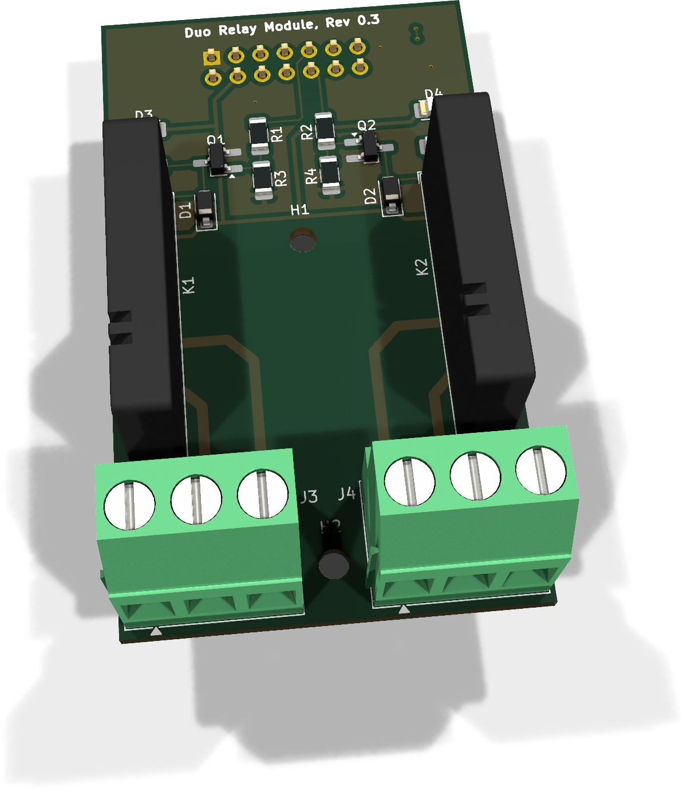

# DuoRelay

DuoRelay ergänzt EnvNode um **zwei unabhängig schaltbare Relaiskanäle**.
Du kannst sie manuell über die Weboberfläche bedienen oder mit einem lokalen
Controller verbinden. Ein Relaiskanal wird in der Firmware als **Aktor** verwendet.

{ .board-view }

## Was möchtest du tun?

| Dein Ausgangspunkt | Die passende Anleitung |
| --- | --- |
| Ich möchte das Modul selbst bestücken oder elektrisch prüfen. | [Aufbau und elektrische Prüfung](assembly.md) |
| Mein Modul ist aufgebaut und geprüft; ich möchte es mit EnvNode einrichten. | [DuoRelay in Betrieb nehmen](commissioning.md) |
| Meine Relaiskanäle funktionieren; ich möchte sie bedienen oder automatisch schalten. | [Relais schalten und mit Blink betreiben](../../firmware/example-relay.md) |

Die Aufbauanleitung enthält auch den PDF-Download.

## Was stellt DuoRelay bereit?

| Eigenschaft | Ausführung |
| --- | --- |
| Kanäle | Zwei unabhängig angesteuerte Wechslerrelais |
| Anschluss an EnvNode | FullSize-Modul im passenden Mainboard-Slot |
| Identifikation | Modul-EEPROM für die Zuordnung in der Firmware |
| Bedienung | Ein/Aus je Kanal; optionale lokale Controller |

Die technische Anschlussbelegung, Kontaktorientierung und elektrischen Prüfungen
stehen ausschließlich in der [Aufbauanleitung](assembly.md#4-anschlussbelegung).
Wähle die angeschlossene Last passend zu Relais und Klemmen. Der dokumentierte
Einstieg und Funktionstest erfolgen mit sicherer Kleinspannung.

[Alte Revisionen](old-revisions.md) · [Kompatibilität](../../compatibility.md)
