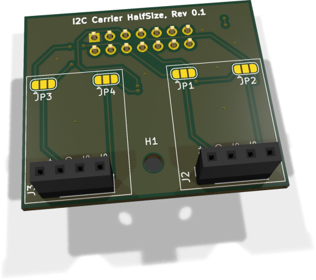

# I2C Carrier HalfSize - Montage und Buswahl

Das HalfSize-Modul nimmt zwei kleine I²C-Platinen auf. Jeder Carrier-Steckplatz kann unabhängig mit I2C0 oder I2C1 verbunden werden. Ohne Brücken auf den vier Lötjumpern ist kein Bus vorausgewählt.

[Anleitung als PDF](../../assets/downloads/I2C_Carrier_HalfSize_Rev0.1_Anleitung.pdf){ .md-button }

## 1. Orientierung und Jumper

{ .board-view }

| Carrier | Anschluss | SCL | SDA |
| --- | --- | --- | --- |
| Carrier 0 | J2 | JP1 | JP2 |
| Carrier 1 | J3 | JP3 | JP4 |

Bei jedem dreipoligen Jumper führt **Pad 2 in der Mitte** zum jeweiligen Carrier-Signal. Pad 1 führt zu I2C0, Pad 3 zu I2C1.

| Gewünschter Bus | Brücke bei beiden Jumpern eines Carriers |
| --- | --- |
| I2C0 | Pad 1 mit Pad 2 verbinden |
| I2C1 | Pad 2 mit Pad 3 verbinden |
| Kein Bus | Beide Brücken offen lassen |

SDA und SCL eines Carriers immer auf denselben Bus setzen. Pro Jumper genau eine Brücke schließen. Alle drei Pads zu verbinden ist unzulässig: Dadurch würden I2C0 und I2C1 direkt miteinander verbunden.

## 2. Zulässige Konfigurationen

| Betrieb | Carrier 0 / J2 | Carrier 1 / J3 | Zu setzende Brücken |
| --- | --- | --- | --- |
| Beide auf I2C0 | I2C0 | I2C0 | JP1 1-2, JP2 1-2; JP3 1-2, JP4 1-2 |
| Beide auf I2C1 | I2C1 | I2C1 | JP1 2-3, JP2 2-3; JP3 2-3, JP4 2-3 |
| Getrennt: 0 / 1 | I2C0 | I2C1 | JP1 1-2, JP2 1-2; JP3 2-3, JP4 2-3 |
| Getrennt: 1 / 0 | I2C1 | I2C0 | JP1 2-3, JP2 2-3; JP3 1-2, JP4 1-2 |

### Elektrische Schnittstelle der Carrier-Stecker

| Pin | Signal | Hinweis |
| --- | --- | --- |
| 1 | +3V3_SYS | 3,3-V-Systemversorgung |
| 2 | GND | Masse |
| 3 | SCL | Buswahl über JP1 beziehungsweise JP3 |
| 4 | SDA | Buswahl über JP2 beziehungsweise JP4 |

Die Reihenfolge ist die der Carrier-Stecker J2/J3. Sie unterscheidet sich von den JST-SH-I²C-Anschlüssen der Mainboards.

### Prüfung vor Inbetriebnahme

- ☐ SDA und SCL jedes Carriers sind auf denselben Bus eingestellt.
- ☐ An jedem Jumper ist nur 1-2 oder nur 2-3 gebrückt.
- ☐ Kein Jumper verbindet alle drei Pads.
- ☐ Bei ausgeschaltetem System Durchgang der gewählten Pfade und Trennung zwischen I2C0 und I2C1 geprüft.
- ☐ Pull-ups im Gesamtsystem nur einmal oder mit passend berechnetem Gesamtwiderstand aktiviert.
- ☐ Die reservierten EEPROM-Adressen 0x52 und 0x53 auf I2C0 werden nicht für Carrier-Sensoren verwendet.

### Modulidentifikation

Das optionale Modul-EEPROM bleibt fest auf I2C0. Seine Busanbindung wird durch die Carrier-Jumper nicht verändert.

### Dokumentationsbasis und Lizenz

Dokumentationsbasis: KiCad-Projekt I2C Carrier HalfSize, Hardware 0.1, Commit `cac0859`, einschließlich der später aus dem lokalen Projektstand übernommenen Jumper-Korrektur.

EnvNode-eigene Inhalte: LicenseRef-EnvNode-Use-and-Redistribution-1.0; siehe [Lizenz](../../license.md). Drittanbieterrechte bleiben unberührt.
