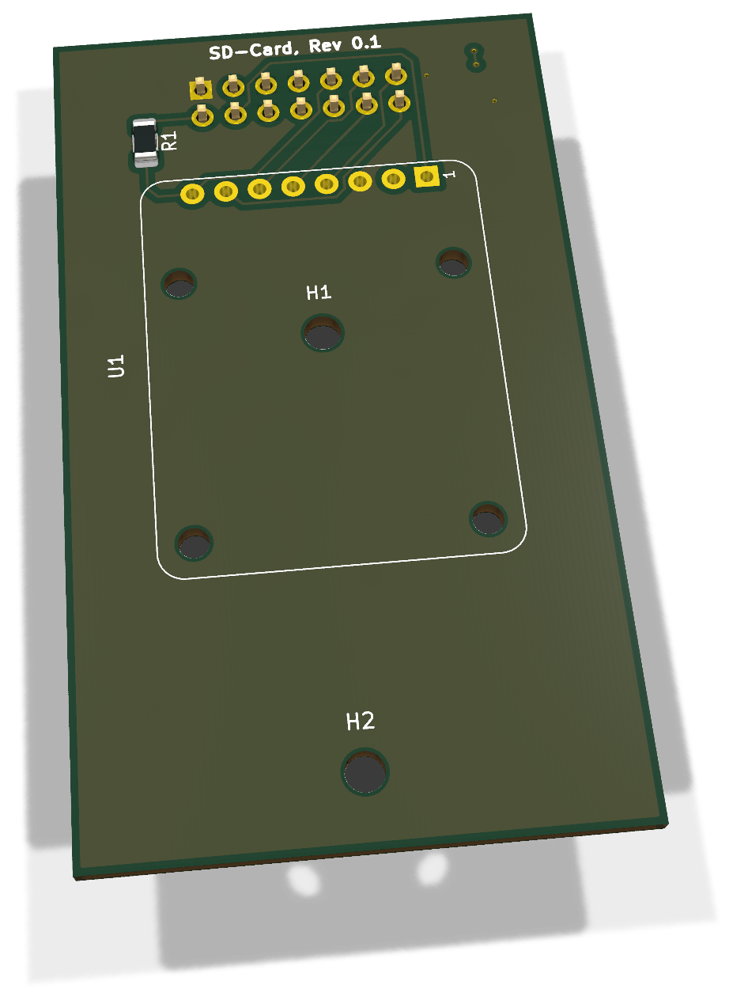
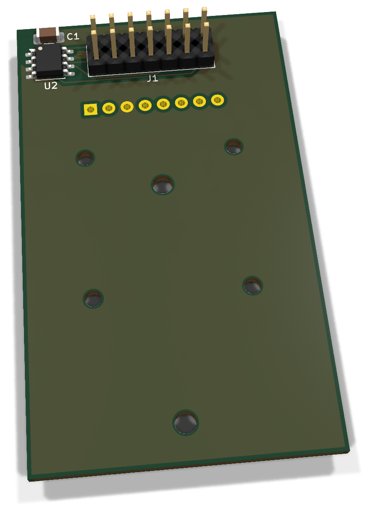
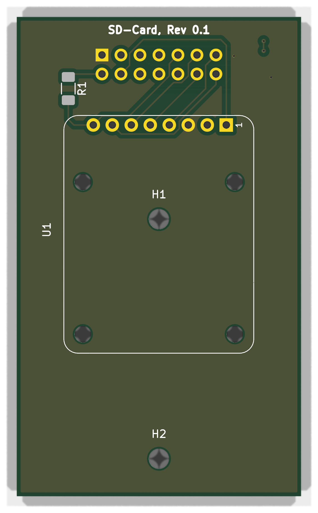
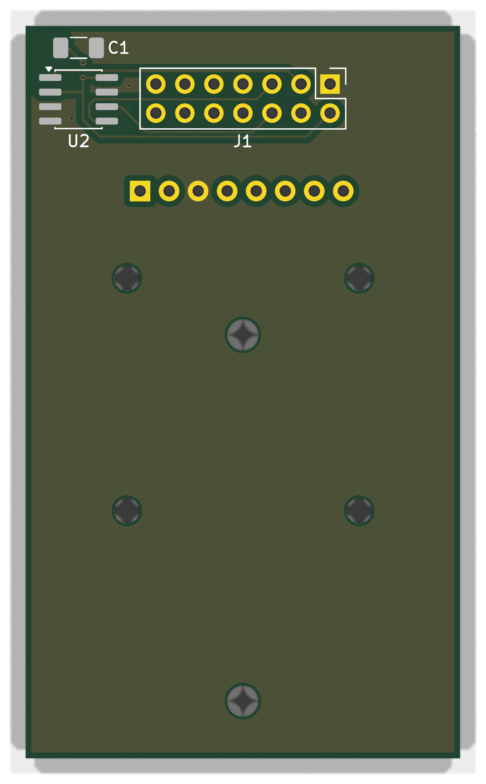

# SD-Card 0.1 - Bestückung und Inbetriebnahme

FullSize-Trägerplatine für das fertig bestückte Adafruit MicroSD card breakout board+ (Produkt 254 / Reichelt DEBO MICROSD). Der Hardwarestand 0.1 ist technisch festgelegt; als nächster Hardwareschritt steht die Fertigung und der Aufbau an. Die Firmware-Mindestversion wird später ergänzt.

**Dokumentation abgeschlossen am 28. Oktober 2026.** Der Fertigungs- und Erprobungsstand wird im Abschlusskapitel getrennt geführt.

[Anleitung als PDF](../../assets/downloads/SD_Card_Rev0.1_Anleitung.pdf){ .md-button }
[Alte Revisionen](old-revisions.md){ .md-button }

## 3D-Ansicht

{ .hero-paired-view }
{ .hero-paired-view }

Vorderseite (F.Cu) und bestückte Rückseite (B.Cu). Nicht hinterlegte 3D-Modelle bleiben ausgespart. Die Bestückungspläne folgen im Abschnitt zur Bestückungsübersicht.

## 1. Teile und Vorbereitung

| Ref. | Anz. | Bauteil | Artikel | Montage |
| --- | --- | --- | --- | --- |
| PCB | 1 | SD-Card Rev. 0.1, 38 × 64 mm | ENP-00137 | Trägerplatine |
| U1 | 1 | Adafruit 254 MicroSD Breakout | ENP-00136 | Oberseite, direkt über 1×8-Stiftleiste |
| U2 | 1 | 24LC32A, SOIC-8 | ENP-00102 | Unterseite |
| C1 | 1 | 100 nF X7R, 1206 | ENP-00006 | Unterseite |
| R1 | 1 | 10 kΩ, 1206 | ENP-00018 | Oberseite, CD-Pull-up |
| J1 | 1 | Modulstecker 2×7, Bottom-Mount | ENP-00059 | Unterseite |
| U1-Stiftleiste | 1 | 1×8, 2,54 mm | Bei U1 enthalten | ENP-00019 nur Ersatz |

Die Kit-BOM ENK-00022 umfasst PCB, U1, U2, C1, R1 und J1 mit jeweils einem Stück. Die mit U1 gelieferte Stiftleiste wird nicht doppelt gezählt. Schrauben, Distanzstücke und microSD-Karte sind separat auszuwählen und zu protokollieren. Keine Buchsenleiste zwischen U1 und Träger vorgesehen.

Feinlötkolben, Vergrößerung, Multimeter, strombegrenzte Versorgung, geeignetes Mainboard und bekannte FAT32-Testkarte bereitlegen. Zum Bestücken keine Karte einstecken.

## 2. Bestückungsübersicht

### Vorderseite: Bestückungsplan

{ .assembly-plan }

[Plan als PNG](../../assets/board-views/sd-card-0.1/assembly-front.png){ .md-button }

### Rückseite: Bestückungsplan

{ .assembly-plan }

[Plan als PNG](../../assets/board-views/sd-card-0.1/assembly-back.png){ .md-button }

Senkrechtes KiCad-Rendering der Leiterplatte ohne Bauteilmodelle. Kupfer, Lötstoppmaske und Bestückungsdruck entsprechen der PCB-Quelle. Rückseitenpläne werden von B.Cu aus betrachtet.

Die Bestückungspläne zeigen die Leiterplatte senkrecht zur jeweiligen Seite. Bestückungsdruck und Referenzen folgen der PCB-Quelle; eine Rückseitenansicht ist keine Kontaktansicht eines Kabelsteckers.

Für das Adafruit-Breakout U1 ist kein 3D-Modell hinterlegt; die Ansichten zeigen die Trägerplatine. Der beabsichtigte Überlapp von U1 und H1 erfordert, H1 vor der U1-Montage zu befestigen und unter dem Breakout elektrisch isolierten Freiraum vorzusehen. H1/H2: 2,7 mm für M2,5; die vier U1-Bohrungen: 2,2 mm für #2-Hardware. Distanzlängen an der realen Steckhöhe bestimmen.

## 3. Löt-Reihenfolge

1. R1 auf der Oberseite, U2 und C1 auf der Unterseite bestücken.
2. U2-Pin 1 und alle SOIC-Pins kontrollieren.
3. J1 von unten einsetzen und mit Gegenbuchse rechtwinklig ausrichten.
4. H1-Befestigung und Isolation unter U1 vorsehen.
5. U1 über die direkte 1×8-Verbindung plan montieren, ohne mechanischen Zug verlöten; Abstandshalter müssen zur tatsächlichen Höhe passen.
6. Reinigen und vor dem Einsetzen einer Karte die elektrischen Prüfungen durchführen.

## 4. Anschlussbelegung

| U1-Pin | Funktion | Verbindung |
| --- | --- | --- |
| 1 | 5V_IN | J1.4, +5V |
| 2 | 3V3_REG | Absichtlich offen; Reglerausgang des Breakouts |
| 3 | GND | J1.1 |
| 4 | CLK | J1.13, SPI_SCK |
| 5 | DO / MISO | J1.12 |
| 6 | DI / MOSI | J1.11 |
| 7 | CS | J1.14, slotabhängiger Chip-Select |
| 8 | CD | J1.9, AUX_GPIO1; R1 nach +3V3_SYS |

**U1.2 nicht mit +3V3_SYS verbinden.** Der Breakout-Reglerausgang bleibt getrennt. U2 wird aus J1.2 versorgt und liegt auf I2C0 (J1.5/.6); A1 HIGH, A2 LOW und A0 an J1.3 ergeben 0x52 in Slot A bzw. 0x53 in Slot B. I2C1 und AUX_GPIO2 bleiben ungenutzt.

## 5. Spannungsfreie Prüfungen

- ☐ Kein niederohmiger Kurzschluss zwischen +5V, +3V3_SYS und GND.
- ☐ U1.2 bleibt vom System getrennt; U1.1 an J1.4.
- ☐ CLK/DO/DI/CS sind nicht vertauscht und entsprechen der Tabelle.
- ☐ CD führt zu J1.9; 10-kΩ-Pull-up nach +3V3_SYS vorhanden.
- ☐ U2-Pin 1, C1 und Bottom-Mount-J1 korrekt.
- ☐ Befestigung berührt keine Leiterbahn; Kartensteckplatz bleibt zugänglich.

## 6. Erstinbetriebnahme

1. Ohne Karte stromlos in den vorgesehenen Slot einsetzen; tatsächliche CS-/CD-GPIOs des Mainboards dokumentieren.
2. Versorgung strombegrenzt einschalten. 5 V am Breakout, +3V3_SYS am EEPROM und Ruhestrom prüfen. Bei auffälligem Strom/Temperatur abschalten.
3. U2-Adresse und gültigen dedizierten SD-Card-Descriptor getrennt prüfen; keinen Descriptor eines fremden Moduls verwenden.
4. CD-Pegel ohne und mit Karte messen. Der Projektstand beschreibt LOW ohne Karte und HIGH mit Karte; die konkrete Kontaktpolarität am vorhandenen Breakout bestätigen.
5. Mit geeigneter Firmware und Testkarte Initialisierung, Dateiauflistung sowie expliziten Schreib-/Lesetest ausführen. Dateiname, Testgröße und Vergleichsergebnis protokollieren.
6. Kartenwechsel und Fehlerzustände gezielt prüfen; laufende Messungen und Heizsteuerung müssen bei fehlender/fehlerhafter Karte weiterarbeiten.

## 7. Mess- und Fertigungsprotokoll

| Prüfschritt | Ergebnis / Datum / Person |
| --- | --- |
| Fertigungslos und PCB-Aufbau | |
| U1-Artikel, Steckhöhe und Distanzstücke | |
| +5V / +3V3_SYS / Strom | |
| EEPROM-Adresse / Descriptor | |
| CD ohne / mit Karte | |
| Karte: Hersteller, Typ, Kapazität, Dateisystem | |
| Firmwareversion und Commit | |
| Initialisierung / Schreiben / Rücklesen | |
| Fehlerfall ohne Karte / Wiederanlauf | |

## 8. Fehlerbilder und Firmware-Zuordnung

| Befund | Prüfen |
| --- | --- |
| Karte fehlt | +5V, SPI-Belegung, tatsächlicher CS, Kartenformat |
| CD falsch | Kontaktpolarität am Breakout, R1, AUX_GPIO1 und Firmwarekonfiguration |
| EEPROM fehlt | U2/C1, I2C0, Slot-A0 und Descriptor |
| Sporadische Fehler | Versorgungseinbruch, Karte, Leitungsführung, Kontaktierung |

**Firmware-Mindestversion: wird später ergänzt.** Der Hardwareabschluss ist keine Zusage, dass jede ältere Firmware SD-Card unterstützt. Spätere Releasezuordnung soll Version und Commit sowie nutzbares Binärabbild nennen. Das aktuelle Dokument implementiert keine Firmware und veröffentlicht kein Binärrelease.

## 9. Abschluss und Prüfstand

Dokumentation und technischer Boardstand 0.1 sind abgeschlossen. Laut Vorgabe vom 28.10.2026 sind am Board keine weiteren technischen Änderungen geplant; Fertigung und Aufbau stehen als nächste Schritte an. Dies ersetzt den bisherigen Entwurfsstatus.

Der gespeicherte CAD-Bericht vom 20.10.2026 nennt DRC ohne Verstöße/offene Pads/Paritätsfehler sowie ERC ohne Fehler und mit sechs Warnungen. Das ist ein historischer CAD-Prüfstand. Bereits dokumentierte Firmware-/Breakoutversuche ersetzen nicht das Fertigungs- und Aufbauprotokoll dieser Trägerplatine. Mindestrevision der Firmware, konkrete Karte und Montagehardware werden später ergänzt.

Adafruit-Design: Limor Fried/Ladyada, CC BY-SA 3.0; die originalen Hersteller- und Bibliotheksrechte bleiben bestehen. Quellen: [Adafruit Produkt 254](https://www.adafruit.com/product/254) und [Herstelleranleitung](https://learn.adafruit.com/adafruit-micro-sd-breakout-board-card-tutorial/overview).

### Quellenstand

Dokumentiert ist der gespeicherte KiCad-Stand aus `sd-card`, Projekt `SD-Card`, Basiscommit `282c399b9bef1744dfd031a46b8cad6a5ce633d4`. Die Prüfsummen bestimmen den tatsächlichen Arbeitsstand einschließlich lokaler Änderungen; der Commit allein beschreibt diese nicht.

| Quelle | SHA-256 |
| --- | --- |
| SD-Card.kicad_pcb | `921f321f83ac23143ae23933033053ab336d1ea51afc8c4f610aec39b9beb263` |
| SD-Card.kicad_pro | `a6a0ad3618d6b37a8107e90e379fb8352f686f7dfbcc59cbfb1007bd9ea17790` |
| SD-Card.kicad_sch | `5b895697d2029cb90ace31d83af0bd9834d58d8a03e8c1bf3db7c6a96964d22c` |

[Rendernachweis](../../assets/images/sd-card-0.1/provenance.json). Dokumentation: LicenseRef-EnvNode-Use-and-Redistribution-1.0, siehe [Lizenz](../../license.md). Drittanbieterrechte an KiCad-Modellen und Bibliotheken bleiben bestehen.
