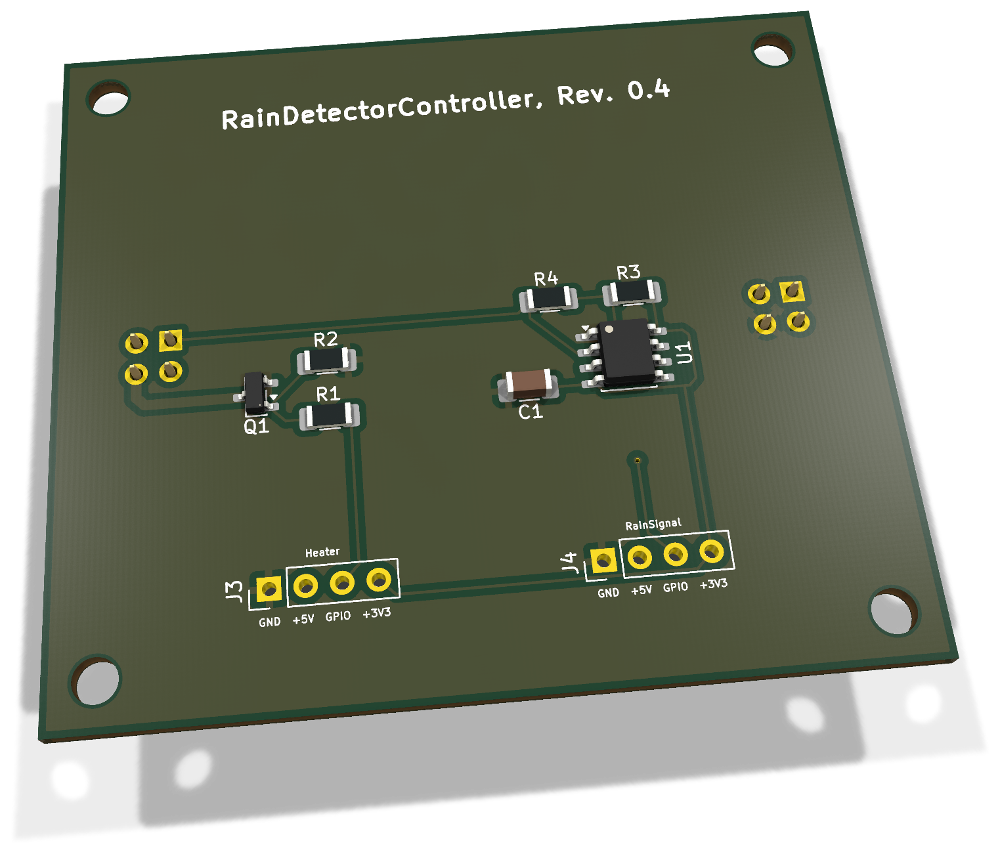
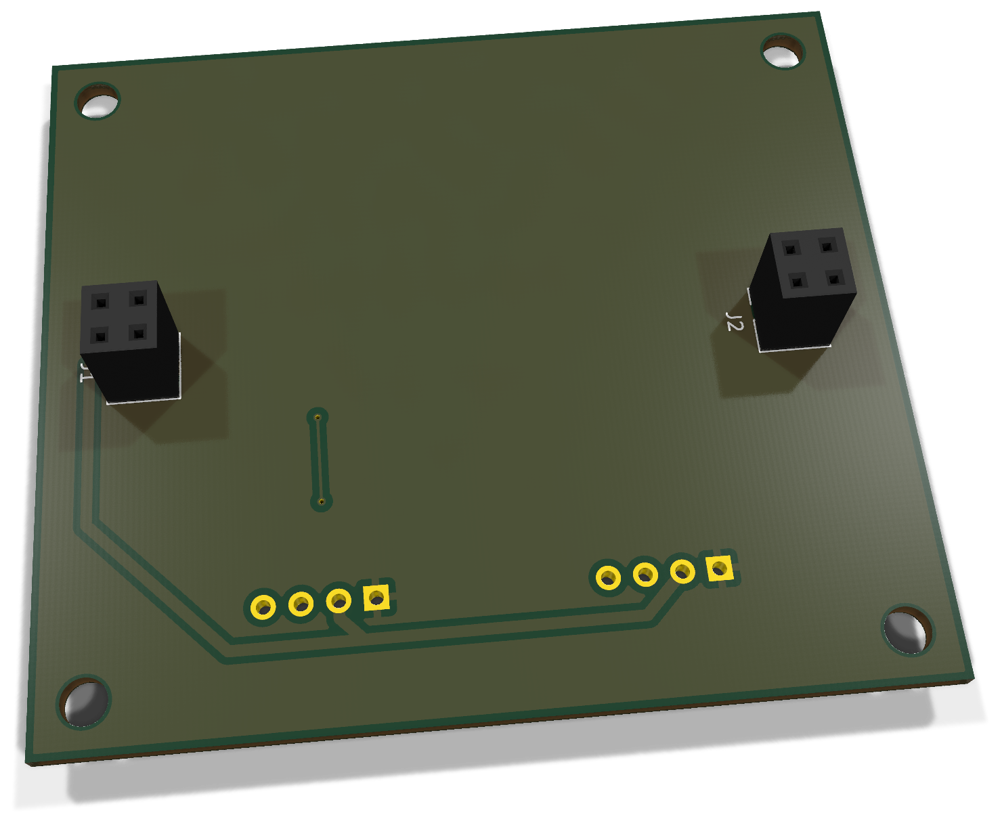
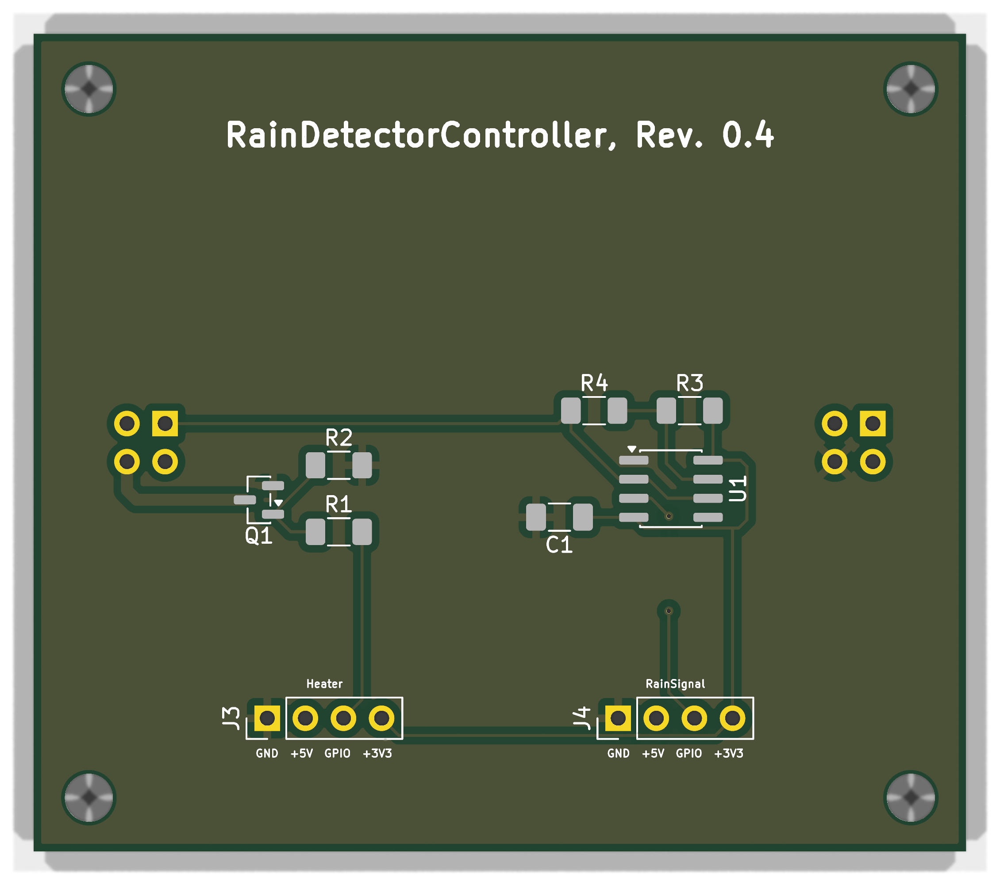
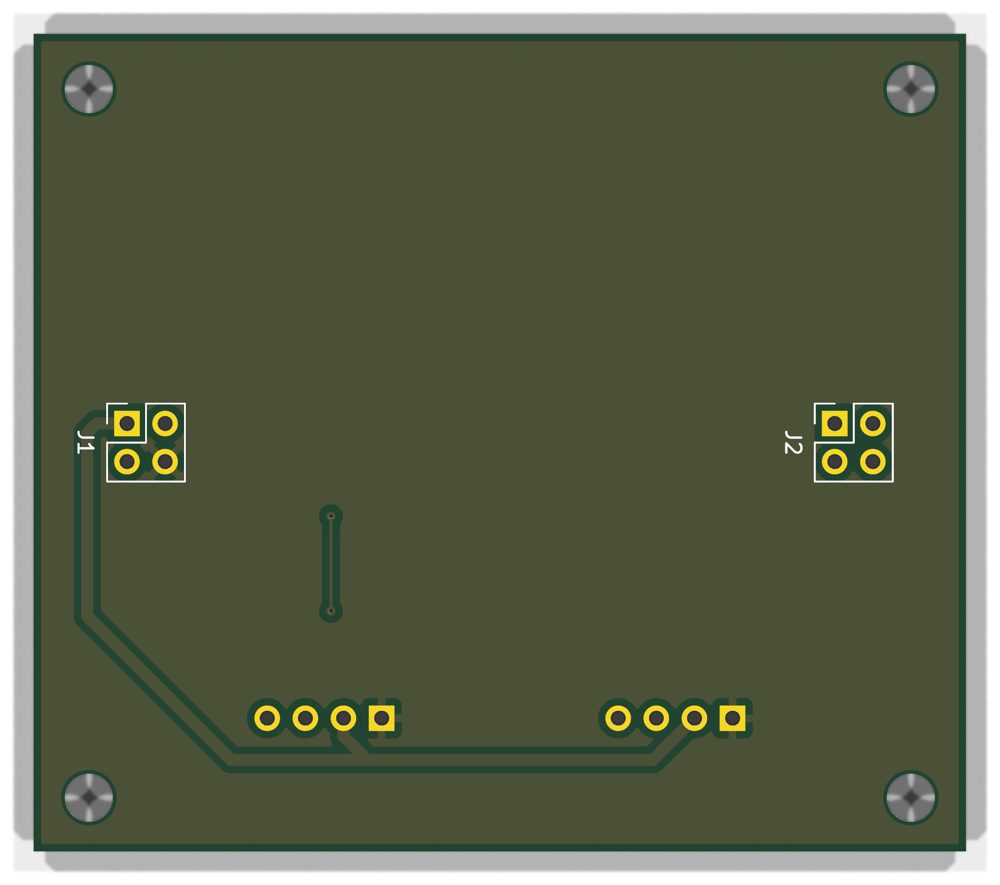

# RainDetectorController 0.4 - Bestückung und Inbetriebnahme

Controller für den separaten RainDetectorHead mit 3,3-V-Frequenzausgang und schaltbarer 5-V-Heizung.

**Dokumentation abgeschlossen am 28. Oktober 2026.** Der Fertigungs- und Erprobungsstand wird im Abschlusskapitel getrennt geführt.

[Anleitung als PDF](../../assets/downloads/RainDetectorController_Rev0.4_Anleitung.pdf){ .md-button }
[Alte Revisionen](old-revisions.md){ .md-button }
### Änderungen und Geltungsbereich

Aktuelle Paarung: **RainDetectorController 0.4 (ENP-00138)** mit **RainDetectorHead 0.2 (ENP-00139)**. Beide Konturen messen **62,12 × 54,52 mm** an der Mittellinie von Edge.Cuts. Die neue Form berücksichtigt die Gehäusedichtung und versetzte Montagebohrungen. Keine neue Firmware-Mindestversion folgt allein aus dieser mechanischen Revision.

## 3D-Ansicht

{ .hero-paired-view }
{ .hero-paired-view }

Vorderseite (F.Cu) und bestückte Rückseite (B.Cu). Nicht hinterlegte 3D-Modelle bleiben ausgespart. Die Bestückungspläne folgen im Abschnitt zur Bestückungsübersicht.

## 1. Teile und Vorbereitung

### 1.1 Elektronische Bestückung

| Ref. | Anz. | Wert / Funktion | EnvNode-Part | Gehäuse / Footprint |
| --- | --- | --- | --- | --- |
| C1 | 1 | 100 nF, X7R, 100 V, 10 % | ENP-00006 | 1206 |
| R1 | 1 | 100 Ohm, 5 %, 250 mW | ENP-00017 | 1206 |
| R2, R4 | 2 | 100 kOhm, 0,1 %, 250 mW | ENP-00016 | 1206 |
| R3 | 1 | 10 kOhm, 0,1 %, 250 mW | ENP-00018 | 1206 |
| J1, J2 | 2 | BKL 10120957, Buchsenleiste 2x2 | ENP-00116 | 2,54 mm; THT; B.Cu |
| Q1 | 1 | AO3400A, N-Kanal-MOSFET | ENP-00013 | SOT-23 |
| U1 | 1 | ICM7555IBAZ, CMOS-Timer | ENP-00020 | SOIC-8 |
| PCB | 1 | RainDetectorController PCB Rev. 0.4 | ENP-00138 | 62,12 × 54,52 mm |

Die Tabelle nennt den Bedarf pro Platine. Die bisherige Kitnummer bestätigt keine auf den neuen PCB-Artikel umgestellte Kit-BOM.

J3/J4 bleiben DNP: Die beiden 1x4-Anschlusspositionen werden in dieser Bestückungsvariante nicht als Stecker bestückt. Anschlussvariante und zugentlastete Kontaktierung separat festlegen. Pigtails und Montagematerial sind hier nicht enthalten.

R2 und R4 sind als zwei Stück desselben Artikels zusammengefasst. J1/J2 sind konkrete BKL-2x2-Buchsen; Steckhöhe und mechanische Paarung mit dem Head separat prüfen.

### 1.2 Vorbereitung

Feinlötkolben, Flussmittel, Vergrößerung und ESD-Arbeitsplatz bereitlegen. Multimeter sowie Oszilloskop oder Frequenzzähler verwenden. Strombegrenzte 3,3-V- und 5-V-Versorgung mit gemeinsamer Masse, Head Rev. 0.2, isolierte Prüfleitungen und Temperaturmessung vorbereiten.

5 V dürfen weder an HEATER_EN noch an RAIN_FREQ oder die 3,3-V-Schiene gelangen. Die Versorgung erst nach den spannungsfreien Prüfungen einschalten.

### 1.3 Artikel- und Dokumentstand

Bauteilwerte und Anschlusszuordnung wurden aus dem aktuellen KiCad-Stand übernommen. Standardartikel stammen aus der bisherigen Anleitung; die neuen PCB-Artikel ENP-00138/ENP-00139 sind im mechanischen Projektstand vom 21.10.2026 dokumentiert. Keine neue Lager- oder Kit-BOM-Prüfung wird behauptet.

EnvNode-eigene Inhalte: LicenseRef-EnvNode-Use-and-Redistribution-1.0; siehe LICENSE im Repository. Drittanbieterrechte bleiben unberührt.

## 2. Bestückungsübersicht

### Vorderseite: Bestückungsplan

{ .assembly-plan }

[Plan als PNG](../../assets/board-views/rain-controller-0.4/assembly-front.png){ .md-button }

### Rückseite: Bestückungsplan

{ .assembly-plan }

[Plan als PNG](../../assets/board-views/rain-controller-0.4/assembly-back.png){ .md-button }

Senkrechtes KiCad-Rendering der Leiterplatte ohne Bauteilmodelle. Kupfer, Lötstoppmaske und Bestückungsdruck entsprechen der PCB-Quelle. Rückseitenpläne werden von B.Cu aus betrachtet.

## Montagehinweise

Unterseite B.Cu: J1/J2 zeigen zum Head. Beide Platinen stehen mit B.Cu zueinander; die Controller-Bauteile auf F.Cu bleiben vom Gehäuseinneren erreichbar. Ansichten der Unterseite erscheinen gegenüber der Oberseite gespiegelt.

Die Bestückungspläne zeigen die Leiterplatte senkrecht zur jeweiligen Seite. Bestückungsdruck und Referenzen folgen der PCB-Quelle; eine Rückseitenansicht ist keine Kontaktansicht eines Kabelsteckers.

### Empfohlene Reihenfolge

1. C1 und R1 bis R4 bestücken; R1 = 100 Ohm nicht mit 100 kOhm verwechseln.
2. U1 und Q1 ausrichten; Pin 1 prüfen, einen Pin fixieren, Lage kontrollieren und fertig löten.
3. J1/J2 von B.Cu einsetzen; Buchsen rechtwinklig und parallel halten.
4. J3/J4 gemäß dokumentierter Anschlussvariante DNP lassen oder freigegeben bestücken.
5. Reinigen und alle Lötstellen prüfen. Head erst nach elektrischer Einzelprüfung aufstecken.

U1-Pin 1 liegt an GND; U1.8 und U1.4 an +3V3. Q1.1 = Gate, Q1.2 = Source/GND, Q1.3 = Drain/HEATER-. Die konkrete Gehäusemarkierung zusätzlich mit dem verwendeten Bauteil abgleichen.

## 3. Anschlussbelegung

| Anschluss | Pin 1 | Pin 2 | Pin 3 | Pin 4 |
| --- | --- | --- | --- | --- |
| J3 HEATER_CTRL | GND | +5V | HEATER_EN | +3V3 |
| J4 RAIN_SIGNAL | GND | +5V | RAIN_FREQ | +3V3 |
| J1 zum Head | +5V / HEATER+ | offen | offen | GND |
| J2 zum Head | SENSE | offen | offen | HEATER- |

Die Versorgungspins von J3 und J4 sind direkt gemeinsam verbunden. Eine eindeutige Einspeisung wählen; unabhängige Netzteile nicht über diese Pins parallel schalten. Pins 2/3 an J1/J2 sind elektrisch unbeschaltet und dienen der mechanischen Abstützung.

### Zuordnung zum Head Rev. 0.2

| Head-Kontakt | Funktion | Controller-Kontakt |
| --- | --- | --- |
| J1.1 | HEATER+ | J1.1 |
| J1.4 | GND / Elektrode 2 | J1.4 |
| J2.1 | SENSE / Elektrode 1 | J2.1 |
| J2.4 | HEATER- | J2.4 |

Elektrische Zuordnung nach den aktuellen PCB-Padnetzen beider Projekte. Tatsächliche Kontaktachsen, Orientierung und Steckhöhe an den gewählten 2x2-Steckverbindern vor Montage prüfen; die Tabelle ersetzt keine mechanische Passprobe.

### Signale

HEATER_EN: 3,3-V-Steuersignal über R1 zum Gate; R2 zieht das Gate gegen GND. LOW = aus, HIGH = Heizung an. RAIN_FREQ: digitaler Ausgang U1.3 der mit 3,3 V versorgten Timerstufe. Keine 5-V-Pegel an den ESP32 anschließen.

## 4. Prüfung ohne Versorgung

- ☐ U1 und Q1 korrekt orientiert; keine Lötbrücken.
- ☐ Kein niederohmiger Kurzschluss zwischen +3V3 und GND, +5V und GND oder den Versorgungsschienen.
- ☐ J3.1/J4.1 und Q1.2 liegen an GND.
- ☐ J3.2/J4.2 haben Durchgang zu J1.1 (+5V).
- ☐ J3.4/J4.4, C1.1, U1.4 und U1.8 liegen an +3V3.
- ☐ C1.2 liegt an GND.
- ☐ J3.3 führt über R1 = 100 Ohm zu Q1.1; R2 = 100 kOhm verbindet Gate und GND.
- ☐ Q1.3 hat Durchgang zu J2.4 (HEATER-).
- ☐ J2.1 (SENSE) hat Durchgang zu U1.2 und U1.6.
- ☐ J4.3 (RAIN_FREQ) hat Durchgang zu U1.3.
- ☐ J1/J2 Pins 2 und 3 bleiben elektrisch unbeschaltet.

### Head vor dem Zusammenstecken

Den unversorgten Head separat prüfen: Der Heizpfad hat nominal 12 Ohm. Er besteht aus fünf parallelen Ketten mit je vier 15-Ohm-Widerständen. Die kapazitiven Elektroden dürfen keinen niederohmigen Kurzschluss bilden. Kontaktfolge anhand der Tabelle in Abschnitt 3 verifizieren.

### Mechanische Freigabe

- ☐ Kontaktachsen beider Platinen stimmen überein.
- ☐ Steckhöhe verhindert Berührung von Bauteilen, Lötstellen und Gegenplatine.
- ☐ Gehäuse, Schrauben und Abstandshalter erzeugen keinen Kurzschluss.
- ☐ Controller bleibt trocken; Beschichtung und Wasserabdichtung des Heads sind gesondert zu qualifizieren.

Diese Prüfungen ersetzen keine Fertigungsfreigabe. Der Head ist ein eigenes Fertigungsprojekt mit eigenen Masken-, Via- und Beschichtungsanforderungen; dafür gilt sein README.

## 5. Erstinbetriebnahme

### 5.1 Timer und Frequenzsignal

1. Head zunächst abziehen. HEATER_EN hardwareseitig LOW halten; 5 V noch nicht einschalten.
2. 3,3 V strombegrenzt einspeisen. Als vorsichtiger Startwert können 20 mA dienen; dies ist kein spezifizierter Sollstrom. Bei Begrenzung oder Erwärmung abschalten und Ursache prüfen.
3. 3,3 V an U1.8/U1.4 und C1 kontrollieren; Ruhestrom dokumentieren.
4. Ausschalten, Head korrekt aufstecken und 3,3 V wieder einschalten.
5. RAIN_FREQ an J4.3 gegen GND mit Oszilloskop prüfen. Ohne Sensor-Kapazität ist keine definierte Grundfrequenz zugesichert.
6. Trockene Grundfrequenz bei festgelegter Montage und Temperatur erfassen. Eine kontrollierte Benetzung des dafür geeigneten Heads darf den Controller nicht erreichen; Frequenzänderung und Rückkehr nach Trocknung dokumentieren.

Die Anleitung legt keinen Regen-Schwellwert fest. Absolute Frequenz und Änderung hängen von Sensorgeometrie, Beschichtung, Montage und parasitären Kapazitäten ab. Für den realen Aufbau liegen noch keine Messgrenzen vor.

### 5.2 Separater Heiztest

1. HEATER_EN LOW halten. Die 5-V-Versorgung des Heads zuschalten; für den Heiztest zunächst etwa 0,5 A Strombegrenzung vorsehen und den Aufbau beaufsichtigen.
2. Ohne Enable darf die Heizung nicht aktiv sein. Gate-Spannung und Stromaufnahme prüfen.
3. HEATER_EN gezielt mit 3,3 V HIGH ansteuern. Bei 5 V und nominal 12 Ohm sind rechnerisch etwa 417 mA und 2,08 W zu erwarten, zusätzlich zu anderen Systemlasten.
4. Versorgungseinbruch, Q1-Erwärmung, Steckverbinder und Head-Temperatur beobachten. Bei Auffälligkeiten abschalten.
5. HEATER_EN LOW setzen; Heizstrom muss zurückgehen. Ausschaltverhalten auch bei abgezogenem Steuersignal prüfen.

Die rechnerischen Heizwerte sind keine Messung. Zulässige Dauer und Temperatur müssen am realen beschichteten Head qualifiziert werden. Die Lab-Firmware übernimmt weder Heizsteuerung noch Temperaturbegrenzung.

## 6. Frequenzmessung und Protokoll

Das separate Projekt lab/RainDetector-PCNT/ zählt steigende Flanken und gibt Rohfrequenzen seriell aus. Anschluss: J4.3 (RAIN_FREQ) an GPIO27 des klassischen ESP32, gemeinsame Masse. GPIO27 ist eine Lab-Vorgabe und muss am verwendeten Aufbau frei sein. Heizung separat ausgeschaltet halten.

Seriell: 115200 Baud, 8N1. Felder: timestamp_ms, pulse_count, frequency_hz. Nominelles Messfenster 250 ms, Zählauflösung ungefähr 4 Hz je Puls. Null Pulse beweisen weder Trockenheit noch einen funktionsfähigen Oszillator. Überlauf ergibt nan; Vergleich mit Oszilloskop/Frequenzzähler erforderlich. Keine MQTT- oder produktive Sensorintegration durch dieses Lab-Projekt.

| Prüfung | Soll / Erwartung | Messwert / Datum |
| --- | --- | --- |
| +3V3 an U1 | 3,3 V nominal |  |
| +5V unter Heizlast | 5 V nominal; Einbruch dokumentieren |  |
| Ruhestrom ohne Heizung | Dokumentieren |  |
| RAIN_FREQ trocken | Grundfrequenz und Signalpegel erfassen |  |
| RAIN_FREQ benetzt / trocken | Änderung und Rückkehr dokumentieren |  |
| Heizstrom bei 5 V | Rechnerisch ca. 417 mA plus Nebenlasten |  |
| HEATER_EN LOW / offen | Heizung aus |  |
| Temperatur Q1 / Head / Stecker | Verlauf und Testdauer erfassen |  |
| PCNT / Referenzmessgerät | Abweichung dokumentieren |  |

### Fehlerbilder

Keine Frequenz: 3,3 V, U1-Orientierung, R3/R4, SENSE-Kontakt und Head prüfen. Heizung bleibt aus: 5 V, Enable-Pegel, R1, Q1 und Heizpfad prüfen. Heizung bleibt an: Steuersignal trennen; R2, Gate-Brücken und Q1 prüfen. Instabile Frequenz: Versorgung, Kontaktierung, Feuchtigkeit, Montage und Referenzmessung kontrollieren.

## 7. Abschluss und Revisionsnachweis

Dokumentation abgeschlossen für Controller 0.4 / Head 0.2. Die vergrößerte Kontur schafft Platz für die Gehäusedichtung; Bohrungen wurden mit der Kontur verschoben. Die Kontaktachsen von J1/J2 und die elektrische Netzzuordnung bleiben gegenüber dem unmittelbar vorherigen gespeicherten PCB unverändert. Beim Head ist die aktive Struktur im aktuellen Footprint 44,78 × 37,25 mm mit 0,51-mm-Raster dokumentiert; der frühere Guide mit 48,86 mm benennt den aktuellen Footprint nicht korrekt.

Quellvergleich und neue Renderings belegen keine gefertigte Dichtung, mechanische Passprobe, Beschichtung, Via-Abdichtung oder reale Heiz-/Regenprüfung. Es wird hier kein neuer bestandener vollständiger ERC-/DRC-Lauf behauptet. Die alten Bring-ups stehen unter [Alte Revisionen](old-revisions.md).

### Quellenstand

Dokumentiert ist der gespeicherte KiCad-Stand aus `rain-detector`, Projekt `RainDetectorController`, Basiscommit `e3ecde6c66d24c26fbb0352b686f2d3f10469c72`. Die Prüfsummen bestimmen den tatsächlichen Arbeitsstand einschließlich lokaler Änderungen; der Commit allein beschreibt diese nicht.

| Quelle | SHA-256 |
| --- | --- |
| RainDetectorController.kicad_pcb | `b793f10c10ec03b201e0514d98e5ed5e4c8befd761ada973139d5f0c5d8845b4` |
| RainDetectorController.kicad_pro | `26e426bc5880f282176b3c91a39e0b19007f7901302b2eec7733e9f4338928f0` |
| RainDetectorController.kicad_sch | `5546327c7d2770689e58bca02692a1a5e798d623826888b6d008aa5ac2dc6cbf` |

[Rendernachweis](../../assets/images/rain-controller-0.4/provenance.json). Dokumentation: LicenseRef-EnvNode-Use-and-Redistribution-1.0, siehe [Lizenz](../../license.md). Drittanbieterrechte an KiCad-Modellen und Bibliotheken bleiben bestehen.
