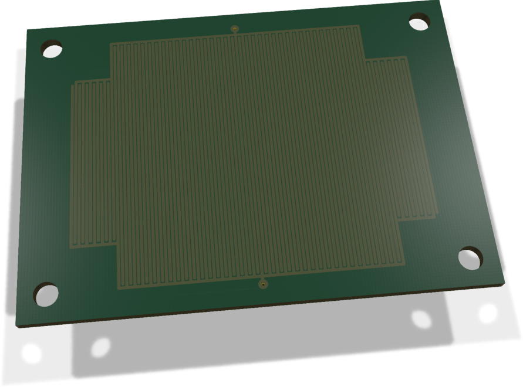
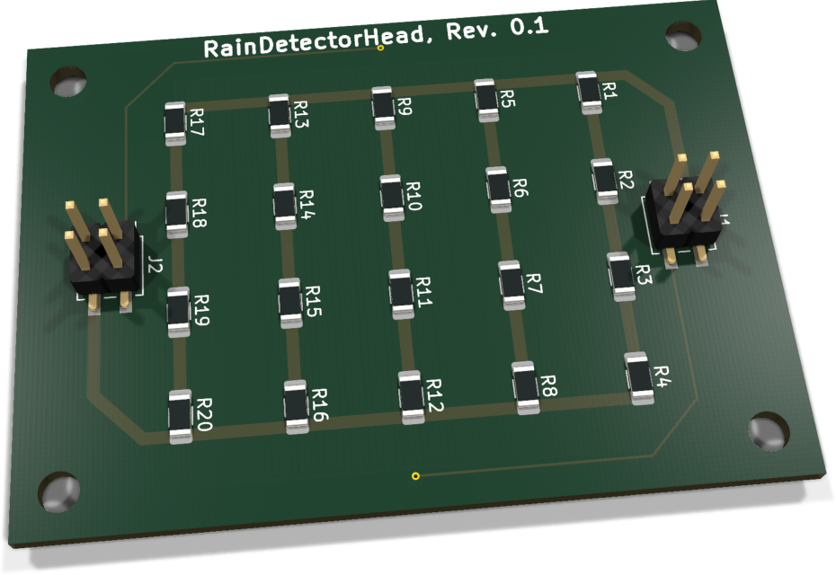

# RainDetectorHead - Bestückung und Inbetriebnahme

Passiver kapazitiver Sensorkopf mit fünf parallelen Heizsträngen und insgesamt zwanzig 15-Ω-Widerständen. Entwurf: Der beschichtete Head wurde laut überführtem Projektstand noch nicht gefertigt oder erprobt. Beschichtung, Via-Verschluss und Witterungsbeständigkeit bleiben zu qualifizieren. Der letzte PDF-Stand enthält die am 17. Oktober aktualisierte Stückliste; die übrigen Nachweise tragen ihre ursprünglichen Datumsangaben.

!!! info "Pilotfassung"
    Aus der jeweils letzten PDF-Anleitung überführt. Inhalt und Darstellung sind noch zur Durchsicht vorgesehen. Webansicht und neue PDF verwenden dieselbe Markdown-Quelle. Die Überführung ist keine neue Hardwareprüfung.

[Generierte PDF-Pilotfassung](../../assets/downloads/RainDetectorHead_Rev0.1_Markdown-Pilot.pdf){ .md-button }

[Bisherige PDF-Ausgabe](../../assets/downloads/RainDetectorHead_Bestueckungs_und_Bringup_Rev0.1.pdf)

## 1. Teile und Vorbereitung

### 1.1 Elektronische Bestückung

| Ref. | Anz. | Wert / Funktion | EnvNode-Part | Gehäuse / Footprint |
| --- | --- | --- | --- | --- |
| R1-R20 | 20 | 15 Ohm, 1 %, 250 mW; WR12X15R0FTL | ENP-00115 | 1206; B.Cu |
| J1, J2 | 1 | 2x10-SMD-Leiste für zwei 2x2-Zuschnitte | ENP-00111 | 2,54 mm; B.Cu |
| PCB | 1 | RainDetectorHead PCB Rev. 0.1 | ENP-00113 | 62,12 x 44,12 mm |

Bausatz ENK-00005, PCB-Revision 0.1. Die Mengen beziehen sich auf den Lieferumfang des Bausatzes.

Zuschnitt: Menge 1 bei ENP-00111 bezeichnet eine ganze SL 2X10G SMD2,54. Daraus entstehen zwei 2x2-Stecker für J1/J2. Je Zuschnitt drei Doppelkontaktpositionen einschließlich Schnittverlust vorsehen; Reststücke werden nicht gutgeschrieben.

C1 ist die gefertigte Kupfer-Sensorstruktur und kein zusätzliches Kauf- oder Lötbauteil. H1-H4 sind vier 3,2-mm-NPTH-Bohrungen; M3-Schrauben, Abstandshalter und Dichtung sind nicht Bestandteil dieses Bausatzes.

### 1.2 Sensorfläche und Fertigung

C1 nutzt RainDetector_Interdigitated_48.86x37.25mm_P0.51mm. Die Sensorpads haben keine F.Mask- oder F.Paste-Öffnungen. Der Mindestabstand 0,10 mm gilt nur zwischen Objekten von C1; sonst gelten die normalen Regeln.

Die beiden Vias sind vorderseitig mit Plugging und Tenting versehen; Filling und Capping sind deaktiviert (Type-IV-a-Absicht). Verschlussprozess und Wasserausschluss mit dem Fertiger vereinbaren. Tenting allein garantiert keine Abdichtung.

Sensorfläche nicht freilegen, verzinnen oder mit Lötpaste versehen. Beschichtung und Reinigung beeinflussen Isolation und Kapazität. Steckhöhe und mechanische Paarung mit den Controller-Buchsen am Muster prüfen.

### 1.3 Artikel- und Dokumentstand

Quelle: inventory/assemblies.rain.draft.json und inventory/parts-preview.json (Artikelstand 15.10.2026), abgeglichen am 17.10.2026. Mengen sind Kit-Kaufmengen; kein neuer Hardwaretest oder ERC/DRC-Lauf.

EnvNode-eigene Inhalte: LicenseRef-EnvNode-Use-and-Redistribution-1.0; siehe LICENSE im Repository. Drittanbieterrechte bleiben unberührt.

## 2. Unterseite und Bestückung

{ .paired-board-view }
{ .paired-board-view }

B.Cu: Hier liegen alle Heizwiderstände sowie J1/J2. In der vorgesehenen Montage zeigen Head und Controller mit B.Cu zueinander. Auf der Controller-Seite sitzen die Buchsen; die aktiven Controller-Bauteile bleiben von innen zugänglich.

### Löt-Reihenfolge

1. Widerstände mit Messung oder belastbarer Kennzeichnung als 15 Ohm identifizieren.
2. R1 bis R20 bestücken. Jeweils einen Heizstrang vollständig prüfen; keine Position auslassen.
3. J1/J2 ausrichten und zunächst je ein Pad fixieren. Kontaktachsen und Rechtwinkligkeit prüfen, danach alle Pads löten.
4. Flussmittelreste materialverträglich entfernen; Sensorfläche und Maskierung nicht beschädigen.
5. Lötstellen, Via-Verschluss, Platinenkanten und Montageabstände prüfen. Vor dem Zusammenstecken die Prüfungen in Abschnitt 4 durchführen.

Der Abstand zwischen den Platinen muss für Widerstände, Steckverbinder, Lötstellen und Befestigung ausreichen. Schrauben und Scheiben dürfen keine Leiterbahnen berühren oder die Sensorfläche beschädigen. Pinfolge nicht allein aus der gespiegelten Unterseitenansicht ableiten.

## 3. Kontakte und Heiznetzwerk

| Head | Funktion | Controller Rev. 0.3 |
| --- | --- | --- |
| J1.1 | HEATER+ / +5V | J1.1 |
| J1.4 | GND / Elektrode 2 | J1.4 |
| J2.1 | SENSE / Elektrode 1 | J2.1 |
| J2.4 | HEATER- / geschalteter Rückleiter | J2.4 |
| J1/J2 Pins 2 und 3 | Elektrisch unbeschaltet | Elektrisch unbeschaltet |

Die Tabelle bildet die Netzzuordnung der aktuellen Quellen ab. SENSE liegt auf J2.1, HEATER- auf J2.4. Orientierung und Kontaktpaarung vor Montage durch eine mechanische Passprobe und Durchgangsprüfung bestätigen.

### Fünf parallele Heizstränge

| Strang | Vier Widerstände in Reihe | Nennwiderstand |
| --- | --- | --- |
| 1 | R1, R2, R3, R4 | 60 Ohm |
| 2 | R5, R6, R7, R8 | 60 Ohm |
| 3 | R9, R10, R11, R12 | 60 Ohm |
| 4 | R13, R14, R15, R16 | 60 Ohm |
| 5 | R17, R18, R19, R20 | 60 Ohm |

Gesamt: 60 Ohm / 5 = 12 Ohm . Bei 5 V: I = 5 / 12 = 0,417 A ; P = 25 / 12 = 2,08 W . Je Widerstand entfallen nominal etwa 0,104 W . Das sind Rechenwerte ohne Bauteiltoleranzen, Leitungsverluste oder Temperaturänderung.

HEATER- ist der vom Controller geschaltete Rückleiter und keine dauerhaft verbundene Masse. Der Controller verbindet ihn über Q1 mit GND. Ein externes Kurzschließen von HEATER- nach GND würde die Abschaltung über Q1 umgehen.

## 4. Spannungsfreie Prüfung

- ☐ Alle zwanzig Widerstände bestückt; keine Brücken oder fehlenden Lötstellen.
- ☐ J1/J2 korrekt ausgerichtet und mechanisch belastbar gelötet.
- ☐ Zwischen J1.1 und J2.4 etwa 12 Ohm, abhängig von Widerstandstoleranz und Messleitungen.
- ☐ J2.1 hat Durchgang zu C1.1 (SENSE).
- ☐ J1.4 hat Durchgang zu C1.2 (GND-Elektrode).
- ☐ Kein niederohmiger Kurzschluss zwischen SENSE und GND.
- ☐ Heizkreis ohne niederohmige Verbindung zu SENSE oder GND-Elektrode, solange der Controller getrennt ist.
- ☐ Pins 2 und 3 beider Stecker bleiben unbeschaltet.
- ☐ Maske über der Sensorfläche intakt; keine Kratzer, Kupferfreilegung oder Verschmutzung.
- ☐ Vorderseitiger Via-Verschluss gemäß vereinbartem Fertigungsprozess geprüft.

### Widerstandsbefunde einordnen

Ein vollständig offener Heizstrang erhöht den Gesamtwiderstand rechnerisch von 12 auf 15 Ohm. Ein zu kleiner Wert kann auf falsche Widerstände oder Brücken hinweisen. Die fünf Stränge anhand der Referenzen prüfen; eine In-Circuit-Einzelmessung kann durch die übrigen Zweige beeinflusst werden.

### Mechanik und Beschichtung

- ☐ Head und Controller ohne Versatz paarbar; keine Pin-gegen-Pin-Fehlzuordnung.
- ☐ Steckhöhe und M3-Befestigung verhindern Kontakt zwischen den Platinen.
- ☐ Montage hält den Controller trocken und entlastet die Steckverbinder.
- ☐ Beschichtungswerkstoff und Aushärtung dokumentiert; Sensorfläche reproduzierbar.
- ☐ Verschluss der Vias und Kanten im vorgesehenen Einsatz separat auf Wassereintritt geprüft.

Eine Multimeterprüfung auf Kurzschluss ist keine nachgewiesene Feuchte- oder Isolationsqualifikation. Eine trockene Grundkapazität beziehungsweise Grundfrequenz wird erst am fertigen Aufbau als Referenz erfasst.

## 5. Erstprüfung und Messprotokoll

### Heizung separat prüfen

1. Controller abziehen. Ein strombegrenztes 5-V-Labornetzteil an J1.1 (+) und J2.4 (-) anschließen; zunächst etwa 0,5 A begrenzen.
2. Nur beaufsichtigt einschalten. Spannung direkt am Head und Gesamtstrom messen; nominal etwa 417 mA bei 5 V.
3. Erwärmung der Widerstände, Leiterplatte und Stecker beobachten. Bei ungleichmäßiger oder auffälliger Erwärmung abschalten und Ursache prüfen.
4. Ausschalten und abkühlen lassen. Widerstand und Sichtzustand erneut kontrollieren. Zulässige Temperatur und Einschaltdauer müssen vor Dauerbetrieb festgelegt werden.

### Sensor zusammen mit dem Controller prüfen

Spannungsfrei gemäß Abschnitt 3 verbinden. Zuerst den Controller mit 3,3 V bei ausgeschalteter Heizung prüfen. RAIN_FREQ am Controller beobachten und trockene Grundfrequenz erfassen. Kontrollierte Benetzung nur auf der dafür vorgesehenen Head-Fläche; Controller und Anschlüsse trocken halten. Frequenzänderung und Rückkehr beim Trocknen dokumentieren. Anschließend Heiz-Ein/Aus-Verhalten nach der Controller-Anleitung prüfen.

| Messung | Erwartung / Dokumentation | Ist / Datum |
| --- | --- | --- |
| Heizwiderstand kalt | Nominal 12 Ohm |  |
| Heizspannung und -strom | 5 V; rechnerisch ca. 417 mA |  |
| Temperaturverlauf | Head, Widerstände, Stecker; Dauer erfassen |  |
| Trockene Grundfrequenz | Montage, Temperatur und Beschichtung notieren |  |
| Benetzung und Trocknung | Frequenzverlauf und Wiederholbarkeit |  |
| Heizung über Controller AUS | Heizstrom geht zurück |  |
| Nach dem Test | Maske, Steckkontakte, Widerstand unauffällig |  |

Keine festen Regen-Schwellwerte aus dieser Anleitung ableiten. Die Firmware soll Rohmesswerte bereitstellen; Interpretation und Automatisierung bleiben in höheren Softwareebenen. Die PCNT-Lab-Firmware steuert die Heizung nicht.

## 6. Quellen- und Revisionsnachweis

Dokumentstand: 6. Oktober 2026. PCB-Titelblock: Revision 0.1 vom 14. September 2026. Aktueller PCB-Commit: 0d3a50b102bfd82d65a3e7f37754b254dc936960. Dieser Stand enthält die am 15. September geänderten Steckverbinder und die Kontur.

RainDetectorHead.kicad_pcb

`bce7ef51f4623b5106ef02c49918cc21bae779a78ca59a78d71062c690db6b50`

RainDetectorHead.kicad_sch

`dcb780409b34e4d5d23e63504bc4cd22451d12b9b1ae8c23069d7170a8c44d87`

RainDetectorHead.kicad_pro

`ae52a76ac7b7eff664a2cb8da327dec63438ae67435d33b22ef9d66d1c18618d`

RainDetectorHead.kicad_dru

`1203b82235c87187154b35954664d914d52d4b1e6ea8024e5ddf9a524a09af13`

fp-lib-table

`3612055830977f411c616fb189976cc2894768fbda91e6d8147380107a682fa6`

Abgleich am 6. Oktober 2026: Schaltplan-Netzliste und PCB-Padnetze stimmen für die gemeinsamen Bauteilpins überein. Die Heiztopologie wurde als fünf parallele Stränge mit je vier Widerständen nachvollzogen. Kontakte, Via-Eigenschaften und die lokale C1-Abstandsregel wurden aus den Projektquellen geprüft.

Weitere Grundlagen: RainDetectorHead/README.md und RainDetectorController/README.md sowie dessen neue Rev.-0.3-Anleitung. Die Ansichten stammen aus dem aktuellen Head-PCB und verwenden den gemeinsamen ORing-Winkel, proportional eingepasst. Sie belegen keinen realen Via-Verschluss oder Beschichtungszustand.

Historischer Prüfstand: Laut Controller-README bestanden beide Projekte am 14. September 2026 ERC/DRC ohne Fehler, Warnungen, offene Verbindungen oder Paritätsabweichungen. Dieser Prüfstand liegt vor der Änderung vom 15. September und validiert sie nicht erneut.

Offen: Vollständige erneute ERC-/DRC-Prüfung mit projektspezifischen Regeln, Fertigerbestätigung zu Sensorstruktur und Via-Verschluss, Auswahl und Passprobe der Steckverbinder, reale Heiz-, Beschichtungs- und Witterungsprüfungen. Im Rahmen dieser Dokumentation erfolgte kein neuer vollständiger ERC-/DRC-Lauf und keine Hardwaremessung.

### Überführung und Lizenz

Diese Pilotfassung übernimmt den zuletzt gepflegten PDF-Stand einschließlich seiner Ergänzungen. Quellenprüfsummen und Prüfberichte im Text sind historische Nachweise aus der PDF und wurden durch diese Überführung nicht neu bestätigt. Für neu generierte Ausgaben protokolliert der Build zusätzlich die Prüfsummen von Markdown, ursprünglicher PDF, Inhaltsbildern, Druckvorlage und Schriften.

EnvNode-eigene Inhalte: LicenseRef-EnvNode-Use-and-Redistribution-1.0; siehe [Lizenz](../../license.md). Rechte an Drittanbieter-Modellen und sonstigen Fremdinhalten bleiben bestehen.
