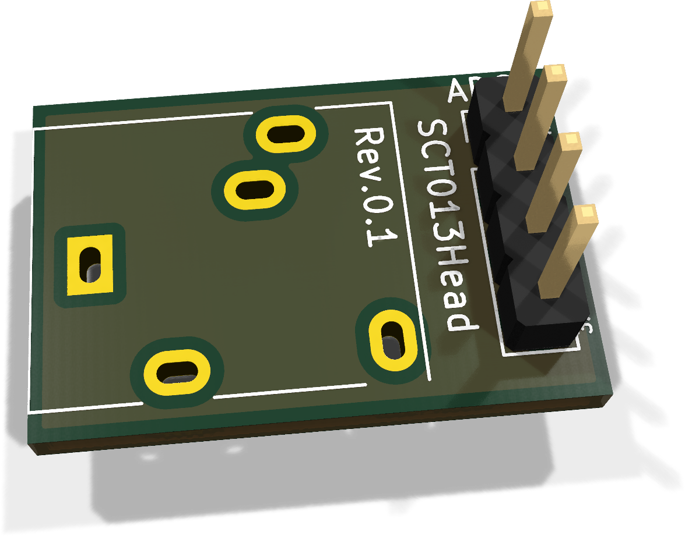
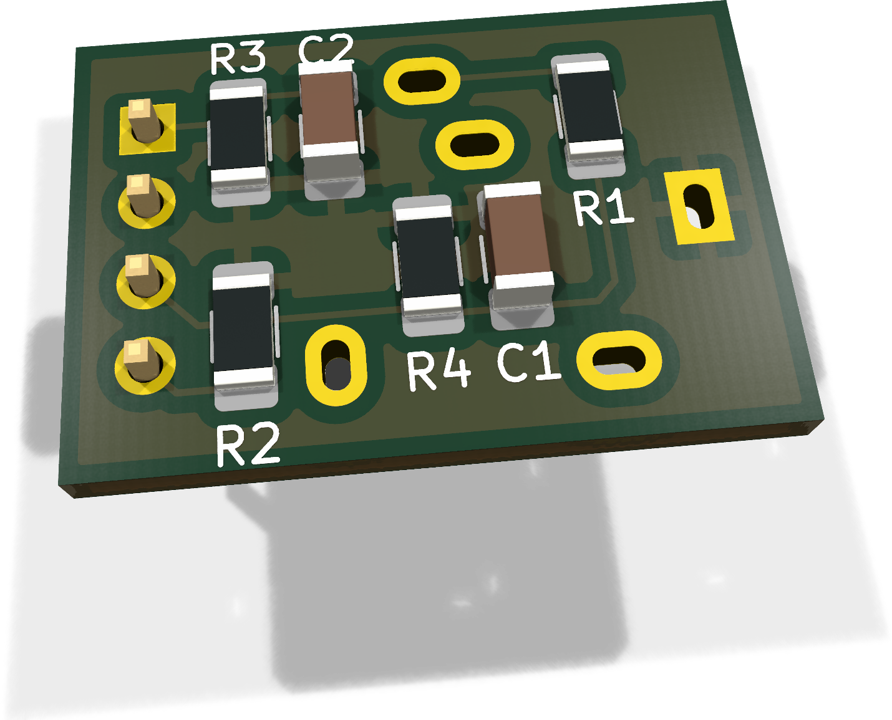

# SCT013Head - Bestückung und Inbetriebnahme

Kompakter passiver Sensorkopf für SCT013-Stromwandler mit integrierter Bürde und Spannungsausgang. Diese Anleitung beschreibt die Bestückung der Platine Rev. 0.1, den ersten Test ohne Sensor und ohne Klinkenbuchse sowie die spätere Montage der Buchse. Die Platine liegt für den Erstaufbau vor; Messergebnisse des bestückten Heads stehen noch aus.

!!! note "Jetzt aufbauen, Buchse später ergänzen"
    R1-R4, C1, C2 und das Pigtail werden jetzt bestückt. J1 bleibt zunächst vollständig frei. Der ADC-Ausgang erhält über R4 trotzdem seine Vorspannung; für diesen Test ist keine Brücke an J1 erforderlich. Ein fehlender Sensor wird von dieser Schaltung nicht automatisch erkannt.

## 1. Teile und Vorbereitung

### 1.1 Artikelzuordnung für einen Head

| Ref. | Anz. | Wert / Funktion | EnvNode-Part | Gehäuse / Montage |
| --- | --- | --- | --- | --- |
| R1-R4 | 4 | 10 kΩ, 0,1 %, 250 mW | ENP-00018 | 1206; Unterseite B.Cu |
| C1 | 1 | 10 nF, 100 V, ±5 %, X7R; Kyocera 12061C103JAT2A | ENP-00044 | 1206; B.Cu; ungepolt |
| C2 | 1 | 10 µF, 25 V, ±10 %, X7R; Kyocera AVX 12063C106KAT2A | ENP-00007 | 1206; B.Cu; ungepolt |
| ADC1 | 1 | JST-PH-kompatibles Kabel-Pigtail, 4-polig, 100 mm | ENP-00127 | Freie Litzen direkt in die vier Lötaugen; Stecker zum Mainboard |
| J1 | 1 | Klinkeneinbaubuchse Lumberg 1503 09 | ENP-00125 | Oberseite F.Cu; später bestücken |
| PCB | 1 | SCT013Head PCB Rev. 0.1 | ENP-00126 | Ca. 20,9 × 14,0 mm |

Die Zuordnung stammt aus dem InvenTree-Artikelpool, gelesen am 23.10.2026. Mengen sind der Bedarf für einen vollständigen Head, keine Aussage über verfügbare Stückzahlen, Reservierungen oder Liefertermine. Es werden keine Lagerbewegungen oder Änderungen am Artikelpool vorgenommen.

**Alle vier Widerstände haben 10 kΩ.** Der ältere Prüfvermerk mit R1 = 1 kΩ ist für diese Bestückung überholt. Der ebenfalls vorhandene 10-kΩ-/5-%-Artikel ENP-00094 wird hier nicht als Ersatz zugeordnet.

C2 ist auf dieser Platine ein **Keramikkondensator**, kein Elko. ENP-00056 (10-µF-SMD-Elko) ist daher nicht der zugeordnete Artikel. Den zusätzlichen 1000-µF-Elko aus den Breadboard-Versuchen zunächst weglassen, damit der erste Platinenbefund die vorgesehene Bestückung dokumentiert.

### 1.2 Arbeitsplatz und Vorbereitung

Feine Lötspitze, geeignetes Lötzinn und Flussmittel, Pinzette, Lupe, Multimeter sowie isolierende Platinenunterlage bereitlegen. Bauteile vor dem Löten identifizieren: Keramikkondensatoren sind häufig unbeschriftet. Pigtail-Adern anhand der Steckerkontakte durchmessen und beschriften; Kabelfarben nicht als Beleg der Pinfolge verwenden.

Nur die Kleinspannungsseite gehört an den Head. Spätere Strommessungen erfolgen mit dem Wandler um einen einzelnen isolierten Leiter; Netzspannung wird niemals an J1 oder ADC1 angeschlossen. Unterstützt sind ausschließlich Spannungsausgangsvarianten mit integrierter Bürde.

## 2. Ansichten und Bestückung

{ .paired-board-view }
{ .paired-board-view }

Die sechs SMD-Bauteile sitzen auf der Unterseite. J1 wird später von oben eingesetzt. Die Ansichten zeigen den unveränderten PCB-Datenstand: Für J1 fehlt ein 3D-Modell; ADC1 erscheint mit dem hinterlegten Stiftleistenmodell. **Für den Pigtail-Aufbau wird dort keine Stiftleiste bestückt.** Die vier Pads werden als Lötaugen verwendet. Pin 1 hat ein rechteckiges Pad; die Blickrichtung der Unterseite kehrt links und rechts gegenüber der Oberseite um.

### Löt-Reihenfolge

1. Platine auf Schäden, leitende Fremdkörper und lesbare Referenzen prüfen. J1 und ADC1 zunächst frei lassen.
2. R1-R4 bestücken: je einen Anschluss fixieren, Lage prüfen, zweiten Anschluss löten und erste Lötstelle nacharbeiten. Alle vier Werte sind 10 kΩ.
3. C1 = 10 nF und C2 = 10 µF bestücken. Beide sind ungepolt; ihre Werte dürfen nicht vertauscht werden. C1 liegt zwischen ADC und VBIAS, C2 zwischen VBIAS und GND.
4. Lötstellen unter Vergrößerung prüfen und Flussmittelreste materialverträglich entfernen. Die spannungsfreien Prüfungen aus Abschnitt 4 durchführen.
5. Pigtail nach Abschnitt 3 anlöten. Litzen nur so weit abisolieren, dass keine blanken Abschnitte benachbarte Pads oder spätere Buchsenkontakte berühren. Ader an Pin 2 bei Nichtverwendung einzeln isolieren; nicht mit GND verbinden.
6. Kabel mechanisch abfangen. Bis J1 montiert ist, die Platine auf einer isolierenden Unterlage befestigen; nicht frei am Pigtail hängen lassen.
7. Nach dem Löten des Kabels Kurzschluss- und Pinfolgeprüfung wiederholen. Erst danach Spannung anlegen.

## 3. Anschlüsse und Messpunkte

### 3.1 ADC1 / Mainboard-Pigtail

Die aktuelle Referenz im Layout ist **ADC1** (nicht J2). Die Lötaugen haben 2,54-mm-Raster; das JST-PH-Steckende des Kabels besitzt eine andere Mechanik. Ein JST-PH-Leiterplattenstecker wird nicht auf diese Padreihe gesetzt.

| Pad | Funktion | Verbindung |
| --- | --- | --- |
| ADC1.1 | GND | Masse des versorgenden Mainboards |
| ADC1.2 | Unbeschaltet | Am Mainboard-Port eventuell +5 V; der Head nutzt diesen Pin nicht |
| ADC1.3 | ADC | Analoger Eingang, für den Lab-Test GPIO34 oder GPIO35 |
| ADC1.4 | +3V3_SYS | Geregelte 3,3-V-Versorgung des Heads |

!!! warning "3,3 V und Pinfolge vor dem Stecken prüfen"
    Den Spannungsteiler ausschließlich aus 3,3 V versorgen. Bei Mini oder Weatherstation die konkrete Portbelegung und Steckrichtung am vorhandenen Board prüfen. Die 5 V vor dem 3,3-V-Regler beziehungsweise an Port-Pin 2 sind nicht die Versorgung des Heads. Eine vorhandene Breadboard-Versorgung vorher trennen; GND gemeinsam führen.

### 3.2 J1 / spätere Sensorbuchse

| Kontakt | Netz / Funktion |
| --- | --- |
| J1.1 | Sleeve; VBIAS, ausdrücklich nicht GND |
| J1.3 | Tip; Sensorsignal zu R1.1 |
| J1.2 | Ring; unbeschaltet |
| J1.4, J1.5 | Schaltkontakte; unbeschaltet |

### 3.3 Zugängliche Messpunkte

| Messpunkt | Gleiches Netz / zugängliche Pads |
| --- | --- |
| GND | ADC1.1, C2.2, R3.2 |
| 3,3 V | ADC1.4, R2.1 |
| VBIAS | J1.1, C2.1, R2.2, R3.1, R4.2, C1.1 |
| ADC | ADC1.3, R1.2, R4.1, C1.2 |
| Sensor-Tip | J1.3, R1.1 |

Messleitungen möglichst spannungsfrei anbringen. Die unbestückten J1-Pads sind beim ersten Aufbau gut zugänglich, aber keine zusätzlichen Massepunkte.

## 4. Spannungsfreie Prüfung

Mainboard, Sensor und alle Versorgungen abziehen. Kondensatoren entladen lassen; Widerstandsanzeigen können während des Ladens durch das Multimeter zunächst wandern.

- ☐ R1-R4 vorhanden und als 10 kΩ identifiziert; C1 und C2 nicht vertauscht.
- ☐ Keine Lötbrücken, losen Litzen oder Lötperlen; J1 bleibt für den ersten Test frei.
- ☐ Pigtail-Kontakte einzeln bis zu den zugehörigen ADC1-Pads durchgemessen.
- ☐ ADC1.1 zu C2.2 und R3.2: Durchgang.
- ☐ ADC1.4 zu R2.1: Durchgang.
- ☐ J1.1 zu C2.1 und R4.2: Durchgang; insbesondere die VBIAS-Verbindung prüfen.
- ☐ ADC1.3 zu R1.2, R4.1 und C1.2: Durchgang.
- ☐ ADC1.2 sowie J1.2/J1.4/J1.5 ohne Verbindung zu den Nutznetzen.
- ☐ Zwischen 3,3 V und GND kein dauerhafter niederohmiger Kurzschluss.

### Widerstandswerte zur Orientierung

Für den vollständig bestückten, aber extern unbeschalteten Head nach Einschwingen des Messgeräts:

| Messstrecke | Rechnerischer Gleichstromwert |
| --- | --- |
| ADC1.4 zu ADC1.1 | R2 + R3 ≈ 20 kΩ |
| VBIAS zu GND | R3 ≈ 10 kΩ |
| ADC zu VBIAS | R4 ≈ 10 kΩ; C1 lädt zunächst |
| J1.3 zu ADC | R1 ≈ 10 kΩ |
| J1.3 zu J1.1 | R1 + R4 ≈ 20 kΩ |

Diese Werte gelten ohne externe Parallelpfade. Sie ersetzen keine Durchgangsprüfung der einzelnen Netze. Bei angeschlossenem Mainboard oder Sensor sind andere Widerstandswerte möglich.

## 5. Erstinbetriebnahme ohne Buchse und Sensor

### 5.1 Versorgung und Mittelpunkt

1. Nur GND und die geprüfte 3,3-V-Versorgung verbinden; ADC-Leitung zum ESP zunächst getrennt lassen. J1 bleibt offen.
2. Einschalten und Spannung ADC1.4 gegen ADC1.1 messen. Erwartet werden etwa 3,3 V.
3. VBIAS gegen GND messen. Bei gleichen R2/R3 gilt VBIAS ≈ Versorgung / 2, also nominal 1,65 V.
4. ADC1.3 gegen GND messen. Ohne Sensor folgt der Ausgang über R4 dem Mittelpunkt und sollte annähernd denselben Gleichspannungswert zeigen.
5. Bei falschem Mittelpunkt oder auffälliger Erwärmung ausschalten und Bestückung, Pinfolge und Lötstellen prüfen. Der passive Teiler benötigt rechnerisch nur 3,3 V / 20 kΩ ≈ 0,165 mA; dies ist der Head-Strom, nicht der Gesamtstrom des ESP-Boards.

### 5.2 Rauschmessung am normalen ADC-Ausgang

Nach bestandener Gleichspannungsprüfung ausschalten, ADC1.3 mit dem ausgewählten GPIO verbinden und wieder einschalten. Für den regulären Test wird der ADC-Ausgang verwendet, nicht direkt VBIAS. Das Multimeter vor der Aufzeichnung abnehmen, um einen einheitlichen Messaufbau zu erhalten.

Die vorhandene Lab-Firmware `SCT013-ADC` unterstützt GPIO34 und GPIO35. Das Aufspielen ersetzt eine vorhandene Firmware auf dem Testboard. Im seriellen Monitor, 115200 Baud, jeweils mit Enter:

```text
pause
pin 35
status
diag on
dump full
```

Bei GPIO34 entsprechend `pin 34` verwenden. `dump full` nimmt 2000 Werte mit nominal 2 kHz auf und pausiert nach der Ausgabe. `dump` gibt nur die ersten 200 Werte desselben einsekündigen Messfensters aus. `resume` startet die laufende Messung erneut. Pin, Sensorprofil und Kalibrierungsfaktor werden gespeichert; Diagnosemodus und Pause gelten nur für die Sitzung.

Für weitere vollständige Messfenster jeweils erneut `dump full` eingeben. Mindestens drei Aufnahmen unter gleichen Bedingungen vergleichen. Rohwert, Millivoltwert und Zeitstempel gehören jeweils zur selben ADC-Messung. Die Firmware zieht kein Rauschen ab.

### 5.3 Logdatei in VSCode sichern

Den bisherigen seriellen Monitor schließen. Im VSCode-Terminal in das Lab-Projekt wechseln und den Monitor mit Dateiaufzeichnung starten. Auf dem verwendeten Mac funktioniert auch ohne `pio` im Suchpfad:

```sh
~/.platformio/penv/bin/pio device monitor --baud 115200 --filter log2file
```

Bei mehreren Geräten zusätzlich den passenden Port mit `--port /dev/cu.…` angeben. Die Logdatei entsteht im aktuellen Terminal-Verzeichnis; den Dateinamen zeigt der Monitor an. Die oben genannten Messbefehle anschließend im Monitor eingeben.

### 5.4 Befunde einordnen

Der Mittelwert soll zur halben gemessenen Versorgung passen. Der Wechselanteil ohne Sensor beschreibt die Störung des gesamten Messaufbaus, keinen realen Strom. Angezeigte Ampere sind hier lediglich die Umrechnung dieses Wechselanteils mit dem gewählten Sensorfaktor.

Bei den früheren Breadboard-Aufnahmen lagen etwa 13 mV RMS am normalen Ausgang und 16-20 mV RMS direkt an VBIAS an; die Störungen traten schubweise auf. Das sind Vergleichsdaten, keine zulässigen Grenzwerte. Der Platinenaufbau enthält nun auch C1; Board, Versorgung, Kondensatoren und Anschlussart müssen im Protokoll stehen.

Als Arbeitsziel für die kleine Testlast sind unter etwa 1-2 mV RMS hilfreich, aber keine zugesicherte ESP32-Eigenschaft oder Freigabegrenze. Zum Vergleich: Ein idealer 5-A-/0,333-V-Sensor liefert bei 0,261 A hinter dem 0,5-Teiler nur etwa 8,7 mV RMS Nutzsignal. Eine Kalibrierung ist erst sinnvoll, wenn der Rauschanteil ausreichend klein und der Aufbau reproduzierbar ist.

Optionaler Vergleich: ADC-Leitung spannungsfrei von ADC1.3 trennen und direkt an VBIAS anschließen; dieselben Aufnahmen wiederholen. Für einen GND-Test die Leitung zum Head vollständig lösen und den GPIO kurz mit ESP-GND verbinden. GND liegt am unteren ADC-Anschlag: Rohwert 0 kann durch die Kalibrierumrechnung als etwa 142 mV erscheinen. Eine ruhige GND-Messung beweist daher keine störungsfreie Messung bei 1,65 V. Anschließend den normalen ADC-Anschluss wiederherstellen.

## 6. Buchse nachrüsten und Sensorbetrieb vorbereiten

1. Aufbau ausschalten und alle Kabel abziehen. J1 mit der gelieferten Lumberg 1503 09 mechanisch prüfen: Pins, Gehäusewand, Gewinde, Mutter und Freiraum zu den SMD-Bauteilen müssen passen.
2. Buchse von der Oberseite einsetzen. Zunächst einen Anschluss fixieren, bündige und spannungsfreie Lage prüfen, danach die übrigen Anschlüsse verlöten. Auch die elektrisch ungenutzten Buchsenpins gehören zur mechanischen Befestigung.
3. Tip/Sleeve mit einem passenden unbelasteten Prüfstecker durchmessen: Tip zu J1.3/R1.1, Sleeve zu J1.1/VBIAS. Ring und Schaltkontakte dürfen die Nutznetze nicht kurzschließen.
4. Gehäuseverschraubung so montieren, dass die Buchse Kräfte beim Stecken aufnimmt. Pigtail im Gehäuse separat zugentlasten; die kleine Platine nicht durch Kabelzug belasten.
5. Spannungsfreie Prüfung und Nullmessung wiederholen. Erst dann einen Sensor mit integrierter Bürde anschließen.

Für die beiden vorhandenen 5-A-Sensoren gilt bei R1 = R4 = 10 kΩ:

| Sensor | Lab-Befehl | Nominaler Faktor am ADC |
| --- | --- | --- |
| 5 A / 0,333 V RMS | `sensor 333` | 30,030 A/V |
| 5 A / 1 V RMS | `sensor 1000` | 10,000 A/V |

`cal <Faktor>` korrigiert den gemessenen Strom zusätzlich; der Wechsel des Sensorprofils setzt den Faktor auf 1 zurück. Die Spannungsangabe des Sensors ist ein Effektivwert bei Nennstrom, keine harte Spitzenbegrenzung. Die Schaltung besitzt keine nachgewiesene Überstromschutzfunktion. Sensoren mit anderen Nennströmen benötigen eine passende Parametrierung; die vorhandenen Lab-Profile gelten für 5 A.

## 7. Messprotokoll und Fehlerbilder

| Prüfung / Aufbau | Erwartung oder Eintrag | Ist / Datum |
| --- | --- | --- |
| Platine und Bauteile | Rev. 0.1; R1-R4 10 kΩ; C1 10 nF; C2 10 µF | |
| Versorgung | Board, Versorgungspfad, USB/Dock und gemessene 3,3 V | |
| Gleichspannung | VBIAS und ADC gegen GND etwa Versorgung / 2 | |
| Normaler ADC-Ausgang | GPIO, Sensor abgezogen, C1 vorhanden, keine Zusatzkapazität | |
| Drei Dumps | Mittelwert, RMS mV, Min/Max, Rohwert-Ausreißer, Timing, Logdateien | |
| Optional direkt VBIAS | Anschlussänderung ausdrücklich dokumentieren | |
| Buchse nachgerüstet | Passprobe, Tip/Sleeve und Zugentlastung bestanden | |
| Sensor und Kalibrierung | Typenschild, Profil, Referenzstrom, Faktor | |

| Beobachtung | Zuerst prüfen |
| --- | --- |
| VBIAS nahe 0 V oder Versorgung | R2/R3, fehlende Lötstelle, Kurzschluss oder falsche Padbelegung |
| ADC deutlich anders als VBIAS, ohne Sensor | R4, Leiterbahn, ADC-Pigtail, Brücke nach GND/3,3 V |
| Ruhiger Mittelpunkt, aber hohe RMS-Werte | C1/C2, Masse- und Kabelführung, Kontakte, Versorgung; vollständige Rohwert-Dumps vergleichen |
| Alles null im Rohwert | Falscher GPIO, GND-Verbindung oder Eingang am unteren Anschlag |
| Rauschen erst mit Messgerät/Kabel verändert | Zusätzliche Leitungen entfernen und Messbedingungen dokumentieren |
| Stromfaktor unplausibel | Sensorprofil, Nennstrom, integrierte Bürde und Kalibrierungsfaktor |

## 8. Quellen- und Revisionsnachweis

Die Artikelzuordnung wurde am 23.10.2026 live im InvenTree-Artikelpool geprüft. C1 und C2 wurden zusätzlich anhand der dort gespeicherten Hersteller- und Lieferantenartikel abgeglichen. Eine Verfügbarkeitsprüfung war nicht Gegenstand der Zuordnung.

Quellen: `hardware/kicad/Sensors/SCT013Head/SCT013Head.kicad_pcb`, zugehöriger Schaltplan, `Lumberg_1503_09_Footprint.md`, aktuelle Netzliste sowie die dokumentierten Lab-Versuche. Der aktuelle Arbeitsstand im Checkout `analog-hydro-pressure` unterscheidet sich vom `main`-Schaltplan nur durch das DNP-Attribut von ADC1; die Leiterplatten sind identisch. Diese Anleitung verwendet ADC1 bewusst als Lötaugen für das Pigtail.

Die Netze und Bestückungswerte wurden aus den CAD-Quellen nachvollzogen. Der für diese Dokumentation gestartete vollständige DRC-Lauf endete ohne Bericht durch einen Programmabbruch; daraus wird keine erfolgreiche DRC-Prüfung abgeleitet. Historische Review-Notizen sind keine erneute Prüfung der gelieferten Platine. Die Durchgangsprüfungen dieser Anleitung sind vor dem Einschalten durchzuführen. Elektrische Erprobung, Kalibrierung und mechanische Buchsen-Passprobe bleiben am realen Aufbau offen.

Die Abbildungen sind echte KiCad-Renderings der Rev.-0.1-Leiterplatte, keine Fotos des aufgebauten Heads. Dokumentquelle ist Markdown mit den gemeinsamen Metadaten; eine separate PDF wird in diesem Arbeitsschritt nicht erstellt.

### SHA-256 der verwendeten Quellen

`SCT013Head.kicad_pcb`

`5361e2f392efc484dd3522dd2f4c0fc8d85c413e14519de21736decc2d476a8e`

`SCT013Head.kicad_sch`

`f15f428eac19332ff472cedba7a76c85895c898270555692e90afb7bffd0b3a7`

### Lizenz

EnvNode-eigene Inhalte: LicenseRef-EnvNode-Use-and-Redistribution-1.0; siehe [Lizenz](../../license.md). Rechte an Drittanbieter-Modellen und sonstigen Fremdinhalten bleiben bestehen.
