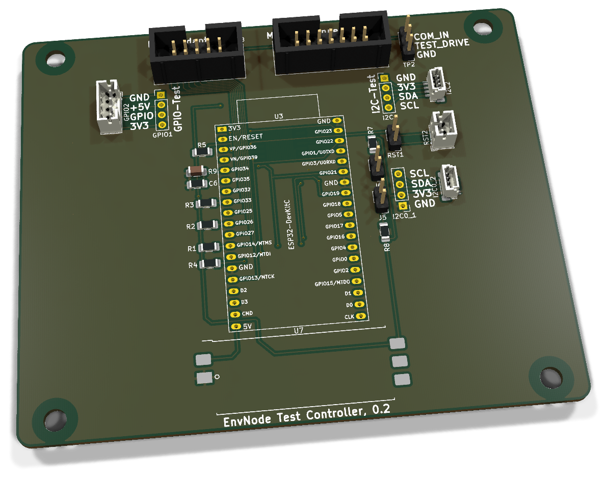
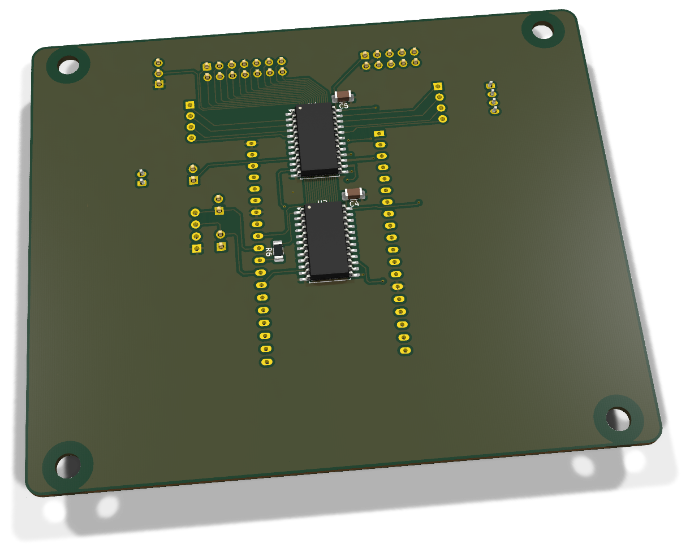
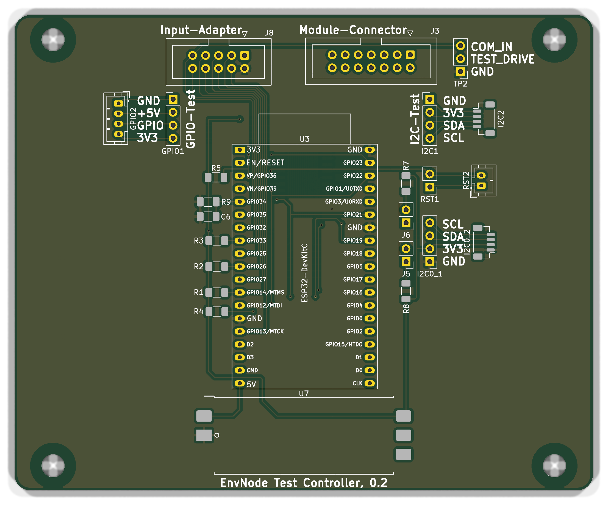
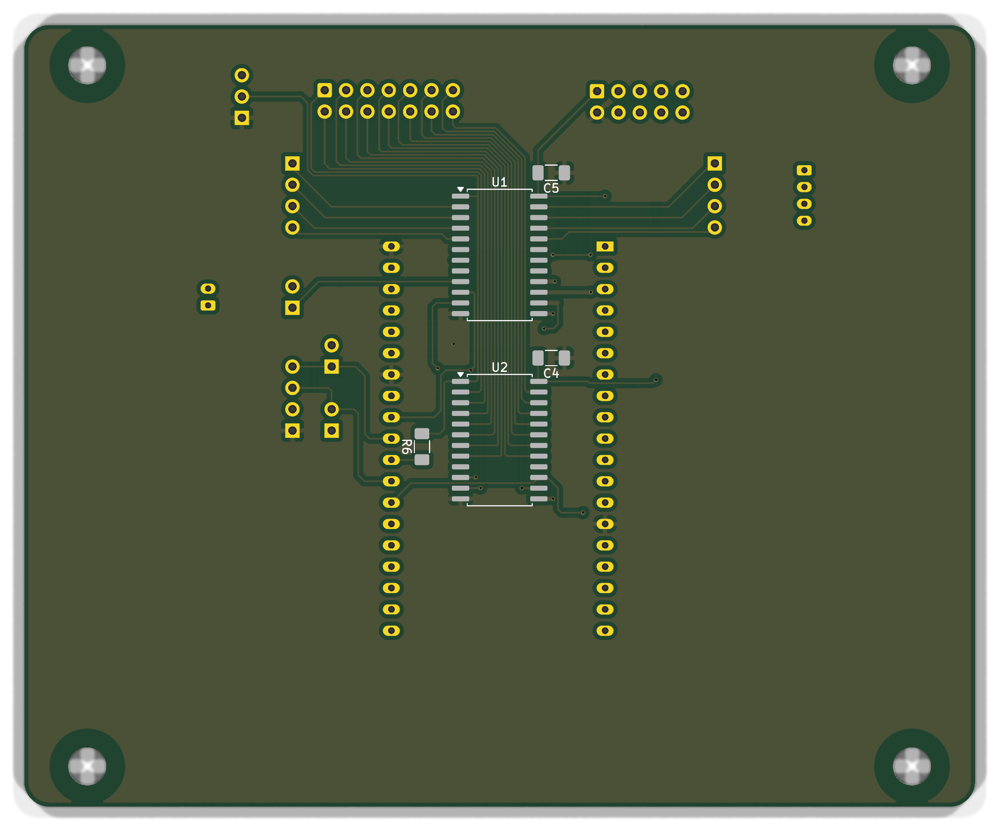

# Test-Controller 0.2 - Aufbau und elektrische Prüfung

ESP32-DevKitC-Steuerplatine für passive Mainboardtests mit separater I²C-Provisioning-Verbindung. Sie arbeitet mit dem ESP32 DevKitC Adapter 0.3 oder dem Legacy-Input-Adapter 0.1 zusammen. Controller 0.2 besitzt TP2 und zwei Reset-Prüfpfade; der passive Modul-Adapter 0.2 verbindet den Modulslot.

**Dokumentstand 14. November 2026.** Die neue Revision ist anhand der CAD-Dateien dokumentiert; die physische Abnahme am gefertigten Aufbau steht aus.

[Anleitung als PDF](../../../assets/downloads/Test_Controller_Rev0.2_Anleitung.pdf){ .md-button }
[Alte Revisionen](old-revisions.md){ .md-button }

!!! warning "DUT nur spannungsfrei testen"
    Vor dem Kontaktieren alle DUT-Versorgungen und USB-Verbindungen trennen, den ESP32 aus dem DUT ziehen und das separate Provisioning-Kabel abziehen. Der Test Controller darf für seine eigene Elektronik versorgt sein. DUT-Masse und DUT-3,3-V-Referenz bleiben Messkontakte; nicht pauschal mit der Tester-Versorgung verbinden.

### Weiter zur Software-Inbetriebnahme

Nach der elektrischen Prüfung folgen [Tester einrichten](../../commissioning/index.md),
[Controller und Adapter auswählen](../../commissioning/hardwareprofile.md)
und die [geführten Selbsttests](../../commissioning/selbsttests.md).
Die gemeinsame Softwareanleitung wird hier nicht wiederholt.

## 3D-Ansicht

{ .hero-paired-view }
{ .hero-paired-view }

Vorderseite (F.Cu) und bestückte Rückseite (B.Cu). Nicht hinterlegte 3D-Modelle bleiben ausgespart. Die Bestückungspläne folgen im Abschnitt zur Bestückungsübersicht.

## 1. Teile und Vorbereitung
| Ref. | Anz. / Einheit | Wert / Funktion | Artikel |
| --- | --- | --- | --- |
| PCB | 1 | Test-Controller Rev. 0.2 | Revisionsgebundene Artikelzuordnung prüfen |
| U1, U2 | 2 | CD74HC4067M, SOIC-24W | ENP-00153 |
| C4-C6 | 3 | 100 nF X7R 1206 | ENP-00006 |
| R1-R5 | 5 | 10 kΩ Enable-Pull-ups | ENP-00094 |
| R6 | 1 | 1 kΩ | ENP-00099 |
| R9 | 1 | 2,2 kΩ | ENP-00154 |
| R7, R8 | 2 | 4,7 kΩ | ENP-00005 |
| U3 | 1 | ESP32 DevKitC, 38 Pins | ENP-00010 |
| U3-Sockel | 2 | Je 19 Kontakte | ENP-00004 |
| U7 | 1 | Geprüftes, bestücktes ORing-Power-Modul | Passende Assembly auswählen |
| J8 | 1 | WSL 10G | ENP-00147 |
| J3 | 1 | WSL 14G | ENP-00151 |
| GPIO1, I2C1, I2C0_1 | 3 | Pinheader 1×4 | ENP-00108 |
| GPIO2 | 1 | JST-PH, vierpolig | ENP-00025 |
| I2C2, I2C0_2 | 2 | JST-SH, vierpolig | ENP-00122 |
| RST1 | 2 Kontaktpositionen | Pinheader 1×2 | ENP-00145 |
| RST2 | 1 | JST-PH, zweipolig | ENP-00132 |
| TP2 | 3 Kontaktpositionen | Pinheader 1×3 | ENP-00145 |
| J5, J6 | 4 Kontaktpositionen | Zwei Pinheader 1×2 | ENP-00145 |
| J5, J6 | 2 | Jumperkappen | ENP-00101 |

ENP-00145 wird in einzelnen Kontaktpositionen gezählt, nicht als Anzahl fertig zugeschnittener Leisten. Kabel, Zugentlastung, Gehäuse und Befestigung separat ergänzen.

U1/U2 sind **CD74HC4067M**, SOIC-24W; kein ungeprüfter HCT-Ersatz. U3 sitzt in zwei auf je 19 Kontakte gekürzten Sockelleisten. U7 ist das fertig bestückte ORing-Power-Modul. Messmittel: Multimeter mit Diodentest, strombegrenzte Versorgung, Oszilloskop/Logikanalysator für spätere Multiplexerprüfung.

## 2. Bestückungsübersicht

### Vorderseite: Bestückungsplan

{ .assembly-plan }

[Plan als PNG](../../../assets/board-views/test-controller-0.2/assembly-front.png){ .md-button }

### Rückseite: Bestückungsplan

{ .assembly-plan }

[Plan als PNG](../../../assets/board-views/test-controller-0.2/assembly-back.png){ .md-button }

Senkrechtes KiCad-Rendering der Leiterplatte ohne Bauteilmodelle. Kupfer, Lötstoppmaske und Bestückungsdruck entsprechen der PCB-Quelle. Rückseitenpläne werden von B.Cu aus betrachtet.

Die Bestückungspläne zeigen die Leiterplatte senkrecht zur jeweiligen Seite. Bestückungsdruck und Referenzen folgen der PCB-Quelle; eine Rückseitenansicht ist keine Kontaktansicht eines Kabelsteckers.

**B.Cu:** U1, U2, C4, C5 und R6. **F.Cu:** übrige Widerstände, C6, Steckverbinder, DevKit-Sockel und ORing-Carrier U7. Pin 1 an U1/U2 und an den IDC-Headern prüfen. Der Controller enthält zwei Ausgangsmultiplexer; die drei Eingangsmultiplexer sitzen auf dem Input-Adapter. Ein sichtbarer ORing-Carrier ohne vollständiges Modulmodell ersetzt das physisch bestückte U7 nicht.

## 3. Löt-Reihenfolge

1. R1-R9 und C4-C6 nach Stückliste bestücken; R6 = 1 kΩ, R9 = 2,2 kΩ nicht verwechseln.
2. U1/U2 ausrichten, einen Pin fixieren, Lage prüfen und alle SOIC-Pins löten.
3. J5/J6, GPIO1/2, I2C1/2, I2C0_1/2, RST1/2, TP2 und die IDC-Header J3/J8 montieren. Kodierung und Pin 1 prüfen.
4. U3-Sockel parallel ausrichten und ORing-Modul U7 plan verlöten.
5. Reinigen, spannungsfrei prüfen; U3 erst danach einsetzen. Erstprüfung ohne Adapter und DUT.

## 4. Verbindungen

### J8 zum Input-Adapter J1
| J8 Pin | Netz / Funktion |
| --- | --- |
| 1 | `3V3_SYS` |
| 2 | `GND` |
| 3 | `/IN_EN1` |
| 4 | `/IN_S3` |
| 5 | `/IN_EN2` |
| 6 | `/IN_S2` |
| 7 | `/IN_EN3` |
| 8 | `/IN_S1` |
| 9 | `/COM_IN` |
| 10 | `/IN_S0` |

Das zehnpolige IDC-Kabel verbindet jeweils dieselbe Pinnummer. GPIO-Zuordnung: IN_EN1 GPIO14, IN_EN2 GPIO26, IN_EN3 GPIO33; IN_S0 GPIO32, IN_S1 GPIO25, IN_S2 GPIO27, IN_S3 GPIO13; COM_IN GPIO34.

### Ausgang und getrenntes Provisioning

J3 geht 1:1 über ein 14-poliges IDC-Kabel zum Modul-Adapter J4. GPIO1/GPIO2 sind parallele vierpolige GPIO-Testanschlüsse, I2C1/I2C2 parallele vierpolige I²C-Testanschlüsse. Jeweils nur eine Anschlussvariante pro Pigtail verwenden. Diese Testkanäle sind keine ständig versorgten Sensorports.

| Funktion | GPIO / Verbindung |
| --- | --- |
| COM_OUT | GPIO17 über R6 = 1 kΩ zu beiden Ausgangs-COMs |
| OUT_S0 / S1 / S2 / S3 | GPIO18 / 19 / 21 / 22 |
| OUT_EN1 / OUT_EN2 | GPIO23 / GPIO4, aktiv LOW |
| Eingang COM_IN | GPIO34, R9 = 2,2 kΩ und C6 = 100 nF nach GND |
| Separates I2C0_1 / I2C0_2 | Pin 1 GND, 2 3V3_SYS, 3 SDA GPIO16, 4 SCL GPIO5 |
| J5 / J6 | Zuschaltung der 4,7-kΩ-Pull-ups für SDA / SCL |

Die I2C0_1/I2C0_2-Provisioning-Verbindung umgeht die Multiplexer und kann den DUT versorgen. Sie wird ausschließlich als getrennte Betriebsphase verwendet. U7-Pins für +3V3_EXT und +3V3_DEVKIT sind unverbunden; die DevKit-3V3-Leitung ist nicht direkt mit 3V3_SYS kurzgeschlossen.

### Ausgangskanäle

| Ausgang | Multiplexerkanäle in Kontaktreihenfolge |
| --- | --- |
| GPIO1/2 Pin 1–4 (GPIO-Pigtail) | U1 I8, I9, I10, I11 |
| I2C1/2 Pin 1–4 (I²C-Pigtail) | U1 I7, I6, I5, I4 |
| RST1/2 Pin 1–2 | U1 I0, I15 |
| J3.1–7 (Modul) | U2 I7, I6, I5, I4, I3, I2, I1 |
| J3.8–14 (Modul) | U2 I14, I13, I12, I11, I10, I9, I8 |

Am DUT ist die GPIO-Pigtailfolge GND, +5V, Signal, +3V3_SYS; beim I²C-Pigtail GND, +3V3_SYS, SDA, SCL. Diese Namen sind Prüfkontakte am unversorgten DUT. Vor Verbindung jede Ader durchmessen.

### TP2 und Reset-Prüfpigtail

| Anschluss | Pin | Netz / Funktion |
| --- | --- | --- |
| TP2 | 1 | Controller-GND, echte LOW-Referenz |
| TP2 | 2 | TEST_DRIVE hinter R6, gemeinsam an U1/U2 COM |
| TP2 | 3 | COM_IN zu GPIO34 |
| RST1 / RST2 | 1 | DUT-GND-Prüfkontakt über U1 I0 |
| RST1 / RST2 | 2 | DUT-EN-Prüfkontakt über U1 I15 |

RST1 und RST2 sind parallel. Ihr Pin 1 ist **kein permanenter Controller-GND**.
Das Resetpigtail wird zum unversorgten Prüfling geführt; bei Mini 0.10 und
Weather 0.4 ist die dortige RST1-Folge GND/EN gleich. Nicht mit TP1 verwechseln.
TP2/2 ist ein geschaltetes Prüfsignal, keine dauerhafte 3,3-V-Versorgung.
Vor einer Schleifenprüfung Prüfling und Provisioning vollständig trennen.

## 5. Spannungsfreie Prüfung

- ☐ Kein niederohmiger Kurzschluss zwischen +5V, 3V3_SYS und GND.
- ☐ U1/U2 Pin 24 an 3V3_SYS, Pin 12 an GND; C4/C5 korrekt.
- ☐ IN_EN1–3 und OUT_EN1/2 haben jeweils 10-kΩ-Pull-up nach 3V3_SYS.
- ☐ GPIO17 führt über R6 zu U1/U2 COM; GPIO34 an R9/C6 und J8.9.
- ☐ J8.1/.2 sind Adapterversorgung, keine DUT-Referenzkontakte.
- ☐ Provisioning-I2C0_1/I2C0_2 und J5/J6 stimmen mit der Tabelle überein.
- ☐ Alle IDC-Kabel 1:1 und ohne Nachbarkurzschluss.
- ☐ TP2.1 an GND, TP2.2 hinter R6 und TP2.3 an GPIO34 nachgemessen.
- ☐ RST1/RST2 pinweise parallel; RST-GND nur über U1 I0 erreichbar, nicht direkt an Controller-GND.
- ☐ Parallele GPIO-, I²C- und Provisioningstecker einzeln durchgemessen.

## 6. Erstinbetriebnahme ohne DUT

1. U3 zunächst entfernt lassen, keine Adapter angeschlossen. Controller über den vorgesehenen ORing-Eingang strombegrenzt versorgen; 5 V und 3V3_SYS messen, Ruhestrom protokollieren.
2. Alle aktiven LOW-Enable-Leitungen müssen durch ihre Pull-ups HIGH bleiben. Bei unbekanntem Pegel nicht mit DUT verbinden.
3. Ausschalten, U3 korrekt einsetzen und mit geeigneter Diagnosefirmware starten. Alle Multiplexer zunächst deaktivieren; COM_OUT zunächst LOW.
4. Mit Diagnosefirmware Adressleitungen nur bei deaktivierten Multiplexern umschalten; pro Prüfpfad genau einen Ausgang und einen Eingang aktivieren. Settlingzeit berücksichtigen.
5. Eingangspfad zunächst mit bekannten isolierten Prüfschleifen testen. R6/R9 und Multiplexerwiderstände begrenzen bzw. teilen die Prüfspannung; keine ungeprüften 3,3-V-ADC-Schwellen übernehmen.
6. Erst nach Einzelprüfung Input-Adapter und Modul-Adapter verbinden und mit bekanntem Referenz-DUT weiterarbeiten.

## 7. Prüfablauf und Protokoll

Für Mini 0.10.0 und Weather 0.4 die TP1-Diodenpfade im passenden Boardprofil berücksichtigen. Vor jedem Kanalwechsel deaktivieren; nach Adresswahl einschwingen lassen, messen, Ergebnis protokollieren und wieder deaktivieren. Nach dem passiven Test Tester und DUT trennen, bevor ein separates Provisioning beginnt.

| Prüfschritt | Ergebnis / Datum / Person |
| --- | --- |
| PCB-Revision / Seriennummer | |
| Bauteile, Orientierung und Lötstellen | |
| Versorgung / Ruhestrom | |
| Kabel-Pin-1 und 1:1-Zuordnung | |
| Einzelkanäle und unerwünschte Querpfade | |
| Testprofil / Firmwarecommit | |
| Referenz-Diodenrichtung / Schaltschwellen | |
| Mechanische Passprobe | |

## 8. Fehlerbilder und Firmwarestand

| Befund | Prüfen |
| --- | --- |
| Mehrere Kanäle gleichzeitig aktiv | Aktive-LOW-Enables, Pull-ups, Umschaltfolge |
| COM_IN immer LOW | J8.9, GPIO34, Auswahl, R9/C6, Teststromrichtung |
| Unerwartete Querpfade | IDC-Orientierung, Brücken, mehrfach aktive Muxe |
| Fremdversorgung des DUT | Provisioning-Kabel, DUT-USB, irrtümliche Masse-/3V3-Brücken |

Test-Firmware **0.15.0** unterstützt Controller 0.2 einschließlich Reset-Prüfpigtail,
reale Multiplexer-/ADC-Ansteuerung, geführte Selbsttests und getrenntes Provisioning.
Controller **0.2 (TP2)** ausdrücklich auswählen. Die Input-Selbsttests speisen
über TP2/2 TEST_DRIVE; Output-Selbsttests verwenden TP2/3 COM_IN.
Die [Softwareanleitung](../../commissioning/hardwareprofile.md)
beschreibt die jeweils einzeln zu steckenden Brücken und die 64 Output-Selbsttestfälle.

Die gespeicherte CAD-Prüfung vom 9. November 2026 nennt ERC 0, DRC 0,
keine offenen Verbindungen und keine Schaltplanabweichungen. Der gefertigte
Controller 0.2 ist gesondert physisch abzunehmen.

## 9. Abschluss und Prüfstand

Die elektrischen Zuordnungen wurden gegen den gespeicherten PCB-Stand und,
soweit anwendbar, die Firmware-Prüfprofile abgeglichen. Diese Dokumentation
bestätigt keine Fertigung oder physische Abnahme der neuen Revision.
Versorgung, Lötstellen, Steckrichtung, Kontaktmechanik und jeden Messpfad am
realen Aufbau prüfen und im Protokoll festhalten. Frühere Betriebsnachweise
gehören weiter zum jeweiligen alten Hardwarestand.

### Quellenstand

Die Anleitung ist an die folgenden Hauptdateien gebunden. Der neue Netzlistenabgleich
mit der gespeicherten Platine bestätigt die gemeinsamen elektrischen Pinzuordnungen;
die physische Abnahme ist getrennt durchzuführen.

| Quelle | SHA-256 |
| --- | --- |
| Test-Controller.kicad_pcb | `54f346a9bd8d84590356683723dcc649b2601897429a01b7920e011ac3eb759f` |
| Test-Controller.kicad_sch | `f8e05f1d45c668788e54cf3b1911a4d966a7eb46465c814dbd43232791a2ff7f` |

[Alle CAD-Dateihashes und Netzlistenabgleich](../../../assets/board-views/test-controller-0.2/assembly-sources.json) ·
[Rendernachweis](../../../assets/board-views/test-controller-0.2/views.json).

EnvNode-eigene Inhalte: LicenseRef-EnvNode-Use-and-Redistribution-1.0,
siehe [Lizenz](../../../license.md). Drittanbieterrechte an Modellen bleiben bestehen.
