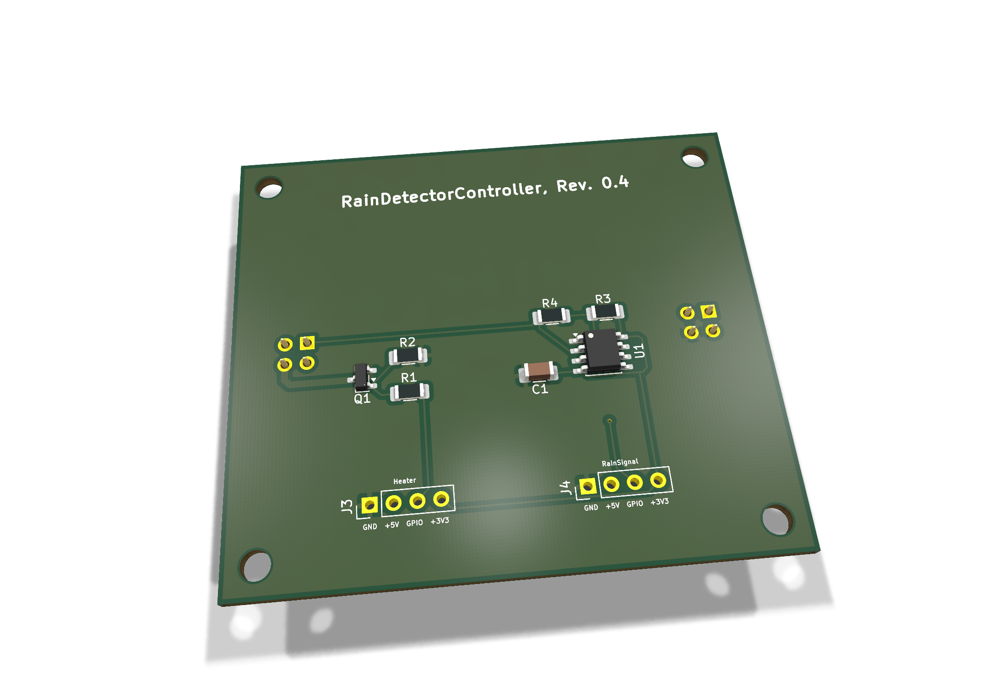
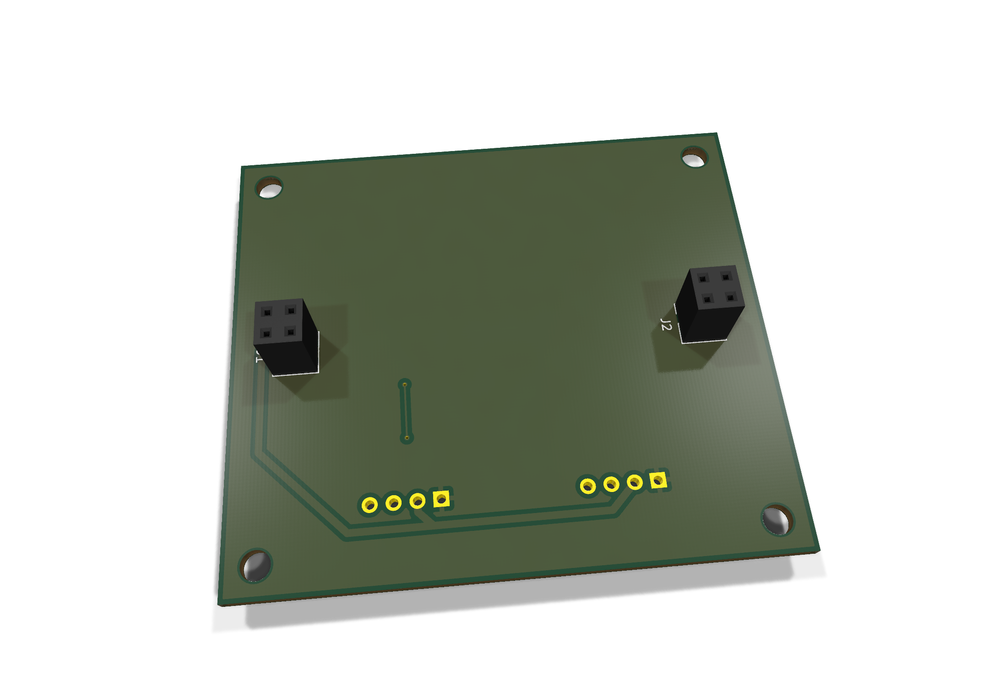

# EnvNode RainDetector Controller — Revision 0.4

## Current mechanical revision - 2026-10-21

PCB **ENP-00138**, revision **0.4**, paired with RainDetectorHead **0.2**.
The outline is **62.12 x 54.52 mm** (Edge.Cuts centerline), enlarged for the
housing seal; mounting holes moved with the outline. The active C1 detector
geometry, J1/J2 positions/orientations and PCB pad-net assignments are unchanged
relative to the previous committed PCB. No electrical or firmware change follows
from this mechanical revision. The head C1 footprint identifier is
`RainDetector_Interdigitated_44.78x37.25mm_P0.51mm`.





Current guide: [Revision 0.4 assembly and bring-up](Documentation/RainDetectorController_Bestueckungs_und_Bringup_Rev0.4.pdf).
Structure, typography, ochre colors and component-table columns follow the
DuoRelay revision 0.3 assembly guide.
Native KiCad renders and source fingerprints: [render provenance](../../../../images/rain-detector/README.md).
The guide uses the new PCB article; kit/assembly records are awaiting the user's
update and were not modified here. Prior PDFs and the historical notes below
remain records of their respective revisions, not the current mechanical guide.
No new full ERC/DRC or physical qualification is claimed for the enlarged boards.

## Previous revision notes (historical)


ICM7555 frequency measurement front end at 3.3 V and AO3400A low-side heater
switch. Timing resistors are 10 kohms and 100 kohms; C1 is the 100 nF supply
bypass. The 5 V heater path uses 0.8 mm tracks and must supply approximately
417 mA for RainDetectorHead revision 0.1, in addition to other system loads.

J1/J2 2x2 sockets are on B.Cu, facing the head; controller components are on F.Cu
for access from the enclosure interior. The board is 62.12 x 44.12 mm.
See `../RainDetectorHead/README.md` for the complete mating table.

J3: 1 GND, 2 +5V, 3 HEATER_EN, 4 +3V3.
J4: 1 GND, 2 +5V, 3 RAIN_FREQ, 4 +3V3.
The supply pins are shared. J3/J4 are currently marked DNP in the schematic
and generated BOM; retain or change this deliberately for the intended
connector/assembly option. J1/J2 use BKL 10120957 (ENP-00116); mating height
still needs verification. The J3/J4 connection option remains separate.

`RainDetectorController.csv` is generated from the current schematic:

```sh
kicad-cli sch export bom --group-by Value,Footprint -o RainDetectorController.csv RainDetectorController.kicad_sch
```

Current assembly guide: `Documentation/RainDetectorController_Bestueckungs_und_Bringup_Rev0.3.pdf` (document date 2026-10-05).

Historical reference/bring-up PDFs remain in `../Raindetector/Documentation/`.
They are NOT revision 0.3 assembly guides. The old `../Raindetector/` project
remains as the previous prototype; local copied PDFs need not be duplicated
in version control.

## Validation

For each of the two projects, run from its directory:

```sh
kicad-cli sch erc -o /tmp/rain-erc.txt PROJECT.kicad_sch
kicad-cli pcb drc --schematic-parity --refill-zones -o /tmp/rain-drc.txt PROJECT.kicad_pcb
```

Replace PROJECT with RainDetectorController or RainDetectorHead. Checked with
KiCad 10.0.5. Standard project-disabled checks (such as missing courtyards)
remain as configured; these commands do not constitute fabrication approval.
The lab firmware in `lab/RainDetector-PCNT/` measures rising edges via ESP32
PCNT and reports raw frequency over Serial. No heater automation is included.

Final checks on 2026-09-14: both projects passed ERC and DRC with zero
errors/warnings, zero unconnected items and zero schematic parity issues.
The Head GND power flag and C1-only 0.10 mm clearance rule are included.

## Documentation verification — 2026-10-05

The current PCB outline is 62.12 x 44.12 mm and J1/J2 use 2x2 sockets. The BOM was regenerated to replace stale 1x4 entries. PCB pad nets and the exported schematic netlist match. On both current projects J2.1 is SENSE and J2.4 is HEATER-; verify mechanical contact alignment and mating height separately.

The historical 2026-09-14 ERC/DRC results predate the connector/outline changes committed on 2026-09-15 (0d3a50b). This documentation update does not repeat full ERC/DRC or physical testing. The PDF includes current source hashes, assembly orientation, connector tables, separate frequency/heater bring-up, and a measurement record.

Assembly table update, 2026-10-17: PDF page 2 now lists kit ENK-00006 and the
EnvNode article numbers, quantities and packages from `inventory/assemblies.rain.draft.json`
and `inventory/parts-preview.json`, including the PCB. J3/J4 remain DNP and are
not included as populated connectors. Other PDF pages remain unchanged;
their source hashes and validation statements retain their historical scope.
